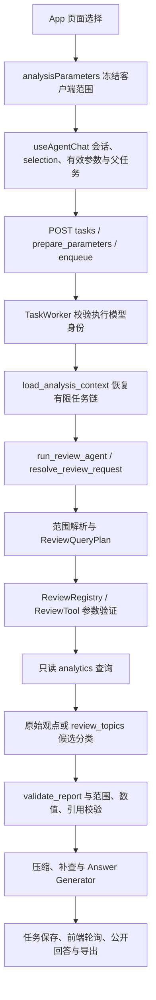

# 商品评论 Agent：多轮范围、意图与负面观点审计及最小修复计划

日期：2026-11-08。阶段 A/B，业务代码修改前记录。

## 结论与边界

现有系统具备真实评论查询、一级维度统计、观点原文分组、候选二级主题发现/复核、原文位置与数值校验。当前问题集中在状态交接、内容目标识别、工具参数匹配和任务完成判定。不能根据“工具成功、数值校验通过”推断用户的内容问题已经得到回答。

本轮不连接生产数据库，不启动生产 Worker，不运行外部 LLM、Embedding 或迁移。既有未提交的六个文件保留。评估、实验、迁移、RAG 检索/评审资产、人工复核实现、冻结查询契约及本机配置共 1,754 个文件已记录修改前 SHA-256，见 `outputs/review-context-repair-20261108/protected.before.json`。阶段结束再次比对；不修改已有审批或人工评分。

## A1. 真实调用关系



| 环节 | 真实入口及职责 |
| --- | --- |
| 页面选择 | `frontend/src/App.tsx:109,450`；`frontend/src/analysis-draft.ts:72` 将数据集、商品、日期、基线和标注身份转换为提交参数。 |
| 前端 State | `features/agent/chat-state.ts` 定义会话、消息、context/intent；`useChatSessions.ts` 用浏览器本地存储保存版本 2 会话并隔离请求状态。 |
| 父任务与恢复 | `useAgentChat.ts:62,84,114` 恢复任务、同步实际范围、冻结本轮 selection；`followup.ts:86` 生成有效问题和查询快照。 |
| 提交与 Worker | `api/routes/tasks.py` → `jobs/submission.py` → `jobs/store.py`；`jobs/worker.py:243-252` 冻结/验证模型身份，加载上下文，再调用 Agent。 |
| 后端 State | `jobs/analysis_context.py:8` 最多读取四轮，同会话、兼容范围，成功结果重新验证；失败轮次仅贡献用户请求。 |
| 范围与 Intent Router | `agents/review_intent.py:238`；`review_semantics.py` 解析商品与内容表达，`review_plan.py` 编译计划；不能确定的少数情况才调用结构化解析器。 |
| Tool Registry | `agents/review_tools.py:85,262,302,326` 共用只读事务、参数模型、商品白名单、缓存及调用预算。 |
| 统计与负面观点 | `reviews/analytics.py:get_top_issues/get_opinion_breakdown/get_aspect_opinions`；前者是维度统计，后两者提供真实观点与原始证据。 |
| 子主题候选 | `agents/review_topics.py:274` 有预算地发现主题、逐条复核归属，代码按评论去重计算数量；不把模型输出作为统计值。 |
| Answer Generator | `agents/reviews.py:327-351` → `review_compression.py`、`review_answer_facts.py`、`review_answers.py`；模型无统计查询入口，可信数字由后端注入。 |
| Validator | `agents/review_validation.py` 校验数值、分母、引用、范围、结果引用和计划；`review_task_contract.py` 是运行时契约，部分统计目标由已选计划反推，不能独立证明意图选择正确。该契约文件本轮保持不变。 |

除前端路径外，Python 路径均相对于 `src/data_analysis_agent/`。

## A2. 原复现与当前代码的区别

用户提供的历史执行记录显示：商品 100010219881 的 84/479 和全部商品的 610/5117 均来自 `overview + get_top_issues`，模型调用为 0，没有执行观点或主题查询。因此这两个历史结果只支持维度计数，不支持具体投诉内容及子主题频次。

当前工作区已经包含上一轮针对“体现/表现”问法的修改。保存的只读回执 `outputs/content-followup-fix-20261108/real-readonly.private.json` 记录这两句明确问法可读取单商品的 84 条匹配评论、95 条负面观点；该回执没有生成已确认子主题。它是既存回执，本次审计没有重查生产数据。不能把它误写成当前子主题分析验收。

“小米空调”匹配多个型号时要求选择 SKU，属于现有明确澄清策略；不是已验证的越权或数据故障。需要把可选型号及当前能力说明清楚，不能暗中挑选一个 SKU，也不能把普通原文分组称为品牌级主题统计。

## A3. 当前仍可复现的问题

| 编号 | 输入或条件 | 修改前实测 | 证据与位置 |
| --- | --- | --- | --- |
| F1 | `物流差评都在说什么？`，语义解析器启用 | 仅 `get_top_issues`，无观点补查，模型调用 0，仍发布计数答案。 | `review_intent.py:327`：规则得到合法计划即返回；`review_semantics.py:opinion_request` 的内容识别仍不完整。 |
| F2 | 页面选择 A/B，上轮明确查 A，State 已恢复 A；再问 `物流差评有多少条？` | 实际查 A/B，合成负面数从 A 的 2 条扩大为 4 条。 | `review_intent.py:315-325`：实际商品继承只在部分追问分支应用。 |
| F3 | 同 F2，问 `这款商品的物流差评体现在哪里？` | 在使用已恢复 A 前先要求重新指定 SKU。 | `review_intent.py:277`：多商品指代检查早于有效历史范围合并。 |
| F4 | 首次通过任务 URL 恢复：原页面选择 A/B、实际执行 A；继续内容追问 | `selection` 未恢复，参数被实际 A 覆盖后被误判为页面范围变化；提交缺少 `context_task_id`。已有 selection 的对照会话正常。 | `useAgentChat.ts:79,86,175`。 |
| F5 | 计划要求未限定维度的差评统计及星级分布；执行时给统计工具额外传 `aspect=service` | 工具成功、校验 passed，公开统计只余客服。 | `review_plan.py:61` 只比较计划已列出的键；`task_matches` 验证统计形状而未拒绝新增筛选。 |

审计仅使用临时合成数据库和模拟响应。复现脚本：`outputs/assistant-routing-audit-20261108/check.py`（网络连接被阻止）；原始结果见 `outputs/review-context-repair-20261108/audit-backend.log`。前端对照脚本：`frontend/.cache/assistant-routing-audit/state.audit.test.ts`，结果为 1 失败、1 通过，见 `audit-frontend.log`。

可复现命令（PowerShell，项目根目录）：

```powershell
$env:PYTHONPATH='.;tests;src'
$env:LABEL_EXECUTION_MODE='local'
.\.venv\Scripts\python.exe outputs/assistant-routing-audit-20261108/check.py
```

前端对照（在 `frontend` 中）：

```powershell
npm test -- --config .cache/assistant-routing-audit/vitest.config.ts --maxWorkers=1
```

## A4. 数据模型缺口与已有能力

`reviews/label_store.py:44` 的 `review_opinions` 保存一级 aspect、sentiment、quote、quote_start/quote_end、annotation_id；没有已确认的子主题标签。人工复核也不能自动等价为子主题人工审批。

`get_opinion_breakdown` 按原始短句和情感精确分组；同义句未合并，不能用它输出“配送慢 N 条、安装等待 M 条”的全量主题频次。

已有 `review_topics` 可复用为候选分类流程：真实观点 → 候选主题及定义 → 独立逐条归属 → 连续原文或全文引用 → 来源/情感/位置校验 → 按评论 ID 去重计数。模糊、矛盾、未处理观点保留为未归类；主题可多选，各主题数量不能相加。受预算限制的结果必须标明抽样方法、覆盖率、样本分母，不外推成全量频次。

本轮实现和验证该流程，但只用明确标识的合成样本与本地模拟分类响应。生产商品的真实子主题、分类准确率和全量主题频次仍待单独授权的分类与人工/独立质量评审，不能从工程测试推导。RAG 仅允许作为证据检索，不进入精确统计分子或分母。

## B. 最小改动计划（按顺序实施）

1. **统一有效范围。** 在后端先合并当前明确条件与同会话有效历史条件，再检查商品歧义、编译计划。当前明确商品和已确认页面范围/数据集/日期变更优先；未改动的条件继承上一轮。记录来源与恢复范围，避免内容问法和统计问法走不同的商品继承逻辑。
   为准确区分“页面未修改”和“明确切换筛选”，新增可选 `selection_scope` 元数据，复用现有范围模型；不新增必填参数，不迁移数据库。缺省时不进入旧载荷，保留旧任务幂等行为。该字段仅提供范围来源，不能提供统计或跳过服务端目录、会话与身份校验。
2. **修复 URL 恢复。** 从任务参数恢复原页面 `selection`，独立保留服务端实际范围；继续复用现有跨会话和范围变化保护，不回填其他会话结果。
3. **明确三类目标。** 数量/占比走精确统计；具体表现归纳走有来源的候选主题分类；原文/举例/具体说什么走观点或原文读取。复用现有工具和结构化意图，不引入新 Agent 框架。
4. **品牌多 SKU 明确澄清。** 列出匹配数量、候选 ID，说明需选择单 SKU 进行本轮子主题分析；整体统计应先明确合并的 SKU 范围。没有明确选择时不执行统计或分类。
5. **候选主题与计数。** 复用 `get_aspect_drilldown`，保持原始评论可追溯、逐条归属及去重计算；不新增数据库字段或写回标签。样本计数与总体统计分开展示。
6. **增加任务级验收。** 新增独立运行时验收模块，检查范围来源与实际范围、所需工具、候选主题、去重统计和引用是否齐备。错误范围/错误工具不得发布正常回答；零证据或无法归类时明确标记业务目标未完成。既有冻结契约、RAG 许可、人工审批资产保持原样。
7. **收紧工具参数。** 使用现有参数模型补齐计划默认值，比较有语义影响的实际条件，拒绝工具自行添加维度/商品筛选；保留合法分页、明确窗口和证据补查行为。

## E. 验收场景

| 场景 | 必须满足 |
| --- | --- |
| 单商品负面主题分析 | 正确的 SKU、物流、负面方向；候选主题及定义；按评论去重；原文位置、来源可验证；不使用模型提供的统计值。 |
| 多轮承接 | 指定 A 后继续问内容/数量/原文，未明确改条件时仍查 A；刷新和任务链接恢复行为一致。 |
| 显式切换商品 | 当前明确 B 优先于历史 A；不能继续使用 A 的统计或证据。 |
| 品牌多 SKU | 明确澄清或基于用户明确范围聚合；不任意挑选 SKU，不把跨商品片段混成单商品结论。 |
| 跨会话 | conversation_id 不同不能恢复另一会话的商品、情感或结果。 |
| 无证据/无法归类 | 明确证据不足及未完成目标；无主题不编造名称或频次；失败批次不得发布完整主题结论。 |
| 参数偏移 | 计划未要求的维度/商品筛选被拒绝，不能只凭统计形状判通过。 |
| 分类去重与引用 | 同评论多观点只计一次；同义归并只按提供的受控分类；未知主题/错商品/错区间必须被拦截。 |

最终验证分层报告：后端离线回归、前端测试与构建、真实浏览器离线回放、保护文件摘要比对。真实模型语义质量与生产端到端执行不属于本轮已授权验证。

## 实施结果

已按上述计划完成本轮代码与离线验证，见 [修复及验收报告](2026-11-08_review-context-repair-acceptance.md)。本文件 A/B 部分保留修改前审计结论；其中行号是审计时的位置。
