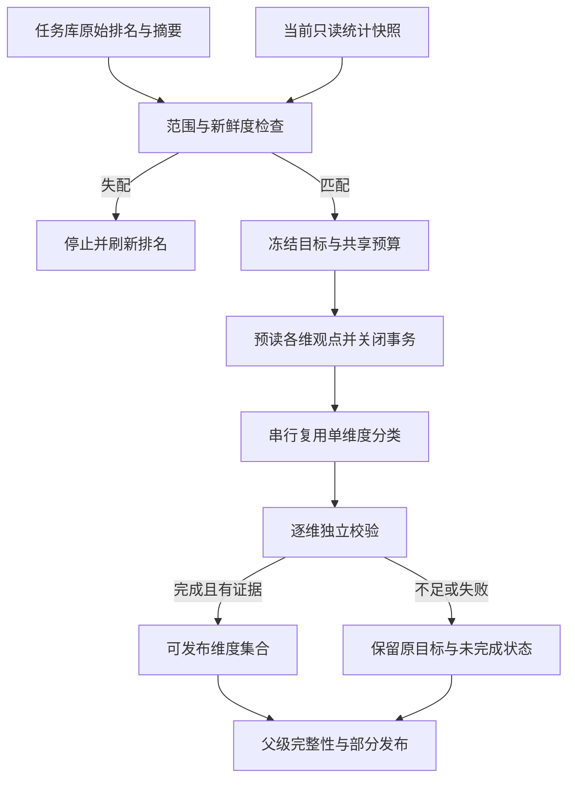

# P6 多维度负面主题下钻实施准备

日期：2026-11-09。依据：当前实际源码、既有 P6 方案及本轮 `P1-A-independent-validation.md`。

**准入结论：BLOCKED。** 可信历史排名输入已验证可用，但 P1-A 独立验收发现 F01（pending 后短情感追问的目标/计划冲突）。P6 的当前数据检查、共享预算、逐维度完整性和部分发布尚未实施。本文件是最小实施方案，不是 P6 功能或真实模型质量验收。

## 1. 已可复用与尚缺能力

| 部件 | 当前事实 | P6 最小增量 |
| --- | --- | --- |
| analysis_state / analysis_context | 已恢复同会话、同范围、六维计数、D、排序与任务/结果摘要 | 最终绑定范围后使用投影器；不直接相信保存的派生 state 或客户端数字 |
| review_intent | 缺负向维度时仍澄清；F01 尚未修复 | 修复 F01 后增加受控 P6 触发分支；明确单维度/数量/原文/正向请求优先 |
| ReviewQueryPlan | 已能容纳多个同名工具的不同参数要求，逐个匹配 | 可选 P6 模式及选择依据，编译至多三份精确要求；不放开 negative/aspect=None |
| review_tools | get_aspect_drilldown 已复用 SQL、缓存、分类和来源结构 | 支持 P6 预读/冻结输入与模式限定预算，禁止分类阶段缓存未命中后再读库 |
| review_topics | 已有发现、独立归属复核、去重和引用校验 | 只增加可选限额/预算钩子，复用分类器；不复制 taxonomy、提示词或另建分类器 |
| RequestGoal / acceptance | v1 独立目标与单轮完整性可用；不能表达必做维度集合 | P6 可选目标约束、逐维度能力和结果检查；不能只要求“任意一个主题结果” |
| reviews | 当前任一失败会影响整轮，partial 不发布完整结论 | P6 专用父/子状态协调；旧模式行为不变 |
| compression / answer_facts | 保留 scope_ref、result_id、每主题分母；存在全局证据/事实截断 | 按维度公平分配并只合并独立通过结果，避免第三维度失去引用或要点 |

源代码证据：`review_plan.py:20–88`、`review_tools.py:93–169,231–239`、`review_topics.py:19–23,274–352`、`review_acceptance.py:11–35,154–270`、`review_compression.py:17–25,155,218,266–279`、`review_answer_facts.py:154–165,203–204`、`reviews.py:338–368`。

## 2. 触发、选择和冻结目标

只有以下条件全部满足才进入 P6：服务端加载同会话历史任务；一个 SKU；negative、完整、未限定维度的当前排名；当前最终范围与 ranking_basis.scope 完全一致；本轮要求具体表现且没有明确指定单维度或其他能力。

选择规则：

```text
required_aspects = sort(六维计数 > 0，按 -count、aspect)[0:3]
```

本轮仅在测试中验证了这条拟定规则：合成计数 service=5、effectiveness=4、logistics=4、quality=2、price=1、packaging=0，对应选择前三者，并列顺序稳定。这不是生产 Planner 实现。零项时明确证据不足；不足三项仅保留实际非零项，不填充零维度。

在任何工具计划编译前：先由原始请求确定 themes 目标，再从已验证排名绑定必做维度及来源，冻结为不可变目标。Planner 只能把它编译成精确工具要求，不能自行减少、替换或扩充维度。

F01 修复必须保持独立验收：目标与 Planner 对 pending 的短情感切换应一致，或在执行前澄清。不能通过把 themes 降为 statistics 解决错误。该修复应先单独验证，再增加 P6 分支。

## 3. 数据流与当前样本复核



实施顺序：

1. 在新请求中从任务库重新加载并核验原始排名；最终商品/日期绑定后调用 analysis_state_for_scope，不能只检查页面选择。
2. 开启当前只读快照，复用 get_analysis_context 得到当前 D 和六维负面计数；同一次快照下比对 source、dataset_version、model、base_url、prompt_version、SKU、日期、baseline、as_of 及分母定义。
3. 比对历史 D 与当前 D，以及全部六维 M_a；任何变化都停止，不暗中换新前三名。状态应是“需要刷新排名”，不是“主题分析已完成”。
4. 通过后在同一事务预读各目标维度的观点及全量匹配数，冻结候选输入、来源和输入摘要。统计复核和各维提取不能落在不同的业务快照中。
5. 预读完成后关闭事务，再串行分类；分类阶段只消费冻结输入。缓存未命中应失败，不用第二个数据快照补齐。

本轮独立测试已证明：历史摘要仍正确时，业务 D 可以从 6 变成 7，packaging 从 0 变成 1。因此历史 scope 指纹不能替代当前计数检查。

边界：D 与六维计数相同也不证明历史所有正文/人工修订完全未变。首版只能声明“当前统计口径和排名计数一致，本次分类使用当前冻结观点”；分别记录历史排名时刻、本轮读取时刻和输入指纹。若要求精确复现历史观点版本，需另行设计版本/修订集合指纹，不能虚构现有统计快照具备该能力。

## 4. 独立多维目标契约

建议为 RequestGoal 增加仅 P6 使用的可选约束：

| 约束 | 目的 |
| --- | --- |
| analysis_mode | multi_aspect_negative_drilldown，隔离新行为 |
| required_aspects | 最多三个不可变维度，保留稳定排名顺序 |
| ranking_source | task_id、result_id、task/result/scope 摘要 |
| selection_basis_sha256 | 绑定完整六维计数、D、选中维度与选择规则版本 |
| per_aspect_level | 每维均要求 themes；不是任意一个主题足够 |

未启用 P6 时保持 v1 的字段、含义、序列化及默认行为。不能只给 dataclass 添加 None 字段然后无条件 asdict，使旧契约输出悄悄变化；应采用模式限定的可选序列化/版本扩展，并保留旧任务解析路径。RAG 冻结契约与其评估资产不改动。

父级验收必须从原始 ranking_basis 独立重算期望维度，并核对冻结目标；不能拿 plan.required_aspects 自证选择正确。还要检查：精确范围与 negative、每维独立工具要求、唯一维度集合、完整分类、可支持主题、引用、分母及样本覆盖率。删除第三维、重复第一维、替换成第四维、混入正向或只返回统计都应失败。

## 5. 统一预算（拟定，尚未实现）

| 项目 | P6 首版约束 |
| --- | --- |
| 维度数 | 最多 3，冻结后不自动增加 |
| 样本 | 每维最多 20 种表达、最多 200 个观点；保留现有读取最多 100 条评论边界，记录排除与覆盖 |
| 工具次数 | 通常 overview 1 + 主题工具 k，k≤3，最多 4；overview 同时承担当前统计检查，不另加隐式工具 |
| 主题模型尝试 | 每维发现 1 + 复核 1，最多 2；整轮最多 6；失败尝试计入，不自动修复/重试 |
| 意图/规划/回答模型 | P6 分支均为 0，确定性编译与模板回答 |
| 单请求超时 | min(配置超时、20 秒、维度剩余、整轮剩余) |
| 维度/共享截止 | 每维最多 40 秒；整轮分类预算 120 秒；不将其宣称为含排队/SQL/校验的任务硬耗时上限 |
| 输出上限 | 发现 1200 tokens，复核 3000；三维最多预留 12600 输出 tokens |
| 请求输入 | 沿用当前 16000 UTF-8 字节 body 上限（含 wire schema、不含 system prompt）；超限拒绝，不静默截断 |
| 重试 | SDK max_retries=0；超时、截断、无效 JSON 均不追加模型请求 |
| 鉴权/额度失败 | 停止余下付费尝试，保留已完成维度；不能向后继续无效调用 |

当前负向默认最多 80 种表达、20 一批，一维最多 1+4=5 次模型调用、独立 60 秒预算。直接循环三次会放大到 15 次调用，且不存在共享费用上限；因此不能直接复用默认循环作为 P6。

最小实现是给现有 public analyze_aspect_topics 增加可选 limits/shared_budget 参数，旧模式默认完全不变。新协调器不导入私有 _call、不复制分类器。预算在唯一串行预留点扣除，模型返回后核对 usage 和截止时间；未来若并行，才需要真正的同步预留机制。

费用单独设已授权上限 C，而不是从字节数猜人民币。每次调用前保守预留：

```text
reserve = 输入 tokens 上界 × 输入单价
        + 最大输出 tokens × 输出单价
        + 供应商其他可计费 tokens 的已知上界
```

只有模型对应 tokenizer/可靠上界、system/schema/协议开销、单价、计费类别和 C 均明确，才允许付费执行；未知时 BLOCKED。失败或缺少 usage 不可当零费用释放额度；保留预留并说明实际账单未知。本轮没有查询实时价格或做真实费用验证，后续付费调用仍需明确授权。

当前 perf_counter 检查发生在同步 SDK 调用前，普通 HTTP timeout 不等于绝对总截止或可靠取消。首版至少禁止截止后启动/接纳结果；若产品要求 120 秒硬取消，需先验证可取消 I/O 或受控执行边界，不能用线程等待超时伪装请求已取消。

## 6. 逐维状态与父级部分完成

| 维度结果 | 父级行为 |
| --- | --- |
| complete 且有可支持主题 | 独立验证通过后加入可发布集合 |
| insufficient_data / 无观点 / 全未归类 | 明确 evidence insufficient，不编造主题；不算完成 |
| partial 归属 | 仅留审计，不能把本维部分主题当完整归类结果发布 |
| 超时/连接/无效输出 | 标 failed，预算允许时处理后续维度 |
| skipped_budget | 保留该必做维度与未开始原因，不从父目标删除 |
| 作用域/身份/来源失配 | 全局硬失败，不作为普通模型失败绕过 |
| 鉴权/额度错误 | 停止后续供应商请求，不无意义重试 |

全部必做维度完成才 parent passed / complete=true；部分完成为 parent partial / complete=false。没有可发布维度时，区分全部证据不足与执行失败，保留逐维结果。父目标始终保留全部维度，不用“成功子集”代替原目标验收。

复用旧 Validator 对每个维度建立精确子计划独立校验。当前 build_analysis_artifacts 只接受 ok 且满足完整计划，不能直接把缺失维度的父 partial 传进去；应先从已独立验证的子结果构造各自公开产物，再用 P6 模式限定的聚合层组织，并分别记录父完成性和可发布子集的数字校验。

当前前端 ChatMessage.tsx 仅在 succeeded 下展示成功结果，AgentResults.tsx 对 partial 直接显示告警。因此后端部分发布完成不等于用户可见功能完成，需另行实施 P6 专用 UI/复制/导出路径，旧模式不变。

## 7. 数字、分母、覆盖率和引用合并

- D 为成功标注评论数；M_a 为当前维度全量负面去重评论数；一级占比为 M_a/D。
- S_a 为该维实际纳入分类的去重评论数；N_a,t 为主题内去重评论数；主题占比为 N_a,t/S_a，观点数另算。不能把 D 用作主题分母，也不能把样本主题数外推为 M_a。
- 保留 selected/evaluated/classified/unclassified、总观点数、population_mode、采样方法及覆盖率。截断样本不改变原始总体计数。
- 按原排名顺序逐维组织；每维公开最多三个主题。保留完整受控快照，不按相同主题名跨维合并。
- 血缘键至少为 source_result_id + aspect + topic_id；scope_ref 相同不代表不同维度结果可以混并。现有 topic_id 已绑定维度与情感，可复用。
- 每个公开主题至少选择一个实际支持观点，引用能追溯评论、观点、原文位置及来源。先按维度公平分配，再去重，避免全局按 review_id 去重时丢失别的维度引用。
- 拟定每维至多三条、整轮至多九条引用。当前父计划默认主题证据 8 条、压缩上限 10 条，需要 P6 模式明确使用 9 及公平分配；必要时为 P6 单独配置 quotes_per_review，而非改变全局默认 2。
- 当前 answer_facts 最多取前 15 条；若三维各八个主题直接串接，最后一维可完全被截断。P6 应先逐维选最多三个有引用主题，再构造至多九个主题要点，截断显式记录。
- 同一评论可能属于多个维度/主题，禁止将 5+4+4 写成 13 个独立投诉用户或总评论。

## 8. 模型候选与人工确认边界

保留 `semantic_status=model_reviewed_not_human_confirmed`、`classification_status=model_candidates_unreviewed`、候选目录、复核归属与失败原因。现有 review_answer_facts 的“未经人工确认”说明要进入 UI、复制和导出，不能只留在开发字段。

父 complete=true 仅代表受限样本分析流程完整，不代表主题语义正确、穷尽全部问题或人工已确认。原文位置和来源通过也不等于语义判断无误。不得写入 human_confirmed、修改人工审批记录，或把工程测试的通过率当真实主题质量分数。

## 9. 拟修改文件

| 文件 | 最小职责 |
| --- | --- |
| agents/review_intent.py | 先修复 F01；P6 模式限定触发及明确请求优先级 |
| agents/review_plan.py | 可选 mode/排名依据/必做维度元数据；编译 k 个现有工具要求 |
| agents/review_acceptance.py | 可选多维目标序列化与独立必做集合校验；旧 v1 不变 |
| 新增 agents/review_multi_aspect.py | 协调选择、样本新鲜度、预读、共享预算、子状态与父完成性；不复制分类逻辑 |
| agents/review_tools.py | 同快照预读与冻结输入、P6 缓存命中约束、共享预算传递 |
| agents/review_topics.py | 仅可选 limits/预算钩子与 usage/失败反馈；保留现有分类器和默认规则 |
| agents/reviews.py | P6 模式专用执行顺序、逐维软失败隔离、事务释放与最终发布 |
| agents/review_compression.py / review_answer_facts.py / review_answers.py | 逐维公开产物、证据公平配额、模板输出与候选提示 |
| jobs/analysis_state.py / analysis_context.py | 原则上复用；如需额外样本元数据，只做可选投影，避免重写状态库 |
| frontend 的结果组件、类型、复制与导出 | 另阶段实现 P6 部分结果可见性，旧行为不变 |
| 新增独立 P6 测试和验收报告 | 错计划、缺维度、预算、失败及显示边界 |

只读复用现有 analytics、review_results、review_validation 和运行契约；不修改冻结 RAG 契约/评审文件，不在 P6 中顺便清理 13 个历史私有导入。

## 10. 测试矩阵与准入条件

| 场景 | 必须断言 |
| --- | --- |
| F01 三轮短情感追问 | 原有独立失败用例修复并通过；不降低目标或放宽验收 |
| 排名选维 | 0/1/2/3/多于3非零、并列、错误排序、缺维度，最多三项且来源一致 |
| 明确请求优先 | 单维度、数量、原文、正向及日期/商品改变不错误触发 P6 |
| 来源与会话 | 错 task/result 引用、篡改、旧任务、跨会话、身份或范围改变均阻断 |
| 当前样本变化 | D 或任一 M_a 改变即停；不自动替换历史前三名 |
| 同一快照 | 预读后新导入/人工修订不能混入分类；分类阶段不允许再查询 |
| 目标与计划故障注入 | 缺第三维、重复首维、选第四维、只有一级统计均不能完成 |
| 多维引用与分母 | 同评论跨维、同名主题、S_a≠M_a、D=0、空主题和样本覆盖均正确 |
| 部分完成 | 首/中/末维失败、部分批次、全部不足、无成功维度，父目标不被缩小 |
| 调用/时间预算 | 假时钟验证每维2次/整轮6次、工具4次、deadline后无新请求/无迟到许可 |
| 费用预算 | 给定合成单价、usage缺失、失败、超上界、未知tokenizer/计费类别，预留不被绕过 |
| 供应商错误 | 401/402停止后续、429/截断/非法JSON不自动追加调用 |
| 公开产物 | 每个公开主题有支持引用，第三维不被全局截断；候选提示在复制/导出仍存在 |
| 旧回归 | P0-A/P0-B/P1-A 全部适用回归；旧单维、正向、原文、RAG许可不变 |
| 实际界面与真实质量 | 后续分别验证桌面/窄屏、部分发布、真实模型质量与延迟，不能用本轮合成数据替代 |

准入门槛按顺序满足：

1. 修复 F01，P1-A 独立用例及旧 450 项全部通过。
2. 冻结 P6 模式目标、选择规则和 partial 发布契约，保持 P0-B v1 不变。
3. 实现并离线验证当前数据检查、同快照预读和完整目标集合验收。
4. 实现共享预算并完成假时钟/模拟供应商/费用边界测试。
5. 逐维与父级验收、公开产物和 P6 UI 路径分别通过；如只做后端，明确尚未完成 UI。
6. 真实收费验证前，另行明确供应商/模型、授权额度、单价、输入上界和质量样本方案。本轮禁止执行。

当前仅完成源码预检、真实 Worker 来源/状态验证、拟定选维规则验证及临时库新鲜度反例；没有运行 P6 多维度工具、共享预算实现或真实模型。故不能将本设计称为已经具备执行准入。

本轮修改范围仅独立测试与两份报告；完成后停止。
