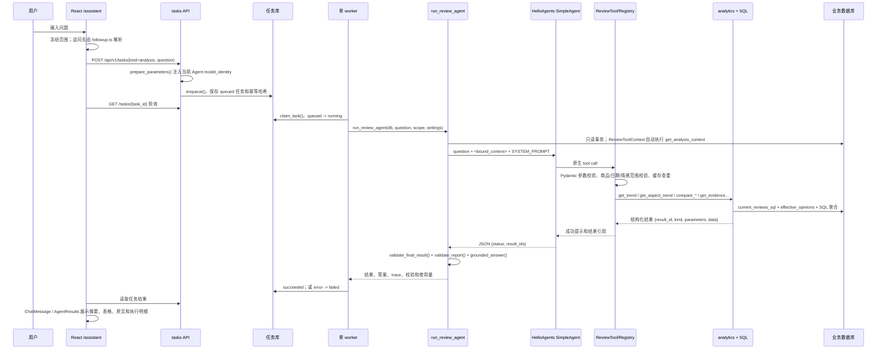

# 阶段 0：商品数据分析 Agent 架构审查

审查日期：2026-10-30（Asia/Taipei）  
审查范围：评论分析 Agent、基础 AI 问答、任务队列、评论统计与证据查询、React 聊天页面及相关测试。  
本阶段只做代码审查、测试和报告生成；未修改 Python、React、数据库、配置或依赖。

## 结论先行

当前系统已经具备一条可核验的只读评论分析链路：前端冻结查询范围并提交 analysis task，worker 调用 `run_review_agent()`，模型只负责选择工具和返回结果 ID，Python 代码负责范围校验、SQL 聚合、证据校验、统计复核和回答文本组装。`grounded_answer()` 不会把原始工具响应直接拼进回答，也没有调用第二个模型生成自然语言答案。

现阶段的主要架构缺口如下：

| 优先级 | 结论 | 影响 |
| --- | --- | --- |
| P0 | 统计层只聚合负面情感，没有正面/中性维度统计；“好评”问题缺少独立的指标语义和工具，最终格式化仍固定输出负面占比。 | 好评问题可能得到负面统计，回答方向与用户意图不一致。 |
| P0 | Agent 允许模型自行编排多个分析项；相同参数的重复调用只命中缓存，仍计入调用次数，且不同页码的证据查询没有结果选择上限。 | 过多工具调用、重复检索和多页原文容易耗尽预算或制造冗长结果。 |
| P0 | worker 对 Agent 失败任务仍保存带有已完成结果的 `task.result`；`ChatMessage` 只按 `result.agent` 渲染，不以任务终态拦截失败/未完成结果。 | 模型超时或最终校验失败后，前端仍可能展示部分结果和统计依据。 |
| P1 | 运行结果、内部身份、执行 trace、原文详情和用户摘要混在一个结果对象及同一页面中。 | 内部模型、提示词版本、base URL、调用次数等技术细节暴露给用户；响应没有统一的公开/内部视图。 |
| P1 | 查询规划、结果压缩、自然语言答案、公开响应组装没有独立边界。 | 后续修改容易同时影响工具选择、统计口径和 UI 展示，难以针对性测试。 |

## 当前真实调用链路

还有一条与评论 Agent 分离的基础问答链路：选择“基础问答”时，前端直接调用 `POST /api/v1/chat`，后端 `answer_message()` 只发送 system prompt 和本轮用户问题，不读取数据范围、不注册业务工具、不保存多轮上下文。该模式的模型文本必须 `finish_reason == "stop"`、非空且没有 tool call，超时或不完整输出直接返回错误。

## 关键模块职责

| 模块 | 当前职责 | 证据 |
| --- | --- | --- |
| `agents/review_prompts.py` | 声明评论 Agent 的能力边界、工具选择规则、范围约束、最终 JSON 协议；版本为 `review-agent-v3`。 | [review_prompts.py](../../src/data_analysis_agent/agents/review_prompts.py) |
| `agents/review_tools.py` | 用 Pydantic 输入模型定义 9 个只读工具；绑定数据集、商品、日期、模型身份；执行缓存、调用计数和 trace。 | [review_tools.py](../../src/data_analysis_agent/agents/review_tools.py) |
| `agents/reviews.py` | 创建只读事务和上下文，自动读取 overview，调用 HelloAgents，校验最终结果，生成确定性回答并返回任务结果。 | [reviews.py](../../src/data_analysis_agent/agents/reviews.py) |
| `agents/runtime.py` | 创建 OpenAI 兼容 LLM、HelloAgents `SimpleAgent`、调用预算和超时；解析并校验最终 JSON。 | [runtime.py](../../src/data_analysis_agent/agents/runtime.py) |
| `agents/review_validation.py` | 不依赖模型，复核计数关系、负面占比、覆盖率、维度变化、星级分布、原文区间和结果引用完整性。 | [review_validation.py](../../src/data_analysis_agent/agents/review_validation.py) |
| `reviews/analytics.py` | 共享 SQL 统计与证据查询；统一计数单位、覆盖率分母、负面占比分母和最新人工复核规则。 | [analytics.py](../../src/data_analysis_agent/reviews/analytics.py) |
| `reviews/scope.py` | 生成日期、商品、来源、数据集和模型身份的 SQL 条件；`current_reviews_sql()` 选择有效模型标注和人工复核意见。 | [scope.py](../../src/data_analysis_agent/reviews/scope.py) |
| `reviews/opinions.py` / `label_store.py` | 定义六个维度、正/负/中性/未知情感、精确原文区间和标注表约束。 | [opinions.py](../../src/data_analysis_agent/reviews/opinions.py)、[label_store.py](../../src/data_analysis_agent/reviews/label_store.py) |
| `jobs/submission.py` / `jobs/worker.py` | 提交时冻结 Agent 身份；worker 串行领取任务，执行 Agent，并把终态和结果写回任务库。 | [submission.py](../../src/data_analysis_agent/jobs/submission.py)、[worker.py](../../src/data_analysis_agent/jobs/worker.py) |
| `features/agent/useAgentChat.ts` | 保存分析会话、解析追问、提交/重试任务、读取历史任务；分析历史写入 localStorage，基础问答只在内存保留。 | [useAgentChat.ts](../../frontend/src/features/agent/useAgentChat.ts)、[chat-state.ts](../../frontend/src/features/agent/chat-state.ts) |
| `features/agent/ChatMessage.tsx` | 渲染任务状态、范围快照、回答、表格、证据、执行记录和重试按钮。 | [ChatMessage.tsx](../../frontend/src/features/agent/ChatMessage.tsx) |
| `AgentResults.tsx` | 按结果 `kind` 重新排版统计、证据、校验、trace 和导出内容。 | [AgentResults.tsx](../../frontend/src/AgentResults.tsx) |

## 必答问题

### 1. Agent 如何理解问题并选择工具？

评论分析模式不是前端直接把自然语言映射成固定工具。流程分为两层：

1. 前端把当前商品、数据集、标注身份、当前/基线窗口复制成冻结参数。已实现的追问先由 `followup.ts` 根据上一轮成功工具参数做确定性解析，例如“只看物流”“换成按月”“继续查原文”；无法明确解析时只创建澄清消息，不创建任务。
2. 后端把原始问题放在 prompt 开头，再追加 `<bound_context>`。`SYSTEM_PROMPT` 描述各工具适用场景，HelloAgents `SimpleAgent` 根据工具 schema 生成原生 tool call。工具层再独立校验商品、日期、情感枚举、页码和模型身份，模型不能改写数据库或绑定范围。
3. 模型完成工具调用后必须只返回 `{"status": ..., "result_ids": [...]}`。`validate_final_result()` 检查结果 ID 存在；`run_review_agent()` 再检查成功工具是否有失败遗漏、是否遗漏已完成结果，并由 `validate_report()` 复核数字和原文证据。

因此，模型负责“理解请求、挑选工具、填写参数、返回引用”，业务代码负责权限边界、SQL、指标口径和最终发布条件。

### 2. 为什么好评问题会出现负面统计？

这是当前真实实现能够解释的结果，不是数据库把正面标签写成负面标签：

- `analytics._summaries()` 只生成 `negative_review_count` 和 `negative_<aspect>`，没有正面或中性计数。
- `get_trend`、`get_aspect_trend`、`get_top_issues`、`compare_products` 和 `compare_time_windows` 的工具描述都围绕“负面评论/问题/负面占比”。
- `grounded_answer()` 对 `context`、`trend`、`quality`、`aspect_trend` 统一拼接“负面占比”，不读取用户意图，也没有好评/正向指标分支。
- 只有观点存储模型和 `get_evidence` 支持 `positive`、`neutral`、`unknown`；不存在“正向统计”工具。

所以用户问“好评”时，模型只能在负面取向的统计工具中做近似选择，或者选 overview/trend；后续确定性回答又固定输出负面率。根因是“情感意图未进入查询计划和统计结果类型”，不是简单的 prompt 词句问题。

### 3. `grounded_answer()` 是否直接拼接工具响应？

没有直接拼接原始工具响应。它按结果 `kind` 读取固定字段，格式化计数、分母、覆盖率、维度变化、星级和最多 160 个字符的引文；它不会把完整 JSON、工具描述或模型文本作为回答返回。成功结果中的 `answer_sections` 也由同一个确定性函数逐项生成。

但原始结构化结果仍保存在 `result["results"]`，前端的“查看统计、证据与执行记录”、详情 JSON 和导出功能可以展示这些字段。因此“回答文本不直出工具响应”和“页面仍可看到内部执行细节”是两个不同层次的问题。

### 4. 为什么会出现重复检索和多页证据？

当前机制只能部分抑制：

- `ReviewToolContext.cache` 使用工具名和规范化参数去重；相同参数再次执行会复用结果数据，但 `RecordingRegistry` 仍先增加 `tool_calls`，模型仍然完成了一次工具调用。
- prompt 要求相同工具和参数成功后不要重复调用，但这是模型遵守的软约束；HelloAgents 没有服务端查询计划或“已满足请求即停止”的硬状态机。
- prompt 明确允许“需要多个分析项时逐项调用”，因此一个宽泛问题可能依次请求趋势、维度趋势、问题对比和证据。`max_steps=8`、`max_tool_calls=12` 只限制总预算，不限制每类结果数量。
- `get_evidence` 允许页码到 1,000,000、每页最多 10 条；同一筛选条件的不同页不是缓存重复。前端“继续查原文”会有意将页码加一，这属于功能行为；但 Agent 自己也可以继续调用更多页。
- 最终 JSON 格式纠正最多一次，纠正 prompt 要求不要重复已成功工具；它只覆盖最终格式错误，不能阻止前一轮已经发生的多次检索。

### 5. 超时发生在哪个阶段？

评论 Agent 的超时主要发生在 `agent.run()` 的模型请求或 HelloAgents 工具执行阶段：

- `create_llm()` 将 `settings.timeout_seconds` 传给 HelloAgents 和 OpenAI client，并设置 `max_retries`。
- `build_agent()` 设置 `llm_async_timeout = timeout * (retries + 1) + 10`，工具异步超时为 30 秒。
- `run_review_agent()` 在模型调用、工具调用、最终 JSON 校验或结果复核失败时返回 `status="error"`；超时异常通过 `execution_failure()` 映射为 `timeout`。
- worker 看到 Agent 结果为 error，会把任务写成 `failed`，同时把该错误结果保存到 `task.result`。

前端 `useTask()` 的轮询不是模型超时，它只在网络失败后 5 秒重连；活跃任务每 1.5 秒读取一次。基础问答另有 `POST /chat` 的后端 OpenAI timeout 和前端 90 秒 HTTP 超时。

### 6. 数据统计是否已经支持维度级正负面情感？

只完成了一半：

- **数据模型支持**：`Opinion.sentiment` 和数据库约束支持 positive、negative、neutral、unknown；人工复核也沿用这些意见。
- **证据检索支持**：`get_evidence` 可以按 aspect、sentiment 或 all 筛选，返回原文和精确 quote 区间。
- **统计聚合不支持正向**：`analytics._summaries()` 只聚合总体负面数及六维度负面数；`Summary`、`Issue`、维度趋势和窗口对比也只暴露负面指标。

因此目前可以查“包装正向原文”，不能查“包装正向评论数/占比”或按维度正负面对照。

### 7. 是否已有结构化结果、回答生成器或可复用压缩逻辑？

已有可复用部分：

- `ReviewToolContext.results` 统一保存 `result_id`、`kind`、`parameters`、`data`。
- `validate_report()` 和 `result_summaries()` 是确定性校验与摘要遍历器，可作为结果层基础。
- `grounded_answer()` 是确定性回答格式化器，`answer_sections` 是按结果拆分的回答结构。
- `canonical_json()` 驱动同工具同参数缓存；`safe_json()` 负责序列化和敏感值处理。
- 前端 `AgentResults`、`sectionSummary()` 和 `report-export.ts` 已有结果展示与导出格式化。

尚不存在独立的“查询计划/结果压缩/自然语言答案生成/公开响应组装”模块。HelloAgents 配置中的 `enable_smart_compression=False`，不能视为已启用压缩；当前的 `result_summaries()` 仅用于校验和告警，不生成用户摘要。

### 8. 前端如何判断成功、失败及部分完成？

任务层使用 `queued | running | succeeded | partial | failed`。`useTask()` 读取任务，活跃状态显示轮询和进度，网络异常显示“任务连接异常”；`canRetry()` 允许 failed/partial 重试。

Agent 层的实际行为有两个特点：

- worker 对 `run_review_agent()` 返回的 `status="error"` 直接 `finish_task(status="failed", result=result, error=...)`；Agent 没有把“已有部分查询结果但回答未确认”映射为独立的 partial 终态。
- `ChatMessage` 用 `task?.result?.agent === true` 取得结果，没有同时要求 `task.status === "succeeded"`。只要失败任务保存了 Agent result，它仍会渲染回答占位、统计结果、原文和执行记录；虽然会显示错误告警，但没有阻止部分结果进入可见区域。

普通 `/chat` 消息则在前端只接受非空字符串，并用 `pending | succeeded | failed` 自己管理状态；没有后台 task 结果。

### 9. 哪些测试覆盖 Agent 完整调用链路？

覆盖最完整的是：

- `tests/test_review_agent.py`：用真实 HelloAgents/OpenAI SDK 加脚本化 HTTP 响应和临时数据库，覆盖工具注册、真实 SQL 工具调用、只读数据库、缓存、范围约束、周期参数、上下文隔离、空/失败/未标注数据、最终 JSON 校验、调用预算、格式纠正、任务队列恢复和冻结模型身份。
- `tests/test_review_capabilities.py`：覆盖数据质量、维度趋势、星级分布、自定义窗口、范围不可扩大，以及新工具的校验/结果/只读属性。
- `tests/test_review_analytics.py`：13 个统计和 SQL 口径测试；`tests/test_reviews.py`：24 个评论业务测试。
- `tests/test_chat_api.py`：覆盖基础 `/chat` 的配置、超时、连接、认证、截断/空响应、工具响应拒绝和密钥脱敏。
- 前端 `frontend/src/features/agent/chat.test.tsx`、`assistant-ui.test.tsx`、`followup.test.tsx`、`AgentResults.test.tsx`、`shared/api/chat-api.test.ts`：覆盖提交、幂等重试、刷新恢复、基础/分析模式隔离、澄清、追问分页、失败展示和结果表格。

这些测试没有证明任意自然语言的模型理解准确率，也没有证明真实供应商在生产负载下的延迟和工具选择稳定性。

## 已确认问题与证据链

### A. 好评语义没有进入统计计划（P0）

**Evidence**：聚合 SQL 只计算 `negative_review_count` 和 `negative_<aspect>`；工具描述及回答格式化都以负面指标为中心。  
**Finding**：正向观点虽可存储和检索，但没有正向统计结果类型；“好评”只能落入负面工具或通用趋势，最终回答仍输出负面率。  
**Path**：[analytics.py](../../src/data_analysis_agent/reviews/analytics.py#L55-L72)、[review_tools.py](../../src/data_analysis_agent/agents/review_tools.py#L200-L208)、[reviews.py](../../src/data_analysis_agent/agents/reviews.py#L25-L86)。

### B. 重复工具调用只缓存结果，不阻断调用（P0）

**Evidence**：缓存命中发生在 `execute()` 内部，而调用计数在 registry 外层先增加；成功响应是 prompt 级提示。  
**Finding**：重复调用仍消耗工具预算和模型轮次；不同页码和宽泛多目标问题会继续扩大证据结果。  
**Path**：[review_tools.py](../../src/data_analysis_agent/agents/review_tools.py#L90-L142)、[review_tools.py](../../src/data_analysis_agent/agents/review_tools.py#L163-L176)、[review_prompts.py](../../src/data_analysis_agent/agents/review_prompts.py#L25-L32)。

### C. 失败任务的部分结果仍进入聊天渲染（P0）

**Evidence**：worker 在 Agent error 时将结果和 error 一起持久化；`ChatMessage` 只判断 `result.agent`；`AgentResults` 可继续展开结果与 trace。  
**Finding**：超时、调用预算耗尽或最终校验失败时，用户可能看到部分统计和证据，形成“未完成结果已发布”的错觉。  
**Path**：[worker.py](../../src/data_analysis_agent/jobs/worker.py#L236-L254)、[ChatMessage.tsx](../../frontend/src/features/agent/ChatMessage.tsx#L40-L87)、[AgentResults.tsx](../../frontend/src/AgentResults.tsx#L63-L127)。

### D. 公开回答与内部执行信息没有统一边界（P1）

**Evidence**：后端结果同时返回 `answer`、`results`、`trace`、`usage`、`agent_model_identity`、校验和；前端范围区直接显示 model、prompt_version、base_url，并把执行记录和 JSON 提供给聊天页。  
**Finding**：内部调试和审计信息与用户回答共用一个展示模型；后续无法只替换回答生成器而不影响导出和详情。  
**Path**：[reviews.py](../../src/data_analysis_agent/agents/reviews.py#L89-L94)、[reviews.py](../../src/data_analysis_agent/agents/reviews.py#L176-L192)、[ChatMessage.tsx](../../frontend/src/features/agent/ChatMessage.tsx#L50-L66)、[AgentResults.tsx](../../frontend/src/AgentResults.tsx#L113-L127)。

### E. 没有独立的查询计划和结果压缩层（P1）

**Evidence**：`SimpleAgent` 直接根据 system prompt 调用全部注册工具；`grounded_answer()` 同时承担多种结果类型的文本格式化；没有统一的结果数量、证据页数或摘要 token 预算。  
**Finding**：工具编排、统计结果选择、用户回答长度和页面详情互相耦合，导致“模型少调用”和“给用户少展示”无法分别控制。  
**Path**：[runtime.py](../../src/data_analysis_agent/agents/runtime.py#L37-L64)、[reviews.py](../../src/data_analysis_agent/agents/reviews.py#L135-L176)、[types.ts](../../frontend/src/types.ts#L188-L219)。

## 可复用的现有实现

后续阶段应优先复用以下边界，避免重写已经稳定的业务口径：

1. `analysis_scope()`、`current_reviews_sql()` 和 `DEFINITIONS`：统一 UTC 日期边界、模型身份、最新人工意见和分母定义。
2. `ReviewToolContext` 的绑定范围、Pydantic schema、只读事务、结果 ID 和缓存框架。
3. `validate_report()` 的计数/分母/引用校验；新增正向统计时应扩展校验，而不是在模型层信任数字。
4. `get_evidence()` 的证据哈希、行号、quote 区间及人工/模型来源；压缩只应减少展示，不应丢失可追溯字段。
5. 任务队列的幂等键、父任务重试、冻结模型身份和 `useTask()` 的取消旧请求逻辑。
6. 前端 `AgentResults` 的分类型展示、结果导出和 `followup.ts` 的确定性追问解析；新增公开摘要应以适配器方式接入。

## 需要新增或修改的模块

后续阶段建议新增清晰的四层，不改变现有 API 和数据库口径作为第一步：

| 层 | 建议职责 | 可能位置 |
| --- | --- | --- |
| 查询意图/计划 | 把正向、负向、评分、证据、趋势、比较等意图转换为受限计划；限制每类工具最多一次或明确页数。 | `agents/review_query_plan.py` |
| 统计结果模型 | 为 positive/negative/neutral 统一定义计数、分母、空分母和维度结果；继续由 SQL 计算。 | `reviews/analytics.py` + `agents/review_result_models.py` |
| 结果压缩 | 按计划选择摘要字段、首尾趋势桶、有限证据片段和可用告警；保留完整结果供审计导出。 | `agents/review_compaction.py` |
| 公开回答组装 | 输入已校验、已压缩结果，生成面向用户的中文回答；内部 trace/identity 与公开 payload 分离。 | `agents/review_response.py` |

前端可以新增一个公开结果适配器或 selector：只在 `task.status === "succeeded"` 且 Agent `status` 为 `ok/unsupported` 时显示回答和公开摘要；失败结果只显示失败原因、重试入口和“已完成查询数”，完整内部结果仍通过受控任务详情或开发导出查看。

## 兼容性风险

- `POST /api/v1/tasks` 的 `analysis` 参数、`question`、Idempotency-Key、任务状态和重试父链已经被前端及测试依赖；后续新增字段必须可选，不能改变旧的结构化分析任务。
- 现有任务结果被历史页面、下载 JSON、追问父轮和 `isAgentTask()` 读取。改变 `result_ids`、`results` 或 `scope` 形状会影响刷新恢复和历史任务。
- `review-agent-v3` 会进入任务模型身份和查询标注身份；升级 prompt 或统计结果 schema 时，旧任务必须保持可读，重试时要继续检查身份变化。
- 正向统计要保持现有负面指标和分母定义的数值兼容；不能把“无成功标注”的 null 变成 0，也不能把星级和情感混为一个指标。
- `current_reviews_sql()` 支持人工复核快照。新增正向聚合必须同时覆盖模型意见和人工修订意见，否则会造成页面与工作台不一致。
- 现有前端 Agent 结果显示内部执行记录，若拆公开/内部响应，应保留下载和审计入口，避免破坏已有排障习惯和历史 JSON。
- 任务 worker 当前单 worker 串行执行；如果把摘要生成再交给模型，会引入第二个超时点、额度和失败状态，必须扩展任务状态语义并重新测试重试行为。

## 阶段 0 基线验证

### 已执行并通过

| 命令 | 结果 |
| --- | --- |
| `.venv\Scripts\python.exe -m unittest discover -s tests -p test_review_analytics.py -q` | 13/13 通过 |
| `.venv\Scripts\python.exe -m unittest discover -s tests -p test_reviews.py -q` | 24/24 通过 |
| `npm test -- --maxWorkers=2`（`frontend/`） | 21 个文件、151 项通过；有既有 jsdom `getComputedStyle` 提示 |
| `npm test -- --run src/features/agent/assistant-ui.test.tsx src/features/agent/chat.test.tsx src/features/agent/followup.test.tsx src/shared/api/chat-api.test.ts --maxWorkers=2`（`frontend/`） | 4 个文件、46 项通过 |
| `npm run build`（`frontend/`） | TypeScript 和 Vite 构建通过；保留既有大于 500 kB 的 chunk 警告 |

### 未完成或受环境限制

| 命令/验证 | 结果与原因 |
| --- | --- |
| `test_review_agent.py`、`test_review_capabilities.py`、`test_chat_api.py` | 在当前受限 Windows 执行环境中分别卡在 TestClient/模型异步首个用例，无结果输出；等待后已停止，不能宣称通过。项目既有文档也记录过 Windows asyncio/本地套接字导致 Agent 测试等待的情况。 |
| `test_review_scope.py` | 11 项中 9 项通过，2 项失败；失败用例要求持久标注队列使用 PostgreSQL，当前测试数据库不满足“只支持 PostgreSQL”的前置条件。 |
| `test_api_routes.py` | TestClient 初始化后无结果输出，有限等待后停止；未判定为代码通过或失败。 |
| 浏览器 1440/1024/768 截图、真实页面关键操作和当前开发服务器 | 本阶段未重新启动服务和执行浏览器验收；工具索引显示 Playwright/agent-browser 不可用，且当前没有外部服务验证授权。历史验收文档不能替代本轮验证。 |

这些限制只影响本轮运行证据，不改变代码静态审查结论。尤其是 Agent 集成链路的真实模型调用、PostgreSQL worker 和浏览器终态展示，必须在具备本地套接字、PostgreSQL、worker、Vite/Chromium 的环境中复跑。

## 后续阶段实施建议

1. **先冻结公开终态契约**：定义 `succeeded + agent.status` 才能发布回答；`failed` 和未确认的部分结果只进入错误/审计视图。先补后端/前端状态测试，再动回答内容。
2. **建立受限查询计划**：把用户问题先归类为情感统计、趋势、比较、质量或证据；每类规定允许的工具集合、最大证据页和是否需要基线。模型只填计划参数，不自由组合无限分析项。
3. **补齐正向统计口径**：扩展 SQL 返回正/负/中性计数及各自分母，明确“评论级去重”和“观点级计数”的选择；同步 `validate_report()`、Python 类型、API 结果和前端表格。保留现有负面字段兼容旧结果。
4. **拆分结果和回答**：保留完整 `results/trace/usage` 作为内部快照，新增公开摘要和回答组装器；压缩层只减少文本和证据展示，不改变原始结果或审计引用。
5. **硬化重复和证据预算**：缓存命中不要继续计入有效工具调用；同一计划默认只允许一页证据；“继续查原文”只能由前端显式追问创建下一页，并在结果中记录父证据 ID。
6. **补测试矩阵**：至少增加好评/差评/正负对比、重复调用、两页证据、模型超时后任务失败、失败任务含部分结果、刷新恢复和重试不重复展示的后端与前端测试。
7. **完成环境化验收**：在允许本地 socket 的 PowerShell 中复跑三组 Python Agent 集成测试；在隔离 PostgreSQL + worker + Vite + Chromium 中按 1440、1024、768 检查无横向滚动、摘要长度、失败遮挡和关键追问操作，然后再进入下一阶段。

本阶段到此停止，等待验收后再进入实现阶段。
