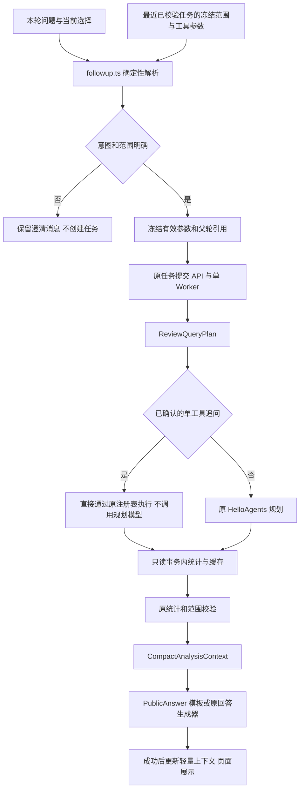

# 阶段 6：多轮对话、上下文管理与性能优化

日期：2026-10-30（Asia/Taipei）。本阶段延续阶段 0～5，未引入新 Agent 框架、数据库表、Redis 缓存或多 Worker。所有示例、性能数据和浏览器截图来自临时 SQLite 与本机模拟模型，不是生产数据，也不是美的真实商品结论。

## 改动及调用流程



| 文件 | 阶段 6 职责 |
| --- | --- |
| `frontend/src/features/agent/followup.ts` | 扩展情感切换、维度收敛、相对时间、优先级限制与范围选择；继承有效参数 |
| `frontend/src/features/agent/chat-state.ts` | 增加可选 ConversationAnalysisContext 和提交时的选择快照，兼容旧 localStorage |
| `frontend/src/features/agent/useAgentChat.ts` | 只从成功且已校验的任务更新上下文；失败后查找有效父轮；保护迟到响应 |
| `frontend/src/App.tsx` | 将数据集、商品、标注版本和窗口选择指纹传入会话 Hook，用于撤销迟到追问 |
| `frontend/src/types.ts` | 可选情感/分析类型和性能字段，不新增提交必填字段 |
| `frontend/src/AgentResults.tsx` | 开发审计区显示阶段耗时；单维度追问表格仅显示对应维度 |
| `frontend/src/features/agent/ExtendedResults.tsx` | 正向单维度详情遵守当前筛选，保留原计数和分母 |
| `src/data_analysis_agent/agents/review_plan.py` | 明确追问的情感与规范化回答问题；拦截无法支持的细分主题及未解析的相对日期 |
| `src/data_analysis_agent/agents/review_tools.py` | 复用原注册表/Pydantic；可选六维筛选；同一只读事务的聚合缓存和查询计时 |
| `src/data_analysis_agent/agents/reviews.py` | 明确追问跳过规划模型，保留预算和完整校验；增加阶段计时 |
| `src/data_analysis_agent/agents/review_compression.py` | 按本轮规范化问题选择相关维度，保留完整原结果 |
| `src/data_analysis_agent/agents/review_answers.py` | 历史安全转换使用同一规范化问题，继续原模型预算与模板降级 |
| `src/data_analysis_agent/jobs/worker.py` | 保存任务实际排队时间，与 Agent 执行耗时分开 |
| `tests/test_review_plan.py`、`tests/test_review_context_performance.py` | 计划、直接执行、缓存边界、修订可见性及发布保护 |
| `frontend/src/features/agent/followup.test.tsx`、`PublicAnswerView.test.tsx` | 多轮语义、范围切换、异步隔离与详情筛选 |
| `frontend/tests/assistant.e2e.mjs` | 恢复完整链路；增加多轮场景、真实耗时和四屏宽截图 |
| `scripts/phase6_performance.py` | 临时数据库和内存 MockTransport 下的可复现绝对测量 |

工作区保留此前阶段未提交的改动。本报告仅描述本阶段新增行为。

## 上下文结构与继承

`Conversation.context` 是可选的轻量元数据，不是第二套聊天系统。它记录稳定的 `conversation_id`、`last_successful_task_id`、来源与数据集版本、商品 ID、当前/基线日期、标注模型与提示词身份、分析类型、情感、唯一维度、证据页码/页长及上一轮结果引用。完整服务身份仍由冻结的 `turn.parameters` 保存，并由 `sameScope()` 比对。

不把评论原文、完整统计 JSON、trace、密钥存入 context；已有每轮 `query`、`clarification`、`parameters` 与任务 ID 的本地历史格式继续可读。上下文是结果引用和条件，不是跨任务统计缓存。

继承规则：

- 明确情感覆盖上轮情感，其他商品、数据集、窗口和标注身份保持冻结。
- 维度追问保持原分析类型：差评维度继续 `get_top_issues`，好评维度继续 `get_positive_aspects`；趋势继续趋势；原文继续原文并重置页码。
- 切换原文情感时保留 page_size、窗口和商品，页码回到 1；“下一页”只增加 page。
- 商品、数据集、日期或标注身份变化后，追问通过原有澄清选择“沿用上轮”或“使用当前范围”。选择当前范围时不带入旧商品或旧证据游标。
- 任务必须 `succeeded`、无 task.error、Agent `status=ok` 且 `validation.status=passed` 才更新有效上下文。失败、partial、unsupported、运行中和校验失败均不更新。
- 当前轮失败后可承接最近同范围的有效成功任务；不会把失败工具结果当成父轮。查看历史任务 URL 时，优先使用正在查看的历史轮次及其冻结范围；“沿用第1轮范围，只看物流”等显式引用也会读取并校验指定轮次，使用该轮冻结范围。
- 提交、重试仍使用原 API 与幂等键。父任务读取过程中更换数据集/商品/窗口或历史路由，会撤销迟到追问，避免旧响应提交到新选择下。
- 不把本地 context 当作可信统计；恢复后仍读取后端任务并检查状态与校验。

`selection` 与 `parameters` 分开保存：前者记录用户发送时的全局选择，后者记录本轮生效范围。因此自然语言指定“最近半年”之后，只要用户没有改动全局选择，后续追问可继续继承计算后的真实日期，而不是回到旧数据窗口。

## 连续追问行为

| 用户表达 | 当前行为 |
| --- | --- |
| 好评主要集中在哪些方面 → 那差评呢 | 沿用范围，切换到负向维度；第二轮无需规划模型 |
| 差评主要方面 → 只看物流方面 / 物流方面呢 | 保持维度汇总，只在公开回答和详情表格展示物流；完整六维原始结果留在审计快照 |
| 物流差评原文 3 条 → 继续查看下一页 | 保留维度、负面情感、商品、日期与页长，只增加页码；实际 SQL 分页测试验证 ID 不重复 |
| 物流原文 → 那好评呢 | 情感改为 positive，保留页长和窗口，页码重置 |
| 最近半年物流问题怎么样 | 以本轮 UTC 时间或明确 as_of 为参考，计算滚动六个月范围并冻结；基线为此前等天数窗口 |
| 那前三个月呢 | “窗口前三个月”和“最近三个月”均合理，先澄清，不创建任务或追加理解模型调用 |
| 安装服务有哪些问题 | 明确 unsupported；不把整个 service 维度当作安装服务数量 |
| 包装和物流变化 → 哪个更值得优先解决 | 说明缺少严重程度、业务影响与成本，不能仅凭负面占比判定商业优先级；建议复核原文与业务记录 |

相对日期示例通过受控时钟测试：参考 `2024-03-31T12:00:00Z` 时，“最近半年”为 `2023-10-01—2024-03-31`，“最近90天”为 `2024-01-02—2024-03-31`。月底计算会限制到目标月份的合法日期。历史数据窗口不会被暗中解释成“最近半年”；绕过前端、直接调用 API 提交未解析相对时间时，计划层返回 unsupported，要求明确日期。

## 缓存边界和性能优化

没有实现持久化或跨任务统计缓存。当前业务表没有一个可同时覆盖导入、标注、内容变动和人工修订的可靠统一变更版本；仅以问题字符串或 max(annotation_id) 缓存都可能返回过期意见。

沿用 `ReviewToolContext.cache`，增加同一只读事务中的业务聚合缓存：键为业务函数名和带默认值的完整参数，包含来源、数据集版本、商品集合、日期、标注身份、周期、情感等。商品顺序规范化；范围和工具参数仍在命中前校验。

具体收益：

- 自动 overview 已读取当前范围的月趋势摘要；同范围的 `get_trend(period=month)` 复用该次业务聚合，依然保留独立、完整的 trend 结果和 result_id。受控测试确认业务查询从两次变为一次，数值完全一致。
- 明确追问已由确定性规则形成 ReviewQueryPlan，不再请规划模型重新选择同一工具。直接走原 Registry、Pydantic、范围限制、工具预算、证据预算、validate_report、压缩与回答生成，不跳过任何发布条件。
- 简单维度统计和原文仍用阶段 4 模板，回答模型调用为 0。复杂趋势仍复用原 NaturalLanguageAnswerGenerator，输入预算、超时及 fallback 保留。
- 不向模型发送完整历史。当前轮只传问题、绑定范围/计划及阶段 4 压缩后的相关事实；结果引用不会自动扩展为所有历史 JSON 或所有评论分页。

缓存失效采用生命周期保证：事务结束即销毁，新任务/新会话创建新 Context。测试验证改变商品、数据集、标注身份、人工修订、导入或新增标注后不会命中旧缓存。数据更新与当前事务同时发生时，当前轮按数据库只读快照解释，下一轮按新快照重新统计。

## 真实计时与测量

内部 `performance` 字段：

| 字段 | 含义 |
| --- | --- |
| planning_duration_ms | 本地构建计划及 Agent.run 的编排耗时，扣除业务聚合时间；不等于纯供应商网络延迟 |
| query_duration_ms | 实际 analytics 函数执行累计耗时，包含 SQL 和结果组装；不是底层 SQL 语句数量 |
| validation_duration_ms | 数值、分母、引用、方向和范围复核 |
| compression_duration_ms | 结构化适配和压缩 |
| answer_duration_ms | 原回答生成器，含模板或 LLM 及降级 |
| total_duration_ms | Agent 完整运行，包含连接/客户端初始化、工具注册、进度回写等开销；不含排队时间 |
| queue_duration_ms | Worker 使用任务 created_at 到 started_at 的实际时间差 |
| answer_input_bytes | UTF-8 序列化字节数；不作为 Token 数报告 |

`model_tool_attempts`、`query_executions`、`cache_hits`、`answer_model_calls` 继续保留。性能信息只进入内部结果/开发审计，不进入 PublicAnswer 普通正文。浏览器验收另记录 `submitToVisibleMs`，包含提交、排队、轮询和测试观察间隔，不能与 Agent 执行时间混用。各子阶段并不覆盖所有初始化和调度开销，不能要求它们相加严格等于 total。

运行 `scripts/phase6_performance.py` 得到 [phase6-performance.json](../../output/agent-refactor/phase6-performance.json)。每个简单场景运行五次，当前绝对中位数：

| 受控场景 | 中位总耗时 ms | 实际业务查询 | 规划 / 回答模型调用 |
| --- | ---: | ---: | --- |
| 明确正向维度 | 13.335 | 2 | 0 / 0 |
| 明确负向维度 | 14.105 | 2 | 0 / 0 |
| 物流单维追问 | 12.330 | 2 | 0 / 0 |
| 证据第一页 | 13.613 | 2 | 0 / 0 |
| 证据第二页 | 13.716 | 2 | 0 / 0 |

这些样本仅验证性能采集方式与调用预算，不代表大数据量性能。两维趋势的同步受控编排测得 18.236 ms、3 次业务查询；此测量的回答客户端未连接，实际使用模板降级。独立 MockTransport 解释生成测得 427.288 ms；模拟抛出超时后降级测得 2.160 ms。后者是模拟异常处理成本，不是“等了一段真实供应商超时”的延迟。真实浏览器链路另有等待 1 秒解释超时的降级场景。

阶段 4/5 缺少与本脚本同一进程、样本、环境的可靠墙钟基线，故只报告绝对值和可验证的调用数变化，不编造提速百分比。阶段 4 的回答输入预算仍适用。

## 测试、浏览器验收与兼容性

复现命令（项目根目录；npm 命令在 frontend 下运行）：

```powershell
$env:LABEL_EXECUTION_MODE = 'local'
.venv/Scripts/python.exe -m unittest discover -s tests -q
.venv/Scripts/python.exe scripts/phase6_performance.py
Set-Location frontend
npm test -- --reporter=dot
npm run build
node tests/assistant.e2e.mjs
```

后端最终回归：338 项运行，306 项通过、32 项跳过。跳过项需要 `TEST_POSTGRES_ADMIN_URL` 或隔离 Redis 等外部前置条件，未宣称这些集成通过。日志：[phase6-backend-tests-verified.log](../../output/phase6-backend-tests-verified.log)。单独的上下文/缓存/性能边界测试 7 项通过。

前端最终测试：22 个文件、185 项通过；TypeScript/Vite 生产构建通过。结果见日志：`output/phase6-frontend-tests.log`、`output/phase6-build.log`。前端覆盖正负切换、同一类型维度追问、页长/窗口保留、商品/数据集/标注/日期隔离、月底时间解析、失败后上下文、读取时切换范围、历史恢复及仅展示选中维度。jsdom 仍有既有伪元素 getComputedStyle 提示；生产构建仍有既有 >500 kB chunk 警告。

真实 E2E 使用临时 SQLite、本机脚本化 OpenAI 兼容模型、实际 FastAPI、单 Worker、HelloAgents 和真实 React/Vite/Chromium；不是前端 Mock 代替任务链路。阶段 5 的本机端口限制已在允许回环连接的执行环境中恢复。

完整结果、任务 ID、冻结参数、计时和截图保存在下方最终浏览器记录。验证包括原有基础问答、正负统计、趋势、证据分页无重复、数据集切换、日期编辑、覆盖率失败重试、URL 恢复、JSON/Markdown 来源保留、failed/partial 保守发布保护、解释超时降级与阶段 6 连续追问。四种宽度为 1440、1024、768、390，检查页面宽度、聊天区域、输入区、导航与折叠详情。

此前失败也保留：

- `output/playwright/assistant-Tr73GB/acceptance.json`：40 张截图后，日期日历操作超时；改用真实输入控件的键盘提交，并仍断言日期值和任务参数。
- `output/playwright/assistant-AhRbYP/acceptance.json`：开发热更新期间出现前端异常，未计为通过；固定代码版本后完整重跑通过。
- `output/phase6-backend-tests-final.log`：受限环境的重复全量运行在异步/HTTP 测试期间长期无进展，已中止，不计为通过；允许回环连接后重新运行的 verified 日志才是最终结果。

已有负向指标、去重正向口径、人工意见优先级、result_ids/results/scope、证据引用、冻结任务、原重试协议、基础问答与评论分析模式隔离均保留。新增字段为可选字段；旧任务无需迁移。历史缺少新版公开回答时仍使用阶段 4 的安全读取，无法证明通过校验的结果不会自动成为追问父轮。

## 最终浏览器记录与实际多轮结果

最终完整 E2E：[acceptance.json](../../output/playwright/assistant-txHfsr/acceptance.json)，状态 passed，100 张截图，浏览器错误 0。四屏宽均无页面/聊天区域横向溢出；已人工查看桌面好评、390px 物流追问和 1024px 优先级澄清截图。

- [好评回答 1440px](../../output/playwright/assistant-txHfsr/phase6-positive-1440.png)
- [多轮物流追问 390px](../../output/playwright/assistant-txHfsr/phase6-multiturn-390.png)
- [优先级限制说明 1024px](../../output/playwright/assistant-txHfsr/phase6-priority-limit-1024.png)
- 同目录保留各场景 1440/1024/768/390px 截图、API/Vite 日志及 Markdown 导出。

这一组范围明确为临时 `SIMULATED-frontend` 数据集、两款 DEMO 商品、2023-01-01 至 2023-02-24、`SIMULATED-ANNOTATIONS` 标注版本。虽然用户测试问题使用“美的空调”字样，绑定商品仍是 DEMO 测试商品，不能把结果解释成真实美的商品分析。SQL 得到 96 条成功标注、76 条含正向观点评论，使用效果正面提及 76 条；物流负面提及为 0，第三轮正确说明没有匹配观点，不编造排名或细分标签。

| 实际浏览器链路 | 规划 / 回答模型调用 | 查询 ms | Agent 执行 ms | 排队 ms |
| --- | --- | ---: | ---: | ---: |
| 好评维度 | 2 / 0 | 4.891 | 1269.582 | 594 |
| 那差评呢 | 0 / 0 | 8.26 | 40.917 | 562 |
| 物流方面呢 | 0 / 0 | 7.268 | 40.871 | 27 |

“那差评呢”和“物流方面呢”保留相同冻结 scope；后两轮均经过数值校验、压缩和模板回答。“沿用第N轮范围，物流方面呢”还实际创建了任务，核验 scope 等于指定历史任务且规划调用为 0；展开表格只出现物流。浏览器刷新后 context 指向最近成功轮次；优先级追问只产生澄清，没有模型调用。

最终前端回归为 22 个测试文件、185 项通过；生产构建通过。最终后端为 338 项运行，306 项通过、32 项跳过。不存在将前端 Mock 当成上述真实任务链路的情况。

另一次日期输入回退的失败记录为 `output/playwright/assistant-p2SWWb/acceptance.json`，保留原严格断言；脚本改为逐键输入、失焦提交和有限次重试后，最终运行通过。之前的成功与失败目录均保留，不覆盖为“全部首次通过”。

## 已知限制与阶段 7 验证建议

- 确定性规则覆盖明确情感、六维、周期、相对时间和分页，不承诺理解任意口语。模糊指代先澄清；支持“沿用第N轮范围，…”（数字以及一至十），更复杂的历史引用仍需明确任务或从历史任务 URL 恢复。
- 仅支持现有六维；安装、制冷、静音的独立数量、正向趋势及因果/商业优先级仍不具备数据依据。
- 没有跨任务统计缓存，未优化为多 Worker；后续若需要，先设计覆盖人工修订的统一变更版本与访问边界。
- 浏览器链路使用模拟模型，数值来自受控 SQL；未使用真实生产数据库或测试真实供应商的性能/任意语义泛化能力。
- 本地历史保留原消息和任务引用，不传给模型；尚未实现历史归档/会话管理产品。context 仅是当前浏览器会话中的条件摘要。
- 阶段 7 应验证真实 PostgreSQL/Redis 集成、真实供应商评测、生产数据范围、并发更改意见时的快照行为，以及更多自然语言追问和长会话性能。

本阶段完成后停止，不自动进入阶段 7。
