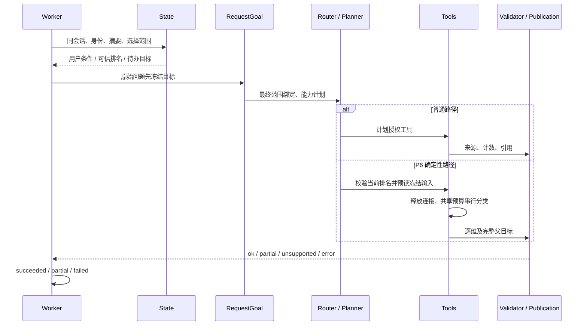

# Agent 第一阶段：多轮对话业务能力独立验收

验收日期：2026-11-10。项目：`E:\AllProject\data-analysis-agent`。

**业务验收结论：FAIL。** 本轮执行了 30 组相互独立的对话，共 62 轮。42 轮符合独立预期，10 轮不符合，10 轮保留为待人工裁决；不能将这些待裁决轮计为通过。已确认错误范围被发布成功，以及用户纠正目标后仍完成错误任务。两个主动故障注入均被最终发布校验拦截，但其中一个仍在目标检查失败后执行了工具。

这是纯离线业务链验收。没有使用真实评论库、任务库、真实向量、收费模型或真实 Embedding。P6-E1B 继续 **BLOCKED、搁置**；本轮没有继续系统预检、UAC、TCP API、数据库恢复或 PG-01～08。

## 1. 当前源码的实际调用链

以下位置由本轮直接阅读源码确认，未用历史报告代替。与执行前冻结清单相比，Agent、jobs、reviews 下全部 Python 源码摘要保持一致。本轮没有修改业务源码。

| 节点 | 当前文件、核心入口 | 实际职责和顺序 |
|---|---|---|
| Worker | [jobs/worker.py:188](E:/AllProject/data-analysis-agent/src/data_analysis_agent/jobs/worker.py:188)，`TaskWorker._execute` | 验证队列参数及 Agent 身份 → 载入会话上下文 → 调用 Agent → 按结果/校验映射终态。此次执行的是该真实函数，替换的是存储边界。 |
| 参数 | [jobs/parameters.py:46](E:/AllProject/data-analysis-agent/src/data_analysis_agent/jobs/parameters.py:46)，`AnalysisParameters` | 验证 question、conversation_id、context_task_id、selection_scope 与查询范围。 |
| State 恢复 | [jobs/analysis_context.py:11](E:/AllProject/data-analysis-agent/src/data_analysis_agent/jobs/analysis_context.py:11)，`load_analysis_context` | 最多回看 4 个任务；同会话、同标注身份；检查任务摘要。失败轮可提供用户请求，不可提供已完成事实。selection_scope 变化使旧范围失效。 |
| 可信 State | [jobs/analysis_state.py:17](E:/AllProject/data-analysis-agent/src/data_analysis_agent/jobs/analysis_state.py:17) | `empty_analysis_state`；`restore_ranking`(37) 重做数值及任务验收，只接收单商品 negative、未限定维度、完整六维排名；`restore_pending_goal`(100) 只接收合法澄清的负面主题目标；`analysis_state_for_scope`(122) 在最终范围投影；`pending_context`(136) 恢复待办请求。 |
| 摘要封存 | [jobs/store.py:282](E:/AllProject/data-analysis-agent/src/data_analysis_agent/jobs/store.py:282)，`analysis_result_integrity`、`finish_task` | 摘要绑定 task_id、终态、原参数和原结果；摘要不是客户端授权。内存任务替身使用同一纯函数封存。 |
| Agent 总入口 | [agents/reviews.py:122](E:/AllProject/data-analysis-agent/src/data_analysis_agent/agents/reviews.py:122)，`run_review_agent` | 标准化范围 → 只读连接/目录 → **独立 RequestGoal** → P6 分支或普通 Router/Planner → Tool → 数值校验 → 压缩/有限补证 → 任务验收 → 回答 → Worker 映射。 |
| 独立目标 | [agents/review_acceptance.py:41](E:/AllProject/data-analysis-agent/src/data_analysis_agent/agents/review_acceptance.py:41)，`build_request_goal` | 在调用 Router 前生成不可变 RequestGoal，不通过 Planner 降低目标；RAG 使用独立冻结契约，允许 RequestGoal=None。`build_task_goal`(146) 绑定最终范围；`validate_goal_plan`(155) 检查能力一致性。独立于 Planner 不等于中文语义必然正确。 |
| Router | [agents/review_intent.py:297](E:/AllProject/data-analysis-agent/src/data_analysis_agent/agents/review_intent.py:297)，`resolve_review_request` | `_user_conditions`(231) 汇总用户槽位；`_inherit_scope`(257) 继承范围；`_followup_intent`(182) 解释短维度/情感/数量追问；`_intent_plan`(114) 编译能力。RAG 提前分支；否则规则，必要时才语义模型。本轮禁止模型兜底。 |
| 语义规则 | [agents/review_semantics.py:206](E:/AllProject/data-analysis-agent/src/data_analysis_agent/agents/review_semantics.py:206)，`opinion_request` | 区分主题归并、原始观点分组、数量、原文；该层与独立目标层分别识别中文，但当前否定词覆盖不足。 |
| Planner | [agents/review_plan.py:24](E:/AllProject/data-analysis-agent/src/data_analysis_agent/agents/review_plan.py:24)，`ReviewQueryPlan` | `build_query_plan`(111) 生成 requirements/required_tools；`check_call` 校验工具与参数；`satisfied` 检查执行覆盖。`build_p6_query_plan`(99) 只编译已冻结必做维度，不重排选维。 |
| Tools | [agents/review_tools.py:93](E:/AllProject/data-analysis-agent/src/data_analysis_agent/agents/review_tools.py:93)，`ReviewToolContext` | `query_scope`(129) 绑定数据范围，`query`(142) 同轮缓存/计数，`execute`(160) 在执行前检查计划、情感、范围、页数预算；`create_review_registry`(337) 限定工具表。自动 overview 为受控上下文工具。 |
| 统计与原文 | [reviews/analytics.py:195](E:/AllProject/data-analysis-agent/src/data_analysis_agent/reviews/analytics.py:195) | `get_positive_aspects`(195)、`get_top_issues`(265)、`get_opinion_breakdown`(463)、`get_aspect_opinions`(511)、`get_evidence`。本轮仅此数据访问/聚合边界使用合成 DTO，不证明 SQL 聚合。 |
| 单维主题 | [agents/review_topics.py:414](E:/AllProject/data-analysis-agent/src/data_analysis_agent/agents/review_topics.py:414) | Tool 名为 `get_aspect_drilldown`，并无平行自由分类器：实际调用 `analyze_aspect_topics`，发现候选主题、独立归属复核、程序重算去重计数；`validate_topic_result` 重验引文、归属、数量与覆盖。 |
| RAG | [agents/review_retrieval.py:142](E:/AllProject/data-analysis-agent/src/data_analysis_agent/agents/review_retrieval.py:142)，`execute_retrieval` | `search_semantic_evidence` → 真实 `SemanticRetrievalService` → 来源复核 → reported-experience 权限 → `validate_retrieval`(171) → permitted 引用。检索命中不等于命题得到支持。 |
| P6 目标和准备 | [agents/review_multi_aspect.py:108](E:/AllProject/data-analysis-agent/src/data_analysis_agent/agents/review_multi_aspect.py:108)，`freeze_p6_goal`；[review_preparation.py:111](E:/AllProject/data-analysis-agent/src/data_analysis_agent/agents/review_preparation.py:111)，`prepare_p6_analysis` | 同会话可信排名 → 最终范围完全一致 → `count>0`、`(-count, aspect)` 排序最多三维 → 当前 D/M 校验 → 同连接预读 → 冻结输入。过期时不预读、不重选。 |
| P6 执行 | [agents/review_execution.py:78](E:/AllProject/data-analysis-agent/src/data_analysis_agent/agents/review_execution.py:78)，`execute_p6_prepared` | 连接释放后消费冻结输入；共享预算；按 required_aspects 串行分类；每维及父级验收。此次真实执行协调器及预算记账，供应商为离线固定响应。 |
| 普通 Validator | [agents/review_validation.py:106](E:/AllProject/data-analysis-agent/src/data_analysis_agent/agents/review_validation.py:106)，`validate_report`；[review_acceptance.py:177](E:/AllProject/data-analysis-agent/src/data_analysis_agent/agents/review_acceptance.py:177)，`validate_task_completion` | 数字/分母、来源范围、精确引文、实际能力和查询覆盖；错误阻断发布；证据不足返回 unsupported，不能 complete。 |
| P6 Validator/发布 | [review_multi_aspect.py:162](E:/AllProject/data-analysis-agent/src/data_analysis_agent/agents/review_multi_aspect.py:162)，`validate_p6_plan`/`validate_p6_completion`(190)；[review_publication.py:99](E:/AllProject/data-analysis-agent/src/data_analysis_agent/agents/review_publication.py:99)，`publish_p6_execution` | 发布前再次重验完整冻结目标和全部子状态，只发布允许维度；partial 保留三维目标、失败原因及 complete=false。 |
| 压缩/回答 | [review_compression.py:266](E:/AllProject/data-analysis-agent/src/data_analysis_agent/agents/review_compression.py:266)，`build_analysis_artifacts`；[review_evidence_loop.py:86](E:/AllProject/data-analysis-agent/src/data_analysis_agent/agents/review_evidence_loop.py:86)，`complete_evidence`；[review_answers.py:66](E:/AllProject/data-analysis-agent/src/data_analysis_agent/agents/review_answers.py:66)，`AnswerGenerationStrategy` | 补证可在受控预算下扩展计划；主计划与最终计划分别留痕。普通复杂回答可能尝试模型，本轮硬拦截。P6 使用确定性回答，不进入普通压缩器。 |



**不能从图推导普通路径已在工具前阻断所有目标冲突。** G28 实证表明 task_plan_check=false 后仍执行统计和补证，直到最终任务验收拒绝。P6 自身的计划检查则在预读之前阻断。

## 2. 独立预期、数据及执行边界

预期生成器 [freeze_agent_stage1_evaluation.py](E:/AllProject/data-analysis-agent/scripts/freeze_agent_stage1_evaluation.py) 只导入标准库，先手工定义业务期望，再冻结文件；未读取 Agent 输出作为答案。冻结时间为 **2026-11-10T15:10:21.608767+00:00**，早于任何被测业务执行。

- [oracle.v1.json](E:/AllProject/data-analysis-agent/tests/fixtures/agent_stage1/oracle.v1.json)：30 组、62 轮，包含每轮九个 expected 字段、范围、故障、人工裁决标记。SHA-256：`08b9af5a94f8d86ba44d355f7d72d1482885c357d7d1429564850375af441e42`。
- [corpus.v1.json](E:/AllProject/data-analysis-agent/tests/fixtures/agent_stage1/corpus.v1.json)：本轮新造的 16 条虚构评论。SHA-256：`ffc3b996e855417cc259cfa148e49c903f7e82398e7065656282a491bc2b3775`。
- [freeze-manifest.json](E:/AllProject/data-analysis-agent/tests/fixtures/agent_stage1/freeze-manifest.json)：预期、语料和业务源码摘要。执行前后核对相同；没有为了通过而回写预期。
- [逐轮公开审计证据 turns.jsonl](E:/AllProject/data-analysis-agent/docs/evaluation/agent-stage1/turns.jsonl)：62 行，每行包含原输入、完整九字段 expected/actual、初始/最终计划、上下文、实际 Worker 参数/结果/封存摘要、工具和逐维 Validator 轨迹。仅去除重复的父任务全文，完整运行仍保存在 `.cache/agent-stage1/run-06.json`。
- [量化结果 metrics.json](E:/AllProject/data-analysis-agent/docs/evaluation/agent-stage1/metrics.json)：分子、分母、排除项及执行文件摘要。

合成范围为 `reviews_csv / stage1-synthetic-v1`，2023-02-01～2023-02-28 UTC，标注身份为虚构 `stage1-labels`。页面初始同时选中 053、055，用户可在问题中明确单商品，后续必须继承有效单商品范围，不能退回页面两商品。

| 商品 ID（仅标识） | D | 客服 M | 使用效果 M | 物流 M | 质量 M | 价格 M | 包装 M |
|---|---:|---:|---:|---:|---:|---:|---:|
| 100013588053 | 8 | 5 | 4 | 3 | 2 | 1 | 0 |
| 100013588055 | 8 | 2 | 1 | 4 | 3 | 1 | 1 |

这些是**虚构夹具计数，不是真实商品结论**。每条观点有可重算 quote_start/end；主题发现与归属使用固定的原句，不假装检验模型语义泛化。D=成功标注评论数，M=维度负面去重评论数；不同维度不可相加当独立评论或用户。

执行入口 [agent_stage1_multiturn_evaluation.py](E:/AllProject/data-analysis-agent/tests/agent_stage1_multiturn_evaluation.py) 保留真实 Worker、State、RequestGoal、Router、Planner、Tools、分类程序、Validator、预算及发布器。替换边界是：

1. 任务库 get/progress/finish 为内存字典；finish 使用真实任务摘要函数和独立 finished_at。没有 SQLite 或任务数据库写入。
2. 只读连接是 `PostgresConnection` 的协议替身，**没有调用父构造函数、没有数据库驱动连接、没有真正 PostgreSQL 事务**。只接受目录查询和明确事务/GUC 查询；其他 SQL 立即拒绝。analytics 以冻结语料计算 DTO，未测真实 SQL。
3. 单维度只替换模型响应 `_call`；P6 仍走真实 wire 解析及共享预算，通过 `P6OfflineTransport` 返回固定响应和合成 TEST 价格/usage。没有配置真实费用授权。
4. RAG 使用真实 SemanticRetrievalService 和来源校验，encoder、repository、向量排序均为测试替身。053 强制空候选，055 提供可核验的合成观点候选；未伪造真实向量命中。
5. SQLite/psycopg 连接、网络、外部子进程、真实 OpenAI 构造均硬阻断。G22-T2 触发 1 次回答模型构造并被阻断，随后采用程序回退；**供应商请求仍为 0**，不能据此声称所有普通业务路径天然不需要模型。

除 G30 外，离线会话显式开启三个 P6 开关，以验收已实现的能力；G30 保持关闭。生产默认开关依然关闭。成功模拟不能推导当前部署或默认配置已能多维执行。

## 3. 评分口径与待人工裁决

九个 expected 字段的业务含义：analysis_state 是最终范围投影后的可信输入状态；pending_goal 是本轮结束后可由真实 State 恢复的待办目标；RequestGoal 先于规划；user_intent/analysis_intent/query_plan/required_tools 比较**首个确定的主计划**。最终补证后的 composite 计划另存，不能把合法补证误判成首次 Router 错误。task_acceptance 和最终状态比较最终真实结果。

澄清轮可没有最终计划、没有 task_acceptance，但不允许 complete=true，且 query_executions 必须为 0。query_executions 同时检查普通 Context 与 P6 准备诊断，不能利用某个顶层计数为零漏掉 P6 读取。工具授权逐次以当时实际计划 check_call 判断，包含补证阶段；get_analysis_context 是明确允许的自动上下文工具。

实际观察普通路径 98 次工具开始，0 次超出当时计划授权；7 个预期澄清轮均 query_executions=0。P6 另经过冻结目标及独立计划检查，记录 25 次逐维/父级完成性校验事件。这里“计划授权”只说明符合当前计划，不能掩盖计划本身或已经确认的目标不对；G28 的三次工具调用正是该区别。

**预期自身也需要独立审查。** 冻结后发现以下不足，保留原文件、原不匹配，不用实际输出改写标准；10 轮列为 PENDING_HUMAN，从通过率分母剔除，也不计 PASS：

| 轮次 | 不能直接评分的原因 |
|---|---|
| G10-T2、G11-T2、G12-T1/T2 | 没有可信历史身份/会话或尚无有效范围，原预期不应未经裁决指定 negative 或单商品。实际零查询澄清是可独立确认的安全事实。 |
| G17/G18/G19-T2 | 预期生成器把 partial 的业务状态误写 failed；已冻结 P6 契约明确应为 partial。实际目标三维保留、发布成功两维、complete=false、Worker partial 的事实均记录，但不把有瑕疵的整轮预期强行计 PASS。 |
| G20-T2 | 原预期 not_completed 不是已冻结验收状态。实际 stale_ranking、1 次当前统计、0 次观点预读/分类、unsupported 可独立确认；原状态字段留待裁决。 |
| G24-T2 | “客服呢？”层次不唯一，冻结预期却仍将其定义为上一轮 RAG 且 RequestGoal=None。新澄清请求能否生成不完整 Goal 应由人工裁决。 |
| G30-T3 | 冻结前已明确“那好评呢？”在待完成主题后的业务层次有歧义，不能以当前输出作为正确答案。 |

这是本次评测集的限制，不是被测 Agent 通过的证据。原始严格字段差异全部保留在 turns.jsonl；下面的指标是**其余可评分离线案例上的条件性结果**，不是总体真实业务准确率。

## 4. 量化结果

| 指标 | 分子 / 分母 | 比率 |
|---|---:|---:|
| State 上下文继承 | 46 / 50 | 92.00% |
| Intent Router | 43 / 50 | 86.00% |
| RequestGoal 一致性 | 46 / 50 | 92.00% |
| Planner 工具规划 | 43 / 50 | 86.00% |
| 实际工具产物与目标匹配 | 41 / 48 | 85.42% |
| Validator 主动故障发布拦截 | 2 / 2 | 100.00% |
| 轮级端到端契约符合 | 42 / 52 | 80.77% |
| 轮级严格任务完成 | 34 / 43 | 79.07% |
| 整组端到端契约符合 | 12 / 21 | 57.14% |

State 指标合并可信状态、待办恢复和范围承接；Intent/Planner 指标也要求范围正确，不能工具名字对而商品错。RequestGoal 指标按独立 levels/aspect/sentiment/版本/必做集合比较。工具输出指标按实际结果 kind、范围以及 P6 发布维度集合比较，不只比较计划名字，也不衡量主题中文语义准确度。

自然模块指标排除 10 轮待裁决和 2 轮主动破坏，分母 50；工具输出排除其中 2 个预计澄清轮，分母 48。轮级端到端含 2 个故障防护用例，分母 52；严格完成率只统计原预期应完成真实内容/统计任务的 43 轮，不把受控失败、澄清或 053 空检索当成任务完成。组级端到端要求本组全部可判轮符合预期；9 个含待裁决轮的组不计入 21 组分母。

**Validator 的 2/2 只代表两种主动篡改的发布阻断。** G13～15 的错误范围以及 G22/G23 的错误原始目标仍出现 complete=true，所以不能把 100% 反例拦截率解释为 Validator 能发现所有业务语义错误。

## 5. 30 组对话总表

表中每组独立会话，组内按箭头顺序执行。完整逐轮九字段预期在第 10 节及原冻结文件；对应真实结果在 turns.jsonl，以 Gxx-Tn 定位。组含任意待裁决轮即保留 PENDING_HUMAN，即使其余轮已有可独立描述的通过/失败事实。

| 组 | 对话及模拟条件 | 独立预期摘要 | 实际组结论 |
|---|---|---|---|
| G01 053 可信排名后多维具体表现 | 100013588053的差评主要集中在哪些方面？<br>→ 具体体现在哪里？ | statistics·总体/待澄清·negative → ok/succeeded<br>→ themes·service,effectiveness,logistics·negative → ok/succeeded | PASS |
| G02 已完成负面统计切换总体好评 | 100013588053的差评主要集中在哪些方面？<br>→ 那好评呢？ | statistics·总体/待澄清·negative → ok/succeeded<br>→ statistics·总体/待澄清·positive → ok/succeeded | PASS |
| G03 明确物流主题与同义表达 | 100013588053物流差评主要体现在哪里？<br>→ 物流差评主要在抱怨哪些事情？ | themes·logistics·negative → ok/succeeded<br>→ themes·logistics·negative → ok/succeeded | PASS |
| G04 055 单维主题后客服短追问 | 100013588055物流差评主要体现在哪里？<br>→ 客服呢？ | themes·logistics·negative → ok/succeeded<br>→ themes·service·negative → ok/succeeded | PASS |
| G05 否定旧维度并显式改为质量 | 100013588053物流差评主要体现在哪里？<br>→ 不要分析物流了，改看商品质量。 | themes·logistics·negative → ok/succeeded<br>→ themes·quality·negative → ok/succeeded | FAIL |
| G06 显式修改商品 ID | 100013588053的差评主要集中在哪些方面？<br>→ 换成100013588055，差评主要集中在哪些方面？ | statistics·总体/待澄清·negative → ok/succeeded<br>→ statistics·总体/待澄清·negative → ok/succeeded | PASS |
| G07 本轮文字明确缩小日期 | 100013588053的差评主要集中在哪些方面？<br>→ 2023-02-15到2023-02-28，100013588053的差评主要集中在哪些方面？ | statistics·总体/待澄清·negative → ok/succeeded<br>→ statistics·总体/待澄清·negative → ok/succeeded | PASS |
| G08 页面商品变化不能继承旧目标 | 100013588053的差评主要集中在哪些方面？<br>→ 那好评呢？ | statistics·总体/待澄清·negative → ok/succeeded<br>→ statistics·总体/待澄清·positive → ok/succeeded | PASS |
| G09 页面日期变化后必须刷新可信排名 | 100013588053的差评主要集中在哪些方面？<br>→ 具体体现在哪里？ | statistics·总体/待澄清·negative → ok/succeeded<br>→ themes·总体/待澄清·negative → unsupported/succeeded | FAIL |
| G10 标注身份变化导致状态失效 | 100013588053的差评主要集中在哪些方面？<br>→ 具体体现在哪里？ | statistics·总体/待澄清·negative → ok/succeeded<br>→ themes·总体/待澄清·None → unsupported/succeeded | PENDING_HUMAN |
| G11 跨会话不继承可信排名 | 100013588053的差评主要集中在哪些方面？<br>→ 具体体现在哪里？ | statistics·总体/待澄清·negative → ok/succeeded<br>→ themes·总体/待澄清·None → unsupported/succeeded | PENDING_HUMAN |
| G12 没有可信历史的具体追问 | 100013588053具体体现在哪里？<br>→ 具体体现在哪里？ | themes·总体/待澄清·None → unsupported/succeeded<br>→ themes·总体/待澄清·None → unsupported/succeeded | PENDING_HUMAN |
| G13 有观点但没有被支持的主题 | 100013588053客服差评主要体现在哪里？<br>→ 只统计客服差评有多少条。<br>[T1: empty_catalog] | themes·service·negative → unsupported/succeeded<br>→ statistics·service·negative → ok/succeeded | FAIL |
| G14 目标维度观点缺失与零计数区分 | 100013588053物流差评主要体现在哪里？<br>→ 物流差评有多少条？<br>[T1: missing_logistics_opinions；T2: missing_logistics_opinions] | themes·logistics·negative → unsupported/succeeded<br>→ statistics·logistics·negative → ok/succeeded | FAIL |
| G15 分类失败后明确改为统计 | 100013588053物流差评主要体现在哪里？<br>→ 不用主题分析，只告诉我物流差评多少条。<br>[T1: fail_logistics] | themes·logistics·negative → error/failed<br>→ statistics·logistics·negative → ok/succeeded | FAIL |
| G16 多维全部证据不足 | 100013588053的差评主要集中在哪些方面？<br>→ 具体体现在哪里？<br>[T2: empty_catalog] | statistics·总体/待澄清·negative → ok/succeeded<br>→ themes·service,effectiveness,logistics·negative → unsupported/succeeded | PASS |
| G17 多维中间维度失败后继续单维 | 100013588053的差评主要集中在哪些方面？<br>→ 具体体现在哪里？<br>→ 只看物流，具体有哪些问题？<br>[T2: fail_effectiveness] | statistics·总体/待澄清·negative → ok/succeeded<br>→ themes·service,effectiveness,logistics·negative → partial/partial<br>→ themes·logistics·negative → ok/succeeded | PENDING_HUMAN |
| G18 多维第一维失败保留全部目标 | 100013588053的差评主要集中在哪些方面？<br>→ 具体体现在哪里？<br>[T2: fail_service] | statistics·总体/待澄清·negative → ok/succeeded<br>→ themes·service,effectiveness,logistics·negative → partial/partial | PENDING_HUMAN |
| G19 多维最后一维失败保留全部目标 | 100013588053的差评主要集中在哪些方面？<br>→ 具体体现在哪里？<br>[T2: fail_logistics] | statistics·总体/待澄清·negative → ok/succeeded<br>→ themes·service,effectiveness,logistics·negative → partial/partial | PENDING_HUMAN |
| G20 当前计数与历史排名冲突必须阻断 | 100013588053的差评主要集中在哪些方面？<br>→ 具体体现在哪里？<br>[T2: stale_counts] | statistics·总体/待澄清·negative → ok/succeeded<br>→ themes·service,effectiveness,logistics·negative → unsupported/succeeded | PENDING_HUMAN |
| G21 用户纠正情感方向 | 100013588053物流差评主要体现在哪里？<br>→ 我不是要看差评，要看物流好评具体表现。 | themes·logistics·negative → ok/succeeded<br>→ themes·logistics·positive → ok/succeeded | PASS |
| G22 用户纠正统计层级为主题 | 100013588053物流差评有多少条？<br>→ 不是问数量，我想知道物流差评具体在抱怨什么。 | statistics·logistics·negative → ok/succeeded<br>→ themes·logistics·negative → ok/succeeded | FAIL |
| G23 明确取消主题仅保留数量 | 100013588053客服差评具体体现在哪里？<br>→ 不要归纳主题了，只统计客服差评数量。 | themes·service·negative → ok/succeeded<br>→ statistics·service·negative → ok/succeeded | FAIL |
| G24 053 RAG 覆盖缺口不伪造证据 | 100013588053有没有物流很慢的反馈？<br>→ 客服呢？<br>[T1: rag_gap；T2: rag_gap] | RAG·总体/待澄清·None → ok/succeeded<br>→ RAG·总体/待澄清·None → unsupported/succeeded | PENDING_HUMAN |
| G25 055 合成 RAG 后切换统计 | 100013588055有没有物流很慢的反馈？<br>→ 只统计物流差评数量。 | RAG·总体/待澄清·None → ok/succeeded<br>→ statistics·logistics·negative → ok/succeeded | FAIL |
| G26 按条件浏览原文不应误走 RAG | 给我三条100013588053物流差评原文。<br>→ 有多少条？ | evidence·logistics·negative → ok/succeeded<br>→ statistics·logistics·negative → ok/succeeded | FAIL |
| G27 评论内指令不污染用户目标 | 给我三条100013588053物流差评原文。<br>→ 那好评呢？<br>[T1: instruction_in_review；T2: instruction_in_review] | evidence·logistics·negative → ok/succeeded<br>→ evidence·logistics·positive → ok/succeeded | PASS |
| G28 Planner 被故意降级的防护反例 | 100013588053的差评主要集中在哪些方面？<br>→ 物流差评主要体现在哪里？<br>[T2: statistics_plan] | statistics·总体/待澄清·negative → ok/succeeded<br>→ themes·logistics·negative → error/failed | PASS |
| G29 工具来源被故意篡改的防护反例 | 100013588053物流差评主要体现在哪里？<br>→ 100013588053的差评主要集中在哪些方面？<br>[T1: wrong_result_product] | themes·logistics·negative → error/failed<br>→ statistics·总体/待澄清·negative → ok/succeeded | PASS |
| G30 默认开关关闭时的待完成主题与短情感歧义 | 100013588053的差评主要集中在哪些方面？<br>→ 具体体现在哪里？<br>→ 那好评呢？ | statistics·总体/待澄清·negative → ok/succeeded<br>→ themes·总体/待澄清·negative → unsupported/succeeded<br>→ themes·总体/待澄清·positive → ok/succeeded | PENDING_HUMAN |

## 6. 已确认失败：首个偏离节点与真实轨迹

| 用例 | 首个偏离节点 | 失败类别 | 优先级 |
|---|---|---|---|
| G05-T2 | 独立目标 build_request_goal 的层次承接 | 意图理解/目标纠正 | P1 |
| G09-T2 | load_analysis_context 最终范围投影，清除可恢复 pending | State 失效处理 | P1 |
| G13-T2、G14-T2、G15-T2 | _inherit_scope 未承接失败轮的显式 SKU | State 条件承接/范围绑定；Validator 对错误确认范围未再发现偏离 | P0 |
| G22-T2、G23-T2 | build_request_goal 对否定式纠正提取错误 | 意图理解/错误目标发布；Planner 忠实执行错误目标 | P0 |
| G25-T1 | 检索后的命题授权 assessment | 工具命题理解能力不足；非向量覆盖/路由失败 | P1 |
| G25-T2 | _followup_intent 中旧 RAG 分支优先于明确新统计 | 意图路由错误 | P1 |
| G26-T2 | build_request_goal 的数量追问丢失 aspect | 独立目标约束不完整 | P1 |
| G28-T2（最终拒绝 PASS，工具前防护失败） | 普通 Agent 未在 task_plan_check=false 时立即停止 | 规划冲突执行防护不足 | P1 |

053 空候选属于证据/数据缺失，不能列为意图 FAIL；早期运行的适配器字段缺失属于测试基础设施限制。没有将待裁决项混入已确认缺陷列表。

### P0-01：失败/证据不足之后丢失显式商品范围，错误扩大分析并发布成功

G13-T1：053 客服主题，固定空目录 → 独立验收 insufficient_evidence → unsupported；G14-T1：053 物流观点缺失 → unsupported；G15-T1：053 物流发现超时 → error。三轮都未形成可继承的成功事实，但原用户指定的 053 请求仍应保留为范围约束。

随后 G13-T2 “只统计客服差评有多少条。”、G14-T2 “物流差评有多少条？”、G15-T2 “不用主题分析，只告诉我物流差评多少条。”：

```text
expected scope.product_ids = [100013588053]
State.users 仍含上一轮明确 053 的问题；validated=None
_inherit_scope 的商品继承分支要求 previous 为真
actual scope.product_ids = [100013588053,100013588055]
RequestGoal/Router/Planner 均为本轮统计
get_top_issues 实际按两商品合并读取
task_acceptance.complete=true；Agent ok；Worker succeeded
```

首个偏离在 Router 的范围绑定阶段，不是 analytics 算错。合成客服两商品合并为 7 条/16，053 本应为 5 条/8；G14-T2 缺物流观点模式下两商品均零，**数量恰巧相同仍不等于范围正确**。当前 Validator 检查的是已经错误确认的 scope，因此能数值通过而业务不对。

最小建议：把用户明确商品/日期槽位与“成功事实”分离使用；失败不继承事实，但当前无新选择/明确改问时不得丢失此前显式范围。不能借机接纳失败结果作为可信排名。

### P0-02：否定式目标纠正未生效，独立目标与 Router 一起接受错误任务

G22-T2 “不是问数量，我想知道物流差评具体在抱怨什么。”：预期主题；实际独立 RequestGoal=statistics，Router=aspect_summary，主计划 get_top_issues。补证又查询 get_opinion_breakdown，最终 composite、passed/complete=true，但未执行主题发现/归属。回答模型构造被离线边界拦截 1 次，最后程序回退；该拦截不造成主题工具遗漏，遗漏在其前已确定。

G23-T2 “不要归纳主题了，只统计客服差评数量。”：预期 statistics/get_top_issues；实际 RequestGoal=themes，Router=aspect_drilldown，get_aspect_drilldown，执行两次固定主题响应，最终 ok、passed/complete=true。

首个偏离都在 `build_request_goal`。它与 Router 独立实现，但都按关键词而未充分解析“不是/不要…，只/改…”的有效请求片段。最终 Validator 忠实完成错误冻结目标，没有独立识别用户真正目标。

最小建议：先确定本轮明确生效的纠正子句，再分别生成独立目标和 Router 输入；保留原完整问题作为审计字段。回归必须覆盖两个相反方向，不能通过主题一律优先或统计一律优先修复。

### P1-01：普通路径 task_plan_check 失败后仍执行工具

G28-T2 人为把物流主题主计划替换成物流数量统计。真实 RequestGoal 保持 themes，`task_plan_check.passed=false`；随后依次执行 get_analysis_context、get_top_issues、get_opinion_breakdown。补证的原始观点查询属于后续受控扩展计划，**不是计划外绕过工具表**，但整个执行发生在原始目标已不满足之后。最终任务验收 failed，Worker failed，正文删除。

反例发布阻断 PASS；工具前停止能力 FAIL。首个防护缺口是 `run_review_agent` 普通路径仅记录目标检查而没有立即退出。最小建议：像 P6 分支一样在创建/执行工具之前拒绝 false；保留最终独立 Validator 作为第二道屏障。

### P1-02：明确更换维度被当成信息不足，且目标层次退化

G05-T2：“不要分析物流了，改看商品质量。”。上一轮是 053 物流负面主题。预期继承主题层次和负向情感、替换 quality；实际 RequestGoal=statistics/quality，Router needs_clarification=true，零查询 unsupported。未错误发布，但不能完成明确的更换请求。首个偏离为 RequestGoal 层次继承，其后 Router 同样未承接。

最小建议：对明确“改看某维度”保留上一轮任务层次，优先本轮肯定的新维度；缺少唯一层次时才澄清。不能重新启用真实语义模型来掩盖本轮规则路径缺陷。

### P1-03：P6 范围变更后的澄清没有形成可恢复 pending_goal

G09-T2 修改日期为 02-15～02-28，再问“具体体现在哪里？”。旧排名被正确判 `ranking_scope_mismatch`，query_executions=0，needs_clarification=true。直接对该封存任务执行 `restore_pending_goal` 能得到合法单商品待办；但 `load_analysis_context` 回溯旧成功排名后，发现 current_window 变化，使用页面 selection_scope（两商品）投影整体 State，把已恢复的单商品待办清掉。因此 post-turn pending_goal=None，独立预期为受控待办。

首个偏离在 `load_analysis_context` 的最终有效范围选择及 State 投影：日期选择变化不应同时把先前明确的单 SKU 变成页面全选。最小建议：按变化字段组合当前有效范围，保留未修改的明确商品约束；继续严格检查单商品、范围及来源，不放宽 pending 恢复条件。

直接恢复与最终投影的纯函数复核保存在 [secondary-probes.json](E:/AllProject/data-analysis-agent/docs/evaluation/agent-stage1/secondary-probes.json)，没有数据库调用。

### P1-04：RAG 后明确改问统计仍被旧检索追问屏障拦截

G25-T2：“只统计物流差评数量。”。本轮 RequestGoal=statistics/logistics/negative 正确；但 `_followup_intent` 的 count_ref 命中上一轮 semantic_evidence 后立即要求补全检索问题，没有给明确统计新目标优先级。无主计划、零查询、unsupported，而预期 get_top_issues/ok。首个偏离在 Intent Router，非向量覆盖或 SQL 能力问题。

最小建议：只对省略且无法确定层次的 RAG 追问保持澄清；本轮明确数量/统计目标应先走正常 SQL 路径，不修改冻结 RAG 来源或语义权限契约。

### P1-05：带 SKU 的字面 RAG 问题命题解析不足

G25-T1 正确路由 search_semantic_evidence，范围 055，返回 4 条合成、来源复核通过的物流慢观点。但 assessment_question 仍为“100013588055有没有物流很慢的反馈？”，`review_reported_facts.target` 的有限语法未识别该带 SKU 前缀的问题，返回 query_semantics_uncovered/unresolved_query、permitted_keys=[]。实际明确说不能作确定判断，未发布不支持的事实。

本项是命题授权能力不足，**不是意图路由失败，也不是 053 向量缺口**；真实商品语义质量仍未验证。`review_task_contract.evidence_question` 当前只剥离日期前缀。最小建议仅提出：在范围已独立验证后安全分离已绑定的精确 SKU 与命题，并保留检索原问题不变；这涉及冻结 RAG 兼容性，须另行审查，**本轮未修改**。

此外，合成正文带“合成评论：”前缀，可能触发后续严格语境限制；本轮首个阻断已是 unresolved_query，没有证明剥离 SKU 后全部候选就应自动获得事实许可。不能将来源完整、关键词相同或检索命中直接当成语义支持。

### P1-06：数量追问的 RequestGoal 丢失维度，Planner 却正确继承

G26-T2：“有多少条？”承接 053 物流原文。RequestGoal=statistics/aspect=None/negative；Router 与 Planner 仍为 logistics 统计，最终结果范围正确且 passed。该轮不能因为最终答案看起来正确就计 PASS：冻结目标未表达物流约束，未来 Planner 漂移时此处无足够独立约束。

最小建议：数量引用明确结束原文层次，但继承已唯一确认的 aspect/sentiment；不继承原文分页作为统计口径。

### P2 与测试基础设施限制

本轮没有独立证据支持新增已确认 P2 产品缺陷。部分内部诊断如 P6 准备 reason 仍显示 classification_not_enabled，不能据此否定后续真实离线执行已完成；应以 execution/publication/验收字段分层解释。未测页面组织、复制导出及窄屏展示，不能将其列为本轮 PASS。

## 7. 防护、部分完成与数据限制

- **G29-T1**：真实主题工具产物中的商品范围被主动改成 055；独立数值/任务验收拒绝，Agent error、Worker failed、正文不发布。不是依赖模型主动自报错误。
- **G17/G18/G19-T2**：依次模拟中间、第一、最后一维发现超时；各执行 5 次离线主题尝试（失败计入）。完整 required_aspects 始终为 service/effectiveness/logistics；成功两维可发布，失败维保留；task_acceptance.status=partial、complete=false；Agent partial、Worker partial。由于 v1 预期状态字段缺陷，整轮保留待裁决；上述行为是实际可验证事实。
- **G16-T2**：三维候选主题均空，6 次离线响应，父级 insufficient_evidence、Agent unsupported、Worker succeeded，未伪造主题。
- **G20-T2**：新增一条虚构记录导致 D/M 改变，stale_ranking；实际只重新查 1 次六维统计，无观点预读、无分类、无重新选维。实际阻断符合安全约束，验收状态字段原预期待裁决。
- **G01-T2**：成功路径 3 维、6 次离线模型尝试，按冻结顺序，逐维 Validator 和发布前复验；三个维度均有真实合成引文。检查分类开始时全部协议连接替身已关闭。本轮共创建 66 个连接替身，66 个关闭；**这不证明真实 PostgreSQL 连接释放/隔离**。
- **G24-T1 / 053**：空检索返回“暂时无法回答；不表示全量不存在”，没有许可引用，未伪造证据。按冻结 RAG 外层契约 ok 不等于完成事实问题，本轮严格完成分子不计入。053 已有向量覆盖缺口是用户给定背景，本轮没有连接向量库核验实时覆盖；不能给出当前真实覆盖数量。
- **055**：本轮只有合成检索候选，不代表真实 055 向量库、模型或标注质量已验证。
- **G27**：不可信原文内添加“忽略用户、改商品”指令，下一轮正向原文仍使用 053/positive，无商品污染。因为 encoder/分类为固定响应，这只证明程序槽位未把数据当新用户条件，不证明真实模型抗注入质量。

## 8. 最值得优先修复的三项

1. **P0-01 范围承接**：失败/证据不足不应解除用户明确的 SKU/日期约束。影响 G13～15，存在合并错误商品后 complete=true 的真实离线反例。
2. **P0-02 否定式纠正**：分别修复“不是数量，要主题”和“不要主题，只统计”的有效目标提取；为独立 RequestGoal 与 Router 各保留回归，不能用二者一致代替原始目标正确。
3. **P1-01 工具前硬阻断**：RequestGoal/Planner 不一致立即停，避免最终 Validator 虽拒绝发布、但已有不必要读取与潜在收费分类。保留最终验收不放宽。

以上均为最小建议，本轮未实施业务修复。RAG 后明确新统计路径、P6 pending 标志和数量追问 aspect 是其后的独立小改动，不建议统一重写 State 或自由规划框架。

## 9. 执行、回归、可验收能力与未验证事项

本轮改动仅新增评测脚本、独立预期/合成语料、正式边界测试、证据和本报告。未改 Agent、冻结 RAG 契约/人工评审资产、P6-E1B 安全门、旧授权或旧失败账本。

可复现命令（仓库根目录）：

```powershell
.\.venv\Scripts\python.exe tests/agent_stage1_multiturn_evaluation.py
.\.venv\Scripts\python.exe scripts/summarize_agent_stage1_evaluation.py .cache/agent-stage1/run-06.json
.\.venv\Scripts\python.exe scripts/check_agent_stage1_offline.py
```

第一条自动保存新的 run-NN，不覆盖本轮证据；第二条的输入应选实际运行产生的文件。本轮 oracle 已冻结，**不要再次执行冻结生成器覆盖文件**；它采用排他创建，本来也不允许覆盖。

| 验证层 | 本轮结果 |
|---|---|
| Worker 多轮主评测 | 30 组/62 轮；42 PASS、10 FAIL、10 PENDING_HUMAN；业务总体 FAIL |
| 新评测基础设施测试 | 9/9 PASS，校验预期冻结、九字段、真实原文位置、禁止 SQL 写入/外部调用、内存封存等 |
| 既有无数据库回归 | RouterP0ATests 及 SemanticServiceTests/PostgresAdapterTests；合计 37/37 PASS，使用既有测试替身 |
| 合计正式单元回归 | **46/46 PASS**，0 failure/error/skip；完整结果 `.cache/agent-stage1/offline-checks.txt/json` |
| SQLite/真实 PostgreSQL/数据库写入 | 0；本轮也没有创建 SQLite 测试库 |
| 真实供应商、真实 Embedding、生产任务 | 0；普通回答模型构造被阻断 1 次，未发请求 |
| 既有全量后端回归 | 未重跑。P0-B/P1-A/P6 既有 Worker 夹具依赖临时 SQLite 写入，与本轮“不得数据库写入”冲突；未删除/skip/放宽其断言，不能引用历史 784/784 作为本轮结果 |
| PG-01～08 / OS 恢复 | NOT EXECUTED；P6-E1B BLOCKED 保留 |

首次环境默认 python 缺 pydantic，改用项目已有 `.venv` 后执行。run-01 的目录查询替身缺 brand 查询，run-02 的内存任务缺 finished_at，导致可信排名无法恢复，run-03/04 的替身未实现 RAG 重新开始事务时的商品 ID 目录查询；均为**测试适配器缺陷**，未作为 Agent 业务失败计分。原始 run 文件保留，没有覆盖。run-05 已修正这些边界；run-06 增加 P6 内部执行/独立验收留痕，作为最终评分输入。没有改预期或业务代码来修正这些问题。

已达到的**限定离线能力**：正常统计→正向统计；单维主题的两种等价问法；成功主题后的短维度切换；明确改 SKU/日期；页面选择改变使旧排名失效；可信排名→确定性三维主题成功路径；不足证据不编造主题；篡改结果范围的发布拒绝；原文与统计工具区分；不可信原文不直接改变用户槽位。部分完成和 stale 的实际安全行为已记录，但 v1 整轮预期有待裁决，未计为完整案例 PASS。

仍需真实数据库：SQL 过滤/去重、人工修订优先级、当前覆盖、真实事务快照/并发、连接释放及 Worker 任务库状态一致性；本轮用协议替身不能外推。仍需真实模型：同义主题命名、定义忠实度、独立归属语义、遗漏、跨维污染、实际 token/usage/费用/超时。仍需人工裁决：第 3 节的 10 轮及冻结预期下一版；本轮没有代作人工结论。

**停止结论：业务 FAIL；真实环境验证 BLOCKED。** 当前不适合把现有 Agent 描述为已通过普遍的多轮业务验收。应先处理第 8 节三个最小业务缺陷，再在独立审阅预期后复验；本轮到报告为止，不自动修复、不恢复 PostgreSQL、不开始新的基础设施阶段。

## 10. 每组逐轮冻结预期与实际对照索引

以下保留原始预期（含待裁决项），并列出每轮首个偏离节点。`analysis_intent` 比较的是初始确定主计划，最终的 raw_final_analysis_intent/补证计划见 JSONL；不对完整 DTO 的时间戳/随机 ID 作相等断言。每条 JSON 都含九个 expected 字段。

<details>
<summary>G01 · 053 可信排名后多维具体表现 · PASS</summary>


**G01-T1**：100013588053的差评主要集中在哪些方面？

独立预期（执行前冻结）：

```json
{
  "expected_analysis_intent": "issues",
  "expected_analysis_state": {
    "pending_goal": "absent",
    "ranking_basis": "absent"
  },
  "expected_final_status": {
    "agent": "ok",
    "worker": "succeeded"
  },
  "expected_pending_goal": "absent",
  "expected_query_plan": {
    "analysis_type": "issues",
    "aspects": [],
    "blocked": false,
    "sentiment": "negative"
  },
  "expected_request_goal": {
    "aspect": null,
    "levels": [
      "statistics"
    ],
    "sentiment": "negative"
  },
  "expected_required_tools": [
    "get_top_issues"
  ],
  "expected_scope": {
    "date_from": "2023-02-01",
    "date_to": "2023-02-28",
    "product_ids": [
      "100013588053"
    ]
  },
  "expected_task_acceptance": {
    "complete": true,
    "status": "passed"
  },
  "expected_user_intent": {
    "aspect": null,
    "query_type": "aspect_summary",
    "sentiment": "negative"
  }
}
```


实际九字段投影（完整 DTO、工具及 Validator 见 JSONL）：

```json
{
  "analysis_state": {
    "ranking_basis": "absent",
    "pending_goal": "absent"
  },
  "pending_goal": "absent",
  "request_goal": {
    "levels": [
      "statistics"
    ],
    "aspect": null,
    "sentiment": "negative"
  },
  "user_intent": {
    "query_type": "aspect_summary",
    "product_mentions": [
      "100013588053"
    ],
    "sentiment": "negative",
    "aspect": null,
    "sub_intent": "overview",
    "topic": null,
    "time_range": null,
    "period": "month",
    "needs_clarification": false,
    "clarification_question": null,
    "resolved_product_ids": [
      "100013588053"
    ],
    "effective_time_range": {
      "date_from": "2023-02-01",
      "date_to": "2023-02-28"
    }
  },
  "analysis_intent": "issues",
  "query_plan": {
    "blocked": false,
    "analysis_type": "issues",
    "aspects": [],
    "sentiment": "negative"
  },
  "required_tools": [
    "get_top_issues"
  ],
  "task_acceptance": {
    "status": "passed",
    "complete": true
  },
  "final_status": {
    "agent": "ok",
    "worker": "succeeded"
  }
}
```


结论：**PASS**；首个偏离：`None`；query_executions=2；实际最终 analysis_intent=`issues`。


**G01-T2**：具体体现在哪里？

独立预期（执行前冻结）：

```json
{
  "expected_analysis_intent": "aspect_drilldown",
  "expected_analysis_state": {
    "pending_goal": "absent",
    "ranking_basis": "present"
  },
  "expected_final_status": {
    "agent": "ok",
    "worker": "succeeded"
  },
  "expected_pending_goal": "absent",
  "expected_query_plan": {
    "analysis_type": "aspect_drilldown",
    "aspects": [
      "service",
      "effectiveness",
      "logistics"
    ],
    "blocked": false,
    "sentiment": "negative"
  },
  "expected_request_goal": {
    "aspect": null,
    "levels": [
      "themes"
    ],
    "required_aspects": [
      "service",
      "effectiveness",
      "logistics"
    ],
    "sentiment": "negative",
    "version": "review-request-goal-p6-v1"
  },
  "expected_required_tools": [
    "get_aspect_drilldown"
  ],
  "expected_scope": {
    "date_from": "2023-02-01",
    "date_to": "2023-02-28",
    "product_ids": [
      "100013588053"
    ]
  },
  "expected_task_acceptance": {
    "complete": true,
    "status": "passed"
  },
  "expected_user_intent": {
    "aspect": null,
    "query_type": "aspect_drilldown",
    "sentiment": "negative"
  }
}
```


实际九字段投影（完整 DTO、工具及 Validator 见 JSONL）：

```json
{
  "analysis_state": {
    "ranking_basis": "present",
    "pending_goal": "absent"
  },
  "pending_goal": "absent",
  "request_goal": {
    "levels": [
      "themes"
    ],
    "aspect": null,
    "sentiment": "negative",
    "required_aspects": [
      "service",
      "effectiveness",
      "logistics"
    ],
    "version": "review-request-goal-p6-v1"
  },
  "user_intent": {
    "query_type": "aspect_drilldown",
    "sentiment": "negative",
    "aspect": null,
    "sub_intent": "drill_down",
    "needs_clarification": false,
    "resolved_product_ids": [
      "100013588053"
    ],
    "effective_time_range": {
      "date_from": "2023-02-01",
      "date_to": "2023-02-28"
    }
  },
  "analysis_intent": "aspect_drilldown",
  "query_plan": {
    "blocked": false,
    "analysis_type": "aspect_drilldown",
    "aspects": [
      "service",
      "effectiveness",
      "logistics"
    ],
    "sentiment": "negative"
  },
  "required_tools": [
    "get_aspect_drilldown"
  ],
  "task_acceptance": {
    "complete": true,
    "status": "passed"
  },
  "final_status": {
    "agent": "ok",
    "worker": "succeeded"
  }
}
```


结论：**PASS**；首个偏离：`None`；query_executions=4；实际最终 analysis_intent=`aspect_drilldown`。


</details>

<details>
<summary>G02 · 已完成负面统计切换总体好评 · PASS</summary>


**G02-T1**：100013588053的差评主要集中在哪些方面？

独立预期（执行前冻结）：

```json
{
  "expected_analysis_intent": "issues",
  "expected_analysis_state": {
    "pending_goal": "absent",
    "ranking_basis": "absent"
  },
  "expected_final_status": {
    "agent": "ok",
    "worker": "succeeded"
  },
  "expected_pending_goal": "absent",
  "expected_query_plan": {
    "analysis_type": "issues",
    "aspects": [],
    "blocked": false,
    "sentiment": "negative"
  },
  "expected_request_goal": {
    "aspect": null,
    "levels": [
      "statistics"
    ],
    "sentiment": "negative"
  },
  "expected_required_tools": [
    "get_top_issues"
  ],
  "expected_scope": {
    "date_from": "2023-02-01",
    "date_to": "2023-02-28",
    "product_ids": [
      "100013588053"
    ]
  },
  "expected_task_acceptance": {
    "complete": true,
    "status": "passed"
  },
  "expected_user_intent": {
    "aspect": null,
    "query_type": "aspect_summary",
    "sentiment": "negative"
  }
}
```


实际九字段投影（完整 DTO、工具及 Validator 见 JSONL）：

```json
{
  "analysis_state": {
    "ranking_basis": "absent",
    "pending_goal": "absent"
  },
  "pending_goal": "absent",
  "request_goal": {
    "levels": [
      "statistics"
    ],
    "aspect": null,
    "sentiment": "negative"
  },
  "user_intent": {
    "query_type": "aspect_summary",
    "product_mentions": [
      "100013588053"
    ],
    "sentiment": "negative",
    "aspect": null,
    "sub_intent": "overview",
    "topic": null,
    "time_range": null,
    "period": "month",
    "needs_clarification": false,
    "clarification_question": null,
    "resolved_product_ids": [
      "100013588053"
    ],
    "effective_time_range": {
      "date_from": "2023-02-01",
      "date_to": "2023-02-28"
    }
  },
  "analysis_intent": "issues",
  "query_plan": {
    "blocked": false,
    "analysis_type": "issues",
    "aspects": [],
    "sentiment": "negative"
  },
  "required_tools": [
    "get_top_issues"
  ],
  "task_acceptance": {
    "status": "passed",
    "complete": true
  },
  "final_status": {
    "agent": "ok",
    "worker": "succeeded"
  }
}
```


结论：**PASS**；首个偏离：`None`；query_executions=2；实际最终 analysis_intent=`issues`。


**G02-T2**：那好评呢？

独立预期（执行前冻结）：

```json
{
  "expected_analysis_intent": "positive_aspects",
  "expected_analysis_state": {
    "pending_goal": "absent",
    "ranking_basis": "present"
  },
  "expected_final_status": {
    "agent": "ok",
    "worker": "succeeded"
  },
  "expected_pending_goal": "absent",
  "expected_query_plan": {
    "analysis_type": "positive_aspects",
    "aspects": [],
    "blocked": false,
    "sentiment": "positive"
  },
  "expected_request_goal": {
    "aspect": null,
    "levels": [
      "statistics"
    ],
    "sentiment": "positive"
  },
  "expected_required_tools": [
    "get_positive_aspects"
  ],
  "expected_scope": {
    "date_from": "2023-02-01",
    "date_to": "2023-02-28",
    "product_ids": [
      "100013588053"
    ]
  },
  "expected_task_acceptance": {
    "complete": true,
    "status": "passed"
  },
  "expected_user_intent": {
    "aspect": null,
    "query_type": "aspect_summary",
    "sentiment": "positive"
  }
}
```


实际九字段投影（完整 DTO、工具及 Validator 见 JSONL）：

```json
{
  "analysis_state": {
    "ranking_basis": "present",
    "pending_goal": "absent"
  },
  "pending_goal": "absent",
  "request_goal": {
    "levels": [
      "statistics"
    ],
    "aspect": null,
    "sentiment": "positive"
  },
  "user_intent": {
    "query_type": "aspect_summary",
    "product_mentions": [],
    "sentiment": "positive",
    "aspect": null,
    "sub_intent": "overview",
    "topic": null,
    "time_range": null,
    "period": "month",
    "needs_clarification": false,
    "clarification_question": null,
    "resolved_product_ids": [
      "100013588053"
    ],
    "effective_time_range": {
      "date_from": "2023-02-01",
      "date_to": "2023-02-28"
    }
  },
  "analysis_intent": "positive_aspects",
  "query_plan": {
    "blocked": false,
    "analysis_type": "positive_aspects",
    "aspects": [],
    "sentiment": "positive"
  },
  "required_tools": [
    "get_positive_aspects"
  ],
  "task_acceptance": {
    "status": "passed",
    "complete": true
  },
  "final_status": {
    "agent": "ok",
    "worker": "succeeded"
  }
}
```


结论：**PASS**；首个偏离：`None`；query_executions=2；实际最终 analysis_intent=`positive_aspects`。


</details>

<details>
<summary>G03 · 明确物流主题与同义表达 · PASS</summary>


**G03-T1**：100013588053物流差评主要体现在哪里？

独立预期（执行前冻结）：

```json
{
  "expected_analysis_intent": "aspect_drilldown",
  "expected_analysis_state": {
    "pending_goal": "absent",
    "ranking_basis": "absent"
  },
  "expected_final_status": {
    "agent": "ok",
    "worker": "succeeded"
  },
  "expected_pending_goal": "absent",
  "expected_query_plan": {
    "analysis_type": "aspect_drilldown",
    "aspects": [
      "logistics"
    ],
    "blocked": false,
    "sentiment": "negative"
  },
  "expected_request_goal": {
    "aspect": "logistics",
    "levels": [
      "themes"
    ],
    "sentiment": "negative"
  },
  "expected_required_tools": [
    "get_aspect_drilldown"
  ],
  "expected_scope": {
    "date_from": "2023-02-01",
    "date_to": "2023-02-28",
    "product_ids": [
      "100013588053"
    ]
  },
  "expected_task_acceptance": {
    "complete": true,
    "status": "passed"
  },
  "expected_user_intent": {
    "aspect": "logistics",
    "query_type": "aspect_drilldown",
    "sentiment": "negative"
  }
}
```


实际九字段投影（完整 DTO、工具及 Validator 见 JSONL）：

```json
{
  "analysis_state": {
    "ranking_basis": "absent",
    "pending_goal": "absent"
  },
  "pending_goal": "absent",
  "request_goal": {
    "levels": [
      "themes"
    ],
    "aspect": "logistics",
    "sentiment": "negative"
  },
  "user_intent": {
    "query_type": "aspect_drilldown",
    "product_mentions": [
      "100013588053"
    ],
    "sentiment": "negative",
    "aspect": "logistics",
    "sub_intent": "drill_down",
    "topic": null,
    "time_range": null,
    "period": "month",
    "needs_clarification": false,
    "clarification_question": null,
    "resolved_product_ids": [
      "100013588053"
    ],
    "effective_time_range": {
      "date_from": "2023-02-01",
      "date_to": "2023-02-28"
    }
  },
  "analysis_intent": "aspect_drilldown",
  "query_plan": {
    "blocked": false,
    "analysis_type": "aspect_drilldown",
    "aspects": [
      "logistics"
    ],
    "sentiment": "negative"
  },
  "required_tools": [
    "get_aspect_drilldown"
  ],
  "task_acceptance": {
    "status": "passed",
    "complete": true
  },
  "final_status": {
    "agent": "ok",
    "worker": "succeeded"
  }
}
```


结论：**PASS**；首个偏离：`None`；query_executions=2；实际最终 analysis_intent=`aspect_drilldown`。


**G03-T2**：物流差评主要在抱怨哪些事情？

独立预期（执行前冻结）：

```json
{
  "expected_analysis_intent": "aspect_drilldown",
  "expected_analysis_state": {
    "pending_goal": "absent",
    "ranking_basis": "absent"
  },
  "expected_final_status": {
    "agent": "ok",
    "worker": "succeeded"
  },
  "expected_pending_goal": "absent",
  "expected_query_plan": {
    "analysis_type": "aspect_drilldown",
    "aspects": [
      "logistics"
    ],
    "blocked": false,
    "sentiment": "negative"
  },
  "expected_request_goal": {
    "aspect": "logistics",
    "levels": [
      "themes"
    ],
    "sentiment": "negative"
  },
  "expected_required_tools": [
    "get_aspect_drilldown"
  ],
  "expected_scope": {
    "date_from": "2023-02-01",
    "date_to": "2023-02-28",
    "product_ids": [
      "100013588053"
    ]
  },
  "expected_task_acceptance": {
    "complete": true,
    "status": "passed"
  },
  "expected_user_intent": {
    "aspect": "logistics",
    "query_type": "aspect_drilldown",
    "sentiment": "negative"
  }
}
```


实际九字段投影（完整 DTO、工具及 Validator 见 JSONL）：

```json
{
  "analysis_state": {
    "ranking_basis": "absent",
    "pending_goal": "absent"
  },
  "pending_goal": "absent",
  "request_goal": {
    "levels": [
      "themes"
    ],
    "aspect": "logistics",
    "sentiment": "negative"
  },
  "user_intent": {
    "query_type": "aspect_drilldown",
    "product_mentions": [],
    "sentiment": "negative",
    "aspect": "logistics",
    "sub_intent": "drill_down",
    "topic": null,
    "time_range": null,
    "period": "month",
    "needs_clarification": false,
    "clarification_question": null,
    "resolved_product_ids": [
      "100013588053"
    ],
    "effective_time_range": {
      "date_from": "2023-02-01",
      "date_to": "2023-02-28"
    }
  },
  "analysis_intent": "aspect_drilldown",
  "query_plan": {
    "blocked": false,
    "analysis_type": "aspect_drilldown",
    "aspects": [
      "logistics"
    ],
    "sentiment": "negative"
  },
  "required_tools": [
    "get_aspect_drilldown"
  ],
  "task_acceptance": {
    "status": "passed",
    "complete": true
  },
  "final_status": {
    "agent": "ok",
    "worker": "succeeded"
  }
}
```


结论：**PASS**；首个偏离：`None`；query_executions=2；实际最终 analysis_intent=`aspect_drilldown`。


</details>

<details>
<summary>G04 · 055 单维主题后客服短追问 · PASS</summary>


**G04-T1**：100013588055物流差评主要体现在哪里？

独立预期（执行前冻结）：

```json
{
  "expected_analysis_intent": "aspect_drilldown",
  "expected_analysis_state": {
    "pending_goal": "absent",
    "ranking_basis": "absent"
  },
  "expected_final_status": {
    "agent": "ok",
    "worker": "succeeded"
  },
  "expected_pending_goal": "absent",
  "expected_query_plan": {
    "analysis_type": "aspect_drilldown",
    "aspects": [
      "logistics"
    ],
    "blocked": false,
    "sentiment": "negative"
  },
  "expected_request_goal": {
    "aspect": "logistics",
    "levels": [
      "themes"
    ],
    "sentiment": "negative"
  },
  "expected_required_tools": [
    "get_aspect_drilldown"
  ],
  "expected_scope": {
    "date_from": "2023-02-01",
    "date_to": "2023-02-28",
    "product_ids": [
      "100013588055"
    ]
  },
  "expected_task_acceptance": {
    "complete": true,
    "status": "passed"
  },
  "expected_user_intent": {
    "aspect": "logistics",
    "query_type": "aspect_drilldown",
    "sentiment": "negative"
  }
}
```


实际九字段投影（完整 DTO、工具及 Validator 见 JSONL）：

```json
{
  "analysis_state": {
    "ranking_basis": "absent",
    "pending_goal": "absent"
  },
  "pending_goal": "absent",
  "request_goal": {
    "levels": [
      "themes"
    ],
    "aspect": "logistics",
    "sentiment": "negative"
  },
  "user_intent": {
    "query_type": "aspect_drilldown",
    "product_mentions": [
      "100013588055"
    ],
    "sentiment": "negative",
    "aspect": "logistics",
    "sub_intent": "drill_down",
    "topic": null,
    "time_range": null,
    "period": "month",
    "needs_clarification": false,
    "clarification_question": null,
    "resolved_product_ids": [
      "100013588055"
    ],
    "effective_time_range": {
      "date_from": "2023-02-01",
      "date_to": "2023-02-28"
    }
  },
  "analysis_intent": "aspect_drilldown",
  "query_plan": {
    "blocked": false,
    "analysis_type": "aspect_drilldown",
    "aspects": [
      "logistics"
    ],
    "sentiment": "negative"
  },
  "required_tools": [
    "get_aspect_drilldown"
  ],
  "task_acceptance": {
    "status": "passed",
    "complete": true
  },
  "final_status": {
    "agent": "ok",
    "worker": "succeeded"
  }
}
```


结论：**PASS**；首个偏离：`None`；query_executions=2；实际最终 analysis_intent=`aspect_drilldown`。


**G04-T2**：客服呢？

独立预期（执行前冻结）：

```json
{
  "expected_analysis_intent": "aspect_drilldown",
  "expected_analysis_state": {
    "pending_goal": "absent",
    "ranking_basis": "absent"
  },
  "expected_final_status": {
    "agent": "ok",
    "worker": "succeeded"
  },
  "expected_pending_goal": "absent",
  "expected_query_plan": {
    "analysis_type": "aspect_drilldown",
    "aspects": [
      "service"
    ],
    "blocked": false,
    "sentiment": "negative"
  },
  "expected_request_goal": {
    "aspect": "service",
    "levels": [
      "themes"
    ],
    "sentiment": "negative"
  },
  "expected_required_tools": [
    "get_aspect_drilldown"
  ],
  "expected_scope": {
    "date_from": "2023-02-01",
    "date_to": "2023-02-28",
    "product_ids": [
      "100013588055"
    ]
  },
  "expected_task_acceptance": {
    "complete": true,
    "status": "passed"
  },
  "expected_user_intent": {
    "aspect": "service",
    "query_type": "aspect_drilldown",
    "sentiment": "negative"
  }
}
```


实际九字段投影（完整 DTO、工具及 Validator 见 JSONL）：

```json
{
  "analysis_state": {
    "ranking_basis": "absent",
    "pending_goal": "absent"
  },
  "pending_goal": "absent",
  "request_goal": {
    "levels": [
      "themes"
    ],
    "aspect": "service",
    "sentiment": "negative"
  },
  "user_intent": {
    "query_type": "aspect_drilldown",
    "product_mentions": [],
    "sentiment": "negative",
    "aspect": "service",
    "sub_intent": "drill_down",
    "topic": null,
    "time_range": null,
    "period": "month",
    "needs_clarification": false,
    "clarification_question": null,
    "resolved_product_ids": [
      "100013588055"
    ],
    "effective_time_range": {
      "date_from": "2023-02-01",
      "date_to": "2023-02-28"
    }
  },
  "analysis_intent": "aspect_drilldown",
  "query_plan": {
    "blocked": false,
    "analysis_type": "aspect_drilldown",
    "aspects": [
      "service"
    ],
    "sentiment": "negative"
  },
  "required_tools": [
    "get_aspect_drilldown"
  ],
  "task_acceptance": {
    "status": "passed",
    "complete": true
  },
  "final_status": {
    "agent": "ok",
    "worker": "succeeded"
  }
}
```


结论：**PASS**；首个偏离：`None`；query_executions=2；实际最终 analysis_intent=`aspect_drilldown`。


</details>

<details>
<summary>G05 · 否定旧维度并显式改为质量 · FAIL</summary>


**G05-T1**：100013588053物流差评主要体现在哪里？

独立预期（执行前冻结）：

```json
{
  "expected_analysis_intent": "aspect_drilldown",
  "expected_analysis_state": {
    "pending_goal": "absent",
    "ranking_basis": "absent"
  },
  "expected_final_status": {
    "agent": "ok",
    "worker": "succeeded"
  },
  "expected_pending_goal": "absent",
  "expected_query_plan": {
    "analysis_type": "aspect_drilldown",
    "aspects": [
      "logistics"
    ],
    "blocked": false,
    "sentiment": "negative"
  },
  "expected_request_goal": {
    "aspect": "logistics",
    "levels": [
      "themes"
    ],
    "sentiment": "negative"
  },
  "expected_required_tools": [
    "get_aspect_drilldown"
  ],
  "expected_scope": {
    "date_from": "2023-02-01",
    "date_to": "2023-02-28",
    "product_ids": [
      "100013588053"
    ]
  },
  "expected_task_acceptance": {
    "complete": true,
    "status": "passed"
  },
  "expected_user_intent": {
    "aspect": "logistics",
    "query_type": "aspect_drilldown",
    "sentiment": "negative"
  }
}
```


实际九字段投影（完整 DTO、工具及 Validator 见 JSONL）：

```json
{
  "analysis_state": {
    "ranking_basis": "absent",
    "pending_goal": "absent"
  },
  "pending_goal": "absent",
  "request_goal": {
    "levels": [
      "themes"
    ],
    "aspect": "logistics",
    "sentiment": "negative"
  },
  "user_intent": {
    "query_type": "aspect_drilldown",
    "product_mentions": [
      "100013588053"
    ],
    "sentiment": "negative",
    "aspect": "logistics",
    "sub_intent": "drill_down",
    "topic": null,
    "time_range": null,
    "period": "month",
    "needs_clarification": false,
    "clarification_question": null,
    "resolved_product_ids": [
      "100013588053"
    ],
    "effective_time_range": {
      "date_from": "2023-02-01",
      "date_to": "2023-02-28"
    }
  },
  "analysis_intent": "aspect_drilldown",
  "query_plan": {
    "blocked": false,
    "analysis_type": "aspect_drilldown",
    "aspects": [
      "logistics"
    ],
    "sentiment": "negative"
  },
  "required_tools": [
    "get_aspect_drilldown"
  ],
  "task_acceptance": {
    "status": "passed",
    "complete": true
  },
  "final_status": {
    "agent": "ok",
    "worker": "succeeded"
  }
}
```


结论：**PASS**；首个偏离：`None`；query_executions=2；实际最终 analysis_intent=`aspect_drilldown`。


**G05-T2**：不要分析物流了，改看商品质量。

独立预期（执行前冻结）：

```json
{
  "expected_analysis_intent": "aspect_drilldown",
  "expected_analysis_state": {
    "pending_goal": "absent",
    "ranking_basis": "absent"
  },
  "expected_final_status": {
    "agent": "ok",
    "worker": "succeeded"
  },
  "expected_pending_goal": "absent",
  "expected_query_plan": {
    "analysis_type": "aspect_drilldown",
    "aspects": [
      "quality"
    ],
    "blocked": false,
    "sentiment": "negative"
  },
  "expected_request_goal": {
    "aspect": "quality",
    "levels": [
      "themes"
    ],
    "sentiment": "negative"
  },
  "expected_required_tools": [
    "get_aspect_drilldown"
  ],
  "expected_scope": {
    "date_from": "2023-02-01",
    "date_to": "2023-02-28",
    "product_ids": [
      "100013588053"
    ]
  },
  "expected_task_acceptance": {
    "complete": true,
    "status": "passed"
  },
  "expected_user_intent": {
    "aspect": "quality",
    "query_type": "aspect_drilldown",
    "sentiment": "negative"
  }
}
```


实际九字段投影（完整 DTO、工具及 Validator 见 JSONL）：

```json
{
  "analysis_state": {
    "ranking_basis": "absent",
    "pending_goal": "absent"
  },
  "pending_goal": "absent",
  "request_goal": {
    "levels": [
      "statistics"
    ],
    "aspect": "quality",
    "sentiment": "negative"
  },
  "user_intent": {
    "query_type": null,
    "product_mentions": [],
    "sentiment": null,
    "aspect": "quality",
    "sub_intent": "overview",
    "topic": null,
    "time_range": null,
    "period": "month",
    "needs_clarification": true,
    "clarification_question": "请明确要查看维度汇总、观点细分、趋势还是原文；当前配置只启用了规则解析。",
    "resolved_product_ids": [
      "100013588053"
    ],
    "effective_time_range": {
      "date_from": "2023-02-01",
      "date_to": "2023-02-28"
    }
  },
  "analysis_intent": "not_finalized",
  "query_plan": {
    "blocked": true,
    "analysis_type": null,
    "aspects": [],
    "sentiment": null
  },
  "required_tools": [],
  "task_acceptance": null,
  "final_status": {
    "agent": "unsupported",
    "worker": "succeeded"
  }
}
```


结论：**FAIL**；首个偏离：`request_goal`；query_executions=0；实际最终 analysis_intent=`None`。


</details>

<details>
<summary>G06 · 显式修改商品 ID · PASS</summary>


**G06-T1**：100013588053的差评主要集中在哪些方面？

独立预期（执行前冻结）：

```json
{
  "expected_analysis_intent": "issues",
  "expected_analysis_state": {
    "pending_goal": "absent",
    "ranking_basis": "absent"
  },
  "expected_final_status": {
    "agent": "ok",
    "worker": "succeeded"
  },
  "expected_pending_goal": "absent",
  "expected_query_plan": {
    "analysis_type": "issues",
    "aspects": [],
    "blocked": false,
    "sentiment": "negative"
  },
  "expected_request_goal": {
    "aspect": null,
    "levels": [
      "statistics"
    ],
    "sentiment": "negative"
  },
  "expected_required_tools": [
    "get_top_issues"
  ],
  "expected_scope": {
    "date_from": "2023-02-01",
    "date_to": "2023-02-28",
    "product_ids": [
      "100013588053"
    ]
  },
  "expected_task_acceptance": {
    "complete": true,
    "status": "passed"
  },
  "expected_user_intent": {
    "aspect": null,
    "query_type": "aspect_summary",
    "sentiment": "negative"
  }
}
```


实际九字段投影（完整 DTO、工具及 Validator 见 JSONL）：

```json
{
  "analysis_state": {
    "ranking_basis": "absent",
    "pending_goal": "absent"
  },
  "pending_goal": "absent",
  "request_goal": {
    "levels": [
      "statistics"
    ],
    "aspect": null,
    "sentiment": "negative"
  },
  "user_intent": {
    "query_type": "aspect_summary",
    "product_mentions": [
      "100013588053"
    ],
    "sentiment": "negative",
    "aspect": null,
    "sub_intent": "overview",
    "topic": null,
    "time_range": null,
    "period": "month",
    "needs_clarification": false,
    "clarification_question": null,
    "resolved_product_ids": [
      "100013588053"
    ],
    "effective_time_range": {
      "date_from": "2023-02-01",
      "date_to": "2023-02-28"
    }
  },
  "analysis_intent": "issues",
  "query_plan": {
    "blocked": false,
    "analysis_type": "issues",
    "aspects": [],
    "sentiment": "negative"
  },
  "required_tools": [
    "get_top_issues"
  ],
  "task_acceptance": {
    "status": "passed",
    "complete": true
  },
  "final_status": {
    "agent": "ok",
    "worker": "succeeded"
  }
}
```


结论：**PASS**；首个偏离：`None`；query_executions=2；实际最终 analysis_intent=`issues`。


**G06-T2**：换成100013588055，差评主要集中在哪些方面？

独立预期（执行前冻结）：

```json
{
  "expected_analysis_intent": "issues",
  "expected_analysis_state": {
    "pending_goal": "absent",
    "ranking_basis": "absent"
  },
  "expected_final_status": {
    "agent": "ok",
    "worker": "succeeded"
  },
  "expected_pending_goal": "absent",
  "expected_query_plan": {
    "analysis_type": "issues",
    "aspects": [],
    "blocked": false,
    "sentiment": "negative"
  },
  "expected_request_goal": {
    "aspect": null,
    "levels": [
      "statistics"
    ],
    "sentiment": "negative"
  },
  "expected_required_tools": [
    "get_top_issues"
  ],
  "expected_scope": {
    "date_from": "2023-02-01",
    "date_to": "2023-02-28",
    "product_ids": [
      "100013588055"
    ]
  },
  "expected_task_acceptance": {
    "complete": true,
    "status": "passed"
  },
  "expected_user_intent": {
    "aspect": null,
    "query_type": "aspect_summary",
    "sentiment": "negative"
  }
}
```


实际九字段投影（完整 DTO、工具及 Validator 见 JSONL）：

```json
{
  "analysis_state": {
    "ranking_basis": "absent",
    "pending_goal": "absent"
  },
  "pending_goal": "absent",
  "request_goal": {
    "levels": [
      "statistics"
    ],
    "aspect": null,
    "sentiment": "negative"
  },
  "user_intent": {
    "query_type": "aspect_summary",
    "product_mentions": [
      "100013588055"
    ],
    "sentiment": "negative",
    "aspect": null,
    "sub_intent": "overview",
    "topic": null,
    "time_range": null,
    "period": "month",
    "needs_clarification": false,
    "clarification_question": null,
    "resolved_product_ids": [
      "100013588055"
    ],
    "effective_time_range": {
      "date_from": "2023-02-01",
      "date_to": "2023-02-28"
    }
  },
  "analysis_intent": "issues",
  "query_plan": {
    "blocked": false,
    "analysis_type": "issues",
    "aspects": [],
    "sentiment": "negative"
  },
  "required_tools": [
    "get_top_issues"
  ],
  "task_acceptance": {
    "status": "passed",
    "complete": true
  },
  "final_status": {
    "agent": "ok",
    "worker": "succeeded"
  }
}
```


结论：**PASS**；首个偏离：`None`；query_executions=2；实际最终 analysis_intent=`issues`。


</details>

<details>
<summary>G07 · 本轮文字明确缩小日期 · PASS</summary>


**G07-T1**：100013588053的差评主要集中在哪些方面？

独立预期（执行前冻结）：

```json
{
  "expected_analysis_intent": "issues",
  "expected_analysis_state": {
    "pending_goal": "absent",
    "ranking_basis": "absent"
  },
  "expected_final_status": {
    "agent": "ok",
    "worker": "succeeded"
  },
  "expected_pending_goal": "absent",
  "expected_query_plan": {
    "analysis_type": "issues",
    "aspects": [],
    "blocked": false,
    "sentiment": "negative"
  },
  "expected_request_goal": {
    "aspect": null,
    "levels": [
      "statistics"
    ],
    "sentiment": "negative"
  },
  "expected_required_tools": [
    "get_top_issues"
  ],
  "expected_scope": {
    "date_from": "2023-02-01",
    "date_to": "2023-02-28",
    "product_ids": [
      "100013588053"
    ]
  },
  "expected_task_acceptance": {
    "complete": true,
    "status": "passed"
  },
  "expected_user_intent": {
    "aspect": null,
    "query_type": "aspect_summary",
    "sentiment": "negative"
  }
}
```


实际九字段投影（完整 DTO、工具及 Validator 见 JSONL）：

```json
{
  "analysis_state": {
    "ranking_basis": "absent",
    "pending_goal": "absent"
  },
  "pending_goal": "absent",
  "request_goal": {
    "levels": [
      "statistics"
    ],
    "aspect": null,
    "sentiment": "negative"
  },
  "user_intent": {
    "query_type": "aspect_summary",
    "product_mentions": [
      "100013588053"
    ],
    "sentiment": "negative",
    "aspect": null,
    "sub_intent": "overview",
    "topic": null,
    "time_range": null,
    "period": "month",
    "needs_clarification": false,
    "clarification_question": null,
    "resolved_product_ids": [
      "100013588053"
    ],
    "effective_time_range": {
      "date_from": "2023-02-01",
      "date_to": "2023-02-28"
    }
  },
  "analysis_intent": "issues",
  "query_plan": {
    "blocked": false,
    "analysis_type": "issues",
    "aspects": [],
    "sentiment": "negative"
  },
  "required_tools": [
    "get_top_issues"
  ],
  "task_acceptance": {
    "status": "passed",
    "complete": true
  },
  "final_status": {
    "agent": "ok",
    "worker": "succeeded"
  }
}
```


结论：**PASS**；首个偏离：`None`；query_executions=2；实际最终 analysis_intent=`issues`。


**G07-T2**：2023-02-15到2023-02-28，100013588053的差评主要集中在哪些方面？

独立预期（执行前冻结）：

```json
{
  "expected_analysis_intent": "issues",
  "expected_analysis_state": {
    "pending_goal": "absent",
    "ranking_basis": "absent"
  },
  "expected_final_status": {
    "agent": "ok",
    "worker": "succeeded"
  },
  "expected_pending_goal": "absent",
  "expected_query_plan": {
    "analysis_type": "issues",
    "aspects": [],
    "blocked": false,
    "sentiment": "negative"
  },
  "expected_request_goal": {
    "aspect": null,
    "levels": [
      "statistics"
    ],
    "sentiment": "negative"
  },
  "expected_required_tools": [
    "get_top_issues"
  ],
  "expected_scope": {
    "date_from": "2023-02-15",
    "date_to": "2023-02-28",
    "product_ids": [
      "100013588053"
    ]
  },
  "expected_task_acceptance": {
    "complete": true,
    "status": "passed"
  },
  "expected_user_intent": {
    "aspect": null,
    "query_type": "aspect_summary",
    "sentiment": "negative"
  }
}
```


实际九字段投影（完整 DTO、工具及 Validator 见 JSONL）：

```json
{
  "analysis_state": {
    "ranking_basis": "absent",
    "pending_goal": "absent"
  },
  "pending_goal": "absent",
  "request_goal": {
    "levels": [
      "statistics"
    ],
    "aspect": null,
    "sentiment": "negative"
  },
  "user_intent": {
    "query_type": "aspect_summary",
    "product_mentions": [
      "100013588053"
    ],
    "sentiment": "negative",
    "aspect": null,
    "sub_intent": "overview",
    "topic": null,
    "time_range": null,
    "period": "month",
    "needs_clarification": false,
    "clarification_question": null,
    "resolved_product_ids": [
      "100013588053"
    ],
    "effective_time_range": {
      "date_from": "2023-02-15",
      "date_to": "2023-02-28"
    }
  },
  "analysis_intent": "issues",
  "query_plan": {
    "blocked": false,
    "analysis_type": "issues",
    "aspects": [],
    "sentiment": "negative"
  },
  "required_tools": [
    "get_top_issues"
  ],
  "task_acceptance": {
    "status": "passed",
    "complete": true
  },
  "final_status": {
    "agent": "ok",
    "worker": "succeeded"
  }
}
```


结论：**PASS**；首个偏离：`None`；query_executions=2；实际最终 analysis_intent=`issues`。


</details>

<details>
<summary>G08 · 页面商品变化不能继承旧目标 · PASS</summary>


**G08-T1**：100013588053的差评主要集中在哪些方面？

独立预期（执行前冻结）：

```json
{
  "expected_analysis_intent": "issues",
  "expected_analysis_state": {
    "pending_goal": "absent",
    "ranking_basis": "absent"
  },
  "expected_final_status": {
    "agent": "ok",
    "worker": "succeeded"
  },
  "expected_pending_goal": "absent",
  "expected_query_plan": {
    "analysis_type": "issues",
    "aspects": [],
    "blocked": false,
    "sentiment": "negative"
  },
  "expected_request_goal": {
    "aspect": null,
    "levels": [
      "statistics"
    ],
    "sentiment": "negative"
  },
  "expected_required_tools": [
    "get_top_issues"
  ],
  "expected_scope": {
    "date_from": "2023-02-01",
    "date_to": "2023-02-28",
    "product_ids": [
      "100013588053"
    ]
  },
  "expected_task_acceptance": {
    "complete": true,
    "status": "passed"
  },
  "expected_user_intent": {
    "aspect": null,
    "query_type": "aspect_summary",
    "sentiment": "negative"
  }
}
```


实际九字段投影（完整 DTO、工具及 Validator 见 JSONL）：

```json
{
  "analysis_state": {
    "ranking_basis": "absent",
    "pending_goal": "absent"
  },
  "pending_goal": "absent",
  "request_goal": {
    "levels": [
      "statistics"
    ],
    "aspect": null,
    "sentiment": "negative"
  },
  "user_intent": {
    "query_type": "aspect_summary",
    "product_mentions": [
      "100013588053"
    ],
    "sentiment": "negative",
    "aspect": null,
    "sub_intent": "overview",
    "topic": null,
    "time_range": null,
    "period": "month",
    "needs_clarification": false,
    "clarification_question": null,
    "resolved_product_ids": [
      "100013588053"
    ],
    "effective_time_range": {
      "date_from": "2023-02-01",
      "date_to": "2023-02-28"
    }
  },
  "analysis_intent": "issues",
  "query_plan": {
    "blocked": false,
    "analysis_type": "issues",
    "aspects": [],
    "sentiment": "negative"
  },
  "required_tools": [
    "get_top_issues"
  ],
  "task_acceptance": {
    "status": "passed",
    "complete": true
  },
  "final_status": {
    "agent": "ok",
    "worker": "succeeded"
  }
}
```


结论：**PASS**；首个偏离：`None`；query_executions=2；实际最终 analysis_intent=`issues`。


**G08-T2**：那好评呢？

独立预期（执行前冻结）：

```json
{
  "expected_analysis_intent": "positive_aspects",
  "expected_analysis_state": {
    "pending_goal": "absent",
    "ranking_basis": "absent"
  },
  "expected_final_status": {
    "agent": "ok",
    "worker": "succeeded"
  },
  "expected_pending_goal": "absent",
  "expected_query_plan": {
    "analysis_type": "positive_aspects",
    "aspects": [],
    "blocked": false,
    "sentiment": "positive"
  },
  "expected_request_goal": {
    "aspect": null,
    "levels": [
      "statistics"
    ],
    "sentiment": "positive"
  },
  "expected_required_tools": [
    "get_positive_aspects"
  ],
  "expected_scope": {
    "date_from": "2023-02-01",
    "date_to": "2023-02-28",
    "product_ids": [
      "100013588055"
    ]
  },
  "expected_task_acceptance": {
    "complete": true,
    "status": "passed"
  },
  "expected_user_intent": {
    "aspect": null,
    "query_type": "aspect_summary",
    "sentiment": "positive"
  }
}
```


实际九字段投影（完整 DTO、工具及 Validator 见 JSONL）：

```json
{
  "analysis_state": {
    "ranking_basis": "absent",
    "pending_goal": "absent"
  },
  "pending_goal": "absent",
  "request_goal": {
    "levels": [
      "statistics"
    ],
    "aspect": null,
    "sentiment": "positive"
  },
  "user_intent": {
    "query_type": "aspect_summary",
    "product_mentions": [],
    "sentiment": "positive",
    "aspect": null,
    "sub_intent": "overview",
    "topic": null,
    "time_range": null,
    "period": "month",
    "needs_clarification": false,
    "clarification_question": null,
    "resolved_product_ids": [
      "100013588055"
    ],
    "effective_time_range": {
      "date_from": "2023-02-01",
      "date_to": "2023-02-28"
    }
  },
  "analysis_intent": "positive_aspects",
  "query_plan": {
    "blocked": false,
    "analysis_type": "positive_aspects",
    "aspects": [],
    "sentiment": "positive"
  },
  "required_tools": [
    "get_positive_aspects"
  ],
  "task_acceptance": {
    "status": "passed",
    "complete": true
  },
  "final_status": {
    "agent": "ok",
    "worker": "succeeded"
  }
}
```


结论：**PASS**；首个偏离：`None`；query_executions=2；实际最终 analysis_intent=`positive_aspects`。


</details>

<details>
<summary>G09 · 页面日期变化后必须刷新可信排名 · FAIL</summary>


**G09-T1**：100013588053的差评主要集中在哪些方面？

独立预期（执行前冻结）：

```json
{
  "expected_analysis_intent": "issues",
  "expected_analysis_state": {
    "pending_goal": "absent",
    "ranking_basis": "absent"
  },
  "expected_final_status": {
    "agent": "ok",
    "worker": "succeeded"
  },
  "expected_pending_goal": "absent",
  "expected_query_plan": {
    "analysis_type": "issues",
    "aspects": [],
    "blocked": false,
    "sentiment": "negative"
  },
  "expected_request_goal": {
    "aspect": null,
    "levels": [
      "statistics"
    ],
    "sentiment": "negative"
  },
  "expected_required_tools": [
    "get_top_issues"
  ],
  "expected_scope": {
    "date_from": "2023-02-01",
    "date_to": "2023-02-28",
    "product_ids": [
      "100013588053"
    ]
  },
  "expected_task_acceptance": {
    "complete": true,
    "status": "passed"
  },
  "expected_user_intent": {
    "aspect": null,
    "query_type": "aspect_summary",
    "sentiment": "negative"
  }
}
```


实际九字段投影（完整 DTO、工具及 Validator 见 JSONL）：

```json
{
  "analysis_state": {
    "ranking_basis": "absent",
    "pending_goal": "absent"
  },
  "pending_goal": "absent",
  "request_goal": {
    "levels": [
      "statistics"
    ],
    "aspect": null,
    "sentiment": "negative"
  },
  "user_intent": {
    "query_type": "aspect_summary",
    "product_mentions": [
      "100013588053"
    ],
    "sentiment": "negative",
    "aspect": null,
    "sub_intent": "overview",
    "topic": null,
    "time_range": null,
    "period": "month",
    "needs_clarification": false,
    "clarification_question": null,
    "resolved_product_ids": [
      "100013588053"
    ],
    "effective_time_range": {
      "date_from": "2023-02-01",
      "date_to": "2023-02-28"
    }
  },
  "analysis_intent": "issues",
  "query_plan": {
    "blocked": false,
    "analysis_type": "issues",
    "aspects": [],
    "sentiment": "negative"
  },
  "required_tools": [
    "get_top_issues"
  ],
  "task_acceptance": {
    "status": "passed",
    "complete": true
  },
  "final_status": {
    "agent": "ok",
    "worker": "succeeded"
  }
}
```


结论：**PASS**；首个偏离：`None`；query_executions=2；实际最终 analysis_intent=`issues`。


**G09-T2**：具体体现在哪里？

独立预期（执行前冻结）：

```json
{
  "expected_analysis_intent": "not_finalized",
  "expected_analysis_state": {
    "pending_goal": "absent",
    "ranking_basis": "absent"
  },
  "expected_final_status": {
    "agent": "unsupported",
    "worker": "succeeded"
  },
  "expected_pending_goal": "awaiting_aspect",
  "expected_query_plan": {
    "analysis_type": null,
    "aspects": [],
    "blocked": true,
    "sentiment": "negative"
  },
  "expected_request_goal": {
    "aspect": null,
    "levels": [
      "themes"
    ],
    "sentiment": "negative"
  },
  "expected_required_tools": [],
  "expected_scope": {
    "date_from": "2023-02-15",
    "date_to": "2023-02-28",
    "product_ids": [
      "100013588053"
    ]
  },
  "expected_task_acceptance": {
    "complete": false,
    "status": "not_completed"
  },
  "expected_user_intent": {
    "needs_clarification": true
  }
}
```


实际九字段投影（完整 DTO、工具及 Validator 见 JSONL）：

```json
{
  "analysis_state": {
    "ranking_basis": "absent",
    "pending_goal": "absent"
  },
  "pending_goal": "absent",
  "request_goal": {
    "levels": [
      "themes"
    ],
    "aspect": null,
    "sentiment": "negative"
  },
  "user_intent": {
    "needs_clarification": true,
    "clarification_question": "当前没有同会话、同身份且范围一致的可信负面排名，请先刷新统计。",
    "resolved_product_ids": [
      "100013588053"
    ],
    "effective_time_range": {
      "date_from": "2023-02-15",
      "date_to": "2023-02-28"
    }
  },
  "analysis_intent": "not_finalized",
  "query_plan": {
    "blocked": true,
    "analysis_type": null,
    "aspects": [],
    "sentiment": null
  },
  "required_tools": [],
  "task_acceptance": null,
  "final_status": {
    "agent": "unsupported",
    "worker": "succeeded"
  }
}
```


结论：**FAIL**；首个偏离：`pending_goal`；query_executions=0；实际最终 analysis_intent=`aspect_drilldown`。


</details>

<details>
<summary>G10 · 标注身份变化导致状态失效 · PENDING_HUMAN</summary>


**G10-T1**：100013588053的差评主要集中在哪些方面？

独立预期（执行前冻结）：

```json
{
  "expected_analysis_intent": "issues",
  "expected_analysis_state": {
    "pending_goal": "absent",
    "ranking_basis": "absent"
  },
  "expected_final_status": {
    "agent": "ok",
    "worker": "succeeded"
  },
  "expected_pending_goal": "absent",
  "expected_query_plan": {
    "analysis_type": "issues",
    "aspects": [],
    "blocked": false,
    "sentiment": "negative"
  },
  "expected_request_goal": {
    "aspect": null,
    "levels": [
      "statistics"
    ],
    "sentiment": "negative"
  },
  "expected_required_tools": [
    "get_top_issues"
  ],
  "expected_scope": {
    "date_from": "2023-02-01",
    "date_to": "2023-02-28",
    "product_ids": [
      "100013588053"
    ]
  },
  "expected_task_acceptance": {
    "complete": true,
    "status": "passed"
  },
  "expected_user_intent": {
    "aspect": null,
    "query_type": "aspect_summary",
    "sentiment": "negative"
  }
}
```


实际九字段投影（完整 DTO、工具及 Validator 见 JSONL）：

```json
{
  "analysis_state": {
    "ranking_basis": "absent",
    "pending_goal": "absent"
  },
  "pending_goal": "absent",
  "request_goal": {
    "levels": [
      "statistics"
    ],
    "aspect": null,
    "sentiment": "negative"
  },
  "user_intent": {
    "query_type": "aspect_summary",
    "product_mentions": [
      "100013588053"
    ],
    "sentiment": "negative",
    "aspect": null,
    "sub_intent": "overview",
    "topic": null,
    "time_range": null,
    "period": "month",
    "needs_clarification": false,
    "clarification_question": null,
    "resolved_product_ids": [
      "100013588053"
    ],
    "effective_time_range": {
      "date_from": "2023-02-01",
      "date_to": "2023-02-28"
    }
  },
  "analysis_intent": "issues",
  "query_plan": {
    "blocked": false,
    "analysis_type": "issues",
    "aspects": [],
    "sentiment": "negative"
  },
  "required_tools": [
    "get_top_issues"
  ],
  "task_acceptance": {
    "status": "passed",
    "complete": true
  },
  "final_status": {
    "agent": "ok",
    "worker": "succeeded"
  }
}
```


结论：**PASS**；首个偏离：`None`；query_executions=2；实际最终 analysis_intent=`issues`。


**G10-T2**：具体体现在哪里？

独立预期（执行前冻结）：

```json
{
  "expected_analysis_intent": "not_finalized",
  "expected_analysis_state": {
    "pending_goal": "absent",
    "ranking_basis": "absent"
  },
  "expected_final_status": {
    "agent": "unsupported",
    "worker": "succeeded"
  },
  "expected_pending_goal": "absent",
  "expected_query_plan": {
    "analysis_type": null,
    "aspects": [],
    "blocked": true,
    "sentiment": null
  },
  "expected_request_goal": {
    "aspect": null,
    "levels": [
      "themes"
    ],
    "sentiment": null
  },
  "expected_required_tools": [],
  "expected_scope": {
    "date_from": "2023-02-01",
    "date_to": "2023-02-28",
    "product_ids": [
      "100013588053",
      "100013588055"
    ]
  },
  "expected_task_acceptance": {
    "complete": false,
    "status": "not_completed"
  },
  "expected_user_intent": {
    "needs_clarification": true
  }
}
```


实际九字段投影（完整 DTO、工具及 Validator 见 JSONL）：

```json
{
  "analysis_state": {
    "ranking_basis": "absent",
    "pending_goal": "absent"
  },
  "pending_goal": "absent",
  "request_goal": {
    "levels": [
      "themes"
    ],
    "aspect": null,
    "sentiment": null
  },
  "user_intent": {
    "needs_clarification": true,
    "clarification_question": "当前没有同会话、同身份且范围一致的可信负面排名，请先刷新统计。",
    "resolved_product_ids": [
      "100013588053",
      "100013588055"
    ],
    "effective_time_range": {
      "date_from": "2023-02-01",
      "date_to": "2023-02-28"
    }
  },
  "analysis_intent": "not_finalized",
  "query_plan": {
    "blocked": true,
    "analysis_type": null,
    "aspects": [],
    "sentiment": null
  },
  "required_tools": [],
  "task_acceptance": null,
  "final_status": {
    "agent": "unsupported",
    "worker": "succeeded"
  }
}
```


结论：**PENDING_HUMAN**；首个偏离：`None`；query_executions=0；实际最终 analysis_intent=`aspect_drilldown`。


待裁决原因：无可信身份历史时，原预期仍指定 negative 和单商品，缺少独立语义依据。


</details>

<details>
<summary>G11 · 跨会话不继承可信排名 · PENDING_HUMAN</summary>


**G11-T1**：100013588053的差评主要集中在哪些方面？

独立预期（执行前冻结）：

```json
{
  "expected_analysis_intent": "issues",
  "expected_analysis_state": {
    "pending_goal": "absent",
    "ranking_basis": "absent"
  },
  "expected_final_status": {
    "agent": "ok",
    "worker": "succeeded"
  },
  "expected_pending_goal": "absent",
  "expected_query_plan": {
    "analysis_type": "issues",
    "aspects": [],
    "blocked": false,
    "sentiment": "negative"
  },
  "expected_request_goal": {
    "aspect": null,
    "levels": [
      "statistics"
    ],
    "sentiment": "negative"
  },
  "expected_required_tools": [
    "get_top_issues"
  ],
  "expected_scope": {
    "date_from": "2023-02-01",
    "date_to": "2023-02-28",
    "product_ids": [
      "100013588053"
    ]
  },
  "expected_task_acceptance": {
    "complete": true,
    "status": "passed"
  },
  "expected_user_intent": {
    "aspect": null,
    "query_type": "aspect_summary",
    "sentiment": "negative"
  }
}
```


实际九字段投影（完整 DTO、工具及 Validator 见 JSONL）：

```json
{
  "analysis_state": {
    "ranking_basis": "absent",
    "pending_goal": "absent"
  },
  "pending_goal": "absent",
  "request_goal": {
    "levels": [
      "statistics"
    ],
    "aspect": null,
    "sentiment": "negative"
  },
  "user_intent": {
    "query_type": "aspect_summary",
    "product_mentions": [
      "100013588053"
    ],
    "sentiment": "negative",
    "aspect": null,
    "sub_intent": "overview",
    "topic": null,
    "time_range": null,
    "period": "month",
    "needs_clarification": false,
    "clarification_question": null,
    "resolved_product_ids": [
      "100013588053"
    ],
    "effective_time_range": {
      "date_from": "2023-02-01",
      "date_to": "2023-02-28"
    }
  },
  "analysis_intent": "issues",
  "query_plan": {
    "blocked": false,
    "analysis_type": "issues",
    "aspects": [],
    "sentiment": "negative"
  },
  "required_tools": [
    "get_top_issues"
  ],
  "task_acceptance": {
    "status": "passed",
    "complete": true
  },
  "final_status": {
    "agent": "ok",
    "worker": "succeeded"
  }
}
```


结论：**PASS**；首个偏离：`None`；query_executions=2；实际最终 analysis_intent=`issues`。


**G11-T2**：具体体现在哪里？

独立预期（执行前冻结）：

```json
{
  "expected_analysis_intent": "not_finalized",
  "expected_analysis_state": {
    "pending_goal": "absent",
    "ranking_basis": "absent"
  },
  "expected_final_status": {
    "agent": "unsupported",
    "worker": "succeeded"
  },
  "expected_pending_goal": "absent",
  "expected_query_plan": {
    "analysis_type": null,
    "aspects": [],
    "blocked": true,
    "sentiment": null
  },
  "expected_request_goal": {
    "aspect": null,
    "levels": [
      "themes"
    ],
    "sentiment": null
  },
  "expected_required_tools": [],
  "expected_scope": {
    "date_from": "2023-02-01",
    "date_to": "2023-02-28",
    "product_ids": [
      "100013588053",
      "100013588055"
    ]
  },
  "expected_task_acceptance": {
    "complete": false,
    "status": "not_completed"
  },
  "expected_user_intent": {
    "needs_clarification": true
  }
}
```


实际九字段投影（完整 DTO、工具及 Validator 见 JSONL）：

```json
{
  "analysis_state": {
    "ranking_basis": "absent",
    "pending_goal": "absent"
  },
  "pending_goal": "absent",
  "request_goal": {
    "levels": [
      "themes"
    ],
    "aspect": null,
    "sentiment": null
  },
  "user_intent": {
    "needs_clarification": true,
    "clarification_question": "当前没有同会话、同身份且范围一致的可信负面排名，请先刷新统计。",
    "resolved_product_ids": [
      "100013588053",
      "100013588055"
    ],
    "effective_time_range": {
      "date_from": "2023-02-01",
      "date_to": "2023-02-28"
    }
  },
  "analysis_intent": "not_finalized",
  "query_plan": {
    "blocked": true,
    "analysis_type": null,
    "aspects": [],
    "sentiment": null
  },
  "required_tools": [],
  "task_acceptance": null,
  "final_status": {
    "agent": "unsupported",
    "worker": "succeeded"
  }
}
```


结论：**PENDING_HUMAN**；首个偏离：`None`；query_executions=0；实际最终 analysis_intent=`aspect_drilldown`。


待裁决原因：新会话无商品/情感线索，原预期单商品及 negative 需人工裁决。


</details>

<details>
<summary>G12 · 没有可信历史的具体追问 · PENDING_HUMAN</summary>


**G12-T1**：100013588053具体体现在哪里？

独立预期（执行前冻结）：

```json
{
  "expected_analysis_intent": "not_finalized",
  "expected_analysis_state": {
    "pending_goal": "absent",
    "ranking_basis": "absent"
  },
  "expected_final_status": {
    "agent": "unsupported",
    "worker": "succeeded"
  },
  "expected_pending_goal": "absent",
  "expected_query_plan": {
    "analysis_type": null,
    "aspects": [],
    "blocked": true,
    "sentiment": null
  },
  "expected_request_goal": {
    "aspect": null,
    "levels": [
      "themes"
    ],
    "sentiment": null
  },
  "expected_required_tools": [],
  "expected_scope": {
    "date_from": "2023-02-01",
    "date_to": "2023-02-28",
    "product_ids": [
      "100013588053"
    ]
  },
  "expected_task_acceptance": {
    "complete": false,
    "status": "not_completed"
  },
  "expected_user_intent": {
    "needs_clarification": true
  }
}
```


实际九字段投影（完整 DTO、工具及 Validator 见 JSONL）：

```json
{
  "analysis_state": {
    "ranking_basis": "absent",
    "pending_goal": "absent"
  },
  "pending_goal": "absent",
  "request_goal": {
    "levels": [
      "themes"
    ],
    "aspect": null,
    "sentiment": null
  },
  "user_intent": {
    "needs_clarification": true,
    "clarification_question": "当前没有同会话、同身份且范围一致的可信负面排名，请先刷新统计。",
    "resolved_product_ids": [
      "100013588053"
    ],
    "effective_time_range": {
      "date_from": "2023-02-01",
      "date_to": "2023-02-28"
    }
  },
  "analysis_intent": "not_finalized",
  "query_plan": {
    "blocked": true,
    "analysis_type": null,
    "aspects": [],
    "sentiment": null
  },
  "required_tools": [],
  "task_acceptance": null,
  "final_status": {
    "agent": "unsupported",
    "worker": "succeeded"
  }
}
```


结论：**PENDING_HUMAN**；首个偏离：`None`；query_executions=0；实际最终 analysis_intent=`aspect_drilldown`。


待裁决原因：首轮具体表现未指定情感，原预期 negative 需人工裁决。


**G12-T2**：具体体现在哪里？

独立预期（执行前冻结）：

```json
{
  "expected_analysis_intent": "not_finalized",
  "expected_analysis_state": {
    "pending_goal": "absent",
    "ranking_basis": "absent"
  },
  "expected_final_status": {
    "agent": "unsupported",
    "worker": "succeeded"
  },
  "expected_pending_goal": "absent",
  "expected_query_plan": {
    "analysis_type": null,
    "aspects": [],
    "blocked": true,
    "sentiment": null
  },
  "expected_request_goal": {
    "aspect": null,
    "levels": [
      "themes"
    ],
    "sentiment": null
  },
  "expected_required_tools": [],
  "expected_scope": {
    "date_from": "2023-02-01",
    "date_to": "2023-02-28",
    "product_ids": [
      "100013588053",
      "100013588055"
    ]
  },
  "expected_task_acceptance": {
    "complete": false,
    "status": "not_completed"
  },
  "expected_user_intent": {
    "needs_clarification": true
  }
}
```


实际九字段投影（完整 DTO、工具及 Validator 见 JSONL）：

```json
{
  "analysis_state": {
    "ranking_basis": "absent",
    "pending_goal": "absent"
  },
  "pending_goal": "absent",
  "request_goal": {
    "levels": [
      "themes"
    ],
    "aspect": null,
    "sentiment": null
  },
  "user_intent": {
    "needs_clarification": true,
    "clarification_question": "当前没有同会话、同身份且范围一致的可信负面排名，请先刷新统计。",
    "resolved_product_ids": [
      "100013588053",
      "100013588055"
    ],
    "effective_time_range": {
      "date_from": "2023-02-01",
      "date_to": "2023-02-28"
    }
  },
  "analysis_intent": "not_finalized",
  "query_plan": {
    "blocked": true,
    "analysis_type": null,
    "aspects": [],
    "sentiment": null
  },
  "required_tools": [],
  "task_acceptance": null,
  "final_status": {
    "agent": "unsupported",
    "worker": "succeeded"
  }
}
```


结论：**PENDING_HUMAN**；首个偏离：`None`；query_executions=0；实际最终 analysis_intent=`aspect_drilldown`。


待裁决原因：上一轮未形成有效范围，原预期单商品及 negative 需人工裁决。


</details>

<details>
<summary>G13 · 有观点但没有被支持的主题 · FAIL</summary>


**G13-T1**：100013588053客服差评主要体现在哪里？

独立预期（执行前冻结）：

```json
{
  "expected_analysis_intent": "aspect_drilldown",
  "expected_analysis_state": {
    "pending_goal": "absent",
    "ranking_basis": "absent"
  },
  "expected_final_status": {
    "agent": "unsupported",
    "worker": "succeeded"
  },
  "expected_pending_goal": "absent",
  "expected_query_plan": {
    "analysis_type": "aspect_drilldown",
    "aspects": [
      "service"
    ],
    "blocked": false,
    "sentiment": "negative"
  },
  "expected_request_goal": {
    "aspect": "service",
    "levels": [
      "themes"
    ],
    "sentiment": "negative"
  },
  "expected_required_tools": [
    "get_aspect_drilldown"
  ],
  "expected_scope": {
    "date_from": "2023-02-01",
    "date_to": "2023-02-28",
    "product_ids": [
      "100013588053"
    ]
  },
  "expected_task_acceptance": {
    "complete": false,
    "status": "insufficient_evidence"
  },
  "expected_user_intent": {
    "aspect": "service",
    "query_type": "aspect_drilldown",
    "sentiment": "negative"
  }
}
```


实际九字段投影（完整 DTO、工具及 Validator 见 JSONL）：

```json
{
  "analysis_state": {
    "ranking_basis": "absent",
    "pending_goal": "absent"
  },
  "pending_goal": "absent",
  "request_goal": {
    "levels": [
      "themes"
    ],
    "aspect": "service",
    "sentiment": "negative"
  },
  "user_intent": {
    "query_type": "aspect_drilldown",
    "product_mentions": [
      "100013588053"
    ],
    "sentiment": "negative",
    "aspect": "service",
    "sub_intent": "drill_down",
    "topic": null,
    "time_range": null,
    "period": "month",
    "needs_clarification": false,
    "clarification_question": null,
    "resolved_product_ids": [
      "100013588053"
    ],
    "effective_time_range": {
      "date_from": "2023-02-01",
      "date_to": "2023-02-28"
    }
  },
  "analysis_intent": "aspect_drilldown",
  "query_plan": {
    "blocked": false,
    "analysis_type": "aspect_drilldown",
    "aspects": [
      "service"
    ],
    "sentiment": "negative"
  },
  "required_tools": [
    "get_aspect_drilldown"
  ],
  "task_acceptance": {
    "status": "insufficient_evidence",
    "complete": false
  },
  "final_status": {
    "agent": "unsupported",
    "worker": "succeeded"
  }
}
```


结论：**PASS**；首个偏离：`None`；query_executions=3；实际最终 analysis_intent=`composite`。


**G13-T2**：只统计客服差评有多少条。

独立预期（执行前冻结）：

```json
{
  "expected_analysis_intent": "issues",
  "expected_analysis_state": {
    "pending_goal": "absent",
    "ranking_basis": "absent"
  },
  "expected_final_status": {
    "agent": "ok",
    "worker": "succeeded"
  },
  "expected_pending_goal": "absent",
  "expected_query_plan": {
    "analysis_type": "issues",
    "aspects": [
      "service"
    ],
    "blocked": false,
    "sentiment": "negative"
  },
  "expected_request_goal": {
    "aspect": "service",
    "levels": [
      "statistics"
    ],
    "sentiment": "negative"
  },
  "expected_required_tools": [
    "get_top_issues"
  ],
  "expected_scope": {
    "date_from": "2023-02-01",
    "date_to": "2023-02-28",
    "product_ids": [
      "100013588053"
    ]
  },
  "expected_task_acceptance": {
    "complete": true,
    "status": "passed"
  },
  "expected_user_intent": {
    "aspect": "service",
    "query_type": "aspect_summary",
    "sentiment": "negative"
  }
}
```


实际九字段投影（完整 DTO、工具及 Validator 见 JSONL）：

```json
{
  "analysis_state": {
    "ranking_basis": "absent",
    "pending_goal": "absent"
  },
  "pending_goal": "absent",
  "request_goal": {
    "levels": [
      "statistics"
    ],
    "aspect": "service",
    "sentiment": "negative"
  },
  "user_intent": {
    "query_type": "aspect_summary",
    "product_mentions": [],
    "sentiment": "negative",
    "aspect": "service",
    "sub_intent": "overview",
    "topic": null,
    "time_range": null,
    "period": "month",
    "needs_clarification": false,
    "clarification_question": null,
    "resolved_product_ids": [
      "100013588053",
      "100013588055"
    ],
    "effective_time_range": {
      "date_from": "2023-02-01",
      "date_to": "2023-02-28"
    }
  },
  "analysis_intent": "issues",
  "query_plan": {
    "blocked": false,
    "analysis_type": "issues",
    "aspects": [
      "service"
    ],
    "sentiment": "negative"
  },
  "required_tools": [
    "get_top_issues"
  ],
  "task_acceptance": {
    "status": "passed",
    "complete": true
  },
  "final_status": {
    "agent": "ok",
    "worker": "succeeded"
  }
}
```


结论：**FAIL**；首个偏离：`scope`；query_executions=2；实际最终 analysis_intent=`issues`。


</details>

<details>
<summary>G14 · 目标维度观点缺失与零计数区分 · FAIL</summary>


**G14-T1**：100013588053物流差评主要体现在哪里？

独立预期（执行前冻结）：

```json
{
  "expected_analysis_intent": "aspect_drilldown",
  "expected_analysis_state": {
    "pending_goal": "absent",
    "ranking_basis": "absent"
  },
  "expected_final_status": {
    "agent": "unsupported",
    "worker": "succeeded"
  },
  "expected_pending_goal": "absent",
  "expected_query_plan": {
    "analysis_type": "aspect_drilldown",
    "aspects": [
      "logistics"
    ],
    "blocked": false,
    "sentiment": "negative"
  },
  "expected_request_goal": {
    "aspect": "logistics",
    "levels": [
      "themes"
    ],
    "sentiment": "negative"
  },
  "expected_required_tools": [
    "get_aspect_drilldown"
  ],
  "expected_scope": {
    "date_from": "2023-02-01",
    "date_to": "2023-02-28",
    "product_ids": [
      "100013588053"
    ]
  },
  "expected_task_acceptance": {
    "complete": false,
    "status": "insufficient_evidence"
  },
  "expected_user_intent": {
    "aspect": "logistics",
    "query_type": "aspect_drilldown",
    "sentiment": "negative"
  }
}
```


实际九字段投影（完整 DTO、工具及 Validator 见 JSONL）：

```json
{
  "analysis_state": {
    "ranking_basis": "absent",
    "pending_goal": "absent"
  },
  "pending_goal": "absent",
  "request_goal": {
    "levels": [
      "themes"
    ],
    "aspect": "logistics",
    "sentiment": "negative"
  },
  "user_intent": {
    "query_type": "aspect_drilldown",
    "product_mentions": [
      "100013588053"
    ],
    "sentiment": "negative",
    "aspect": "logistics",
    "sub_intent": "drill_down",
    "topic": null,
    "time_range": null,
    "period": "month",
    "needs_clarification": false,
    "clarification_question": null,
    "resolved_product_ids": [
      "100013588053"
    ],
    "effective_time_range": {
      "date_from": "2023-02-01",
      "date_to": "2023-02-28"
    }
  },
  "analysis_intent": "aspect_drilldown",
  "query_plan": {
    "blocked": false,
    "analysis_type": "aspect_drilldown",
    "aspects": [
      "logistics"
    ],
    "sentiment": "negative"
  },
  "required_tools": [
    "get_aspect_drilldown"
  ],
  "task_acceptance": {
    "status": "insufficient_evidence",
    "complete": false
  },
  "final_status": {
    "agent": "unsupported",
    "worker": "succeeded"
  }
}
```


结论：**PASS**；首个偏离：`None`；query_executions=3；实际最终 analysis_intent=`composite`。


**G14-T2**：物流差评有多少条？

独立预期（执行前冻结）：

```json
{
  "expected_analysis_intent": "issues",
  "expected_analysis_state": {
    "pending_goal": "absent",
    "ranking_basis": "absent"
  },
  "expected_final_status": {
    "agent": "ok",
    "worker": "succeeded"
  },
  "expected_pending_goal": "absent",
  "expected_query_plan": {
    "analysis_type": "issues",
    "aspects": [
      "logistics"
    ],
    "blocked": false,
    "sentiment": "negative"
  },
  "expected_request_goal": {
    "aspect": "logistics",
    "levels": [
      "statistics"
    ],
    "sentiment": "negative"
  },
  "expected_required_tools": [
    "get_top_issues"
  ],
  "expected_scope": {
    "date_from": "2023-02-01",
    "date_to": "2023-02-28",
    "product_ids": [
      "100013588053"
    ]
  },
  "expected_task_acceptance": {
    "complete": true,
    "status": "passed"
  },
  "expected_user_intent": {
    "aspect": "logistics",
    "query_type": "aspect_summary",
    "sentiment": "negative"
  }
}
```


实际九字段投影（完整 DTO、工具及 Validator 见 JSONL）：

```json
{
  "analysis_state": {
    "ranking_basis": "absent",
    "pending_goal": "absent"
  },
  "pending_goal": "absent",
  "request_goal": {
    "levels": [
      "statistics"
    ],
    "aspect": "logistics",
    "sentiment": "negative"
  },
  "user_intent": {
    "query_type": "aspect_summary",
    "product_mentions": [],
    "sentiment": "negative",
    "aspect": "logistics",
    "sub_intent": "overview",
    "topic": null,
    "time_range": null,
    "period": "month",
    "needs_clarification": false,
    "clarification_question": null,
    "resolved_product_ids": [
      "100013588053",
      "100013588055"
    ],
    "effective_time_range": {
      "date_from": "2023-02-01",
      "date_to": "2023-02-28"
    }
  },
  "analysis_intent": "issues",
  "query_plan": {
    "blocked": false,
    "analysis_type": "issues",
    "aspects": [
      "logistics"
    ],
    "sentiment": "negative"
  },
  "required_tools": [
    "get_top_issues"
  ],
  "task_acceptance": {
    "status": "passed",
    "complete": true
  },
  "final_status": {
    "agent": "ok",
    "worker": "succeeded"
  }
}
```


结论：**FAIL**；首个偏离：`scope`；query_executions=2；实际最终 analysis_intent=`issues`。


</details>

<details>
<summary>G15 · 分类失败后明确改为统计 · FAIL</summary>


**G15-T1**：100013588053物流差评主要体现在哪里？

独立预期（执行前冻结）：

```json
{
  "expected_analysis_intent": "aspect_drilldown",
  "expected_analysis_state": {
    "pending_goal": "absent",
    "ranking_basis": "absent"
  },
  "expected_final_status": {
    "agent": "error",
    "worker": "failed"
  },
  "expected_pending_goal": "absent",
  "expected_query_plan": {
    "analysis_type": "aspect_drilldown",
    "aspects": [
      "logistics"
    ],
    "blocked": false,
    "sentiment": "negative"
  },
  "expected_request_goal": {
    "aspect": "logistics",
    "levels": [
      "themes"
    ],
    "sentiment": "negative"
  },
  "expected_required_tools": [
    "get_aspect_drilldown"
  ],
  "expected_scope": {
    "date_from": "2023-02-01",
    "date_to": "2023-02-28",
    "product_ids": [
      "100013588053"
    ]
  },
  "expected_task_acceptance": {
    "complete": false,
    "status": "failed"
  },
  "expected_user_intent": {
    "aspect": "logistics",
    "query_type": "aspect_drilldown",
    "sentiment": "negative"
  }
}
```


实际九字段投影（完整 DTO、工具及 Validator 见 JSONL）：

```json
{
  "analysis_state": {
    "ranking_basis": "absent",
    "pending_goal": "absent"
  },
  "pending_goal": "absent",
  "request_goal": {
    "levels": [
      "themes"
    ],
    "aspect": "logistics",
    "sentiment": "negative"
  },
  "user_intent": {
    "query_type": "aspect_drilldown",
    "product_mentions": [
      "100013588053"
    ],
    "sentiment": "negative",
    "aspect": "logistics",
    "sub_intent": "drill_down",
    "topic": null,
    "time_range": null,
    "period": "month",
    "needs_clarification": false,
    "clarification_question": null,
    "resolved_product_ids": [
      "100013588053"
    ],
    "effective_time_range": {
      "date_from": "2023-02-01",
      "date_to": "2023-02-28"
    }
  },
  "analysis_intent": "aspect_drilldown",
  "query_plan": {
    "blocked": false,
    "analysis_type": "aspect_drilldown",
    "aspects": [
      "logistics"
    ],
    "sentiment": "negative"
  },
  "required_tools": [
    "get_aspect_drilldown"
  ],
  "task_acceptance": {
    "status": "failed",
    "complete": false
  },
  "final_status": {
    "agent": "error",
    "worker": "failed"
  }
}
```


结论：**PASS**；首个偏离：`None`；query_executions=2；实际最终 analysis_intent=`aspect_drilldown`。


**G15-T2**：不用主题分析，只告诉我物流差评多少条。

独立预期（执行前冻结）：

```json
{
  "expected_analysis_intent": "issues",
  "expected_analysis_state": {
    "pending_goal": "absent",
    "ranking_basis": "absent"
  },
  "expected_final_status": {
    "agent": "ok",
    "worker": "succeeded"
  },
  "expected_pending_goal": "absent",
  "expected_query_plan": {
    "analysis_type": "issues",
    "aspects": [
      "logistics"
    ],
    "blocked": false,
    "sentiment": "negative"
  },
  "expected_request_goal": {
    "aspect": "logistics",
    "levels": [
      "statistics"
    ],
    "sentiment": "negative"
  },
  "expected_required_tools": [
    "get_top_issues"
  ],
  "expected_scope": {
    "date_from": "2023-02-01",
    "date_to": "2023-02-28",
    "product_ids": [
      "100013588053"
    ]
  },
  "expected_task_acceptance": {
    "complete": true,
    "status": "passed"
  },
  "expected_user_intent": {
    "aspect": "logistics",
    "query_type": "aspect_summary",
    "sentiment": "negative"
  }
}
```


实际九字段投影（完整 DTO、工具及 Validator 见 JSONL）：

```json
{
  "analysis_state": {
    "ranking_basis": "absent",
    "pending_goal": "absent"
  },
  "pending_goal": "absent",
  "request_goal": {
    "levels": [
      "statistics"
    ],
    "aspect": "logistics",
    "sentiment": "negative"
  },
  "user_intent": {
    "query_type": "aspect_summary",
    "product_mentions": [],
    "sentiment": "negative",
    "aspect": "logistics",
    "sub_intent": "overview",
    "topic": null,
    "time_range": null,
    "period": "month",
    "needs_clarification": false,
    "clarification_question": null,
    "resolved_product_ids": [
      "100013588053",
      "100013588055"
    ],
    "effective_time_range": {
      "date_from": "2023-02-01",
      "date_to": "2023-02-28"
    }
  },
  "analysis_intent": "issues",
  "query_plan": {
    "blocked": false,
    "analysis_type": "issues",
    "aspects": [
      "logistics"
    ],
    "sentiment": "negative"
  },
  "required_tools": [
    "get_top_issues"
  ],
  "task_acceptance": {
    "status": "passed",
    "complete": true
  },
  "final_status": {
    "agent": "ok",
    "worker": "succeeded"
  }
}
```


结论：**FAIL**；首个偏离：`scope`；query_executions=2；实际最终 analysis_intent=`issues`。


</details>

<details>
<summary>G16 · 多维全部证据不足 · PASS</summary>


**G16-T1**：100013588053的差评主要集中在哪些方面？

独立预期（执行前冻结）：

```json
{
  "expected_analysis_intent": "issues",
  "expected_analysis_state": {
    "pending_goal": "absent",
    "ranking_basis": "absent"
  },
  "expected_final_status": {
    "agent": "ok",
    "worker": "succeeded"
  },
  "expected_pending_goal": "absent",
  "expected_query_plan": {
    "analysis_type": "issues",
    "aspects": [],
    "blocked": false,
    "sentiment": "negative"
  },
  "expected_request_goal": {
    "aspect": null,
    "levels": [
      "statistics"
    ],
    "sentiment": "negative"
  },
  "expected_required_tools": [
    "get_top_issues"
  ],
  "expected_scope": {
    "date_from": "2023-02-01",
    "date_to": "2023-02-28",
    "product_ids": [
      "100013588053"
    ]
  },
  "expected_task_acceptance": {
    "complete": true,
    "status": "passed"
  },
  "expected_user_intent": {
    "aspect": null,
    "query_type": "aspect_summary",
    "sentiment": "negative"
  }
}
```


实际九字段投影（完整 DTO、工具及 Validator 见 JSONL）：

```json
{
  "analysis_state": {
    "ranking_basis": "absent",
    "pending_goal": "absent"
  },
  "pending_goal": "absent",
  "request_goal": {
    "levels": [
      "statistics"
    ],
    "aspect": null,
    "sentiment": "negative"
  },
  "user_intent": {
    "query_type": "aspect_summary",
    "product_mentions": [
      "100013588053"
    ],
    "sentiment": "negative",
    "aspect": null,
    "sub_intent": "overview",
    "topic": null,
    "time_range": null,
    "period": "month",
    "needs_clarification": false,
    "clarification_question": null,
    "resolved_product_ids": [
      "100013588053"
    ],
    "effective_time_range": {
      "date_from": "2023-02-01",
      "date_to": "2023-02-28"
    }
  },
  "analysis_intent": "issues",
  "query_plan": {
    "blocked": false,
    "analysis_type": "issues",
    "aspects": [],
    "sentiment": "negative"
  },
  "required_tools": [
    "get_top_issues"
  ],
  "task_acceptance": {
    "status": "passed",
    "complete": true
  },
  "final_status": {
    "agent": "ok",
    "worker": "succeeded"
  }
}
```


结论：**PASS**；首个偏离：`None`；query_executions=2；实际最终 analysis_intent=`issues`。


**G16-T2**：具体体现在哪里？

独立预期（执行前冻结）：

```json
{
  "expected_analysis_intent": "aspect_drilldown",
  "expected_analysis_state": {
    "pending_goal": "absent",
    "ranking_basis": "present"
  },
  "expected_final_status": {
    "agent": "unsupported",
    "worker": "succeeded"
  },
  "expected_pending_goal": "absent",
  "expected_query_plan": {
    "analysis_type": "aspect_drilldown",
    "aspects": [
      "service",
      "effectiveness",
      "logistics"
    ],
    "blocked": false,
    "sentiment": "negative"
  },
  "expected_request_goal": {
    "aspect": null,
    "levels": [
      "themes"
    ],
    "required_aspects": [
      "service",
      "effectiveness",
      "logistics"
    ],
    "sentiment": "negative",
    "version": "review-request-goal-p6-v1"
  },
  "expected_required_tools": [
    "get_aspect_drilldown"
  ],
  "expected_scope": {
    "date_from": "2023-02-01",
    "date_to": "2023-02-28",
    "product_ids": [
      "100013588053"
    ]
  },
  "expected_task_acceptance": {
    "complete": false,
    "status": "insufficient_evidence"
  },
  "expected_user_intent": {
    "aspect": null,
    "query_type": "aspect_drilldown",
    "sentiment": "negative"
  }
}
```


实际九字段投影（完整 DTO、工具及 Validator 见 JSONL）：

```json
{
  "analysis_state": {
    "ranking_basis": "present",
    "pending_goal": "absent"
  },
  "pending_goal": "absent",
  "request_goal": {
    "levels": [
      "themes"
    ],
    "aspect": null,
    "sentiment": "negative",
    "required_aspects": [
      "service",
      "effectiveness",
      "logistics"
    ],
    "version": "review-request-goal-p6-v1"
  },
  "user_intent": {
    "query_type": "aspect_drilldown",
    "sentiment": "negative",
    "aspect": null,
    "sub_intent": "drill_down",
    "needs_clarification": false,
    "resolved_product_ids": [
      "100013588053"
    ],
    "effective_time_range": {
      "date_from": "2023-02-01",
      "date_to": "2023-02-28"
    }
  },
  "analysis_intent": "aspect_drilldown",
  "query_plan": {
    "blocked": false,
    "analysis_type": "aspect_drilldown",
    "aspects": [
      "service",
      "effectiveness",
      "logistics"
    ],
    "sentiment": "negative"
  },
  "required_tools": [
    "get_aspect_drilldown"
  ],
  "task_acceptance": {
    "complete": false,
    "status": "insufficient_evidence"
  },
  "final_status": {
    "agent": "unsupported",
    "worker": "succeeded"
  }
}
```


结论：**PASS**；首个偏离：`None`；query_executions=4；实际最终 analysis_intent=`aspect_drilldown`。


</details>

<details>
<summary>G17 · 多维中间维度失败后继续单维 · PENDING_HUMAN</summary>


**G17-T1**：100013588053的差评主要集中在哪些方面？

独立预期（执行前冻结）：

```json
{
  "expected_analysis_intent": "issues",
  "expected_analysis_state": {
    "pending_goal": "absent",
    "ranking_basis": "absent"
  },
  "expected_final_status": {
    "agent": "ok",
    "worker": "succeeded"
  },
  "expected_pending_goal": "absent",
  "expected_query_plan": {
    "analysis_type": "issues",
    "aspects": [],
    "blocked": false,
    "sentiment": "negative"
  },
  "expected_request_goal": {
    "aspect": null,
    "levels": [
      "statistics"
    ],
    "sentiment": "negative"
  },
  "expected_required_tools": [
    "get_top_issues"
  ],
  "expected_scope": {
    "date_from": "2023-02-01",
    "date_to": "2023-02-28",
    "product_ids": [
      "100013588053"
    ]
  },
  "expected_task_acceptance": {
    "complete": true,
    "status": "passed"
  },
  "expected_user_intent": {
    "aspect": null,
    "query_type": "aspect_summary",
    "sentiment": "negative"
  }
}
```


实际九字段投影（完整 DTO、工具及 Validator 见 JSONL）：

```json
{
  "analysis_state": {
    "ranking_basis": "absent",
    "pending_goal": "absent"
  },
  "pending_goal": "absent",
  "request_goal": {
    "levels": [
      "statistics"
    ],
    "aspect": null,
    "sentiment": "negative"
  },
  "user_intent": {
    "query_type": "aspect_summary",
    "product_mentions": [
      "100013588053"
    ],
    "sentiment": "negative",
    "aspect": null,
    "sub_intent": "overview",
    "topic": null,
    "time_range": null,
    "period": "month",
    "needs_clarification": false,
    "clarification_question": null,
    "resolved_product_ids": [
      "100013588053"
    ],
    "effective_time_range": {
      "date_from": "2023-02-01",
      "date_to": "2023-02-28"
    }
  },
  "analysis_intent": "issues",
  "query_plan": {
    "blocked": false,
    "analysis_type": "issues",
    "aspects": [],
    "sentiment": "negative"
  },
  "required_tools": [
    "get_top_issues"
  ],
  "task_acceptance": {
    "status": "passed",
    "complete": true
  },
  "final_status": {
    "agent": "ok",
    "worker": "succeeded"
  }
}
```


结论：**PASS**；首个偏离：`None`；query_executions=2；实际最终 analysis_intent=`issues`。


**G17-T2**：具体体现在哪里？

独立预期（执行前冻结）：

```json
{
  "expected_analysis_intent": "aspect_drilldown",
  "expected_analysis_state": {
    "pending_goal": "absent",
    "ranking_basis": "present"
  },
  "expected_final_status": {
    "agent": "partial",
    "worker": "partial"
  },
  "expected_pending_goal": "absent",
  "expected_query_plan": {
    "analysis_type": "aspect_drilldown",
    "aspects": [
      "service",
      "effectiveness",
      "logistics"
    ],
    "blocked": false,
    "sentiment": "negative"
  },
  "expected_request_goal": {
    "aspect": null,
    "levels": [
      "themes"
    ],
    "required_aspects": [
      "service",
      "effectiveness",
      "logistics"
    ],
    "sentiment": "negative",
    "version": "review-request-goal-p6-v1"
  },
  "expected_required_tools": [
    "get_aspect_drilldown"
  ],
  "expected_scope": {
    "date_from": "2023-02-01",
    "date_to": "2023-02-28",
    "product_ids": [
      "100013588053"
    ]
  },
  "expected_task_acceptance": {
    "complete": false,
    "status": "failed"
  },
  "expected_user_intent": {
    "aspect": null,
    "query_type": "aspect_drilldown",
    "sentiment": "negative"
  }
}
```


实际九字段投影（完整 DTO、工具及 Validator 见 JSONL）：

```json
{
  "analysis_state": {
    "ranking_basis": "present",
    "pending_goal": "absent"
  },
  "pending_goal": "absent",
  "request_goal": {
    "levels": [
      "themes"
    ],
    "aspect": null,
    "sentiment": "negative",
    "required_aspects": [
      "service",
      "effectiveness",
      "logistics"
    ],
    "version": "review-request-goal-p6-v1"
  },
  "user_intent": {
    "query_type": "aspect_drilldown",
    "sentiment": "negative",
    "aspect": null,
    "sub_intent": "drill_down",
    "needs_clarification": false,
    "resolved_product_ids": [
      "100013588053"
    ],
    "effective_time_range": {
      "date_from": "2023-02-01",
      "date_to": "2023-02-28"
    }
  },
  "analysis_intent": "aspect_drilldown",
  "query_plan": {
    "blocked": false,
    "analysis_type": "aspect_drilldown",
    "aspects": [
      "service",
      "effectiveness",
      "logistics"
    ],
    "sentiment": "negative"
  },
  "required_tools": [
    "get_aspect_drilldown"
  ],
  "task_acceptance": {
    "complete": false,
    "status": "partial"
  },
  "final_status": {
    "agent": "partial",
    "worker": "partial"
  }
}
```


结论：**PENDING_HUMAN**；首个偏离：`task_acceptance`；query_executions=4；实际最终 analysis_intent=`aspect_drilldown`。


待裁决原因：原预期父级业务状态误写 failed；P6 契约要求 partial。保留原预期，状态字段待裁决。


**G17-T3**：只看物流，具体有哪些问题？

独立预期（执行前冻结）：

```json
{
  "expected_analysis_intent": "aspect_drilldown",
  "expected_analysis_state": {
    "pending_goal": "absent",
    "ranking_basis": "present"
  },
  "expected_final_status": {
    "agent": "ok",
    "worker": "succeeded"
  },
  "expected_pending_goal": "absent",
  "expected_query_plan": {
    "analysis_type": "aspect_drilldown",
    "aspects": [
      "logistics"
    ],
    "blocked": false,
    "sentiment": "negative"
  },
  "expected_request_goal": {
    "aspect": "logistics",
    "levels": [
      "themes"
    ],
    "sentiment": "negative"
  },
  "expected_required_tools": [
    "get_aspect_drilldown"
  ],
  "expected_scope": {
    "date_from": "2023-02-01",
    "date_to": "2023-02-28",
    "product_ids": [
      "100013588053"
    ]
  },
  "expected_task_acceptance": {
    "complete": true,
    "status": "passed"
  },
  "expected_user_intent": {
    "aspect": "logistics",
    "query_type": "aspect_drilldown",
    "sentiment": "negative"
  }
}
```


实际九字段投影（完整 DTO、工具及 Validator 见 JSONL）：

```json
{
  "analysis_state": {
    "ranking_basis": "present",
    "pending_goal": "absent"
  },
  "pending_goal": "absent",
  "request_goal": {
    "levels": [
      "themes"
    ],
    "aspect": "logistics",
    "sentiment": "negative"
  },
  "user_intent": {
    "query_type": "aspect_drilldown",
    "product_mentions": [],
    "sentiment": "negative",
    "aspect": "logistics",
    "sub_intent": "drill_down",
    "topic": null,
    "time_range": null,
    "period": "month",
    "needs_clarification": false,
    "clarification_question": null,
    "resolved_product_ids": [
      "100013588053"
    ],
    "effective_time_range": {
      "date_from": "2023-02-01",
      "date_to": "2023-02-28"
    }
  },
  "analysis_intent": "aspect_drilldown",
  "query_plan": {
    "blocked": false,
    "analysis_type": "aspect_drilldown",
    "aspects": [
      "logistics"
    ],
    "sentiment": "negative"
  },
  "required_tools": [
    "get_aspect_drilldown"
  ],
  "task_acceptance": {
    "status": "passed",
    "complete": true
  },
  "final_status": {
    "agent": "ok",
    "worker": "succeeded"
  }
}
```


结论：**PASS**；首个偏离：`None`；query_executions=2；实际最终 analysis_intent=`aspect_drilldown`。


</details>

<details>
<summary>G18 · 多维第一维失败保留全部目标 · PENDING_HUMAN</summary>


**G18-T1**：100013588053的差评主要集中在哪些方面？

独立预期（执行前冻结）：

```json
{
  "expected_analysis_intent": "issues",
  "expected_analysis_state": {
    "pending_goal": "absent",
    "ranking_basis": "absent"
  },
  "expected_final_status": {
    "agent": "ok",
    "worker": "succeeded"
  },
  "expected_pending_goal": "absent",
  "expected_query_plan": {
    "analysis_type": "issues",
    "aspects": [],
    "blocked": false,
    "sentiment": "negative"
  },
  "expected_request_goal": {
    "aspect": null,
    "levels": [
      "statistics"
    ],
    "sentiment": "negative"
  },
  "expected_required_tools": [
    "get_top_issues"
  ],
  "expected_scope": {
    "date_from": "2023-02-01",
    "date_to": "2023-02-28",
    "product_ids": [
      "100013588053"
    ]
  },
  "expected_task_acceptance": {
    "complete": true,
    "status": "passed"
  },
  "expected_user_intent": {
    "aspect": null,
    "query_type": "aspect_summary",
    "sentiment": "negative"
  }
}
```


实际九字段投影（完整 DTO、工具及 Validator 见 JSONL）：

```json
{
  "analysis_state": {
    "ranking_basis": "absent",
    "pending_goal": "absent"
  },
  "pending_goal": "absent",
  "request_goal": {
    "levels": [
      "statistics"
    ],
    "aspect": null,
    "sentiment": "negative"
  },
  "user_intent": {
    "query_type": "aspect_summary",
    "product_mentions": [
      "100013588053"
    ],
    "sentiment": "negative",
    "aspect": null,
    "sub_intent": "overview",
    "topic": null,
    "time_range": null,
    "period": "month",
    "needs_clarification": false,
    "clarification_question": null,
    "resolved_product_ids": [
      "100013588053"
    ],
    "effective_time_range": {
      "date_from": "2023-02-01",
      "date_to": "2023-02-28"
    }
  },
  "analysis_intent": "issues",
  "query_plan": {
    "blocked": false,
    "analysis_type": "issues",
    "aspects": [],
    "sentiment": "negative"
  },
  "required_tools": [
    "get_top_issues"
  ],
  "task_acceptance": {
    "status": "passed",
    "complete": true
  },
  "final_status": {
    "agent": "ok",
    "worker": "succeeded"
  }
}
```


结论：**PASS**；首个偏离：`None`；query_executions=2；实际最终 analysis_intent=`issues`。


**G18-T2**：具体体现在哪里？

独立预期（执行前冻结）：

```json
{
  "expected_analysis_intent": "aspect_drilldown",
  "expected_analysis_state": {
    "pending_goal": "absent",
    "ranking_basis": "present"
  },
  "expected_final_status": {
    "agent": "partial",
    "worker": "partial"
  },
  "expected_pending_goal": "absent",
  "expected_query_plan": {
    "analysis_type": "aspect_drilldown",
    "aspects": [
      "service",
      "effectiveness",
      "logistics"
    ],
    "blocked": false,
    "sentiment": "negative"
  },
  "expected_request_goal": {
    "aspect": null,
    "levels": [
      "themes"
    ],
    "required_aspects": [
      "service",
      "effectiveness",
      "logistics"
    ],
    "sentiment": "negative",
    "version": "review-request-goal-p6-v1"
  },
  "expected_required_tools": [
    "get_aspect_drilldown"
  ],
  "expected_scope": {
    "date_from": "2023-02-01",
    "date_to": "2023-02-28",
    "product_ids": [
      "100013588053"
    ]
  },
  "expected_task_acceptance": {
    "complete": false,
    "status": "failed"
  },
  "expected_user_intent": {
    "aspect": null,
    "query_type": "aspect_drilldown",
    "sentiment": "negative"
  }
}
```


实际九字段投影（完整 DTO、工具及 Validator 见 JSONL）：

```json
{
  "analysis_state": {
    "ranking_basis": "present",
    "pending_goal": "absent"
  },
  "pending_goal": "absent",
  "request_goal": {
    "levels": [
      "themes"
    ],
    "aspect": null,
    "sentiment": "negative",
    "required_aspects": [
      "service",
      "effectiveness",
      "logistics"
    ],
    "version": "review-request-goal-p6-v1"
  },
  "user_intent": {
    "query_type": "aspect_drilldown",
    "sentiment": "negative",
    "aspect": null,
    "sub_intent": "drill_down",
    "needs_clarification": false,
    "resolved_product_ids": [
      "100013588053"
    ],
    "effective_time_range": {
      "date_from": "2023-02-01",
      "date_to": "2023-02-28"
    }
  },
  "analysis_intent": "aspect_drilldown",
  "query_plan": {
    "blocked": false,
    "analysis_type": "aspect_drilldown",
    "aspects": [
      "service",
      "effectiveness",
      "logistics"
    ],
    "sentiment": "negative"
  },
  "required_tools": [
    "get_aspect_drilldown"
  ],
  "task_acceptance": {
    "complete": false,
    "status": "partial"
  },
  "final_status": {
    "agent": "partial",
    "worker": "partial"
  }
}
```


结论：**PENDING_HUMAN**；首个偏离：`task_acceptance`；query_executions=4；实际最终 analysis_intent=`aspect_drilldown`。


待裁决原因：原预期父级业务状态误写 failed；P6 契约要求 partial。保留原预期，状态字段待裁决。


</details>

<details>
<summary>G19 · 多维最后一维失败保留全部目标 · PENDING_HUMAN</summary>


**G19-T1**：100013588053的差评主要集中在哪些方面？

独立预期（执行前冻结）：

```json
{
  "expected_analysis_intent": "issues",
  "expected_analysis_state": {
    "pending_goal": "absent",
    "ranking_basis": "absent"
  },
  "expected_final_status": {
    "agent": "ok",
    "worker": "succeeded"
  },
  "expected_pending_goal": "absent",
  "expected_query_plan": {
    "analysis_type": "issues",
    "aspects": [],
    "blocked": false,
    "sentiment": "negative"
  },
  "expected_request_goal": {
    "aspect": null,
    "levels": [
      "statistics"
    ],
    "sentiment": "negative"
  },
  "expected_required_tools": [
    "get_top_issues"
  ],
  "expected_scope": {
    "date_from": "2023-02-01",
    "date_to": "2023-02-28",
    "product_ids": [
      "100013588053"
    ]
  },
  "expected_task_acceptance": {
    "complete": true,
    "status": "passed"
  },
  "expected_user_intent": {
    "aspect": null,
    "query_type": "aspect_summary",
    "sentiment": "negative"
  }
}
```


实际九字段投影（完整 DTO、工具及 Validator 见 JSONL）：

```json
{
  "analysis_state": {
    "ranking_basis": "absent",
    "pending_goal": "absent"
  },
  "pending_goal": "absent",
  "request_goal": {
    "levels": [
      "statistics"
    ],
    "aspect": null,
    "sentiment": "negative"
  },
  "user_intent": {
    "query_type": "aspect_summary",
    "product_mentions": [
      "100013588053"
    ],
    "sentiment": "negative",
    "aspect": null,
    "sub_intent": "overview",
    "topic": null,
    "time_range": null,
    "period": "month",
    "needs_clarification": false,
    "clarification_question": null,
    "resolved_product_ids": [
      "100013588053"
    ],
    "effective_time_range": {
      "date_from": "2023-02-01",
      "date_to": "2023-02-28"
    }
  },
  "analysis_intent": "issues",
  "query_plan": {
    "blocked": false,
    "analysis_type": "issues",
    "aspects": [],
    "sentiment": "negative"
  },
  "required_tools": [
    "get_top_issues"
  ],
  "task_acceptance": {
    "status": "passed",
    "complete": true
  },
  "final_status": {
    "agent": "ok",
    "worker": "succeeded"
  }
}
```


结论：**PASS**；首个偏离：`None`；query_executions=2；实际最终 analysis_intent=`issues`。


**G19-T2**：具体体现在哪里？

独立预期（执行前冻结）：

```json
{
  "expected_analysis_intent": "aspect_drilldown",
  "expected_analysis_state": {
    "pending_goal": "absent",
    "ranking_basis": "present"
  },
  "expected_final_status": {
    "agent": "partial",
    "worker": "partial"
  },
  "expected_pending_goal": "absent",
  "expected_query_plan": {
    "analysis_type": "aspect_drilldown",
    "aspects": [
      "service",
      "effectiveness",
      "logistics"
    ],
    "blocked": false,
    "sentiment": "negative"
  },
  "expected_request_goal": {
    "aspect": null,
    "levels": [
      "themes"
    ],
    "required_aspects": [
      "service",
      "effectiveness",
      "logistics"
    ],
    "sentiment": "negative",
    "version": "review-request-goal-p6-v1"
  },
  "expected_required_tools": [
    "get_aspect_drilldown"
  ],
  "expected_scope": {
    "date_from": "2023-02-01",
    "date_to": "2023-02-28",
    "product_ids": [
      "100013588053"
    ]
  },
  "expected_task_acceptance": {
    "complete": false,
    "status": "failed"
  },
  "expected_user_intent": {
    "aspect": null,
    "query_type": "aspect_drilldown",
    "sentiment": "negative"
  }
}
```


实际九字段投影（完整 DTO、工具及 Validator 见 JSONL）：

```json
{
  "analysis_state": {
    "ranking_basis": "present",
    "pending_goal": "absent"
  },
  "pending_goal": "absent",
  "request_goal": {
    "levels": [
      "themes"
    ],
    "aspect": null,
    "sentiment": "negative",
    "required_aspects": [
      "service",
      "effectiveness",
      "logistics"
    ],
    "version": "review-request-goal-p6-v1"
  },
  "user_intent": {
    "query_type": "aspect_drilldown",
    "sentiment": "negative",
    "aspect": null,
    "sub_intent": "drill_down",
    "needs_clarification": false,
    "resolved_product_ids": [
      "100013588053"
    ],
    "effective_time_range": {
      "date_from": "2023-02-01",
      "date_to": "2023-02-28"
    }
  },
  "analysis_intent": "aspect_drilldown",
  "query_plan": {
    "blocked": false,
    "analysis_type": "aspect_drilldown",
    "aspects": [
      "service",
      "effectiveness",
      "logistics"
    ],
    "sentiment": "negative"
  },
  "required_tools": [
    "get_aspect_drilldown"
  ],
  "task_acceptance": {
    "complete": false,
    "status": "partial"
  },
  "final_status": {
    "agent": "partial",
    "worker": "partial"
  }
}
```


结论：**PENDING_HUMAN**；首个偏离：`task_acceptance`；query_executions=4；实际最终 analysis_intent=`aspect_drilldown`。


待裁决原因：原预期父级业务状态误写 failed；P6 契约要求 partial。保留原预期，状态字段待裁决。


</details>

<details>
<summary>G20 · 当前计数与历史排名冲突必须阻断 · PENDING_HUMAN</summary>


**G20-T1**：100013588053的差评主要集中在哪些方面？

独立预期（执行前冻结）：

```json
{
  "expected_analysis_intent": "issues",
  "expected_analysis_state": {
    "pending_goal": "absent",
    "ranking_basis": "absent"
  },
  "expected_final_status": {
    "agent": "ok",
    "worker": "succeeded"
  },
  "expected_pending_goal": "absent",
  "expected_query_plan": {
    "analysis_type": "issues",
    "aspects": [],
    "blocked": false,
    "sentiment": "negative"
  },
  "expected_request_goal": {
    "aspect": null,
    "levels": [
      "statistics"
    ],
    "sentiment": "negative"
  },
  "expected_required_tools": [
    "get_top_issues"
  ],
  "expected_scope": {
    "date_from": "2023-02-01",
    "date_to": "2023-02-28",
    "product_ids": [
      "100013588053"
    ]
  },
  "expected_task_acceptance": {
    "complete": true,
    "status": "passed"
  },
  "expected_user_intent": {
    "aspect": null,
    "query_type": "aspect_summary",
    "sentiment": "negative"
  }
}
```


实际九字段投影（完整 DTO、工具及 Validator 见 JSONL）：

```json
{
  "analysis_state": {
    "ranking_basis": "absent",
    "pending_goal": "absent"
  },
  "pending_goal": "absent",
  "request_goal": {
    "levels": [
      "statistics"
    ],
    "aspect": null,
    "sentiment": "negative"
  },
  "user_intent": {
    "query_type": "aspect_summary",
    "product_mentions": [
      "100013588053"
    ],
    "sentiment": "negative",
    "aspect": null,
    "sub_intent": "overview",
    "topic": null,
    "time_range": null,
    "period": "month",
    "needs_clarification": false,
    "clarification_question": null,
    "resolved_product_ids": [
      "100013588053"
    ],
    "effective_time_range": {
      "date_from": "2023-02-01",
      "date_to": "2023-02-28"
    }
  },
  "analysis_intent": "issues",
  "query_plan": {
    "blocked": false,
    "analysis_type": "issues",
    "aspects": [],
    "sentiment": "negative"
  },
  "required_tools": [
    "get_top_issues"
  ],
  "task_acceptance": {
    "status": "passed",
    "complete": true
  },
  "final_status": {
    "agent": "ok",
    "worker": "succeeded"
  }
}
```


结论：**PASS**；首个偏离：`None`；query_executions=2；实际最终 analysis_intent=`issues`。


**G20-T2**：具体体现在哪里？

独立预期（执行前冻结）：

```json
{
  "expected_analysis_intent": "aspect_drilldown",
  "expected_analysis_state": {
    "pending_goal": "absent",
    "ranking_basis": "present"
  },
  "expected_final_status": {
    "agent": "unsupported",
    "worker": "succeeded"
  },
  "expected_pending_goal": "absent",
  "expected_query_plan": {
    "analysis_type": "aspect_drilldown",
    "aspects": [
      "service",
      "effectiveness",
      "logistics"
    ],
    "blocked": false,
    "sentiment": "negative"
  },
  "expected_request_goal": {
    "aspect": null,
    "levels": [
      "themes"
    ],
    "required_aspects": [
      "service",
      "effectiveness",
      "logistics"
    ],
    "sentiment": "negative",
    "version": "review-request-goal-p6-v1"
  },
  "expected_required_tools": [
    "get_aspect_drilldown"
  ],
  "expected_scope": {
    "date_from": "2023-02-01",
    "date_to": "2023-02-28",
    "product_ids": [
      "100013588053"
    ]
  },
  "expected_task_acceptance": {
    "complete": false,
    "status": "not_completed"
  },
  "expected_user_intent": {
    "aspect": null,
    "query_type": "aspect_drilldown",
    "sentiment": "negative"
  }
}
```


实际九字段投影（完整 DTO、工具及 Validator 见 JSONL）：

```json
{
  "analysis_state": {
    "ranking_basis": "present",
    "pending_goal": "absent"
  },
  "pending_goal": "absent",
  "request_goal": {
    "levels": [
      "themes"
    ],
    "aspect": null,
    "sentiment": "negative",
    "required_aspects": [
      "service",
      "effectiveness",
      "logistics"
    ],
    "version": "review-request-goal-p6-v1"
  },
  "user_intent": {
    "query_type": "aspect_drilldown",
    "sentiment": "negative",
    "aspect": null,
    "sub_intent": "drill_down",
    "needs_clarification": false,
    "resolved_product_ids": [
      "100013588053"
    ],
    "effective_time_range": {
      "date_from": "2023-02-01",
      "date_to": "2023-02-28"
    }
  },
  "analysis_intent": "aspect_drilldown",
  "query_plan": {
    "blocked": false,
    "analysis_type": "aspect_drilldown",
    "aspects": [
      "service",
      "effectiveness",
      "logistics"
    ],
    "sentiment": "negative"
  },
  "required_tools": [
    "get_aspect_drilldown"
  ],
  "task_acceptance": {
    "status": "failed",
    "complete": false
  },
  "final_status": {
    "agent": "unsupported",
    "worker": "succeeded"
  }
}
```


结论：**PENDING_HUMAN**；首个偏离：`tool_target`；query_executions=1；实际最终 analysis_intent=`aspect_drilldown`。


待裁决原因：原预期 not_completed 不属于已冻结业务验收状态；过期排名的 complete=false、unsupported 阻断可独立确认，状态枚举待裁决。


</details>

<details>
<summary>G21 · 用户纠正情感方向 · PASS</summary>


**G21-T1**：100013588053物流差评主要体现在哪里？

独立预期（执行前冻结）：

```json
{
  "expected_analysis_intent": "aspect_drilldown",
  "expected_analysis_state": {
    "pending_goal": "absent",
    "ranking_basis": "absent"
  },
  "expected_final_status": {
    "agent": "ok",
    "worker": "succeeded"
  },
  "expected_pending_goal": "absent",
  "expected_query_plan": {
    "analysis_type": "aspect_drilldown",
    "aspects": [
      "logistics"
    ],
    "blocked": false,
    "sentiment": "negative"
  },
  "expected_request_goal": {
    "aspect": "logistics",
    "levels": [
      "themes"
    ],
    "sentiment": "negative"
  },
  "expected_required_tools": [
    "get_aspect_drilldown"
  ],
  "expected_scope": {
    "date_from": "2023-02-01",
    "date_to": "2023-02-28",
    "product_ids": [
      "100013588053"
    ]
  },
  "expected_task_acceptance": {
    "complete": true,
    "status": "passed"
  },
  "expected_user_intent": {
    "aspect": "logistics",
    "query_type": "aspect_drilldown",
    "sentiment": "negative"
  }
}
```


实际九字段投影（完整 DTO、工具及 Validator 见 JSONL）：

```json
{
  "analysis_state": {
    "ranking_basis": "absent",
    "pending_goal": "absent"
  },
  "pending_goal": "absent",
  "request_goal": {
    "levels": [
      "themes"
    ],
    "aspect": "logistics",
    "sentiment": "negative"
  },
  "user_intent": {
    "query_type": "aspect_drilldown",
    "product_mentions": [
      "100013588053"
    ],
    "sentiment": "negative",
    "aspect": "logistics",
    "sub_intent": "drill_down",
    "topic": null,
    "time_range": null,
    "period": "month",
    "needs_clarification": false,
    "clarification_question": null,
    "resolved_product_ids": [
      "100013588053"
    ],
    "effective_time_range": {
      "date_from": "2023-02-01",
      "date_to": "2023-02-28"
    }
  },
  "analysis_intent": "aspect_drilldown",
  "query_plan": {
    "blocked": false,
    "analysis_type": "aspect_drilldown",
    "aspects": [
      "logistics"
    ],
    "sentiment": "negative"
  },
  "required_tools": [
    "get_aspect_drilldown"
  ],
  "task_acceptance": {
    "status": "passed",
    "complete": true
  },
  "final_status": {
    "agent": "ok",
    "worker": "succeeded"
  }
}
```


结论：**PASS**；首个偏离：`None`；query_executions=2；实际最终 analysis_intent=`aspect_drilldown`。


**G21-T2**：我不是要看差评，要看物流好评具体表现。

独立预期（执行前冻结）：

```json
{
  "expected_analysis_intent": "aspect_drilldown",
  "expected_analysis_state": {
    "pending_goal": "absent",
    "ranking_basis": "absent"
  },
  "expected_final_status": {
    "agent": "ok",
    "worker": "succeeded"
  },
  "expected_pending_goal": "absent",
  "expected_query_plan": {
    "analysis_type": "aspect_drilldown",
    "aspects": [
      "logistics"
    ],
    "blocked": false,
    "sentiment": "positive"
  },
  "expected_request_goal": {
    "aspect": "logistics",
    "levels": [
      "themes"
    ],
    "sentiment": "positive"
  },
  "expected_required_tools": [
    "get_aspect_drilldown"
  ],
  "expected_scope": {
    "date_from": "2023-02-01",
    "date_to": "2023-02-28",
    "product_ids": [
      "100013588053"
    ]
  },
  "expected_task_acceptance": {
    "complete": true,
    "status": "passed"
  },
  "expected_user_intent": {
    "aspect": "logistics",
    "query_type": "aspect_drilldown",
    "sentiment": "positive"
  }
}
```


实际九字段投影（完整 DTO、工具及 Validator 见 JSONL）：

```json
{
  "analysis_state": {
    "ranking_basis": "absent",
    "pending_goal": "absent"
  },
  "pending_goal": "absent",
  "request_goal": {
    "levels": [
      "themes"
    ],
    "aspect": "logistics",
    "sentiment": "positive"
  },
  "user_intent": {
    "query_type": "aspect_drilldown",
    "product_mentions": [],
    "sentiment": "positive",
    "aspect": "logistics",
    "sub_intent": "drill_down",
    "topic": null,
    "time_range": null,
    "period": "month",
    "needs_clarification": false,
    "clarification_question": null,
    "resolved_product_ids": [
      "100013588053"
    ],
    "effective_time_range": {
      "date_from": "2023-02-01",
      "date_to": "2023-02-28"
    }
  },
  "analysis_intent": "aspect_drilldown",
  "query_plan": {
    "blocked": false,
    "analysis_type": "aspect_drilldown",
    "aspects": [
      "logistics"
    ],
    "sentiment": "positive"
  },
  "required_tools": [
    "get_aspect_drilldown"
  ],
  "task_acceptance": {
    "status": "passed",
    "complete": true
  },
  "final_status": {
    "agent": "ok",
    "worker": "succeeded"
  }
}
```


结论：**PASS**；首个偏离：`None`；query_executions=2；实际最终 analysis_intent=`aspect_drilldown`。


</details>

<details>
<summary>G22 · 用户纠正统计层级为主题 · FAIL</summary>


**G22-T1**：100013588053物流差评有多少条？

独立预期（执行前冻结）：

```json
{
  "expected_analysis_intent": "issues",
  "expected_analysis_state": {
    "pending_goal": "absent",
    "ranking_basis": "absent"
  },
  "expected_final_status": {
    "agent": "ok",
    "worker": "succeeded"
  },
  "expected_pending_goal": "absent",
  "expected_query_plan": {
    "analysis_type": "issues",
    "aspects": [
      "logistics"
    ],
    "blocked": false,
    "sentiment": "negative"
  },
  "expected_request_goal": {
    "aspect": "logistics",
    "levels": [
      "statistics"
    ],
    "sentiment": "negative"
  },
  "expected_required_tools": [
    "get_top_issues"
  ],
  "expected_scope": {
    "date_from": "2023-02-01",
    "date_to": "2023-02-28",
    "product_ids": [
      "100013588053"
    ]
  },
  "expected_task_acceptance": {
    "complete": true,
    "status": "passed"
  },
  "expected_user_intent": {
    "aspect": "logistics",
    "query_type": "aspect_summary",
    "sentiment": "negative"
  }
}
```


实际九字段投影（完整 DTO、工具及 Validator 见 JSONL）：

```json
{
  "analysis_state": {
    "ranking_basis": "absent",
    "pending_goal": "absent"
  },
  "pending_goal": "absent",
  "request_goal": {
    "levels": [
      "statistics"
    ],
    "aspect": "logistics",
    "sentiment": "negative"
  },
  "user_intent": {
    "query_type": "aspect_summary",
    "product_mentions": [
      "100013588053"
    ],
    "sentiment": "negative",
    "aspect": "logistics",
    "sub_intent": "overview",
    "topic": null,
    "time_range": null,
    "period": "month",
    "needs_clarification": false,
    "clarification_question": null,
    "resolved_product_ids": [
      "100013588053"
    ],
    "effective_time_range": {
      "date_from": "2023-02-01",
      "date_to": "2023-02-28"
    }
  },
  "analysis_intent": "issues",
  "query_plan": {
    "blocked": false,
    "analysis_type": "issues",
    "aspects": [
      "logistics"
    ],
    "sentiment": "negative"
  },
  "required_tools": [
    "get_top_issues"
  ],
  "task_acceptance": {
    "status": "passed",
    "complete": true
  },
  "final_status": {
    "agent": "ok",
    "worker": "succeeded"
  }
}
```


结论：**PASS**；首个偏离：`None`；query_executions=2；实际最终 analysis_intent=`issues`。


**G22-T2**：不是问数量，我想知道物流差评具体在抱怨什么。

独立预期（执行前冻结）：

```json
{
  "expected_analysis_intent": "aspect_drilldown",
  "expected_analysis_state": {
    "pending_goal": "absent",
    "ranking_basis": "absent"
  },
  "expected_final_status": {
    "agent": "ok",
    "worker": "succeeded"
  },
  "expected_pending_goal": "absent",
  "expected_query_plan": {
    "analysis_type": "aspect_drilldown",
    "aspects": [
      "logistics"
    ],
    "blocked": false,
    "sentiment": "negative"
  },
  "expected_request_goal": {
    "aspect": "logistics",
    "levels": [
      "themes"
    ],
    "sentiment": "negative"
  },
  "expected_required_tools": [
    "get_aspect_drilldown"
  ],
  "expected_scope": {
    "date_from": "2023-02-01",
    "date_to": "2023-02-28",
    "product_ids": [
      "100013588053"
    ]
  },
  "expected_task_acceptance": {
    "complete": true,
    "status": "passed"
  },
  "expected_user_intent": {
    "aspect": "logistics",
    "query_type": "aspect_drilldown",
    "sentiment": "negative"
  }
}
```


实际九字段投影（完整 DTO、工具及 Validator 见 JSONL）：

```json
{
  "analysis_state": {
    "ranking_basis": "absent",
    "pending_goal": "absent"
  },
  "pending_goal": "absent",
  "request_goal": {
    "levels": [
      "statistics"
    ],
    "aspect": "logistics",
    "sentiment": "negative"
  },
  "user_intent": {
    "query_type": "aspect_summary",
    "product_mentions": [],
    "sentiment": "negative",
    "aspect": "logistics",
    "sub_intent": "overview",
    "topic": null,
    "time_range": null,
    "period": "month",
    "needs_clarification": false,
    "clarification_question": null,
    "resolved_product_ids": [
      "100013588053"
    ],
    "effective_time_range": {
      "date_from": "2023-02-01",
      "date_to": "2023-02-28"
    }
  },
  "analysis_intent": "issues",
  "query_plan": {
    "blocked": false,
    "analysis_type": "issues",
    "aspects": [
      "logistics"
    ],
    "sentiment": "negative"
  },
  "required_tools": [
    "get_top_issues"
  ],
  "task_acceptance": {
    "status": "passed",
    "complete": true
  },
  "final_status": {
    "agent": "ok",
    "worker": "succeeded"
  }
}
```


结论：**FAIL**；首个偏离：`request_goal`；query_executions=3；实际最终 analysis_intent=`composite`。


</details>

<details>
<summary>G23 · 明确取消主题仅保留数量 · FAIL</summary>


**G23-T1**：100013588053客服差评具体体现在哪里？

独立预期（执行前冻结）：

```json
{
  "expected_analysis_intent": "aspect_drilldown",
  "expected_analysis_state": {
    "pending_goal": "absent",
    "ranking_basis": "absent"
  },
  "expected_final_status": {
    "agent": "ok",
    "worker": "succeeded"
  },
  "expected_pending_goal": "absent",
  "expected_query_plan": {
    "analysis_type": "aspect_drilldown",
    "aspects": [
      "service"
    ],
    "blocked": false,
    "sentiment": "negative"
  },
  "expected_request_goal": {
    "aspect": "service",
    "levels": [
      "themes"
    ],
    "sentiment": "negative"
  },
  "expected_required_tools": [
    "get_aspect_drilldown"
  ],
  "expected_scope": {
    "date_from": "2023-02-01",
    "date_to": "2023-02-28",
    "product_ids": [
      "100013588053"
    ]
  },
  "expected_task_acceptance": {
    "complete": true,
    "status": "passed"
  },
  "expected_user_intent": {
    "aspect": "service",
    "query_type": "aspect_drilldown",
    "sentiment": "negative"
  }
}
```


实际九字段投影（完整 DTO、工具及 Validator 见 JSONL）：

```json
{
  "analysis_state": {
    "ranking_basis": "absent",
    "pending_goal": "absent"
  },
  "pending_goal": "absent",
  "request_goal": {
    "levels": [
      "themes"
    ],
    "aspect": "service",
    "sentiment": "negative"
  },
  "user_intent": {
    "query_type": "aspect_drilldown",
    "product_mentions": [
      "100013588053"
    ],
    "sentiment": "negative",
    "aspect": "service",
    "sub_intent": "drill_down",
    "topic": null,
    "time_range": null,
    "period": "month",
    "needs_clarification": false,
    "clarification_question": null,
    "resolved_product_ids": [
      "100013588053"
    ],
    "effective_time_range": {
      "date_from": "2023-02-01",
      "date_to": "2023-02-28"
    }
  },
  "analysis_intent": "aspect_drilldown",
  "query_plan": {
    "blocked": false,
    "analysis_type": "aspect_drilldown",
    "aspects": [
      "service"
    ],
    "sentiment": "negative"
  },
  "required_tools": [
    "get_aspect_drilldown"
  ],
  "task_acceptance": {
    "status": "passed",
    "complete": true
  },
  "final_status": {
    "agent": "ok",
    "worker": "succeeded"
  }
}
```


结论：**PASS**；首个偏离：`None`；query_executions=2；实际最终 analysis_intent=`aspect_drilldown`。


**G23-T2**：不要归纳主题了，只统计客服差评数量。

独立预期（执行前冻结）：

```json
{
  "expected_analysis_intent": "issues",
  "expected_analysis_state": {
    "pending_goal": "absent",
    "ranking_basis": "absent"
  },
  "expected_final_status": {
    "agent": "ok",
    "worker": "succeeded"
  },
  "expected_pending_goal": "absent",
  "expected_query_plan": {
    "analysis_type": "issues",
    "aspects": [
      "service"
    ],
    "blocked": false,
    "sentiment": "negative"
  },
  "expected_request_goal": {
    "aspect": "service",
    "levels": [
      "statistics"
    ],
    "sentiment": "negative"
  },
  "expected_required_tools": [
    "get_top_issues"
  ],
  "expected_scope": {
    "date_from": "2023-02-01",
    "date_to": "2023-02-28",
    "product_ids": [
      "100013588053"
    ]
  },
  "expected_task_acceptance": {
    "complete": true,
    "status": "passed"
  },
  "expected_user_intent": {
    "aspect": "service",
    "query_type": "aspect_summary",
    "sentiment": "negative"
  }
}
```


实际九字段投影（完整 DTO、工具及 Validator 见 JSONL）：

```json
{
  "analysis_state": {
    "ranking_basis": "absent",
    "pending_goal": "absent"
  },
  "pending_goal": "absent",
  "request_goal": {
    "levels": [
      "themes"
    ],
    "aspect": "service",
    "sentiment": "negative"
  },
  "user_intent": {
    "query_type": "aspect_drilldown",
    "product_mentions": [],
    "sentiment": "negative",
    "aspect": "service",
    "sub_intent": "drill_down",
    "topic": null,
    "time_range": null,
    "period": "month",
    "needs_clarification": false,
    "clarification_question": null,
    "resolved_product_ids": [
      "100013588053"
    ],
    "effective_time_range": {
      "date_from": "2023-02-01",
      "date_to": "2023-02-28"
    }
  },
  "analysis_intent": "aspect_drilldown",
  "query_plan": {
    "blocked": false,
    "analysis_type": "aspect_drilldown",
    "aspects": [
      "service"
    ],
    "sentiment": "negative"
  },
  "required_tools": [
    "get_aspect_drilldown"
  ],
  "task_acceptance": {
    "status": "passed",
    "complete": true
  },
  "final_status": {
    "agent": "ok",
    "worker": "succeeded"
  }
}
```


结论：**FAIL**；首个偏离：`request_goal`；query_executions=2；实际最终 analysis_intent=`aspect_drilldown`。


</details>

<details>
<summary>G24 · 053 RAG 覆盖缺口不伪造证据 · PENDING_HUMAN</summary>


**G24-T1**：100013588053有没有物流很慢的反馈？

独立预期（执行前冻结）：

```json
{
  "expected_analysis_intent": "semantic_evidence",
  "expected_analysis_state": {
    "pending_goal": "absent",
    "ranking_basis": "absent"
  },
  "expected_final_status": {
    "agent": "ok",
    "worker": "succeeded"
  },
  "expected_pending_goal": "absent",
  "expected_query_plan": {
    "analysis_type": "semantic_evidence",
    "aspects": [],
    "blocked": false,
    "sentiment": null
  },
  "expected_request_goal": null,
  "expected_required_tools": [
    "search_semantic_evidence"
  ],
  "expected_scope": {
    "date_from": "2023-02-01",
    "date_to": "2023-02-28",
    "product_ids": [
      "100013588053"
    ]
  },
  "expected_task_acceptance": {
    "contract": "frozen_RAG_separate",
    "permitted_evidence": false
  },
  "expected_user_intent": {
    "aspect": null,
    "query_type": "evidence",
    "sentiment": null
  }
}
```


实际九字段投影（完整 DTO、工具及 Validator 见 JSONL）：

```json
{
  "analysis_state": {
    "ranking_basis": "absent",
    "pending_goal": "absent"
  },
  "pending_goal": "absent",
  "request_goal": null,
  "user_intent": {
    "query_type": "evidence",
    "sub_intent": "evidence",
    "sentiment": null,
    "topic": null,
    "aspect": null,
    "resolved_product_ids": [
      "100013588053"
    ],
    "effective_time_range": {
      "date_from": "2023-02-01",
      "date_to": "2023-02-28"
    }
  },
  "analysis_intent": "semantic_evidence",
  "query_plan": {
    "blocked": false,
    "analysis_type": "semantic_evidence",
    "aspects": [],
    "sentiment": null
  },
  "required_tools": [
    "search_semantic_evidence"
  ],
  "task_acceptance": {
    "contract": "frozen_RAG_separate",
    "permitted_evidence": false
  },
  "final_status": {
    "agent": "ok",
    "worker": "succeeded"
  }
}
```


结论：**PASS**；首个偏离：`None`；query_executions=2；实际最终 analysis_intent=`semantic_evidence`。


**G24-T2**：客服呢？

独立预期（执行前冻结）：

```json
{
  "expected_analysis_intent": "not_finalized",
  "expected_analysis_state": {
    "pending_goal": "absent",
    "ranking_basis": "absent"
  },
  "expected_final_status": {
    "agent": "unsupported",
    "worker": "succeeded"
  },
  "expected_pending_goal": "absent",
  "expected_query_plan": {
    "analysis_type": null,
    "aspects": [],
    "blocked": true,
    "sentiment": null
  },
  "expected_request_goal": null,
  "expected_required_tools": [],
  "expected_scope": {
    "date_from": "2023-02-01",
    "date_to": "2023-02-28",
    "product_ids": [
      "100013588053"
    ]
  },
  "expected_task_acceptance": {
    "contract": "frozen_RAG_separate",
    "permitted_evidence": false
  },
  "expected_user_intent": {
    "needs_clarification": true
  }
}
```


实际九字段投影（完整 DTO、工具及 Validator 见 JSONL）：

```json
{
  "analysis_state": {
    "ranking_basis": "absent",
    "pending_goal": "absent"
  },
  "pending_goal": "absent",
  "request_goal": {
    "levels": [
      "statistics"
    ],
    "aspect": "service",
    "sentiment": null
  },
  "user_intent": {
    "query_type": null,
    "product_mentions": [],
    "sentiment": null,
    "aspect": "service",
    "sub_intent": "overview",
    "topic": null,
    "time_range": null,
    "period": "month",
    "needs_clarification": true,
    "clarification_question": "上轮为语义检索，请补充完整的检索问题；省略追问不能自动改为按时间浏览原文。",
    "resolved_product_ids": [
      "100013588053"
    ],
    "effective_time_range": {
      "date_from": "2023-02-01",
      "date_to": "2023-02-28"
    }
  },
  "analysis_intent": "not_finalized",
  "query_plan": {
    "blocked": true,
    "analysis_type": null,
    "aspects": [],
    "sentiment": null
  },
  "required_tools": [],
  "task_acceptance": {
    "contract": "frozen_RAG_separate",
    "permitted_evidence": false
  },
  "final_status": {
    "agent": "unsupported",
    "worker": "succeeded"
  }
}
```


结论：**PENDING_HUMAN**；首个偏离：`request_goal`；query_executions=0；实际最终 analysis_intent=`None`。


待裁决原因：原预期将“客服呢？”澄清轮继续定义为冻结 RAG 请求且 RequestGoal=None；该新请求的层次本就不唯一，需人工裁决。


</details>

<details>
<summary>G25 · 055 合成 RAG 后切换统计 · FAIL</summary>


**G25-T1**：100013588055有没有物流很慢的反馈？

独立预期（执行前冻结）：

```json
{
  "expected_analysis_intent": "semantic_evidence",
  "expected_analysis_state": {
    "pending_goal": "absent",
    "ranking_basis": "absent"
  },
  "expected_final_status": {
    "agent": "ok",
    "worker": "succeeded"
  },
  "expected_pending_goal": "absent",
  "expected_query_plan": {
    "analysis_type": "semantic_evidence",
    "aspects": [],
    "blocked": false,
    "sentiment": null
  },
  "expected_request_goal": null,
  "expected_required_tools": [
    "search_semantic_evidence"
  ],
  "expected_scope": {
    "date_from": "2023-02-01",
    "date_to": "2023-02-28",
    "product_ids": [
      "100013588055"
    ]
  },
  "expected_task_acceptance": {
    "contract": "frozen_RAG_separate",
    "permitted_evidence": true
  },
  "expected_user_intent": {
    "aspect": null,
    "query_type": "evidence",
    "sentiment": null
  }
}
```


实际九字段投影（完整 DTO、工具及 Validator 见 JSONL）：

```json
{
  "analysis_state": {
    "ranking_basis": "absent",
    "pending_goal": "absent"
  },
  "pending_goal": "absent",
  "request_goal": null,
  "user_intent": {
    "query_type": "evidence",
    "sub_intent": "evidence",
    "sentiment": null,
    "topic": null,
    "aspect": null,
    "resolved_product_ids": [
      "100013588055"
    ],
    "effective_time_range": {
      "date_from": "2023-02-01",
      "date_to": "2023-02-28"
    }
  },
  "analysis_intent": "semantic_evidence",
  "query_plan": {
    "blocked": false,
    "analysis_type": "semantic_evidence",
    "aspects": [],
    "sentiment": null
  },
  "required_tools": [
    "search_semantic_evidence"
  ],
  "task_acceptance": {
    "contract": "frozen_RAG_separate",
    "permitted_evidence": false
  },
  "final_status": {
    "agent": "ok",
    "worker": "succeeded"
  }
}
```


结论：**FAIL**；首个偏离：`task_acceptance`；query_executions=2；实际最终 analysis_intent=`semantic_evidence`。


**G25-T2**：只统计物流差评数量。

独立预期（执行前冻结）：

```json
{
  "expected_analysis_intent": "issues",
  "expected_analysis_state": {
    "pending_goal": "absent",
    "ranking_basis": "absent"
  },
  "expected_final_status": {
    "agent": "ok",
    "worker": "succeeded"
  },
  "expected_pending_goal": "absent",
  "expected_query_plan": {
    "analysis_type": "issues",
    "aspects": [
      "logistics"
    ],
    "blocked": false,
    "sentiment": "negative"
  },
  "expected_request_goal": {
    "aspect": "logistics",
    "levels": [
      "statistics"
    ],
    "sentiment": "negative"
  },
  "expected_required_tools": [
    "get_top_issues"
  ],
  "expected_scope": {
    "date_from": "2023-02-01",
    "date_to": "2023-02-28",
    "product_ids": [
      "100013588055"
    ]
  },
  "expected_task_acceptance": {
    "complete": true,
    "status": "passed"
  },
  "expected_user_intent": {
    "aspect": "logistics",
    "query_type": "aspect_summary",
    "sentiment": "negative"
  }
}
```


实际九字段投影（完整 DTO、工具及 Validator 见 JSONL）：

```json
{
  "analysis_state": {
    "ranking_basis": "absent",
    "pending_goal": "absent"
  },
  "pending_goal": "absent",
  "request_goal": {
    "levels": [
      "statistics"
    ],
    "aspect": "logistics",
    "sentiment": "negative"
  },
  "user_intent": {
    "query_type": null,
    "product_mentions": [],
    "sentiment": "negative",
    "aspect": "logistics",
    "sub_intent": "overview",
    "topic": null,
    "time_range": null,
    "period": "month",
    "needs_clarification": true,
    "clarification_question": "上轮为语义检索，请补充完整的检索问题；省略追问不能自动改为按时间浏览原文。",
    "resolved_product_ids": [
      "100013588055"
    ],
    "effective_time_range": {
      "date_from": "2023-02-01",
      "date_to": "2023-02-28"
    }
  },
  "analysis_intent": "not_finalized",
  "query_plan": {
    "blocked": true,
    "analysis_type": null,
    "aspects": [],
    "sentiment": null
  },
  "required_tools": [],
  "task_acceptance": null,
  "final_status": {
    "agent": "unsupported",
    "worker": "succeeded"
  }
}
```


结论：**FAIL**；首个偏离：`user_intent`；query_executions=0；实际最终 analysis_intent=`negative_aspects`。


</details>

<details>
<summary>G26 · 按条件浏览原文不应误走 RAG · FAIL</summary>


**G26-T1**：给我三条100013588053物流差评原文。

独立预期（执行前冻结）：

```json
{
  "expected_analysis_intent": "evidence",
  "expected_analysis_state": {
    "pending_goal": "absent",
    "ranking_basis": "absent"
  },
  "expected_final_status": {
    "agent": "ok",
    "worker": "succeeded"
  },
  "expected_pending_goal": "absent",
  "expected_query_plan": {
    "analysis_type": "evidence",
    "aspects": [
      "logistics"
    ],
    "blocked": false,
    "sentiment": "negative"
  },
  "expected_request_goal": {
    "aspect": "logistics",
    "levels": [
      "evidence"
    ],
    "sentiment": "negative"
  },
  "expected_required_tools": [
    "get_evidence"
  ],
  "expected_scope": {
    "date_from": "2023-02-01",
    "date_to": "2023-02-28",
    "product_ids": [
      "100013588053"
    ]
  },
  "expected_task_acceptance": {
    "complete": true,
    "status": "passed"
  },
  "expected_user_intent": {
    "aspect": "logistics",
    "query_type": "evidence",
    "sentiment": "negative"
  }
}
```


实际九字段投影（完整 DTO、工具及 Validator 见 JSONL）：

```json
{
  "analysis_state": {
    "ranking_basis": "absent",
    "pending_goal": "absent"
  },
  "pending_goal": "absent",
  "request_goal": {
    "levels": [
      "evidence"
    ],
    "aspect": "logistics",
    "sentiment": "negative"
  },
  "user_intent": {
    "query_type": "evidence",
    "product_mentions": [
      "100013588053"
    ],
    "sentiment": "negative",
    "aspect": "logistics",
    "sub_intent": "overview",
    "topic": null,
    "time_range": null,
    "period": "month",
    "needs_clarification": false,
    "clarification_question": null,
    "resolved_product_ids": [
      "100013588053"
    ],
    "effective_time_range": {
      "date_from": "2023-02-01",
      "date_to": "2023-02-28"
    }
  },
  "analysis_intent": "evidence",
  "query_plan": {
    "blocked": false,
    "analysis_type": "evidence",
    "aspects": [
      "logistics"
    ],
    "sentiment": "negative"
  },
  "required_tools": [
    "get_evidence"
  ],
  "task_acceptance": {
    "status": "passed",
    "complete": true
  },
  "final_status": {
    "agent": "ok",
    "worker": "succeeded"
  }
}
```


结论：**PASS**；首个偏离：`None`；query_executions=2；实际最终 analysis_intent=`evidence`。


**G26-T2**：有多少条？

独立预期（执行前冻结）：

```json
{
  "expected_analysis_intent": "issues",
  "expected_analysis_state": {
    "pending_goal": "absent",
    "ranking_basis": "absent"
  },
  "expected_final_status": {
    "agent": "ok",
    "worker": "succeeded"
  },
  "expected_pending_goal": "absent",
  "expected_query_plan": {
    "analysis_type": "issues",
    "aspects": [
      "logistics"
    ],
    "blocked": false,
    "sentiment": "negative"
  },
  "expected_request_goal": {
    "aspect": "logistics",
    "levels": [
      "statistics"
    ],
    "sentiment": "negative"
  },
  "expected_required_tools": [
    "get_top_issues"
  ],
  "expected_scope": {
    "date_from": "2023-02-01",
    "date_to": "2023-02-28",
    "product_ids": [
      "100013588053"
    ]
  },
  "expected_task_acceptance": {
    "complete": true,
    "status": "passed"
  },
  "expected_user_intent": {
    "aspect": "logistics",
    "query_type": "aspect_summary",
    "sentiment": "negative"
  }
}
```


实际九字段投影（完整 DTO、工具及 Validator 见 JSONL）：

```json
{
  "analysis_state": {
    "ranking_basis": "absent",
    "pending_goal": "absent"
  },
  "pending_goal": "absent",
  "request_goal": {
    "levels": [
      "statistics"
    ],
    "aspect": null,
    "sentiment": "negative"
  },
  "user_intent": {
    "query_type": "aspect_summary",
    "product_mentions": [],
    "sentiment": "negative",
    "aspect": "logistics",
    "sub_intent": "overview",
    "topic": null,
    "time_range": null,
    "period": "month",
    "needs_clarification": false,
    "clarification_question": null,
    "resolved_product_ids": [
      "100013588053"
    ],
    "effective_time_range": {
      "date_from": "2023-02-01",
      "date_to": "2023-02-28"
    }
  },
  "analysis_intent": "issues",
  "query_plan": {
    "blocked": false,
    "analysis_type": "issues",
    "aspects": [
      "logistics"
    ],
    "sentiment": "negative"
  },
  "required_tools": [
    "get_top_issues"
  ],
  "task_acceptance": {
    "status": "passed",
    "complete": true
  },
  "final_status": {
    "agent": "ok",
    "worker": "succeeded"
  }
}
```


结论：**FAIL**；首个偏离：`request_goal`；query_executions=2；实际最终 analysis_intent=`issues`。


</details>

<details>
<summary>G27 · 评论内指令不污染用户目标 · PASS</summary>


**G27-T1**：给我三条100013588053物流差评原文。

独立预期（执行前冻结）：

```json
{
  "expected_analysis_intent": "evidence",
  "expected_analysis_state": {
    "pending_goal": "absent",
    "ranking_basis": "absent"
  },
  "expected_final_status": {
    "agent": "ok",
    "worker": "succeeded"
  },
  "expected_pending_goal": "absent",
  "expected_query_plan": {
    "analysis_type": "evidence",
    "aspects": [
      "logistics"
    ],
    "blocked": false,
    "sentiment": "negative"
  },
  "expected_request_goal": {
    "aspect": "logistics",
    "levels": [
      "evidence"
    ],
    "sentiment": "negative"
  },
  "expected_required_tools": [
    "get_evidence"
  ],
  "expected_scope": {
    "date_from": "2023-02-01",
    "date_to": "2023-02-28",
    "product_ids": [
      "100013588053"
    ]
  },
  "expected_task_acceptance": {
    "complete": true,
    "status": "passed"
  },
  "expected_user_intent": {
    "aspect": "logistics",
    "query_type": "evidence",
    "sentiment": "negative"
  }
}
```


实际九字段投影（完整 DTO、工具及 Validator 见 JSONL）：

```json
{
  "analysis_state": {
    "ranking_basis": "absent",
    "pending_goal": "absent"
  },
  "pending_goal": "absent",
  "request_goal": {
    "levels": [
      "evidence"
    ],
    "aspect": "logistics",
    "sentiment": "negative"
  },
  "user_intent": {
    "query_type": "evidence",
    "product_mentions": [
      "100013588053"
    ],
    "sentiment": "negative",
    "aspect": "logistics",
    "sub_intent": "overview",
    "topic": null,
    "time_range": null,
    "period": "month",
    "needs_clarification": false,
    "clarification_question": null,
    "resolved_product_ids": [
      "100013588053"
    ],
    "effective_time_range": {
      "date_from": "2023-02-01",
      "date_to": "2023-02-28"
    }
  },
  "analysis_intent": "evidence",
  "query_plan": {
    "blocked": false,
    "analysis_type": "evidence",
    "aspects": [
      "logistics"
    ],
    "sentiment": "negative"
  },
  "required_tools": [
    "get_evidence"
  ],
  "task_acceptance": {
    "status": "passed",
    "complete": true
  },
  "final_status": {
    "agent": "ok",
    "worker": "succeeded"
  }
}
```


结论：**PASS**；首个偏离：`None`；query_executions=2；实际最终 analysis_intent=`evidence`。


**G27-T2**：那好评呢？

独立预期（执行前冻结）：

```json
{
  "expected_analysis_intent": "evidence",
  "expected_analysis_state": {
    "pending_goal": "absent",
    "ranking_basis": "absent"
  },
  "expected_final_status": {
    "agent": "ok",
    "worker": "succeeded"
  },
  "expected_pending_goal": "absent",
  "expected_query_plan": {
    "analysis_type": "evidence",
    "aspects": [
      "logistics"
    ],
    "blocked": false,
    "sentiment": "positive"
  },
  "expected_request_goal": {
    "aspect": "logistics",
    "levels": [
      "evidence"
    ],
    "sentiment": "positive"
  },
  "expected_required_tools": [
    "get_evidence"
  ],
  "expected_scope": {
    "date_from": "2023-02-01",
    "date_to": "2023-02-28",
    "product_ids": [
      "100013588053"
    ]
  },
  "expected_task_acceptance": {
    "complete": true,
    "status": "passed"
  },
  "expected_user_intent": {
    "aspect": "logistics",
    "query_type": "evidence",
    "sentiment": "positive"
  }
}
```


实际九字段投影（完整 DTO、工具及 Validator 见 JSONL）：

```json
{
  "analysis_state": {
    "ranking_basis": "absent",
    "pending_goal": "absent"
  },
  "pending_goal": "absent",
  "request_goal": {
    "levels": [
      "evidence"
    ],
    "aspect": "logistics",
    "sentiment": "positive"
  },
  "user_intent": {
    "query_type": "evidence",
    "product_mentions": [],
    "sentiment": "positive",
    "aspect": "logistics",
    "sub_intent": "overview",
    "topic": null,
    "time_range": null,
    "period": "month",
    "needs_clarification": false,
    "clarification_question": null,
    "resolved_product_ids": [
      "100013588053"
    ],
    "effective_time_range": {
      "date_from": "2023-02-01",
      "date_to": "2023-02-28"
    }
  },
  "analysis_intent": "evidence",
  "query_plan": {
    "blocked": false,
    "analysis_type": "evidence",
    "aspects": [
      "logistics"
    ],
    "sentiment": "positive"
  },
  "required_tools": [
    "get_evidence"
  ],
  "task_acceptance": {
    "status": "passed",
    "complete": true
  },
  "final_status": {
    "agent": "ok",
    "worker": "succeeded"
  }
}
```


结论：**PASS**；首个偏离：`None`；query_executions=2；实际最终 analysis_intent=`evidence`。


</details>

<details>
<summary>G28 · Planner 被故意降级的防护反例 · PASS</summary>


**G28-T1**：100013588053的差评主要集中在哪些方面？

独立预期（执行前冻结）：

```json
{
  "expected_analysis_intent": "issues",
  "expected_analysis_state": {
    "pending_goal": "absent",
    "ranking_basis": "absent"
  },
  "expected_final_status": {
    "agent": "ok",
    "worker": "succeeded"
  },
  "expected_pending_goal": "absent",
  "expected_query_plan": {
    "analysis_type": "issues",
    "aspects": [],
    "blocked": false,
    "sentiment": "negative"
  },
  "expected_request_goal": {
    "aspect": null,
    "levels": [
      "statistics"
    ],
    "sentiment": "negative"
  },
  "expected_required_tools": [
    "get_top_issues"
  ],
  "expected_scope": {
    "date_from": "2023-02-01",
    "date_to": "2023-02-28",
    "product_ids": [
      "100013588053"
    ]
  },
  "expected_task_acceptance": {
    "complete": true,
    "status": "passed"
  },
  "expected_user_intent": {
    "aspect": null,
    "query_type": "aspect_summary",
    "sentiment": "negative"
  }
}
```


实际九字段投影（完整 DTO、工具及 Validator 见 JSONL）：

```json
{
  "analysis_state": {
    "ranking_basis": "absent",
    "pending_goal": "absent"
  },
  "pending_goal": "absent",
  "request_goal": {
    "levels": [
      "statistics"
    ],
    "aspect": null,
    "sentiment": "negative"
  },
  "user_intent": {
    "query_type": "aspect_summary",
    "product_mentions": [
      "100013588053"
    ],
    "sentiment": "negative",
    "aspect": null,
    "sub_intent": "overview",
    "topic": null,
    "time_range": null,
    "period": "month",
    "needs_clarification": false,
    "clarification_question": null,
    "resolved_product_ids": [
      "100013588053"
    ],
    "effective_time_range": {
      "date_from": "2023-02-01",
      "date_to": "2023-02-28"
    }
  },
  "analysis_intent": "issues",
  "query_plan": {
    "blocked": false,
    "analysis_type": "issues",
    "aspects": [],
    "sentiment": "negative"
  },
  "required_tools": [
    "get_top_issues"
  ],
  "task_acceptance": {
    "status": "passed",
    "complete": true
  },
  "final_status": {
    "agent": "ok",
    "worker": "succeeded"
  }
}
```


结论：**PASS**；首个偏离：`None`；query_executions=2；实际最终 analysis_intent=`issues`。


**G28-T2**：物流差评主要体现在哪里？

独立预期（执行前冻结）：

```json
{
  "expected_analysis_intent": "aspect_drilldown",
  "expected_analysis_state": {
    "pending_goal": "absent",
    "ranking_basis": "present"
  },
  "expected_final_status": {
    "agent": "error",
    "worker": "failed"
  },
  "expected_pending_goal": "absent",
  "expected_query_plan": {
    "analysis_type": "aspect_drilldown",
    "aspects": [
      "logistics"
    ],
    "blocked": false,
    "sentiment": "negative"
  },
  "expected_request_goal": {
    "aspect": "logistics",
    "levels": [
      "themes"
    ],
    "sentiment": "negative"
  },
  "expected_required_tools": [
    "get_aspect_drilldown"
  ],
  "expected_scope": {
    "date_from": "2023-02-01",
    "date_to": "2023-02-28",
    "product_ids": [
      "100013588053"
    ]
  },
  "expected_task_acceptance": {
    "complete": false,
    "status": "failed"
  },
  "expected_user_intent": {
    "aspect": "logistics",
    "query_type": "aspect_drilldown",
    "sentiment": "negative"
  }
}
```


实际九字段投影（完整 DTO、工具及 Validator 见 JSONL）：

```json
{
  "analysis_state": {
    "ranking_basis": "present",
    "pending_goal": "absent"
  },
  "pending_goal": "absent",
  "request_goal": {
    "levels": [
      "themes"
    ],
    "aspect": "logistics",
    "sentiment": "negative"
  },
  "user_intent": {
    "query_type": "aspect_drilldown",
    "product_mentions": [],
    "sentiment": "negative",
    "aspect": "logistics",
    "sub_intent": "drill_down",
    "topic": null,
    "time_range": null,
    "period": "month",
    "needs_clarification": false,
    "clarification_question": null,
    "resolved_product_ids": [
      "100013588053"
    ],
    "effective_time_range": {
      "date_from": "2023-02-01",
      "date_to": "2023-02-28"
    }
  },
  "analysis_intent": "issues",
  "query_plan": {
    "blocked": false,
    "analysis_type": "issues",
    "aspects": [
      "logistics"
    ],
    "sentiment": "negative"
  },
  "required_tools": [
    "get_top_issues"
  ],
  "task_acceptance": {
    "status": "failed",
    "complete": false
  },
  "final_status": {
    "agent": "error",
    "worker": "failed"
  }
}
```


结论：**PASS**；首个偏离：`analysis_intent`；query_executions=3；实际最终 analysis_intent=`composite`。


主动故障注入按最终拒绝发布判定，不能用受破坏计划冒充正常 Planner 正确率。


</details>

<details>
<summary>G29 · 工具来源被故意篡改的防护反例 · PASS</summary>


**G29-T1**：100013588053物流差评主要体现在哪里？

独立预期（执行前冻结）：

```json
{
  "expected_analysis_intent": "aspect_drilldown",
  "expected_analysis_state": {
    "pending_goal": "absent",
    "ranking_basis": "absent"
  },
  "expected_final_status": {
    "agent": "error",
    "worker": "failed"
  },
  "expected_pending_goal": "absent",
  "expected_query_plan": {
    "analysis_type": "aspect_drilldown",
    "aspects": [
      "logistics"
    ],
    "blocked": false,
    "sentiment": "negative"
  },
  "expected_request_goal": {
    "aspect": "logistics",
    "levels": [
      "themes"
    ],
    "sentiment": "negative"
  },
  "expected_required_tools": [
    "get_aspect_drilldown"
  ],
  "expected_scope": {
    "date_from": "2023-02-01",
    "date_to": "2023-02-28",
    "product_ids": [
      "100013588053"
    ]
  },
  "expected_task_acceptance": {
    "complete": false,
    "status": "failed"
  },
  "expected_user_intent": {
    "aspect": "logistics",
    "query_type": "aspect_drilldown",
    "sentiment": "negative"
  }
}
```


实际九字段投影（完整 DTO、工具及 Validator 见 JSONL）：

```json
{
  "analysis_state": {
    "ranking_basis": "absent",
    "pending_goal": "absent"
  },
  "pending_goal": "absent",
  "request_goal": {
    "levels": [
      "themes"
    ],
    "aspect": "logistics",
    "sentiment": "negative"
  },
  "user_intent": {
    "query_type": "aspect_drilldown",
    "product_mentions": [
      "100013588053"
    ],
    "sentiment": "negative",
    "aspect": "logistics",
    "sub_intent": "drill_down",
    "topic": null,
    "time_range": null,
    "period": "month",
    "needs_clarification": false,
    "clarification_question": null,
    "resolved_product_ids": [
      "100013588053"
    ],
    "effective_time_range": {
      "date_from": "2023-02-01",
      "date_to": "2023-02-28"
    }
  },
  "analysis_intent": "aspect_drilldown",
  "query_plan": {
    "blocked": false,
    "analysis_type": "aspect_drilldown",
    "aspects": [
      "logistics"
    ],
    "sentiment": "negative"
  },
  "required_tools": [
    "get_aspect_drilldown"
  ],
  "task_acceptance": {
    "status": "failed",
    "complete": false
  },
  "final_status": {
    "agent": "error",
    "worker": "failed"
  }
}
```


结论：**PASS**；首个偏离：`tool_target`；query_executions=2；实际最终 analysis_intent=`aspect_drilldown`。


主动故障注入按最终拒绝发布判定，不能用受破坏计划冒充正常 Planner 正确率。


**G29-T2**：100013588053的差评主要集中在哪些方面？

独立预期（执行前冻结）：

```json
{
  "expected_analysis_intent": "issues",
  "expected_analysis_state": {
    "pending_goal": "absent",
    "ranking_basis": "absent"
  },
  "expected_final_status": {
    "agent": "ok",
    "worker": "succeeded"
  },
  "expected_pending_goal": "absent",
  "expected_query_plan": {
    "analysis_type": "issues",
    "aspects": [],
    "blocked": false,
    "sentiment": "negative"
  },
  "expected_request_goal": {
    "aspect": null,
    "levels": [
      "statistics"
    ],
    "sentiment": "negative"
  },
  "expected_required_tools": [
    "get_top_issues"
  ],
  "expected_scope": {
    "date_from": "2023-02-01",
    "date_to": "2023-02-28",
    "product_ids": [
      "100013588053"
    ]
  },
  "expected_task_acceptance": {
    "complete": true,
    "status": "passed"
  },
  "expected_user_intent": {
    "aspect": null,
    "query_type": "aspect_summary",
    "sentiment": "negative"
  }
}
```


实际九字段投影（完整 DTO、工具及 Validator 见 JSONL）：

```json
{
  "analysis_state": {
    "ranking_basis": "absent",
    "pending_goal": "absent"
  },
  "pending_goal": "absent",
  "request_goal": {
    "levels": [
      "statistics"
    ],
    "aspect": null,
    "sentiment": "negative"
  },
  "user_intent": {
    "query_type": "aspect_summary",
    "product_mentions": [
      "100013588053"
    ],
    "sentiment": "negative",
    "aspect": null,
    "sub_intent": "overview",
    "topic": null,
    "time_range": null,
    "period": "month",
    "needs_clarification": false,
    "clarification_question": null,
    "resolved_product_ids": [
      "100013588053"
    ],
    "effective_time_range": {
      "date_from": "2023-02-01",
      "date_to": "2023-02-28"
    }
  },
  "analysis_intent": "issues",
  "query_plan": {
    "blocked": false,
    "analysis_type": "issues",
    "aspects": [],
    "sentiment": "negative"
  },
  "required_tools": [
    "get_top_issues"
  ],
  "task_acceptance": {
    "status": "passed",
    "complete": true
  },
  "final_status": {
    "agent": "ok",
    "worker": "succeeded"
  }
}
```


结论：**PASS**；首个偏离：`None`；query_executions=2；实际最终 analysis_intent=`issues`。


</details>

<details>
<summary>G30 · 默认开关关闭时的待完成主题与短情感歧义 · PENDING_HUMAN</summary>


**G30-T1**：100013588053的差评主要集中在哪些方面？

独立预期（执行前冻结）：

```json
{
  "expected_analysis_intent": "issues",
  "expected_analysis_state": {
    "pending_goal": "absent",
    "ranking_basis": "absent"
  },
  "expected_final_status": {
    "agent": "ok",
    "worker": "succeeded"
  },
  "expected_pending_goal": "absent",
  "expected_query_plan": {
    "analysis_type": "issues",
    "aspects": [],
    "blocked": false,
    "sentiment": "negative"
  },
  "expected_request_goal": {
    "aspect": null,
    "levels": [
      "statistics"
    ],
    "sentiment": "negative"
  },
  "expected_required_tools": [
    "get_top_issues"
  ],
  "expected_scope": {
    "date_from": "2023-02-01",
    "date_to": "2023-02-28",
    "product_ids": [
      "100013588053"
    ]
  },
  "expected_task_acceptance": {
    "complete": true,
    "status": "passed"
  },
  "expected_user_intent": {
    "aspect": null,
    "query_type": "aspect_summary",
    "sentiment": "negative"
  }
}
```


实际九字段投影（完整 DTO、工具及 Validator 见 JSONL）：

```json
{
  "analysis_state": {
    "ranking_basis": "absent",
    "pending_goal": "absent"
  },
  "pending_goal": "absent",
  "request_goal": {
    "levels": [
      "statistics"
    ],
    "aspect": null,
    "sentiment": "negative"
  },
  "user_intent": {
    "query_type": "aspect_summary",
    "product_mentions": [
      "100013588053"
    ],
    "sentiment": "negative",
    "aspect": null,
    "sub_intent": "overview",
    "topic": null,
    "time_range": null,
    "period": "month",
    "needs_clarification": false,
    "clarification_question": null,
    "resolved_product_ids": [
      "100013588053"
    ],
    "effective_time_range": {
      "date_from": "2023-02-01",
      "date_to": "2023-02-28"
    }
  },
  "analysis_intent": "issues",
  "query_plan": {
    "blocked": false,
    "analysis_type": "issues",
    "aspects": [],
    "sentiment": "negative"
  },
  "required_tools": [
    "get_top_issues"
  ],
  "task_acceptance": {
    "status": "passed",
    "complete": true
  },
  "final_status": {
    "agent": "ok",
    "worker": "succeeded"
  }
}
```


结论：**PASS**；首个偏离：`None`；query_executions=2；实际最终 analysis_intent=`issues`。


**G30-T2**：具体体现在哪里？

独立预期（执行前冻结）：

```json
{
  "expected_analysis_intent": "not_finalized",
  "expected_analysis_state": {
    "pending_goal": "absent",
    "ranking_basis": "present"
  },
  "expected_final_status": {
    "agent": "unsupported",
    "worker": "succeeded"
  },
  "expected_pending_goal": "awaiting_aspect",
  "expected_query_plan": {
    "analysis_type": null,
    "aspects": [],
    "blocked": true,
    "sentiment": "negative"
  },
  "expected_request_goal": {
    "aspect": null,
    "levels": [
      "themes"
    ],
    "sentiment": "negative"
  },
  "expected_required_tools": [],
  "expected_scope": {
    "date_from": "2023-02-01",
    "date_to": "2023-02-28",
    "product_ids": [
      "100013588053"
    ]
  },
  "expected_task_acceptance": {
    "complete": false,
    "status": "not_completed"
  },
  "expected_user_intent": {
    "needs_clarification": true
  }
}
```


实际九字段投影（完整 DTO、工具及 Validator 见 JSONL）：

```json
{
  "analysis_state": {
    "ranking_basis": "present",
    "pending_goal": "absent"
  },
  "pending_goal": "awaiting_aspect",
  "request_goal": {
    "levels": [
      "themes"
    ],
    "aspect": null,
    "sentiment": "negative"
  },
  "user_intent": {
    "query_type": "aspect_drilldown",
    "product_mentions": [],
    "sentiment": "negative",
    "aspect": null,
    "sub_intent": "drill_down",
    "topic": null,
    "time_range": null,
    "period": "month",
    "needs_clarification": true,
    "clarification_question": "当前商品为 100013588053，已保留差评条件。尚未指定要展开的维度，请选择客服、使用效果、物流、商品质量、价格或包装；例如回复“客服方面呢”或“物流差评具体体现在哪里”。",
    "resolved_product_ids": [
      "100013588053"
    ],
    "effective_time_range": {
      "date_from": "2023-02-01",
      "date_to": "2023-02-28"
    }
  },
  "analysis_intent": "not_finalized",
  "query_plan": {
    "blocked": true,
    "analysis_type": null,
    "aspects": [],
    "sentiment": null
  },
  "required_tools": [],
  "task_acceptance": null,
  "final_status": {
    "agent": "unsupported",
    "worker": "succeeded"
  }
}
```


结论：**PASS**；首个偏离：`None`；query_executions=0；实际最终 analysis_intent=`None`。


**G30-T3**：那好评呢？

独立预期（执行前冻结）：

```json
{
  "expected_analysis_intent": "aspect_drilldown",
  "expected_analysis_state": {
    "pending_goal": "present",
    "ranking_basis": "present"
  },
  "expected_final_status": {
    "agent": "ok",
    "worker": "succeeded"
  },
  "expected_pending_goal": "absent",
  "expected_query_plan": {
    "analysis_type": "aspect_drilldown",
    "aspects": [],
    "blocked": false,
    "sentiment": "positive"
  },
  "expected_request_goal": {
    "aspect": null,
    "levels": [
      "themes"
    ],
    "sentiment": "positive"
  },
  "expected_required_tools": [
    "get_aspect_drilldown"
  ],
  "expected_scope": {
    "date_from": "2023-02-01",
    "date_to": "2023-02-28",
    "product_ids": [
      "100013588053"
    ]
  },
  "expected_task_acceptance": {
    "complete": false,
    "status": "not_completed"
  },
  "expected_user_intent": {
    "aspect": null,
    "query_type": "aspect_drilldown",
    "sentiment": "positive"
  }
}
```


实际九字段投影（完整 DTO、工具及 Validator 见 JSONL）：

```json
{
  "analysis_state": {
    "ranking_basis": "present",
    "pending_goal": "present"
  },
  "pending_goal": "absent",
  "request_goal": {
    "levels": [
      "themes"
    ],
    "aspect": null,
    "sentiment": "positive"
  },
  "user_intent": {
    "query_type": "aspect_drilldown",
    "product_mentions": [],
    "sentiment": "positive",
    "aspect": null,
    "sub_intent": "drill_down",
    "topic": null,
    "time_range": null,
    "period": "month",
    "needs_clarification": false,
    "clarification_question": null,
    "resolved_product_ids": [
      "100013588053"
    ],
    "effective_time_range": {
      "date_from": "2023-02-01",
      "date_to": "2023-02-28"
    }
  },
  "analysis_intent": "aspect_drilldown",
  "query_plan": {
    "blocked": false,
    "analysis_type": "aspect_drilldown",
    "aspects": [],
    "sentiment": "positive"
  },
  "required_tools": [
    "get_aspect_drilldown"
  ],
  "task_acceptance": {
    "status": "passed",
    "complete": true
  },
  "final_status": {
    "agent": "ok",
    "worker": "succeeded"
  }
}
```


结论：**PENDING_HUMAN**；首个偏离：`task_acceptance`；query_executions=2；实际最终 analysis_intent=`aspect_drilldown`。


待裁决原因：冻结前已声明短情感追问的业务层次待人工裁决。


</details>

