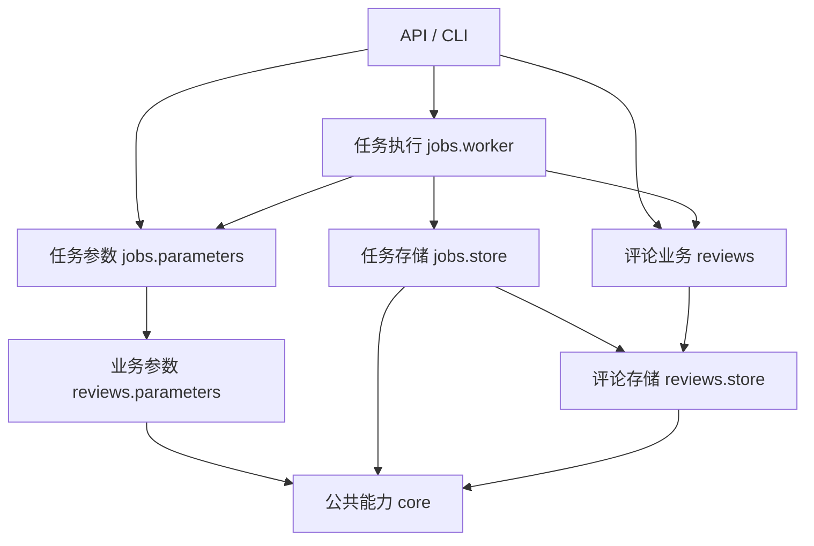

# 依赖与公开接口

新增代码从所属业务模块的公开接口调用功能。原有根目录模块仍转发到新实现，命令名称与运行入口继续可用；此前跨模块使用的私有函数已改名，直接调用这些私有名称的脚本应按下表迁移。



`core` 只依赖自身与第三方库；`reviews` 和 `jobs` 不导入 `api`。任务库初始化会通过评论存储的公开接口验证所绑定的业务库，因此保留 `jobs.store → reviews.store` 的业务依赖。

## 打开与关闭数据库

| 接口 | 职责 | 调用方责任 |
| --- | --- | --- |
| `core.database.connect_database` | 创建 SQLite/PostgreSQL 连接，统一行格式、只读设置和 SQLite 外键；不自动创建 SQLite 文件 | 显式初始化或校验结构，管理事务并关闭连接 |
| `reviews.store.connect_review_database` | 打开现有评论库并校验应用标识、版本；校验失败时关闭连接 | 管理事务并关闭成功返回的连接 |
| `jobs.store.connect_task_database` | 打开现有任务库并校验版本；保留 SQLite 10 秒等待时间和 PostgreSQL 任务锁命名空间 | 管理事务并关闭成功返回的连接 |
| `jobs.store.check_task_database` | 校验任务库绑定的业务库身份 | 提供正确的业务库目标 |

普通业务调用使用经过校验的评论库或任务库接口。显式初始化、迁移目标和 worker 会话锁使用底层连接工厂。初始化仍由原有 `init_*` 函数执行；没有引入自动迁移或连接池。

下面的示例只在临时目录创建模拟库，可以在安装项目后直接执行：

```python
from contextlib import closing
from pathlib import Path
from tempfile import TemporaryDirectory

from data_analysis_agent.reviews.store import connect_review_database, init_database

with TemporaryDirectory() as directory:
    database = Path(directory) / "reviews.sqlite3"
    init_database(database)
    with closing(connect_review_database(database, readonly=True)) as connection:
        print(connection.execute("SELECT COUNT(*) FROM reviews").fetchone()[0])
```

写入时使用 `with closing(connect_review_database(database)) as connection, connection:`，在块内完成事务。连接上下文只负责提交或回滚，`closing` 负责关闭。已有连接上的 `check_*_schema`、`read_analysis_run` 和 `attach_alert_occurrence` 不另开连接、不提交调用方事务，监控快照和告警写入继续保持原子性。

库不存在或版本不支持时，业务接口抛出 `core.errors.ReviewDataError`；旧的 `reviews.loader.ReviewDataError` 仍是同一异常类。SQLite 驱动错误和已脱敏的 PostgreSQL 错误继续由 `DATABASE_ERRORS` 覆盖。

## 区分任务载荷与 HTTP 请求

| 模块 | 放什么 | 不放什么 |
| --- | --- | --- |
| `core.validation` | 禁止额外字段的模型基类、通用文本/整数校验 | 路由、任务类型、数据库操作 |
| `reviews.parameters` | 商品/日期范围、模型身份、基线、监控规则、月份校验 | HTTP 分页、请求封装、任务执行 |
| `jobs.parameters` | 导入、标注、分析、回放的参数模型与类型映射 | HTTP Query/Body、路由、请求对象 |
| `api.schemas` | 分页/筛选查询、人工复核请求、`kind + parameters` 请求封装 | 任务执行实现 |

HTTP 请求封装引用任务参数模型。worker 入队准备和读取持久化参数时也使用同一任务契约，避免两份字段定义逐渐偏离。服务端导入目录约束、标注模型身份冻结与重试检查仍在任务执行层。

```python
from data_analysis_agent.jobs.parameters import ImportParameters

parameters = ImportParameters(reviews_path="sample.jsonl", max_reviews=100)
print(parameters.model_dump())  # 只校验参数，不读取文件或提交任务
```

任务载荷不接受 `page`、`page_size`、`kind` 等 HTTP 字段；`model_identity` 由服务端为标注任务补充，不接受客户端填写。非法范围、未知字段及原有严格整数约束继续生效。旧的 `api.schemas.ImportParameters` 等导入保留为重导出，内部任务代码直接引用 `jobs.parameters`。

## 放置共享观点模型与业务路由

| 模块 | 职责 | 新代码如何使用 |
| --- | --- | --- |
| `reviews.opinions` | 六个观点维度、情感类型、`Opinion` / `Extraction` 模型及逐字原文定位 | 统计、人工复核、HTTP 参数模型直接导入此模块 |
| `reviews.labeling` | 提示词与版本、SDK 调用、并发批量标注与失败处理 | 只有需要执行模型标注的调用方依赖它 |
| `api.routes.reviews` | 商品、评论、标注查询和人工复核 | 添加这些业务对应的 HTTP 端点 |
| `api.routes.analytics` | 趋势、问题、商品对比、统计证据 | 调用已有只读统计接口 |
| `api.routes.monitoring` | 分析记录与告警查询、告警处理 | 调用监控存储接口 |
| `api.routes.tasks` | 任务提交、状态查询、幂等与重试 | 复用任务参数、队列和任务执行层校验 |
| `api.app` / `api.responses` | 应用组装、生命周期、统一安全与异常处理 / 成功和错误响应 | 路由依赖响应模块，不反向导入应用工厂 |
| `cli.sales` / `cli.workbench` | 销售分析与原生工作台的命令行解析 | 使用原有命令名称，也可直接执行这些新模块 |

共享观点模块仅依赖 Pydantic 和严格 JSON 解析，不加载模型 SDK、配置或数据库。人工复核与模型输出使用同一原文校验；重复观点去重、Unicode 字符位置、未知情感和六维度约束继续使用原口径。

```python
from data_analysis_agent.reviews.opinions import validate_opinions

result = validate_opinions(
    '{"opinions":[{"aspect":"packaging","sentiment":"negative","quote":"包装破了"}]}',
    "🙂包装破了。",
)
assert result[0]["quote_start"] == 1
assert result[0]["quote_end"] == 5
```

`reviews.labeling` 和旧的 `review_labeler` 仍重导出 `Opinion`、`Extraction`、`ASPECTS`、`OpinionValidationError` 与 `validate_opinions`，旧调用方继续得到相同对象。拆分没有改变观点 JSON Schema 或 `PROMPT_VERSION`，因此不会仅因这次重构改变增量标注身份。

每个路由模块提供 `create_router(...)`，显式接收本应用的数据库和任务配置；不用全局变量保存这些配置。应用工厂统一挂载 `/api/v1` 前缀、错误响应和请求策略，23 个端点的路径、方法、状态码和标签保持一致。健康检查保留在 `api.app`；其余 22 个业务端点归属四个路由模块。

旧的 `sales.workflow.main()`、`api.workbench.main()` 和根目录入口继续转发到 `cli`；参数解析只有一份实现。按文件运行和 `python -m` 的既有规则保持兼容，工作台静态资源仍由 `api.workbench` 提供。

## 使用公开接口

以下名称均相对 `data_analysis_agent` 包：

| 原调用 | 新接口 | 职责 |
| --- | --- | --- |
| `reviews.store._connect` | `reviews.store.connect_review_database` | 打开并校验评论库 |
| `jobs.store._connect` | `jobs.store.connect_task_database` | 打开并校验任务库 |
| `reviews.store._check_schema` / `jobs.store._check` | `check_review_schema` / `check_task_schema`，仍在各自模块 | 验证已有连接的库版本 |
| `label_store._check_labels` | `reviews.label_store.check_labeling_schema` | 验证标注表 |
| `human_review._check_workbench` | `reviews.human_review.check_workbench_schema` | 验证人工复核表 |
| `monitor_store._check_monitor` | `reviews.monitor_store.check_monitoring_schema` | 验证监控表 |
| `monitor_store._read_run` | `reviews.monitor_store.read_analysis_run` | 在已有快照中读取运行记录 |
| `monitor_store._attach_alert` | `reviews.monitor_store.attach_alert_occurrence` | 在调用方事务内写入告警命中 |
| `analytics._scope` / `scope._day` | `reviews.scope.analysis_scope` / `parse_day` | 统一统计范围与日期校验 |
| `monitoring._rules` / `_month` / `_shift_month` | `reviews.parameters.validate_rules` / `parse_month` / `shift_month` | 规则与月份校验 |
| JSON 私有解析钩子 | `core.serialization.strict_json_loads` | 拒绝重复键和 NaN/Infinity 常量 |
| `monitor_store._json` / `_digest` | `core.serialization.canonical_json` / `content_sha256` | 稳定序列化与内容摘要 |
| `monitor_store._integer` / `_text` | `core.validation.validate_integer` / `validate_text` | 通用数值与文本校验 |
| `reviews.store._now` | `core.clock.utc_now` | 统一毫秒精度 UTC 时间戳 |
| worker 读取 `connection._lock_key()` 并拼锁 SQL | `PostgresConnection.try_session_lock()` | 尝试获取当前命名空间会话锁，关闭连接释放 |

仅在模块内部使用的辅助函数继续保持私有；没有为了改名把全部内部实现公开。

## 验证依赖边界

在项目根目录执行：

```powershell
.\.venv\Scripts\python.exe -m unittest discover -s tests -p test_dependency_boundaries.py -v
.\.venv\Scripts\python.exe -m unittest discover -s tests -v
```

新增测试检查跨模块私有导入、连接创建位置、底层依赖方向，以及在阻止导入 HTTP 层时加载 worker。行为测试覆盖缺失数据库不被创建、只读保护、外键与等待时间、结构校验失败后的连接关闭、任务参数往返与拒绝非法输入。现有监控回滚测试改为在公开告警写入接口注入失败，继续验证分析与告警一起回滚。

职责拆分测试进一步覆盖：阻止导入模型 SDK 时使用观点/统计/人工复核模块、旧观点导入对象与提示词版本兼容、四个路由组的读写接口、多应用的数据库/队列/导入目录隔离，以及新旧销售命令的实际输出一致性。路由失败仍按统一策略返回错误，保留参数校验、来源限制、幂等键和任务 `Location` 响应头。

本次验收另对比了重构前后的 OpenAPI 描述，结果一致。PostgreSQL 集成测试通过独立临时实例运行；前端端到端测试继续使用模拟数据，检查实际 API 与 worker 的完整流程。
