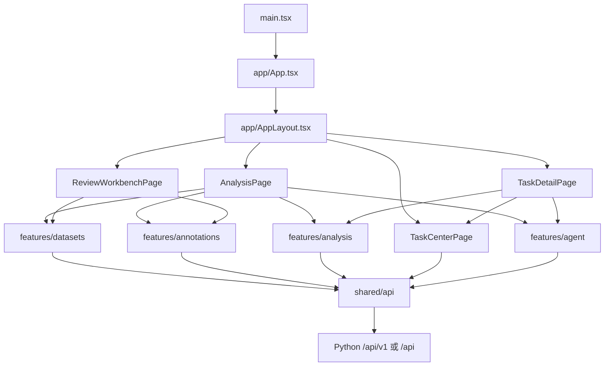

# 观数前端重构计划

## 1. 目标与边界

本计划以当前 `frontend/src` React 工作台和 `frontend/workbench` 人工复核页面为基线，目标是逐步形成按业务功能划分的前端架构：

- `datasets`：数据集、商品目录、导入文件和数据预览。
- `annotations`：评论标注、标注进度、标注版本和人工复核衔接。
- `analysis`：分析范围、日期基线、固定统计和结果快照。
- `tasks`：任务创建、任务进度、历史任务、重试和删除。
- `agent`：在当前分析上下文中提交只读问答并展示证据。
- `shared`：统一布局、UI、Hooks、API 基础层、格式化函数、类型和样式。

重构保持以下外部契约不变：

- Python 后端 API 路径、HTTP 方法、响应包络、错误结构和 CORS/Host 约束。
- `import`、`label`、`analysis`、`replay` 任务的创建、查询、幂等、重试和删除语义。
- 结构化分析的计算、冻结快照、基线比较、规则判断和证据引用。
- 评论标注的模型版本、成功/失败/待处理状态和进度字段。
- 原始评论正文、引用位置、文件哈希/行号和 JSON 导出能力。
- 现有用户路径：导入数据 → 准备数据 → 分析 → 查看结果 → Agent 问答。

本文件描述目标架构和迁移顺序；各次实施以第 10 节的阶段边界为准。阶段 0 只建立基线，后续阶段按顺序独立验收，不修改 Python API、业务数据库或模型配置。

## 2. 当前基线

当前 React 入口是 `frontend/src/main.tsx`，主编排集中在约 561 行的 `frontend/src/App.tsx`。页面没有 URL 路由，使用 `localStorage` 保存当前任务、分析草稿和备注；任务进度由 `useTask` 手写轮询。

当前主要依赖为 React、TypeScript、Vite、Ant Design、ECharts、dayjs、Vitest、Testing Library 和 Playwright。第一阶段优先继续使用这些依赖，不预先引入新的状态框架或 UI 框架。

当前 React 页面和独立人工复核页面使用两套接口：

| 页面 | 前端技术 | 服务 | 接口形态 | 主要职责 |
| --- | --- | --- | --- | --- |
| React 工作台 | React + TypeScript + Vite | `api.app` | `/api/v1`，统一 `{status,result}` 包络 | 导入、标注、固定分析、Agent、任务历史 |
| 人工复核工作台 | 原生 HTML/CSS/JavaScript | `api.workbench` | `/api`，直接返回业务 JSON，并使用 CSRF token | 评论筛选、原文定位、人工确认和纠错 |

这两套页面暂时都要保留。迁移人工复核前先统一领域类型和接口说明，避免把两个响应协议混为一谈。

## 3. 目标架构

### 3.1 目标目录树

```text
frontend/src/
├─ app/
│  ├─ App.tsx                 # 根组件，只负责 Providers 和路由出口
│  ├─ AppLayout.tsx           # 导航区、顶部状态区、内容区
│  ├─ router.ts               # 轻量路径解析和 history 适配
│  └─ providers.tsx           # Ant Design、错误边界和应用级上下文
├─ pages/
│  ├─ AnalysisPage/
│  │  ├─ AnalysisPage.tsx
│  │  └─ index.ts
│  ├─ TaskCenterPage/
│  │  ├─ TaskCenterPage.tsx
│  │  └─ index.ts
│  ├─ TaskDetailPage/
│  │  ├─ TaskDetailPage.tsx
│  │  └─ index.ts
│  └─ ReviewWorkbenchPage/
│     ├─ ReviewWorkbenchPage.tsx
│     └─ index.ts
├─ features/
│  ├─ datasets/
│  │  ├─ components/
│  │  │  ├─ DatasetSelector.tsx
│  │  │  ├─ ProductSelector.tsx
│  │  │  ├─ ImportDialog.tsx
│  │  │  ├─ ImportProgress.tsx
│  │  │  └─ DataPreviewDrawer.tsx
│  │  ├─ hooks/
│  │  │  ├─ useDatasetOptions.ts
│  │  │  └─ useImportTask.ts
│  │  ├─ model/
│  │  │  └─ dataset-draft.ts
│  │  └─ index.ts
│  ├─ annotations/
│  │  ├─ components/
│  │  │  ├─ AnnotationForm.tsx
│  │  │  ├─ AnnotationProgress.tsx
│  │  │  └─ AnnotationVersionSelect.tsx
│  │  ├─ hooks/
│  │  │  └─ useAnnotationTask.ts
│  │  ├─ model/
│  │  │  └─ annotation-scope.ts
│  │  └─ index.ts
│  ├─ analysis/
│  │  ├─ components/
│  │  │  ├─ AnalysisScopeForm.tsx
│  │  │  ├─ AnalysisActions.tsx
│  │  │  └─ AnalysisContextSummary.tsx
│  │  ├─ hooks/
│  │  │  └─ useAnalysisDraft.ts
│  │  ├─ model/
│  │  │  ├─ analysis-draft.ts
│  │  │  └─ analysis-view-model.ts
│  │  └─ index.ts
│  ├─ tasks/
│  │  ├─ components/
│  │  │  ├─ TaskCenterDrawer.tsx
│  │  │  ├─ TaskList.tsx
│  │  │  ├─ TaskProgressCard.tsx
│  │  │  └─ TaskActions.tsx
│  │  ├─ hooks/
│  │  │  ├─ useTask.ts
│  │  │  ├─ useTaskHistory.ts
│  │  │  └─ useTaskMutations.ts
│  │  ├─ model/
│  │  │  ├─ task-types.ts
│  │  │  └─ task-state.ts
│  │  └─ index.ts
│  └─ agent/
│     ├─ components/
│     │  ├─ AgentQuestionDialog.tsx
│     │  ├─ AgentSummary.tsx
│     │  ├─ AgentToolResultCard.tsx
│     │  └─ AgentEvidenceList.tsx
│     ├─ hooks/
│     │  └─ useAgentTask.ts
│     ├─ model/
│     │  └─ agent-report.ts
│     └─ index.ts
├─ entities/
│  ├─ dataset/
│  ├─ product/
│  ├─ review/
│  ├─ annotation/
│  ├─ analysis-run/
│  └─ task/
├─ shared/
│  ├─ api/
│  │  ├─ http-client.ts
│  │  ├─ catalog-api.ts
│  │  ├─ dataset-api.ts
│  │  ├─ review-api.ts
│  │  ├─ task-api.ts
│  │  ├─ analysis-api.ts
│  │  └─ workbench-api.ts
│  ├─ hooks/
│  │  ├─ useInterval.ts
│  │  ├─ useAbortableRequest.ts
│  │  └─ useLocalStorage.ts
│  ├─ ui/
│  │  ├─ AppShell.tsx
│  │  ├─ PageHeader.tsx
│  │  ├─ StatusBadge.tsx
│  │  ├─ MetricCard.tsx
│  │  ├─ DataTable.tsx
│  │  ├─ EvidenceDrawer.tsx
│  │  └─ JsonExportButton.tsx
│  ├─ formatters/
│  │  ├─ date.ts
│  │  ├─ number.ts
│  │  ├─ rate.ts
│  │  └─ task.ts
│  ├─ types/
│  │  ├─ api.ts
│  │  ├─ task.ts
│  │  ├─ review.ts
│  │  └─ analysis.ts
│  └─ styles/
│     ├─ tokens.css
│     ├─ globals.css
│     └─ layout.css
└─ main.tsx
```

目录迁移不要求一次完成。每个业务目录先容纳原文件，再逐步拆出 `components`、`hooks` 和 `model`，避免为了目录形式进行无行为价值的重写。

### 3.2 页面依赖关系



业务模块只依赖 `entities`、`shared` 和自己的内部文件；`shared` 不反向依赖业务模块。页面只负责编排 feature，不直接拼接后端参数或解释任务结果。

## 4. 页面路由表

第一阶段不强制增加路由框架。使用 `window.history.pushState`、`popstate` 和一个小型 `router.ts` 即可满足当前页面数量；当路由需要嵌套路由、权限守卫或数据加载器时，再评估引入 React Router。路由变化应可被 URL 表达，不再只依赖 localStorage。

| 路径 | 页面 | 入口 | 关键状态 | 兼容行为 |
| --- | --- | --- | --- | --- |
| `/analysis/new` | 分析工作台 | 顶部“新建分析” | 数据集、商品、当前窗口、基线、标注版本、备注 | 读取旧 localStorage 草稿作为初始值 |
| `/analysis/new?mode=agent` | Agent 问答 | 分析工作台“Agent 问答” | 当前分析范围和问题文本 | 不改变分析范围，只创建 Agent 分析任务 |
| `/tasks` | 任务中心 | 顶部“任务记录” | 分页、任务类型、状态、当前任务 | 保留现有分页和历史任务查询 |
| `/tasks/:taskId` | 任务详情 | 任务中心、提交后自动跳转 | 任务状态、进度、结果、错误、重试 | 刷新后直接恢复任务 |
| `/tasks/:taskId?tab=result` | 分析结果 | 固定分析任务完成后 | 摘要、趋势、商品对比、问题、证据 | 继续使用 `/analysis-runs/{id}` |
| `/tasks/:taskId?tab=agent` | Agent 结果 | Agent 任务完成后 | 回答、工具结果、证据、校验和轨迹 | 继续从任务结果恢复，不重复模型调用 |
| `/reviews` | 人工复核 | 导航区“人工复核” | 商品、日期、维度、情感、状态、人工记录 | 迁移完成前可跳转现有独立工作台 |

路由迁移期间保留 `/`：访问 `/` 时重定向到 `/analysis/new`，并根据旧 localStorage 的 `selected` 值跳转到对应 `/tasks/:taskId`。

## 5. 组件迁移映射

| 当前文件/职责 | 目标位置 | 迁移方式 | 保留的行为 |
| --- | --- | --- | --- |
| `App.tsx` 页面壳和所有流程 | `app/App.tsx`、`app/AppLayout.tsx`、各页面 | 先抽布局，再按任务类型拆页面 | 顶部状态、任务记录、错误提示 |
| `Composer.tsx` | `features/analysis/components/AnalysisScopeForm.tsx`、`features/agent/components/AgentQuestionDialog.tsx` | 将 Agent Modal 从分析表单分离 | 数据集、商品、日期、基线校验 |
| `LabelForm.tsx` | `features/annotations/components/AnnotationForm.tsx` | 保留 Ant Form，参数转换移入 annotation model | 标注数量、并发、失败重试 |
| `ImportProgress.tsx` | `features/datasets/components/ImportProgress.tsx` | 视觉组件与上传状态模型分离 | 上传确认、字节进度、入库阶段 |
| `DataPreview.tsx` | `features/datasets/components/DataPreviewDrawer.tsx` | API 调用移至 `useDatasetPreview` | 商品选择、分页、原文详情 |
| `ResultCards.tsx` | `features/analysis/components/AnalysisSnapshot.tsx` | 拆成摘要、趋势、对比、问题、证据卡片 | 现有分析快照和 JSON 导出 |
| `AgentResults.tsx` | `features/agent/components/AgentResultView.tsx` | 共享指标表、证据卡和样本状态 | 工具结果引用、校验、Agent JSON 导出 |
| `useTask.ts` | `features/tasks/hooks/useTask.ts` | 保留 AbortController 和轮询间隔 | 活跃任务轮询、网络失败重连 |
| `task-state.ts` | `features/tasks/model/task-state.ts` | 任务状态机集中管理 | 状态标签、阶段标签、重试条件 |
| `analysis-draft.ts` | `features/analysis/model/analysis-draft.ts` | 只保留范围和日期推导 | UTC 日期和基线不重叠校验 |
| `agent-report.ts` | `features/agent/model/agent-report.ts` | 与共享指标格式化函数配合 | 空分母、样本有限和证据说明 |
| `api.ts` | `shared/api/*` | 按资源拆分，底层请求仍统一 | 30 秒请求超时、错误包络、上传字节进度 |
| `local-history.ts` | `shared/hooks/useLocalStorage.ts`、`shared/ui/JsonExportButton.tsx` | 按职责拆分 | 旧 key 兼容、浏览器 JSON 下载 |
| `styles.css` | `shared/styles/*` 和 feature 局部样式 | 先提取 Token，再按布局/功能拆分 | 现有桌面、平板和窄屏断点 |
| `frontend/workbench/*` | `pages/ReviewWorkbenchPage` 或独立 legacy 目录 | 先共享模型和 API 说明，后迁移 UI | 人工确认、纠错、冲突检测和 CSRF |

固定分析结果统一使用以下分组结构：

1. 摘要与指标。
2. 评论趋势：图表和数据表切换。
3. 商品对比：成功标注、覆盖率、负面占比和数据状态。
4. 负面问题：维度、负面数、当前占比、基线变化和规则判断。
5. 原文证据：正文、商品、日期、引用和详情抽屉。

Agent 结果复用同样的摘要、指标、表格和证据组件，但保留 Agent 的工具结果 ID、调用轨迹、校验状态和问题上下文。

## 6. 状态管理边界

### 6.1 应用级状态

只保留真正跨页面共享的状态：

- API 基址和后端健康状态。
- 当前用户界面主题配置（当前仍使用固定 Ant Design 中文主题）。
- 当前路由。
- 当前选中的任务 ID。

这些状态放在 `app/providers.tsx` 或路由层，不放回单个页面组件。

### 6.2 服务端状态

由资源 API 和 feature Hooks 管理：

- `options`、`quality`、`health`
- 任务历史分页
- 单任务详情
- 分析运行快照
- 评论预览和评论详情
- 导入、标注、分析、重试、删除 mutation

第一阶段继续使用现有 `fetch`、`useReducer`、AbortController 和小型 Hooks，不强制引入 TanStack Query。应先统一 query key、请求取消、失效和轮询策略。若后续增加告警、任务筛选、多页面并发请求后，手写缓存产生重复问题，再单独评估 TanStack Query。

### 6.3 URL 状态

以下状态必须能通过 URL 恢复：

- 当前任务 ID
- 任务结果 Tab
- 任务中心分页和筛选
- 人工复核筛选条件
- Agent 模式

URL 状态优先于 localStorage，localStorage 只负责恢复未提交分析草稿和本机备注。

### 6.4 Feature 局部状态

以下状态保留在业务 feature 内：

- 导入文件对象、上传进度和上传阶段
- 标注表单展开状态
- 分析高级设置展开状态
- Agent 问题输入框
- 数据预览抽屉的商品和页码
- 详情 Drawer、删除 Modal 和确认状态

局部状态不能直接修改任务历史或全局 draft；通过明确的回调或 mutation 触发刷新。

### 6.5 数据一致性规则

- 任务提交后以服务端返回的 `task_id` 为准。
- 任务历史只保存后端任务摘要，备注继续保持浏览器本地。
- `analysis` 任务必须区分固定分析结果和 Agent 结果。
- `run_id` 只用于固定分析快照；Agent 结果直接来自任务结果。
- 删除导入数据后必须同时刷新 options、quality、任务详情和任务历史。
- 切换任务时取消旧请求，迟到响应不能覆盖新任务。

## 7. API 分层方案

### 7.1 HTTP 基础层

`shared/api/http-client.ts` 只负责：

- 拼接 `VITE_API_BASE_URL`。
- 添加 `Accept`、JSON Content-Type 和 `Idempotency-Key`。
- 30 秒请求超时和 AbortSignal 合并。
- 解析 `{status:"ok", result}`。
- 将 `{status:"error", error}` 转为统一 `ApiError`。
- 处理非 JSON、网络失败和 HTTP 错误。

上传继续使用 XMLHttpRequest，以保留浏览器真实字节进度；上传服务应补充取消入口和卸载时的清理。

### 7.2 资源 API 层

| 模块 | 负责接口 | 调用方 |
| --- | --- | --- |
| `catalog-api.ts` | `/options`、`/quality`、`/products` | datasets、analysis、annotations |
| `dataset-api.ts` | `/import-files`、`/reviews`、`/reviews/{id}` | datasets |
| `task-api.ts` | `/tasks`、`/tasks/{id}`、`retry`、删除接口 | tasks、datasets、annotations、analysis、agent |
| `analysis-api.ts` | `/analysis-runs/{id}`、必要时 `/analytics/*` | analysis、results |
| `review-api.ts` | `/reviews`、人工复核相关接口 | annotations、ReviewWorkbench |
| `workbench-api.ts` | 独立 `/api` 服务的原始响应和 CSRF | 迁移前的人工复核页面 |

feature 不直接调用 `fetch`，也不拼接 URL。所有后端字段解释和参数转换放在 API 层或 feature model 层。

### 7.3 类型层

将当前 `types.ts` 拆为资源类型，并把任务结果改为判别联合：

```ts
type TaskInput =
  | { kind: 'import'; parameters: ImportParameters }
  | { kind: 'label'; parameters: LabelParameters }
  | { kind: 'analysis'; parameters: AnalysisParameters }
  | { kind: 'replay'; parameters: ReplayParameters };

type AnalysisTaskResult =
  | { kind: 'structured'; run_id: string }
  | { kind: 'agent'; agent: true; results: Record<string, AgentToolResult> };
```

迁移过程中先通过适配器兼容旧任务 JSON，确认历史任务可恢复后，再收紧字段类型。后端 API 类型以实际 Pydantic/OpenAPI 契约为准，不在前端复制业务计算规则。

## 8. AppLayout 与页面设计

### 8.1 AppLayout

统一布局包含三层：

1. **导航区**：品牌、分析工作台、任务中心、人工复核入口。
2. **顶部状态区**：API/Worker 健康、刷新、当前任务入口和任务数量。
3. **内容区**：页面标题、范围摘要、业务内容、错误和加载状态。

布局组件只管理视觉结构和导航，不负责提交任务、解释结果或读取后端字段。

### 8.2 分析工作台

页面顺序固定为：

1. 当前数据集和商品选择。
2. 当前分析时间与基线时间。
3. 标注版本和可选备注。
4. 数据预览、准备数据、Agent 问答、开始分析。
5. 导入数据作为独立流程入口。

页面应保持当前“没有可用成功标注时先准备数据”的引导逻辑。

### 8.3 任务中心

任务中心替代当前 Drawer 中的历史任务实现，统一提供：

- 分页和任务类型。
- 任务状态、创建时间、当前阶段和进度。
- 当前查看任务标记。
- 打开任务详情。
- 失败/部分完成任务重试。
- 已完成任务删除。

任务中心不直接展示完整结果；完整结果由 `TaskDetailPage` 按任务类型渲染。

## 9. Design Tokens

优先复用现有 Ant Design Token，并将当前散落在 `main.tsx` 和 `styles.css` 中的值集中到 `shared/styles/tokens.css`。

```css
:root {
  --color-primary: #127568;
  --color-primary-hover: #0f655b;
  --color-text: #243331;
  --color-text-secondary: #76827e;
  --color-border: #dce5e1;
  --color-surface: #ffffff;
  --color-background: #f5f7f6;
  --color-success: #378773;
  --color-warning: #a87e36;
  --color-danger: #b55c50;
  --radius-sm: 6px;
  --radius-md: 10px;
  --radius-lg: 16px;
  --space-1: 4px;
  --space-2: 8px;
  --space-3: 12px;
  --space-4: 16px;
  --space-5: 20px;
  --space-6: 24px;
  --space-8: 32px;
  --content-max-width: 1200px;
}
```

Token 使用规则：

- 颜色、边框、圆角、间距和断点不在业务 JSX 中重复写字面量。
- Ant Design `ConfigProvider` 与 CSS Token 使用同一组语义值。
- 图表颜色使用 `--color-primary`、`--color-warning` 等语义 Token。
- 表格、证据卡、指标卡和任务状态统一使用 shared UI。
- 现有 600、760、1000 像素断点先保留；迁移后再根据实际截图和 E2E 结果调整。

## 10. 分阶段迁移计划

### 阶段 0：基线冻结与回归清单

**目标**：建立重构前行为基线，代码不变。

**文件范围**：

- 只读检查 `frontend/src`、`frontend/workbench`、`frontend/tests`。
- 新增计划文档和迁移记录，不修改业务代码。

**验收标准**：

- 记录当前 API 请求和响应类型。
- 记录导入、标注、固定分析、Agent、重试、删除、导出和刷新恢复路径。
- 记录现有 aria-label、按钮名称和 E2E 关键选择器。
- 确认 Git 工作区没有既有改动被迁移覆盖。

**风险**：基线遗漏会导致后续把现有行为误认为重构缺陷。

**回滚方式**：不产生业务代码变更；删除本阶段新增文档即可回到原状态。

### 阶段 1A：抽取 AppLayout 与布局样式

**目标**：基于阶段 0 的验收记录，先独立抽取页面壳；保持现有 `/`、交互和业务行为。

**文件范围**：`App.tsx`、`main.tsx`、`styles.css`、新增 `app/AppLayout.tsx` 和 `shared/styles/{tokens,globals,layout}.css`；维护现有 E2E 及布局采集辅助文件。

**主要动作**：

- AppLayout 负责品牌、顶部状态、工作台操作、范围摘要和内容容器；只接收展示状态与回调。
- App 继续负责请求、任务编排、错误提示和所有 Drawer/Modal 的开关。
- Ant Design 与布局样式共用 CSS Token；保留现有绿色视觉和响应式断点。
- 修复基线已确认的导入 Modal 关闭同步问题；隔离验收显式使用 local 标注模式。
- 使用现有真实隔离 API/Worker 验证原流程，采集 1440、1024、768、390 px 截图。

**验收标准**：既有单元测试、构建和 E2E 通过；导航、刷新、历史任务、导入、标注、分析和 Agent 操作保持；无新增页面溢出、文字裁切或对话框越界。

**范围限制**：本阶段不迁移 API、路由、任务中心或人工复核页面；不为单一布局再增加 AppShell 包装层。

**风险与回滚**：保持 Portal 挂载位置和所有选择器；如有回归，仅撤回本阶段 AppLayout 接入、样式拆分和入口引用，不撤回既有文件或后端。

**完成记录**：见 [阶段 1A 验收记录](frontend-refactor-phase1a.md)。完成后停止，阶段 1B 另行推进。

### 阶段 1B：抽取 API 基础层

**目标**：不改变页面路径和业务行为，拆分 HTTP 基础层和资源 API。

**文件范围**：

- `frontend/src/api.ts` 及对应测试
- 新建 `frontend/src/shared/api/*`

**主要动作**：

- 将 `api.ts` 拆为基础 HTTP 层和资源 API 层。
- 保留现有 `/` 入口，用适配层承接旧组件。
- 保留现有 API 地址、超时、错误消息和幂等键。

**验收标准**：

- 现有单元测试全部通过。
- 任务历史、刷新、健康状态和错误提示行为不变。
- 1366、1024、768、390 像素布局无新增横向溢出。
- API 请求 URL 和请求体与基线一致。

**风险**：拆分可能影响超时、请求取消、上传字节进度或错误解析。

**回滚方式**：通过原 `api.ts` 导出保持调用兼容；若验收失败，只撤回 API 分层，不回退已完成的布局或后端。

### 阶段 2：迁移 datasets 和 annotations

**目标**：把导入和标注变成两个独立业务 feature。

**文件范围**：

- `Composer.tsx` 中的数据集/商品选择部分
- `LabelForm.tsx`
- `ImportProgress.tsx`
- `DataPreview.tsx`
- `analysis-draft.ts` 中的数据集和商品推导部分
- 新建 `features/datasets/*`
- 新建 `features/annotations/*`

**主要动作**：

- `ImportDialog` 管理文件选择、上传和导入任务提交。
- `DataPreviewDrawer` 管理评论分页和原文详情。
- `AnnotationForm` 只负责标注参数，不负责任务历史或页面布局。
- 共享 `DatasetSelector`、`ProductSelector` 和 `AnnotationVersionSelect`。

**验收标准**：

- CSV、JSONL、JSONL.GZ 文件选择和 512 MiB 校验保持一致。
- 上传完成但服务端未确认时仍显示等待确认。
- 导入进度仍区分上传、读取、校验、入库和部分完成。
- 标注批量、并发、失败重试和刷新恢复保持一致。
- 数据预览的商品、分页、字段详情和原文导出保持一致。

**风险**：Form 状态和 draft 状态重复，拆分时可能丢失用户输入。

**回滚方式**：保留旧组件导出；通过 feature flag 或页面适配器切回旧 Import/Label 组件。

### 阶段 3：迁移 analysis 和 results

**目标**：形成分析工作台和固定分析结果的分组结构。

**文件范围**：

- `Composer.tsx`
- `ResultCards.tsx`
- `Chart.tsx`
- `analysis-draft.ts`
- 新建 `features/analysis/*`
- 新建 `entities/analysis-run/*`
- 新建 shared 指标、表格和证据组件

**主要动作**：

- 将分析表单拆成范围、日期、版本和操作区。
- 将结果拆成摘要、趋势、商品对比、负面问题和原文证据。
- 统一 `rate`、覆盖率、成功标注分母、空分母和样本有限展示。
- 保留 ECharts 懒加载和当前图表数据结构。

**验收标准**：

- 固定分析仍只创建一个 analysis task。
- `run_id` 恢复后结果与后端快照逐项一致。
- 结果包含当前窗口、基线、商品、问题、证据和规则状态。
- “—”仍代表分母为空，不显示为 `0%`。
- JSON 下载内容与当前分析快照一致。

**风险**：结果拆分可能丢失历史字段或误把 Agent 结果当作结构化快照。

**回滚方式**：保留原 `ResultCards`，新结果容器通过任务详情页开关切换。

### 阶段 4：迁移 tasks 和路由

**目标**：建立任务中心、任务详情页和可恢复 URL。

**文件范围**：

- `useTask.ts`
- `task-state.ts`
- `local-history.ts`
- `App.tsx` 中的任务历史、删除和重试逻辑
- 新建 `features/tasks/*`
- 新建 `pages/TaskCenterPage/*`
- 新建 `pages/TaskDetailPage/*`
- 新建 `app/router.ts`

**主要动作**：

- 将任务历史从 Drawer 内联 JSX 提取为任务中心。
- 将任务进度、任务操作和任务列表拆分。
- 使用 URL 保存任务 ID和结果 Tab。
- 兼容旧 localStorage 的 `selected` 和 `notes`。
- 保留当前任务轮询间隔、网络失败重连和迟到响应隔离。

**验收标准**：

- 直接打开 `/tasks/:taskId` 可以恢复任务。
- 刷新、重试、删除任务记录、删除导入数据均保持原行为。
- 历史任务分页和当前查看标记保持一致。
- 任务类型、状态、阶段和错误码展示不丢失。

**风险**：URL 路由和旧 localStorage 的优先级处理不当会改变刷新恢复行为。

**回滚方式**：保留 `/` 旧入口和旧 `selected` 恢复逻辑；路由解析失败时回退到分析工作台。

### 阶段 5：迁移 agent

**目标**：让 Agent 明确依赖当前分析上下文，并与固定结果复用同一套指标和证据组件。

**文件范围**：

- `AgentResults.tsx`
- `agent-report.ts`
- `Composer.tsx` 中的 Agent Modal
- `useTask.ts` 中 Agent 结果判断
- 新建 `features/agent/*`

**主要动作**：

- Agent 问题提交从分析范围中读取数据集、商品、日期、标注版本和截止时间。
- Agent 结果按摘要、趋势、商品对比、问题、证据和执行校验分组。
- 共享固定分析的指标表、证据详情和 JSON 导出。
- 明确 Agent 结果直接从 task.result 恢复，不读取 `run_id`。

**验收标准**：

- Agent 任务参数包含当前分析上下文。
- 刷新 Agent 结果不重复调用模型。
- 工具结果 ID、原文证据、校验状态、调用次数和 warnings 保持一致。
- “补齐当前范围标注”只打开标注表单，不自动提交任务。

**风险**：共用 analysis task 类型容易出现结构化结果和 Agent 结果判别错误。

**回滚方式**：保留 `agentResult` 旧分支；Agent 页面出现解析错误时回退到旧 `AgentResults`。

### 阶段 6：人工复核页面迁移与收口

**目标**：在验证 React 工作台稳定后，再决定是否把原生人工复核页面纳入统一 AppLayout。

**文件范围**：

- `frontend/workbench/index.html`
- `frontend/workbench/workbench.js`
- `frontend/workbench/workbench.css`
- `src/data_analysis_agent/api/workbench.py` 只允许在单独 API 兼容任务中修改；本次前端重构默认不改它
- `features/annotations` 和 `pages/ReviewWorkbenchPage`

**主要动作**：

- 先实现 `workbench-api.ts`，保持 `/api` 原始响应和 CSRF 行为。
- 迁移筛选、评论列表、详情、原文定位、人工确认、人工纠错和历史记录。
- 迁移期间保留原生页面作为回滚入口。

**验收标准**：

- 人工确认、纠错、并发冲突和历史追踪完全保持。
- 模型原始观点不会被人工记录覆盖。
- CSRF、Host、Origin 和纯文本渲染行为不弱化。
- 独立人工复核服务仍可在 React 迁移失败时使用。

**风险**：这是两套 API 协议和两套安全边界的合并，风险最高。

**回滚方式**：保留 `frontend/workbench` 和 `api.workbench` 原入口；React 入口只做链接，不删除 legacy 页面。

## 11. 总体验收标准

每个阶段都必须满足以下通用标准：

- Python API 不变，前端请求方法、路径、请求体和关键请求头不变。
- 既有前端单元测试通过。
- 适用的 Playwright 流程通过，浏览器无运行时错误。
- 任务刷新恢复、网络失败重连、迟到响应隔离和终态停止轮询保持。
- 桌面和窄屏页面没有新增横向溢出。
- 页面不显示模型密钥、数据库 URL 或上传文件的绝对本机路径。
- 固定分析和 Agent 的导出 JSON 与任务真实结果一致。
- 失败任务、部分完成任务和导入删除流程可回滚或重试。

## 12. 回滚总原则

- 每个阶段只合并一个可独立回退的前端变更组。
- 后端 API、数据库、任务表和模型配置不随前端重构修改。
- 新组件先以适配器方式接入，旧组件保留到对应阶段验收完成。
- 任务数据和历史结果始终由后端保留，浏览器 localStorage 只影响本机草稿和备注。
- 发生结果口径、任务恢复或证据引用回归时，优先切回上一阶段页面容器，不删除已生成的后端任务和分析快照。

