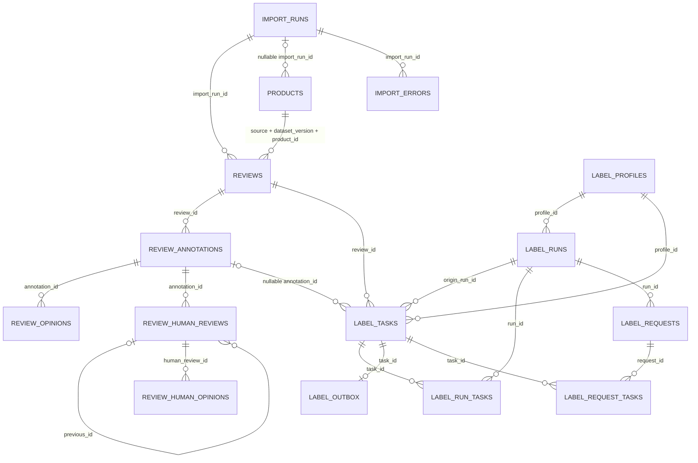
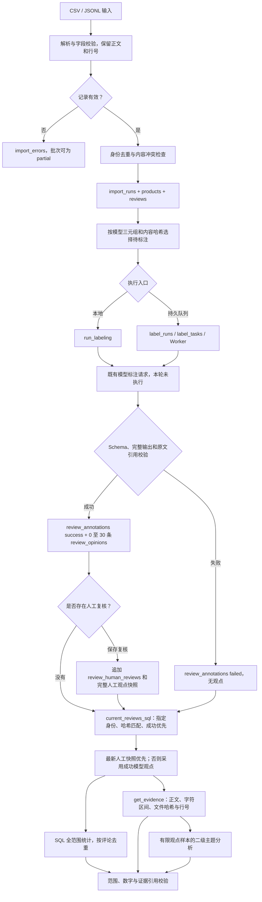

# RAG 第一阶段：现有评论数据与观点标注结构审查

审查日期：2026-11-02（Asia/Taipei）。范围：当前工作区源码及本机 PostgreSQL `reviews` 数据库。本文是 Step 1 审查报告；所有向量表、索引和同步流程均为建议，未实施。

数据库检查使用现有依赖、现有本地配置和强制只读连接，事务为 `REPEATABLE READ READ ONLY`。关键有效集检查时间为 **2026-11-02 22:54:00 +08:00**。查询输出仅包含结构、汇总、内部 ID、字符位置和匹配布尔值；真实正文仅在本机比对，未写入本报告、未发送给外部模型。各次检查使用独立快照，数量只代表检查时点。

本轮只新增本文件。未修改业务代码、数据库、标注或 Agent 流程，未执行初始化、迁移、重新标注或 Embedding 调用，未安装依赖。工作区原有未提交改动保留，并以其当前源码作为审查对象。

## 1. 项目现有数据架构

### 1.1 关键结论速查

| 需要明确的问题 | 已验证结论 | 依据 |
|---|---|---|
| 原始评论在哪里 | `public.reviews`；正文为 `text TEXT`，原始字段为 `raw_json TEXT` | E01、E06、Q2 |
| 观点如何保存 | 模型观点在独立表 `review_opinions`，通过 `annotation_id` 关联 `review_annotations`，再关联评论；不是 JSONB 数组 | E02、Q2、Q3 |
| 一条评论能否有多个观点 | 可以；一次成功标注关联 0～30 条经过应用校验的观点，可跨维度，也可同维度多观点、多情感 | E02、E03、Q6 |
| 哪些观点有效 | 指定模型身份、匹配评论内容哈希、成功优先的标注；如有人工修订则采用该标注最新的完整人工快照 | E04、E05、Q7 |
| 是否有观点 ID | 两张观点表均有整数主键，但统一有效观点 CTE 不输出这个主键；没有跨模型/人工修订稳定的业务观点 ID | E02、E04、E05、E08 |
| 人工修正是否覆盖原始模型结果 | 不物理覆盖；追加人工修订及完整观点快照，查询时整组替代。当前真实库人工记录为 0 | E04、Q5 |
| 推荐向量化什么 | 先对当前有效观点的原文 `quote` 向量化；商品、维度、情感、版本等作为过滤元数据；需要上下文时再评估受控的 C 方案 | 第 6、7 节，属于建议 |
| 如何保持一致 | 向量必须带来源观点、评论哈希、标注身份与人工修订信息，检索时回连当前有效集合；后台同步不能代替最终有效性校验 | 第 7、8 节，属于建议 |

### 1.2 核心模块与调用入口

以下路径均相对于仓库根目录，行号对应本轮所读工作区。

| 模块/实际文件 | 关键函数或对象 | 职责 |
|---|---|---|
| `src/data_analysis_agent/reviews/csv_loader.py:27` | `iter_review_csv`、`normalize_csv_review` | 流式解析 UTF-8-SIG/GB18030 CSV，映射中英文表头，保留多行正文及物理起始行号，校验 ID、时间、评分 |
| `src/data_analysis_agent/reviews/loader.py:38` | `file_sha256`、`iter_jsonl`、`normalize_review`、`normalize_product` | Amazon JSONL/压缩输入、原文件哈希、字段与时间规范化；保留正文 |
| `src/data_analysis_agent/reviews/store.py:133` | `_store_product`、`_store_review`、`_import_file`、`import_amazon_jsonl` | 创建导入批次和商品占位记录，去重、冲突拒绝、评论写入、行错误归档；批次事务及读取前后文件哈希校验 |
| 同上 `:387`、`:466` | `delete_import_runs`、`get_review_evidence` | 按导入批次物理删除依赖；从已保存正文和原始字段返回原文证据 |
| `src/data_analysis_agent/reviews/catalog.py:10` | `dataset_summaries`、`list_products` | 按 `source + dataset_version` 汇总数据集，按商品复合身份关联评论、计算覆盖率 |
| `src/data_analysis_agent/reviews/prompts.py:11` | `SYSTEM_PROMPT`、`BATCH_SYSTEM_PROMPT`、`PROMPT_VERSION` | 六维度、四种情感、逐字连续引用规则和标注提示版本 |
| `src/data_analysis_agent/reviews/opinions.py:19` | `Opinion`、`Extraction`、`BatchExtraction`、`validate_opinions`、`validate_batch_opinions` | 严格模型输出 Schema；原文定位、去重及批次评论 ID 完整性校验 |
| `src/data_analysis_agent/reviews/labeling.py:78` | `_label_review`、`_request_batch`、`_label_batch`、`run_labeling` | 单条/批量请求、截断与失败处理、拆批、增量选择、标注入库；本轮未运行这些模型请求函数 |
| `src/data_analysis_agent/reviews/label_store.py:82` | `pending_reviews`、`append_annotation_on_connection`、`labeling_status`、`query_review_opinions`、`opinion_evidence` | 按模型身份和评论哈希选择待处理记录，只追加尝试与观点，原子写入，输出当前观点或全部模型历史 |
| `src/data_analysis_agent/jobs/label_queue.py:21` | `create_run`、`seed_run`、`prepare_request`、`finish_tasks` | PostgreSQL 持久标注队列、配置身份、正文哈希、租约、请求记录、事务发件箱；最终复用标注存储函数 |
| `src/data_analysis_agent/jobs/label_worker.py:64` | `LabelWorker` | Redis 消息消费、模型请求、限额与重试协调；Redis 不是观点事实来源 |
| `src/data_analysis_agent/jobs/label_dispatch.py:11` | `run_queued_labeling` | `LABEL_EXECUTION_MODE=redis` 的任务协调入口 |
| `src/data_analysis_agent/reviews/human_review.py:201` | `review_detail`、`save_human_review` | 人工复核历史与完整快照，乐观修订检查，保留模型原始结果 |
| `src/data_analysis_agent/reviews/scope.py:22` | `review_scope`、`model_identity`、`current_reviews_sql`、`analysis_scope` | 共享数据范围、UTC 日期边界、模型身份和有效观点 CTE，是后续 RAG 必须沿用的口径 |
| `src/data_analysis_agent/reviews/analytics.py:31` | `_snapshot`、`_summaries`、`get_trend`、`get_positive_aspects`、`get_top_issues`、`get_opinion_breakdown`、`get_aspect_opinions`、`get_evidence` | 统一只读统计、分母、精确观点归组、有限主题样本和原文证据 |
| `src/data_analysis_agent/agents/review_tools.py:84` | `ReviewToolContext.query_scope/query/execute` | 将已确认范围绑定到只读工具，限制商品子集和证据预算，在当前事务内缓存 |
| `src/data_analysis_agent/agents/review_topics.py:139` | `_units`、`analyze_aspect_topics`、`recompute_topics`、`validate_topic_result` | 对有限有效观点样本发现和复核二级主题，代码重算计数；生成任务内观点引用 ID |
| `src/data_analysis_agent/agents/review_evidence.py:16` | `assess_evidence` | 判断解释所需证据是否充分并提出补查建议；本文件本身不是 SQL 原文仓库 |
| `src/data_analysis_agent/agents/review_evidence_loop.py:22` | `check_sample_continuity`、`complete_evidence` | 在新只读事务内进行受限补查，独立与合并校验、已知样本数量连续性检查 |
| `src/data_analysis_agent/agents/review_validation.py:7`、`:106` | `expected_result_scopes`、`validate_report` | 复核范围、统计分母、结果引用、文件证据引用和正文字符片段 |
| `src/data_analysis_agent/agents/reviews.py:122` | `run_review_agent` | 主分析只读事务、规划与工具调用、核验后组织回答；后续补查可能另开事务 |
| `src/data_analysis_agent/jobs/analysis_context.py:8` | `load_analysis_context` | 限制会话及父任务范围，只恢复已核验条件/查询引用；不能当作数据库修订快照 |
| `src/data_analysis_agent/api/routes/reviews.py:18`、`api/routes/tasks.py:26` | `create_router` 内部处理函数 | 评论/复核/标注状态/证据接口，导入与其他任务提交、导入数据删除 |
| `src/data_analysis_agent/jobs/submission.py:35`、`jobs/worker.py:220` | `prepare_parameters`、Worker 的任务分派 | 校验导入目录与任务参数，冻结提交模型身份，分派导入和标注 |
| `src/data_analysis_agent/jobs/store.py:24` | `tasks` Schema、`enqueue`、`finish_task` | 通用异步任务及 JSON 文本结果，和逐评论标注任务不是同一层 |
| `src/data_analysis_agent/core/database.py:123` | `postgres_schema`、`PostgresConnection`、`connect_database` | SQLite/PostgreSQL 固定 SQL 桥接、类型转换、只读连接、重复读事务、写入锁 |
| `src/data_analysis_agent/core/serialization.py:26` | `canonical_json`、`content_sha256` | 确定性 JSON 序列化与 SHA-256；其哈希不是直接对任意原文字符串字节计算的哈希 |
| `src/data_analysis_agent/cli/migrate.py:88` | `migrate_sqlite` | 显式 SQLite→空 PostgreSQL 复制及字段/行哈希校验；本轮只读源码，未执行 |

项目核心数据访问是模块内参数化 SQL，未在上述链路中使用 ORM 实体或独立 Repository 层。建表定义集中在各 Store/队列模块，迁移入口复用这些定义；不能将 SQLite DDL 的 `REAL/BLOB/INTEGER PRIMARY KEY` 直接当成实际 PostgreSQL 类型。[E01、E02、E04、E06]

### 1.3 导入和数据集身份

1. CSV 来源固定为 `reviews_csv`；Amazon 来源固定为 `amazon_reviews_2023`。CSV 校验商品 ID 非空、拒绝科学计数法 ID、评分只允许空或有限 1～5 数值，评论时间转换成 UTC。无时区时间按 UTC 解释。正文不做摘要、翻译或空格压缩，`has_text` 只依据 `text.strip()` 是否为空。[E01]
2. **当前没有独立 `datasets` 表，也没有 `reviews.dataset_id`。** 数据集是 `source + dataset_version` 的逻辑分组；多次导入可以属于同一个数据集。`import_run_id` 是导入批次身份，不能替代数据集身份。[E01、E07、Q1～Q3]
3. 商品主键是 `(source, dataset_version, product_id)`。同名商品 ID 可以出现在不同数据集，不能只按 `product_id` 跨库或跨数据集拼接。[Q3]
4. 评论唯一身份为 `(source, dataset_version, source_record_id)`。CSV 有评论 ID 时沿用；没有评论 ID 但有用户 ID 时使用规范化记录内容哈希；两者均无法提供跨文件身份时，使用原文件指纹与行号生成身份。匿名重复导出可能形成不同记录，系统没有全库语义去重。[E01：`store.py:156`]
5. 评论 `content_sha256` 对规范化记录计算，排除 `source_record_id/product_title/brand`，覆盖正文以及商品、日期、评分等保留字段；它不等于正文独立哈希。同一版本的显式评论 ID 如内容冲突，拒绝覆盖并记录错误；正常导入不会就地更新旧评论。[E01：`store.py:159-169`]
6. `raw_json` 是原字段对象的 JSON **文本**。对 CSV 而言，它保留字段值但不是原 CSV 行字节；原文件字节身份由 `import_runs.file_sha256` 保存，多行 CSV 用起始物理行号定位。读取前后文件哈希不同会回滚整次导入；行级格式/字段错误进入 `import_errors`，批次可为 `partial`。[E01]

## 2. PostgreSQL 表结构

### 2.1 实际库检查结果与边界

已连接并核对：数据库名 `reviews`，服务器 `18.6`，`vector` 扩展 `0.8.7`，事务只读状态 `on`。`public` 下共 28 张应用表；未发现 `vector/halfvec/sparsevec` 列。已启用扩展不等于已经建立向量表或检索能力。[Q1、Q2、Q8]

| 实际表组 | 已确认表名 |
|---|---|
| 原始导入 | `import_runs`、`products`、`reviews`、`import_errors` |
| 模型/人工结果 | `review_annotations`、`review_opinions`、`review_human_reviews`、`review_human_opinions` |
| 持久标注队列 | `label_profiles`、`label_runs`、`label_tasks`、`label_run_tasks`、`label_outbox`、`label_requests`、`label_request_tasks`、`label_workers` |
| 通用任务 | `tasks`、`task_context`、`worker_state` |
| 监控结果 | `review_analysis_runs`、`review_alerts`、`review_alert_occurrences`、`review_alert_actions` |
| 结构版本 | `review_database_schema`、`review_labeling_schema`、`review_workbench_schema`、`review_monitor_schema`、`label_queue_schema` |

`review_database_schema` 实测包含 `business=1`、`tasks=1`。结构版本表记录的是**数据库格式**，不是评论标注的当前生效版本。下文详细列出评论、观点、复核和标注任务相关结构，监控表仅作为既有结果快照列明，不将其当成 RAG 主数据。[Q1、E06]

### 2.2 原始评论与导入表

表内 `!` 表示 `NOT NULL`；未标记字段可空。以下类型来自实际 `information_schema.columns`。[Q2]

| 表 | 实际字段及类型 | 主键/职责 |
|---|---|---|
| `import_runs` | `id integer! identity`；`source text!`；`dataset_version text!`；`kind text!`；`file_path text!`；`file_sha256 text!`；`started_at text!`；`completed_at text`；`summary_json text` | PK `id`；来源文件、哈希、批次状态摘要；`kind` 仅 `reviews/meta` |
| `products` | `source text!`；`dataset_version text!`；`product_id text!`；`title/brand/category/raw_json/content_sha256 text`；`import_run_id integer`；`line_number integer` | 复合 PK `(source,dataset_version,product_id)`；允许仅有商品占位资料 |
| `reviews` | `id integer! identity`；`source/dataset_version/source_record_id/product_id/asin/user_id/title/text text!`；`has_text integer!`；`rating double precision`；`published_at/fetched_at/raw_json/content_sha256 text!`；`import_run_id/line_number integer!` | PK `id`；正文、原始字段及导入证据 |
| `import_errors` | `id integer! identity`；`import_run_id/line_number integer!`；`reason text!`；`raw_line bytea!` | PK `id`；无效行及原因，不应作为观点向量语料 |

对用户关心的时间和来源字段：评论时间是 `reviews.published_at`，导入抓取时间是 `reviews.fetched_at`，导入批次创建/完成时间是 `import_runs.started_at/completed_at`，源文件通过 `import_run_id` 取得。**`reviews` 当前不存在 `created_at`、`updated_at`、`deleted_at` 或修订号字段**；`fetched_at` 不能用作内容更新游标。时间列实测都是 `TEXT`，不是 `timestamp/timestamptz`。[Q2、E01]

### 2.3 模型标注与观点表

| 表 | 实际字段及类型 | 含义 |
|---|---|---|
| `review_annotations` | `id integer! identity`；`review_id integer!`；`content_sha256/requested_model/base_url/prompt_version text!`；`model_version/response_id text`；`status text!`；`error_code text`；`input_tokens/output_tokens/total_tokens integer`；`elapsed_ms double precision!`；`created_at text!` | 一次标注尝试的元数据，状态仅 `success/failed`；请求模型和返回模型版本分开保存 |
| `review_opinions` | `id integer! identity`；`annotation_id integer!`；`aspect/sentiment/quote text!`；`quote_start/quote_end integer!` | 一条模型观点；没有直接 `review_id`，沿标注表追溯评论 |

标注响应先按 `{"opinions":[{"aspect":...,"sentiment":...,"quote":...}]}` 校验，再拆成关系表记录；**实际观点数据不是 JSONB 存储，标注表也没有完整模型响应 JSON 字段**。`raw_json`、任务参数/结果、批次摘要虽然名字含 JSON，实际类型仍为 `TEXT`。[E02、E03、Q2]

| 字段 | 允许值与业务意义 |
|---|---|
| `aspect` | `quality` 商品质量、`effectiveness` 使用效果、`price` 价格、`packaging` 包装、`logistics` 物流、`service` 客服 |
| `sentiment` | `positive` 正向、`negative` 负向、`neutral` 中性、`unknown` 无法判断；不能将中性/未知并入负向或“未提及” |
| `quote` | 正文中连续且逐字一致的原文，不是观点摘要或模型改写 |
| `quote_start/quote_end` | Python 字符串索引的左闭右开区间 `[start,end)`；应用校验 `text[start:end] == quote` |

单评论 Schema 最多 30 条观点，每段 `quote` 最多 2,000 字符；单条输入正文上限 12,000 字符，超长作为失败处理。四种情感及六维度均有数据库 CHECK；30 条/2,000 字符上限及跨表正文一致性由应用校验，数据库没有同等跨表约束或触发器。[E02、E03、Q3、Q4]

`failed` 标注不保存观点；截断或不可验证输出不能作为部分成功观点落库。`success` 可以有空观点数组，表示本次没有可支持观点；这不同于 `pending`、`failed` 或空正文。批次/通用任务的 `partial` 表示部分评论处理失败等情况，不是 `review_annotations.status` 的第三种值。[E02、E03、E09]

### 2.4 人工复核表

| 表 | 实际字段及类型 | 含义 |
|---|---|---|
| `review_human_reviews` | `id integer! identity`；`annotation_id integer!`；`previous_id integer`；`action text!`；`reviewer text!`；`note text!`；`created_at text!` | 一次人工决策；`action` 仅 `confirmed/corrected`；`previous_id` 关联上次决策 |
| `review_human_opinions` | `id integer! identity`；`human_review_id integer!`；`aspect/sentiment/quote text!`；`quote_start/quote_end integer!` | 此次人工决策完整观点快照，约束与模型观点基本一致 |

人工可以调整维度、情感、增删观点或改选原文片段，但 `quote` 仍必须逐字存在于正文，不能提交自由改写的“观点文本”。`confirmed` 会复制**模型原始观点**为新快照；即使前一人工修订是纠正结果，再确认也不是复制前一人工快照。`corrected` 必须提交完整列表，允许空列表；空列表会清空有效观点，不能回退模型观点。[E04：`save_human_review`]

### 2.5 两层任务表与配置身份

| 实际表 | 核心字段与类型 | 键和作用 |
|---|---|---|
| `tasks` | `task_id/kind/status/parameters_json/request_hash text!`；`idempotency_key/parent_task_id/worker_id text`；`created_at/updated_at text!`；`started_at/finished_at text`；`progress_json text!`；`result_json/error_json text` | PK `task_id`，唯一 `idempotency_key`，父任务自引用；`kind=import/label/analysis/replay`，状态包含 `partial`；不是逐观点事实表 |
| `label_profiles` | `profile_id/model/base_url/prompt_version text!`；`paused_reason text` | PK `profile_id`；队列配置哈希身份，无密钥 |
| `label_runs` | `run_id/profile_id/scope_json/selection/status text!`；`upper_id/cursor_id/selected bigint!`；`review_limit bigint`；`seeded integer!`；`started_at double precision!`；`finished_at double precision` | PK `run_id`，FK `profile_id`；范围、游标、数量和批次状态 |
| `label_tasks` | `task_id/profile_id/origin_run_id/content_sha256/body_sha256/status text!`；`review_id integer!`；`attempts/retry_count/split_count integer!`；`available_at/created_at double precision!`；`lease_until/finished_at double precision`；`lease_token/worker_id/error_code text`；`annotation_id integer` | PK `task_id`；逐评论任务，唯一 `(review_id,content_sha256,body_sha256,profile_id)`；状态 `queued/running/retry/succeeded/failed/manual` |
| `label_run_tasks` | `run_id/task_id text!` | 联合 PK；一个任务可被多个运行引用 |
| `label_outbox` | `task_id text!`；`next_at double precision!`；`sent_at double precision`；`deliveries integer!` | PK/FK `task_id`；事务发件箱，属于标注队列，不是向量同步事件 |
| `label_requests` | `request_id/run_id/worker_id/status text!`；`review_count/is_retry/sdk_max_retries/was_split integer!`；`started_at double precision!`；`finished_at/elapsed_ms/retry_after double precision`；`error_code text`；`input_tokens/output_tokens/total_tokens bigint` | PK `request_id`；一次模型请求与消耗，不存观点正文 |
| `label_request_tasks` | `request_id/task_id text!` | 联合 PK；一次批量请求关联多个逐评论任务 |
| `label_workers` | `worker_id text!`；`heartbeat_at double precision!`；`stopped_at double precision` | PK `worker_id`；运行心跳 |

`label_tasks.body_sha256` 是评论正文 UTF-8 字节的 SHA-256，可用于正文独立变化判断，但只存在于队列任务上，不能假设每条评论均有任务。`label_profiles.profile_id = content_sha256([model,base_url,PROMPT_VERSION])`；`review_annotations` 与该表**没有 profile 外键**，本地标注入口也不依赖先创建配置表行。[E09、Q2、Q3]

工作台的数字 `profile_id` 另有含义：取某组标注的 `MIN(review_annotations.id)` 作为配置选择引用，再从该标注读取三元组；它不是队列中的文本哈希 `profile_id`。后续不能将二者直接互换或建同一个外键。[E04：`_profile/workbench_options`]

工作台未传 `profile_id` 时，`_profile` 从全库 `ORDER BY id DESC LIMIT 1` 的标注读取默认三元组，然后仍按该身份查询，并非逐条评论各取一个最新模型。这只是工作台入口的默认选择规则，不是数据库全局生效指针；统计/观点接口要求调用方显式指定身份，RAG 也应冻结显式身份。[E04、E05]

### 2.6 实际主外键、唯一约束与索引

下列关系已通过 `pg_constraint + pg_get_constraintdef` 检查；不是按字段名猜测。[Q3]

| 子表字段 | 实际外键目标 |
|---|---|
| `products.import_run_id` | `import_runs.id`，可空 |
| `reviews.import_run_id`、`import_errors.import_run_id` | `import_runs.id` |
| `reviews.(source,dataset_version,product_id)` | `products.(source,dataset_version,product_id)`，真实复合 FK |
| `review_annotations.review_id` | `reviews.id` |
| `review_opinions.annotation_id` | `review_annotations.id` |
| `review_human_reviews.annotation_id` | `review_annotations.id` |
| `review_human_reviews.previous_id` | `review_human_reviews.id`，可空；同一标注链约束由应用检查 |
| `review_human_opinions.human_review_id` | `review_human_reviews.id` |
| `label_runs.profile_id` | `label_profiles.profile_id` |
| `label_tasks.profile_id/origin_run_id/review_id/annotation_id` | 分别指向 `label_profiles.profile_id`、`label_runs.run_id`、`reviews.id`、`review_annotations.id` |
| `label_run_tasks.run_id/task_id` | `label_runs.run_id`、`label_tasks.task_id` |
| `label_outbox.task_id` | `label_tasks.task_id` |
| `label_requests.run_id` | `label_runs.run_id` |
| `label_request_tasks.request_id/task_id` | `label_requests.request_id`、`label_tasks.task_id` |
| `tasks.parent_task_id` | `tasks.task_id`，`DEFERRABLE INITIALLY DEFERRED` |

`label_tasks.worker_id`、`label_requests.worker_id` 没有指向 `label_workers` 的实际外键。`tasks.parameters_json/result_json` 内含的业务身份也不形成关系型外键。[Q3]

除上述主键索引外，关键索引如下。所有查询到的相关索引均为 B-tree。[Q4]

| 索引/唯一约束 | 列、谓词与意义 |
|---|---|
| `reviews_source_dataset_version_source_record_id_key` | 唯一 `(source,dataset_version,source_record_id)` |
| `reviews_product_date` | `(source,dataset_version,product_id,published_at)` |
| `review_annotation_success` | **部分唯一** `(review_id,content_sha256,requested_model,base_url,prompt_version) WHERE status='success'` |
| `review_annotation_lookup` | 同上五列加 `status` |
| `review_opinions_annotation_id_aspect_sentiment_quote_start__key` | 唯一 `(annotation_id,aspect,sentiment,quote_start,quote_end)` |
| `human_reviews_annotation` | `(annotation_id,id)`，读取最新修订 |
| `review_human_opinions_human_review_id_aspect_sentiment_quot_key` | 唯一 `(human_review_id,aspect,sentiment,quote_start,quote_end)` |
| `human_opinions_review` | `(human_review_id)` |
| `label_tasks_review_id_content_sha256_body_sha256_profile_id_key` | 逐评论队列任务唯一性 |
| `label_tasks_ready`、`label_tasks_lease` | `(status,available_at)`；`(lease_until) WHERE status='running'` |
| `label_run_task_lookup`、`label_outbox_due`、`label_request_run` | `(task_id,run_id)`；`(next_at,task_id)`；`(run_id,started_at)` |
| `tasks_idempotency_key_key`、`tasks_queue`、`tasks_one_active_retry` | 唯一请求键；`(status,created_at,task_id)`；同一父任务仅一个排队/运行重试 |

`import_runs`、`import_errors` 实测只有各自主键索引；不能假设每个外键均自动有独立索引。所有查询到的 public 外键删除/更新策略均是 `NO ACTION`，没有现有的自动级联删除；也未发现 public 用户触发器。[Q3、Q4、Q8]

现有删除使用 `delete_import_runs` 显式依次清理队列依赖、人工观点、人工修订、模型观点、标注、评论、错误、可删除商品及批次。没有评论软删除标志、观点有效位或向量删除钩子。本轮只审查删除实现，没有执行删除。[E01：`store.py:387-456`、E09：`delete_review_tasks_on_connection`]

## 3. 评论与观点关系

### 3.1 已验证关系图

下图所有连线均为 Q3 验证的外键；逻辑数据集不是物理实体，故不绘制虚构的 `datasets` 外键。没有未确认的外键被画成实线。



图不表示“每条评论恰有一次标注”或“每次成功标注必有观点”：两者均可为零或多条。`review_human_reviews.previous_id` 的 FK 只保证被引用行存在，不单独保证来自同一标注；正常保存路径通过当前标注查询上次修订。[E02、E04、Q3]

### 3.2 多观点、稳定 ID 与去重

一条评论的一次标注用一个 `review_annotations.id` 表示，其中每个观点用一行 `review_opinions` 表示；多个观点共享标注 ID，并最终共享评论 ID。人工复核则为一个 `review_human_reviews.id` 下的多行 `review_human_opinions`。最新人工快照与模型观点不会一起组成有效集合。[E02、E04、E05]

需要区分三类标识：

- **持久行 ID**：两张观点表的 `id` 是各自表内稳定主键，可用于定位这一版记录。两张表 ID 可数值相同，必须加 `model/human` 命名空间；重新标注/新人工修订会产生新行，不承诺跨版本相同 ID。
- **当前统一输出**：`effective_opinions` 仅输出 `review_id,aspect,sentiment,quote,quote_start,quote_end`，没有输出观点行 ID、标注 ID或修订 ID；后两项在 `current` 评论行上。不能假设当前 API 的每条观点都携带数据库观点 ID。
- **二级主题临时 ID**：`review_topics._units` 生成 `opinion:` 加 `[review_id,annotation_id,revision_id,index,opinion]` 哈希前 24 位，同时按 `(aspect,quote)` 构造 `u1...` 单元。它依赖当次列表位置、筛选与快照，不是数据库观点主键，不能直接作为长期向量主键。[E08]

现有去重规则：[E03、E07、E08]

1. `validate_opinions` 使用 `text.find(quote)` 取**第一次**精确出现的位置；同一 `(aspect,sentiment,start,end)` 只保留一次，数据库也有对应唯一约束。
2. 同一原文片段若标成不同维度或情感可以共存；相互重叠的片段、相近表达及跨评论相同表达也可以共存。系统没有同义观点归并或事实正确性的数据库约束。
3. 同一引用文本在正文多次出现时，当前校验器无法选择第二处作为独立提取位置，重复引用会指向第一处；这是后续上下文截取需要考虑的限制。
4. SQL 维度/情感统计用 `COUNT(DISTINCT review_id)`，同条评论同维度多个观点不重复放大评论数；一条评论可以计入多个维度，也可以同时计入正向和负向评论数。
5. `get_opinion_breakdown` 在当前筛选范围按 `(quote,sentiment)` 精确分组，分别输出去重评论数与观点行数；没有同义词语义排名。不限定维度时，同文本同情感也可能跨维度被归到一组。

## 4. 数据流与真实样本追踪

### 4.1 现有流程

实线表示已审查的实现路径；人工分支有源码和表结构依据，但本机库尚无真实人工记录，未进行人工写入验收。



### 4.2 实际样本：评论 6948

通过只读查询选择 CSV 来源、至少三个维度且多种情感的现有成功标注。**没有重新调用模型**；以下都是既存记录，不输出真实正文、用户身份、商品名称或服务器文件路径。[Q6]

| 追踪项 | 实测结果 |
|---|---|
| 评论 | `reviews.id=6948`，来源 `reviews_csv`，数据集版本 `reviews-csv`，正文 102 字符，评论日期 `2022-04-09` |
| 导入 | `import_runs.id=17`，`line_number=22`，源文件实际存在 |
| 商品 | 通过真实复合商品 FK，样本对应商品记录存在；商品 ID 未在报告展开 |
| 文件到数据库 | 原文件 SHA-256 与入库指纹一致；CSV 第 22 起始行的规范化正文、商品 ID、时间均与评论匹配；原字段 JSON 对象也一致 |
| 模型标注 | `review_annotations.id=2333`，`status=success`，标注哈希匹配评论当前哈希；该评论查得 1 条标注历史 |
| 请求/返回模型 | 均为 `Pro/deepseek-ai/DeepSeek-V3.2`；这是存量标注元数据，不代表本轮调用了该模型 |
| 提示版本 | `review-opinions-v1-e61de599683cba6703c2f61e85125d0be4627c2763440486aa717e4bc884036e` |
| 选中模型配置哈希 | `1b58dc189d7d3ea6a55713a989f4555837eb83492690afdc020d808a268a5304`，按现有规范 JSON 哈希算法计算；没有展开服务地址 |
| 当前状态 | `annotation_id=2333`、`revision_id=NULL`、`processing_status=success`、`human_status=unreviewed` |

同一个 `annotation_id=2333` 下实存六行观点：

| `review_opinions.id` | `aspect` | `sentiment` | `[quote_start,quote_end)` | 字符数 | 与正文切片一致 |
|---|---|---|---|---:|---|
| 4108 | quality | positive | [39,48) | 9 | 是 |
| 4109 | effectiveness | positive | [54,68) | 14 | 是 |
| 4110 | effectiveness | neutral | [80,84) | 4 | 是 |
| 4111 | price | positive | [17,21) | 4 | 是 |
| 4112 | logistics | positive | [22,25) | 3 | 是 |
| 4113 | service | positive | [26,38) | 12 | 是 |

在同一只读事务中，以该评论的商品、数据集、日期和模型配置调用现有 `get_evidence(...,review_id=6948,sentiment=None)`，返回 1 条评论、6 条观点；文件证据引用与 `sha256:<入库文件指纹>#line=22` 匹配。调用 `get_trend` 返回该范围 1 条评论、1 条成功标注、0 条负向评论，覆盖率 1.0。这证明六条观点没有将评论数放大到六条。[Q6、E07]

人工环节在该样本中不存在。实际库两张人工表均为 0 行，所以本报告没有“真实人工纠正前后”样本；复核的覆盖行为依据源码、真实表结构及现有测试代码审阅，未通过写库补造案例。[Q5、E04、E11]

### 4.3 用户提供的假设案例：仅验证结构表达能力

对假设正文“制冷效果不错，但是客服响应慢，物流也比较慢。”，本轮在本机直接调用纯校验函数 `validate_opinions`，传入三条人工构造的候选结果，返回：

| 观点 | 维度 | 情感 | 假设原文片段 | 字符区间 |
|---|---|---|---|---|
| A | effectiveness | positive | 制冷效果不错 | [0,6) |
| B | service | negative | 客服响应慢 | [9,14) |
| C | logistics | negative | 物流也比较慢 | [15,21) |

因此现有结构**可以表示**这三条观点：一条评论、一条标注、三行观点，共享标注 FK，各自保存维度、情感和原文区间。此操作没有模型请求、没有写数据库；它验证 Schema 和定位能力，**不代表模型实际会提取该结果，更不是数据库真实样本**。[E03、Q9]

## 5. 标注版本与有效观点机制

### 5.1 当前有效选择的精确规则

唯一权威实现是 `reviews/scope.py:116 current_reviews_sql`：[E05]

1. 调用方明确提供 `(requested_model,base_url,prompt_version)`。这三个值必须成组提供；没有数据库全局“当前模型配置”指针。
2. 仅考虑 `annotation.review_id=review.id` 且 `annotation.content_sha256=review.content_sha256` 的尝试。旧内容的标注留存但不参与当前选择。
3. 在指定三元组内，按评论分区，排序 `(status='success') DESC,id DESC`，取第一条。即**成功优先；没有成功时才取最新失败**，不是全库按最大标注 ID 或最后时间选模型。
4. `processing_status` 为：无正文 `empty`；没有匹配尝试 `pending`；否则所选标注的 `success/failed`。
5. 对所选 `annotation_id` 查人工记录 `MAX(id)`，作为 `revision_id`；不是按 `created_at` 排序，也不是按评论跨所有模型取最新人工记录。
6. 若有人工修订，读取该次修订完整快照，包括有效空快照；否则读取成功模型观点。二者是替代关系，不是合并关系。
7. 对输出再应用来源、数据集版本、商品集合及 UTC 评论时间范围过滤。`as_of` 约束的是 `published_at`，**不是标注或人工修订的历史截止时间**。

部分唯一索引保证同一评论、内容哈希和模型三元组最多一个成功记录。存储函数也在已有成功结果时返回 `None`，跳过再次成功写入；正常入口不能用同一身份“强制重跑成功结果并替换”。新模型、服务地址、提示版本或内容哈希可以形成新标注版本，失败重试则保留历史。[E02]

`model_version` 是模型响应元数据，不参与当前选择或成功唯一性；即使服务商更改同名模型背后的版本，现有系统也不会仅凭返回版本自动重标注。标注提示版本 `reviews/prompts.py.PROMPT_VERSION` 与 Agent 回答提示版本 `agents/review_prompts.py.PROMPT_VERSION` 是不同概念。[E03、E10]

### 5.2 对八个版本问题的直接回答

| 问题 | 当前事实及对向量的含义 |
|---|---|
| 一个评论能否有多个模型版本 | 可以。真实库有 26 条评论存在多个模型身份；模型配置可并存，失败尝试也可多条。不能选全局最新 ID 代替用户选中配置。[Q7、E02] |
| 什么决定生效版本 | 当前评论哈希、指定模型三元组、成功优先选择及该标注最新人工快照；没有全局 `is_current` 字段。[E05] |
| 重标注后旧观点是否还在 | 不同身份/内容的新标注不会删除旧标注和观点；正常保存只追加。人工历史也保留。删除导入批次是另一条物理清理路径。[E01、E02、E04] |
| 人工复核后分析读哪个结果 | 统计和证据工具共用 `effective_opinions`，读取最新人工完整快照；纠正为空也不回退模型。历史接口仍可查看模型原始结果。[E04、E05、E07] |
| 人工改观点文本如何判断向量失效 | 已有 `revision_id` 和新的人工观点行 ID，但**当前不存在 Embedding 内容哈希、向量失效或同步机制**。后续需对实际送入 Embedding 的文本另算哈希，并与当前修订绑定。[E04、第 7 节建议] |
| 仅改维度/情感更新什么 | 新修订和来源观点引用、维度/情感及有效集合身份必须更新；若向量输入仅为同一 `quote`，可复用同文本向量；若输入拼接了标签，输入变化就必须重算。当前没有这样的复用逻辑。[第 7、8 节建议] |
| 删除/切数据集/切版本怎样避免旧向量 | 当前没有向量。后续检索需显式范围过滤并回连当前标注/修订，物理删除需兼容现有清理顺序。切换数据集或模型配置不等于删除其他配置的向量。[E01、E05、第 8 节建议] |
| 可复用哈希/修订/时间有哪些 | 已有评论内容哈希、文件哈希、队列正文哈希、人工修订 ID及 `previous_id`、标注/人工 `created_at`；没有评论更新时间、观点独立内容哈希、跨修订观点 ID或 RAG 同步水位。[E01、E02、E04、E09、Q2] |

人工保存检查成功标注和正文哈希匹配、`expected_revision_id` 等于当前最新修订，并在事务内保存完整快照。PostgreSQL 的 `BEGIN IMMEDIATE` 桥接为事务加业务命名空间 advisory lock，避免正常写入入口互相覆盖。新模型配置或新内容不会继承旧标注的人工决定。[E04、E06]

### 5.3 实际有效数据规模

以下为 22:54 只读快照，全库范围、每个模型三元组分别计算；此处两组三元组的提示版本均为第 4.2 节所列版本，服务地址未展开。[Q7]

| 配置中的请求模型 | 成功评论 | 失败评论 | 待标注评论 | 空正文评论 | 当前有效观点 |
|---|---:|---:|---:|---:|---:|
| `Pro/deepseek-ai/DeepSeek-V3.2` | 7,368 | 963 | 8,180 | 3 | 14,845 |
| `deepseek-ai/DeepSeek-V4-Flash` | 25 | 1 | 16,485 | 3 | 41 |

另一次检查快照中：评论总数 16,514，CSV 9,573、Amazon 6,941；标注尝试 8,935，其中成功尝试 7,393、失败尝试 1,542；模型观点 14,886，人工修订/观点均 0。**失败尝试数不是当前失败评论数**，不同配置也可能标注同一评论，不能直接相加作为去重成功评论数。[Q5]

Q8 检查了全部 14,886 条模型观点：字符区间/正文不匹配为 0，标注内容哈希过期为 0，父标注非成功为 0。另有 760 条成功标注没有观点。它们不是标注失败，也不会自然产生观点向量。此一致性检查只验证来源与存储结构，不证明模型维度和情感判断准确。[Q8]

### 5.4 当前快照保证的限度

主分析在只读重复读事务内共用连接，统计与证据可读到一致版本；工具缓存仅在该事务上下文复用。当前证据补查会在后续**新事务**中查询，`check_sample_continuity` 检查已知样本数量变化，但不是所有观点及修订的内容摘要。因此不能声称整个问答跨补查共享同一个数据库 MVCC 快照，也不能将 `snapshot_at/as_of` 当作可重放人工修订的版本号。[E06、E10]

后续 RAG 应明确采用“单次检索及证据核验的同一只读快照”或显式保存语料集合版本；复用旧任务 JSON 不能自动获得当前有效性。此点属于设计前置条件，不在本轮改动 Agent。

## 6. RAG 向量化方案对比

比较对象均假设仍保留原 SQL 统计和版本过滤；语义效果是待评估假设，本轮未生成向量、未测准确率。

| 角度 | A：整条评论 | B：有效观点原文 | C：观点原文加必要上下文 |
|---|---|---|---|
| 语义检索 | 原文完整，可覆盖未抽出的内容；长评论容易稀释单一意图 | 聚焦已有观点，依赖提取覆盖率；短泛化片段可能含义不足 | 可改善代词、否定、条件和短片段歧义；上下文选择需验证 |
| 多维度评论 | 一个向量混合多个维度、多个情感 | 每条观点独立，天然对齐六维度 | 仍以观点为单位，但窗口可能带入其他维度的相反表达 |
| 情感过滤 | 评论可同时正负；评论级标签过滤不能保证命中的语义片段是该情感 | 直接过滤当前观点 `sentiment/aspect` | 过滤仍用观点元数据，不能把上下文的情感当作观点标签 |
| 向量数量 | 每个纳入的评论一个；全部非空评论约 16,511 个文本单位，选中配置成功评论则分别为 7,368/25 个 | 当前所选配置分别 14,845/41 个单位，人工后数量可增减 | 与 B 相同单位数，通常输入更长；同样不应直接乘“六个维度” |
| 计算/存储 | 向量数通常少，但正文更长；取决于纳入哪些评论 | 向量数取决于实际观点数；短输入降低文本量，同文跨评论重复可缓存 | 向量行数同 B，输入 token、缓存失配和文本存储通常更多 |
| 原文追溯 | 评论主键可靠，但需额外定位相关片段 | 已有精确片段与起止位置，来源链最直接 | 同时存观点区间和上下文区间，并保留逐字出处 |
| 标注版本一致性 | 若向量纯正文，标注改变可复用向量，但过滤标签仍须取当前版本；纳入待标注正文会与有效观点口径不同 | 必须绑定所选标注及最新人工快照 | 同 B，并绑定上下文构造规则和实际输入哈希 |
| 增量更新 | 正文变化重算；标注标签变化仍要同步检索元数据 | 按评论有效观点快照重建，文本不变可复用 | 同 B；上下文或构造规则变化也会失效 |
| SQL 兼容 | 检索按评论，不能用召回数直接代替全库统计 | 与现有观点结构最接近；统计仍按评论 ID 去重 | 同 B，但多观点窗口重叠不可重复计算评论 |

**建议首先采用 B，保留升级到受控 C 的能力。** 当前已有独立观点行、明确情感/维度、精确原文区间和人工完整快照，足以支持按有效观点建索引，无需先引入新的主题体系或拆分框架。起步将 `quote` 作为 Embedding 输入，结构字段作为数据库过滤条件，减少对原有统计口径的影响。

这项建议有两个明确限制：其一，B 无法找回未标注、失败或模型漏提取的内容，检索覆盖率需单独披露；其二，真实样本中存在仅 3～4 字的引用，单独向量化可能不够明确。下一阶段应先用脱敏/合成评测集比较 B 与 C，而不是宣称 B 已优于其他方案。

C 的最小评估规则可以是“同一原文句/有限邻近字符”，精确保留 `context_start/context_end`，不让模型改写上下文；窗口应尽量避免吸收其他观点的相反情感。不存在可靠句界或规则尚未验证时保留 B。商品 ID、来源文件路径、用户身份和评分不应无条件拼接进语义文本；维度/情感是否进入输入必须固定版本，否则“只改元数据不重算”的前提不成立。

A 可作为未来独立的“原始评论语义搜索”能力候选，用于补足抽取盲区，但它的召回范围和可声明结论应与当前有效观点搜索分别定义。本阶段没有实施任何方案。

## 7. 推荐向量数据模型

### 7.1 事实字段、可计算字段与新增字段

建议下一阶段新建一张派生表，暂名 `review_opinion_embeddings`。它不是新的观点事实来源，也不替换两张既有观点表。以下均为设计草案，**未创建表或执行 DDL**。

标记：**已有**＝可从当前表读取；**可算**＝可在本机确定性计算，但当前没有该派生列；**新增**＝当前系统没有的配置/生命周期能力。即使值来源“已有”，向量表里的对应列仍需以后新增。

| 建议字段 | 建议类型/语义 | 来源类别与可靠映射 |
|---|---|---|
| `id` | `bigint` identity PK | 新增向量行身份 |
| `source`、`dataset_version` | `text NOT NULL` | 已有：`reviews`；共同表达数据集身份，无需虚构现有 `dataset_id` |
| `product_id` | `text NOT NULL` | 已有：`reviews`，连同前两项构成商品身份 |
| `review_id` | `integer NOT NULL` | 已有：`reviews.id` |
| `review_content_sha256` | `text NOT NULL` | 已有：评论当前哈希及所选标注哈希，二者必须一致 |
| `annotation_id` | `integer NOT NULL` | 已有：当前 `review_annotations.id` |
| `label_profile_key` | `text NOT NULL`，完整 SHA-256 | 可算：`content_sha256([requested_model,base_url,prompt_version])`；采用现有规范 JSON 算法，不能用数字工作台 profile ID |
| `requested_model`、`prompt_version` | `text NOT NULL` | 已有：标注元数据；身份还必须能在本机还原服务地址三元组 |
| `annotation_model_version` | `text NULL` | 已有：响应元数据，仅审计用，不代替身份三元组 |
| `opinion_source` | `text`，`model/human` | 可算：是否采用人工快照 |
| `model_opinion_id` | `integer NULL` | 已有：`review_opinions.id`；人工来源时为空 |
| `human_opinion_id` | `integer NULL` | 已有：`review_human_opinions.id`；模型来源时为空 |
| `human_revision_id` | `integer NULL` | 已有：所选 `review_human_reviews.id`；无人工修订时为空 |
| `opinion_key` | 命名空间加完整哈希的文本键 | 可算：模型 `H(["model",annotation_id,model_opinion_id])`；人工 `H(["human",annotation_id,human_revision_id,human_opinion_id])`；这是版本化记录身份，不承诺跨修订相同 |
| `quote`、`quote_start`、`quote_end` | `text`、`integer`、`integer` | 已有：选中的来源观点；可保存引用文本副本及来源 ID，引用仍回连正文 |
| `aspect`、`sentiment` | `text`，沿用现有枚举 | 已有：来源观点；用于精确过滤，不由相似度猜测 |
| `review_published_at` | 可用 `timestamptz` 派生副本，原始值仍由评论表提供 | 可算：由现有标准 UTC `published_at TEXT` 严格解析；最终筛选沿用现有范围，不能擅自改日期口径 |
| `import_run_id`、`line_number`、`file_sha256` | `integer`、`integer`、`text` | 已有：评论与导入批次；不复制服务器绝对文件路径或用户 ID |
| `evidence_ref` | `text`，或查询时构造 | 可算：`sha256:{file_sha256}#line={line_number}` |
| `opinion_text_sha256` | 完整 SHA-256 | 可算但当前无列：对实际 `quote` UTF-8 字节计算，避免和评论记录内容哈希混用 |
| `effective_snapshot_sha256` | 完整 SHA-256 | 可算但当前无列：评论哈希、配置、标注、最新人工修订及排序后完整有效观点元组的规范 JSON 哈希；空快照也有摘要 |
| `embedding_input` 或其可重建引用 | `text`，按最小必要原则保存 | 可算：B 为 `quote`；C 按固定规则截取原文；是实际待向量化文本，不是模型摘要 |
| `embedding_input_sha256` | 完整 SHA-256 | 可算：对实际发送的输入字节计算；专门判断是否需要重算向量 |
| `context_start/context_end` | `integer NULL` | 新增派生位置；仅 C 使用，要求属于同一正文、能完整重建输入 |
| `text_builder_version` | `text NOT NULL` | 新增：输入拼接、Unicode/空白处理、上下文/截断规则版本；初期可定义为纯原文、不做隐式规范化 |
| `embedding_model`、`embedding_model_revision`、`embedding_provider_key` | `text` | 新增：向量模型、明确修订和本机配置标识，不保存密钥；返回版本不明确时要记录此限制 |
| `embedding_dimension` | `integer NOT NULL` | 新增：由选定模型和返回向量验证，不能由用户所装 pgvector 版本推导 |
| `embedding_space_id` | `text NOT NULL` | 新增配置/可算身份：绑定提供方、模型修订、维度、距离度量、归一化规则；不同空间不得互相比较 |
| `embedding` | 固定维度 pgvector 列，维度在模型选定后确定 | 新增：当前实际库不存在向量列；暂不指定维度或生成迁移 |
| `embedded_at`、`synced_at` | `timestamptz` | 新增：向量生成和派生记录刷新时间，不代替原始数据修订身份 |
| `invalidated_at`（可选） | `timestamptz NULL` | 新增：后台失效/清理标记；不能作为唯一的当前有效性判断 |

`previous_id/action` 可以沿 `human_revision_id` 查回，复核人/备注没有必要复制进向量输入。配置哈希是本机身份，不是权限凭证；哈希不能替代对真实三元组、评论和人工修订的回连核验。[设计依据 E01～E09]

### 7.2 唯一约束和外键建议

1. `opinion_source` 与两类来源 ID 做 XOR 检查：模型必须仅有 `model_opinion_id`，且无人工修订；人工必须仅有 `human_opinion_id` 且有 `human_revision_id`。分别建立真实 FK，避免只存一个无法约束来源表的多态整数。
2. 以 `(opinion_key,embedding_space_id,text_builder_version,embedding_input_sha256)` 为幂等唯一键；不依赖可空 `human_revision_id` 的普通 UNIQUE，避免 NULL 导致重复。身份哈希使用完整值，避免沿用任务内 24 位截断和列表位置。
3. `review_id` 和两个来源观点 ID 的外键可考虑 `ON DELETE CASCADE`，使现有显式依赖删除能同步清理派生向量；这仅是**新表设计建议**，当前外键仍全部 `NO ACTION`。也可为标注/人工修订增加对应 FK，但跨字段“同一评论/同一标注”的一致性仍需来源 JOIN 校验。
4. 可为 `(source,dataset_version,product_id)` 建真实复合商品 FK，但单列 `product_id` 不能指向现有复合主键。冗余身份字段必须从同一条已核验来源 JOIN 读取，不能接受客户端自由拼接。
5. 采用生成中间结果后原子发布的方式，只发布已验证的向量行；若需要排队/重试状态，下一阶段再决定是否另设同步任务记录，不复用 `label_tasks.status` 冒充 Embedding 状态。

以上约束保护记录身份和来源，不自动表示“这是当前生效观点”。同一配置的历史模型/人工快照仍可能有派生记录，查询必须继续执行第 8 节有效集验证。

### 7.3 索引与成本建议

- 优先考虑过滤 B-tree：`(source,dataset_version,label_profile_key,product_id,review_published_at)`；实际列顺序需按检索形态及执行计划验证，不能保证一个复合索引覆盖所有筛选。
- 为按评论修订重建和删除建立 `(review_id,label_profile_key)` 查询路径，并覆盖来源观点 FK 的查找。
- 初期数据约 1.5 万观点，可先验证带过滤的精确距离查询；是否增加 HNSW/IVFFlat、距离算子、参数与分区，需要模型维度、过滤选择性和性能测试后确定。本轮未验证任何 ANN 查询性能或参数。
- 每个向量空间独立查询与建索引，不混用不同模型或维度。模型确定后再选择固定维度表/分区策略，避免在同一距离计算中混入不兼容空间。
- 若模型维度为 `d`、观点数为 `N`，32 位浮点向量数值本体约 `4×N×d` 字节，另有行、文本、元数据及索引开销；C 通常增加输入 token 与文本开销，和 B 同维度时不增加单向量数值长度。此为估算，未测实际空间。

## 8. 增量更新与失效处理

### 8.1 最小同步原则

建议按“**评论 + 标注配置的完整有效观点集合**”同步，而不是逐行猜测某一观点是否被编辑。当前人工行为本来就是追加完整快照，这样最容易保持兼容。

1. 在短只读快照中执行与 `current_reviews_sql` 相同的标注选择，补充读取来源观点行 ID，计算完整有效集合摘要和每条实际输入哈希。必须覆盖空观点/无有效结果的评论，否则无法清除被人工删空的旧向量。
2. 模型/人工分支的取舍严格沿用现有 CTE；后续提取器可在其结果上按标注/修订、维度、情感、位置及原文 JOIN 回来源表取得 ID。不要独立实现另一套“最新版本”规则；若将来调整共享输出结构，应单独验证 API 兼容性。
3. 只对缺失的 `(input_sha256,embedding_space_id)` 请求向量；文本相同且空间兼容时允许复用已有结果，但每条来源关系仍须独立记录。不能为节省向量而丢失跨评论的证据身份。
4. 网络计算期间不保持长数据库事务。结果回来后，在发布事务中重新读取当前评论哈希、标注与最新人工修订，比较完整集合摘要；已变化的结果不进入当前派生集合。下一阶段应制定与原写入入口协调的锁或原子重验协议，不能把“先读后写”当成自动无竞争。
5. 同一评论/配置原子更新派生集合，将不再属于该集合的记录标记失效或删除；空集合也必须发布其同步状态。失败保留可重试状态，但不对外返回过期记录作为降级证据。
6. 最终检索仍在当前只读快照中把候选回连真实来源及有效集合；异步同步有延迟，`invalidated_at IS NULL` 不足以证明有效。

### 8.2 各类事件应如何处理

| 事件 | 当前系统事实 | 后续向量处理建议 |
|---|---|---|
| 新导入评论 | 先有评论；所选模型配置可能为 `pending` | B/C 等成功标注及有效观点出现再建向量，记录未索引覆盖情况；不把原始正文临时伪装成观点 |
| 新成功标注/失败恢复 | 追加标注，保留旧失败尝试 | 重算该评论/配置有效集合，生成缺失向量；失败尝试本身不产生向量 |
| 同身份已有成功再次请求 | 正常入口跳过，部分唯一索引也阻止第二成功 | 不假定会出现新版本；如未来提供强制重跑，应先定义新标注修订身份 |
| 更换模型、服务地址、提示版本 | 三元组改变，旧结果保留 | 新配置独立构建和计算覆盖率；查询冻结所选配置，不能静默回退旧配置 |
| 人工 confirmed | 新修订复制原始模型观点 | 有效来源切换成人工行；可复用相同输入向量，但更新来源、修订和集合摘要 |
| 人工 corrected 改原文片段 | 新完整快照，原评论本身可能完全不变 | 输入哈希变化则重算；旧人工/模型来源从当前有效集排除，不能只比较评论哈希 |
| 人工只改维度/情感 | 仍会产生新人工修订及新观点行 | 更新过滤字段、来源和修订；B 且文本相同可复用向量，标签拼入文本时重算 |
| 人工删除某条观点/提交空列表 | 最新快照完整替代原集合 | 对比完整集合删除/失效旧行；空集合不能触发模型回退 |
| 评论正文/其他参与内容哈希的字段改变 | 正常导入拒绝同版本 ID 冲突；若未来合法维护改变哈希，旧标注不再匹配 | 先排除旧向量并等待对应新内容成功标注；C 还要重新截取上下文；不能假设当前有编辑 API |
| 删除导入批次 | 显式物理清理评论及相关观点和标注 | 新派生表用兼容的级联 FK 或在授权后的删除事务中补清理；检索回连已删除评论自然拒绝；定期排查孤儿 |
| 切换数据集/商品/日期 | 查询范围变更，不是数据更新 | 每次检索强制范围过滤、校验商品所属数据集；无需删除其他数据集向量 |
| `as_of` 改变 | 过滤评论发布时间 | 沿用相同 UTC 截止规则；不能据此回到过去的人工修订 |
| Embedding 模型/维度/归一化变化 | 当前无此机制 | 建新空间并独立回填，完成覆盖与评测后再切换；禁止新旧空间混查 |
| C 的上下文规则变化 | 当前没有上下文构造字段 | 改 `text_builder_version` 并比较实际输入；相同输入可缓存复用，变化的输入重算 |

### 8.3 新增、修改、失效的发现方式

当前可利用标注 ID、人工修订 ID、评论 ID 作为增量候选线索，但**仅保存 `MAX(id)` 水位不构成完整可靠同步**：人工空快照没有观点行，删除没有新 ID；序列分配顺序也不等于并发事务提交顺序；现有评论没有通用更新时间。旧水位之后也可能出现较小 ID 的延迟提交。

以当前规模，最小可靠起点是定期读取指定配置下的完整有效集合，与派生表作集合核对；增量候选和重叠扫描只用于减少工作量，完整对账负责找出删除、失效及漏事件。未来若规模要求更低延迟，可再为导入、标注、人工及删除设计统一事务事件/outbox；**当前 `label_outbox` 仅投递标注任务，并未覆盖这些 RAG 生命周期事件**，不能直接视为已实现的向量同步总线。[E01、E04、E09]

### 8.4 检索时的最终门槛

后续查询应由代码冻结 `source,dataset_version,product_ids,date_from,date_to,as_of`、标注三元组和向量空间；沿用 `review_scope/analysis_scope` 的 UTC 边界以及 `ReviewToolContext` 的商品子集检查。

对每个向量候选，在同一当前只读快照里至少确认：

- 评论仍存在，商品/数据集/日期在允许范围内，当前评论哈希等于派生记录和所选标注哈希。
- 当前选中 `annotation_id`、配置三元组一致；人工来源必须是该标注最新修订，模型来源必须没有人工修订替代。
- 来源观点行仍属于该标注/人工快照，原文、维度、情感、字符区间与当前记录相同，`text[start:end] == quote`。
- 实际输入可按所记规则重建且哈希相同，Embedding 模型空间/维度匹配当前查询。

过滤应尽可能进入距离查询的候选范围，返回前再核验；如 ANN 候选被过滤，应有受控补取/精确回退或明确返回不足，不能为凑数量放宽数据集或版本。最终证据沿用现有引用格式并携带版本信息。相似度、召回条数及 Top K 都不是原 SQL 统计分母；统计问题仍走现有全范围 SQL。

## 9. 当前风险与待解决问题

| 发现 | 已有证据 | 对后续设计的影响/处理路径 |
|---|---|---|
| 有观点行主键，但统一有效输出丢失行 ID | E02、E04、E05、E08 | 后续需要可靠补出命名空间和来源 ID，不能用列表序号或二级主题临时 ID |
| 没有跨人工/模型版本稳定的业务观点 ID | E02、E04 | 首期按版本化来源行标识，整评论快照同步；不要先做语义“同一观点”自动匹配 |
| 人工表当前无真实记录 | Q5 | 本轮仅证实结构与源码行为；后续在隔离测试数据中验收确认、纠正、删空、并发及版本隔离 |
| 评论哈希不感知人工观点变化 | E01、E04 | 增加实际输入哈希和有效集合摘要；不能只按 `reviews.content_sha256` 判断重算 |
| 无评论更新时间、软删除、RAG 事件或可靠同步水位 | Q2、E01、E09 | 完整对账起步，必要时单独设计统一事件，避免只扫描新增观点 |
| 短观点或指代可能语义不足 | Q6 的片段长度、E03 | 评测 B/C；上下文规则必须可重建且避免跨情感污染 |
| 同文多次出现只定位首处，存在重叠/相近观点 | E03 | 现有区间不能假装唯一语义实体；上下文和去重保持来源事实 |
| 部分模型/数据集标注覆盖不足 | Q5、Q7 | 检索需展示索引覆盖与标注覆盖，不能将无向量当成“没有问题” |
| 模型别名漂移不自动更新标注身份 | E02、E03、E05 | 后续建立明确的标注/向量模型修订策略；`model_version` 不能冒充当前选择条件 |
| 标注提示哈希未直接包含 `BATCH_SYSTEM_PROMPT` 字符串 | E03：`prompts.py:39-42` | 批量专用指令单独修改未必生成新身份；实施前确认提示版本覆盖范围，本轮不改版本算法 |
| 原文精确性依赖应用，没有跨表正文校验触发器 | E02、E04、Q3、Q4 | 后续索引发布和证据返回前继续校验；实测全部观点区间正确不代表永远不会被外部维护破坏 |
| 现有 FK 无级联，删除靠应用顺序 | E01、Q3、Q8 | 新表必须兼容清理链，不能增加会阻断既有删除的未处理依赖 |
| `as_of/snapshot_at` 不是可重放的标注快照版本 | E05、E10 | 明确当前检索与历史结果重放的区别；跨事务需要内容摘要或版本清单 |
| 二级主题是有限样本模型结果，非持久人工主题事实表 | E08、Q1 | 不用主题标题替换原文向量，也不把任务内主题计数当成全库统计 |
| 扩展启用但尚无模型、维度、距离及性能实测 | Q1、Q8 | 不预设向量维度、索引参数或准确率；下一阶段以评测和实际输出确定 |

尚未验证的项目：真实人工修订数据流、Embedding 语义效果、模型费用/限额、ANN 过滤召回率/性能、并发向量发布、删除兼容及故障恢复。本轮没有通过写入生产库、调用外部模型或运行会建测试表的回归套件来补齐这些项。

## 10. 下一阶段最小实施顺序

1. **先冻结有效语料契约。** 为一个明确数据集和标注三元组定义只读导出结构：来源观点 ID、评论身份/哈希、标注/人工修订、原文区间与范围。用隔离样本验证模型、人工、删空、失败、改版本和多观点去重；不先改 Agent。
2. **再确定 Embedding 配置与输入。** 使用合成/脱敏评测集比较 B 与受控 C，确认中英文、短片段、否定、多维度及正负过滤效果；选定模型修订、维度、距离和隐私范围。本轮没有替用户选择或调用外部模型。
3. **评审派生表和删除兼容后再建表。** 落实来源外键、幂等键、向量空间与输入哈希、空集合状态；迁移需要后续开发授权，本轮无迁移文件。
4. **先做小范围离线同步。** 限定商品和模型配置，验证幂等、复用、重新读取后发布及完整对账；生成向量数量应与该配置的有效观点集合逐条一致，不以全库模型观点数充当目标。
5. **单独验收增量和失效。** 覆盖新增成功、模型切换、人工确认/纠正/删空、仅改标签、正文变化、评论删除、并发和中断恢复；检索前有效性回连必须先于接入自然语言问答。
6. **最后接只读检索，再考虑 Agent 工具接入。** 保持原 SQL 统计与分母，先评测范围/版本隔离、证据追溯和语义召回，再按结果决定 ANN；Agent 的改动留到后续独立阶段。

本轮到本报告为止；未编写向量化程序、创建向量表或实施 RAG 检索。

## 附录：检查依据与复现方法

### A. 源码证据索引

该表给出“观察 → 结论 → 后续处理路径”的对应关系，源文件可用 `rg -n` 按函数名复核。源码是审查时的工作区版本，包含用户原有未提交内容；不以旧验收文档替代当前代码或实际库。

| 证据 ID | 源文件/关键位置 | 观察与结论 | 对应路径 |
|---|---|---|---|
| E01 | `reviews/csv_loader.py:27-107`；`reviews/loader.py:38-119`；`reviews/store.py:24-78,133-294,332-478` | 导入、身份、哈希、去重、原文、显式删除 | 第 1、2、4、8 节 |
| E02 | `reviews/label_store.py:20-53,82-173,254-317` | 独立观点表、尝试追加、成功唯一性、历史/当前查询 | 第 2、3、5、7 节 |
| E03 | `reviews/opinions.py:11-104`；`reviews/prompts.py:8-42`；`reviews/labeling.py:78-134,183-300,330-500` | 输出 Schema、精确区间、提示版本和失败语义 | 第 2～6 节 |
| E04 | `reviews/human_review.py:19-42,86-127,201-234,250-294` | 数字配置引用、人工链和完整快照，模型原始结果保留 | 第 2、3、5、8 节 |
| E05 | `reviews/scope.py:22-98,101-159,162-182` | 明确范围、三元组、内容匹配、成功优先、最新人工替代 | 第 3、5、7、8 节 |
| E06 | `core/database.py:123-169,225-280`；`cli/migrate.py:27-32,88-135` | 实际类型转换、只读重复读、显式初始化/迁移 | 第 1、2、5 节 |
| E07 | `reviews/catalog.py:10-36`；`reviews/analytics.py:18-43,87-130,463-614` | 逻辑数据集、评论去重、有效观点、精确分组及证据引用 | 第 1、3～6 节 |
| E08 | `agents/review_topics.py:139-158,202-242,287` | 临时观点 ID、有限采样与主题重算；非稳定观点事实表 | 第 3、6、9 节 |
| E09 | `jobs/label_queue.py:21-76,122-189,249-340,442`；`jobs/label_worker.py:64`；`jobs/label_dispatch.py:11`；`jobs/store.py:22-52` | 持久队列、正文独立哈希和配置身份，与通用任务分层 | 第 2、5、8 节 |
| E10 | `agents/review_tools.py:84-147,149-244`；`agents/reviews.py:122-181,270-315`；`agents/review_evidence.py:16`；`agents/review_evidence_loop.py:22,86`；`agents/review_validation.py:7,106-225`；`jobs/analysis_context.py:8-58`；`jobs/submission.py:25-56` | 只读范围约束、事务缓存、核验及跨事务补查限度；两类提示身份 | 第 1、5、8、9 节 |
| E11 | `tests/test_review_labels.py` 的版本/空结果/内容变化测试；`tests/test_review_scope.py` 的人工快照/范围测试；`tests/test_review_workbench.py` 的确认/纠正/空快照/并发测试；`tests/test_review_csv.py` 的多行/去重测试 | 只审阅既有测试意图和用例，不将“有测试文件”写成“本轮测试通过” | 第 4、9、10 节 |

以上路径统一位于 `src/data_analysis_agent/` 下，E11 测试路径除外。

### B. 实际数据库检查编号

| 编号 | 只读依据 | 本轮结果 |
|---|---|---|
| Q1 | `current_database()`、`server_version`、`transaction_read_only`、`pg_extension`、`pg_tables`、`review_database_schema` | reviews / 18.6 / on；vector 0.8.7；28 表；business/tasks 格式版本 1 |
| Q2 | `information_schema.columns`，包含类型、可空性和 identity | 原始、模型、人工及任务结构已实际核对；JSON 字段为 TEXT |
| Q3 | `pg_constraint` 联接 `pg_class/pg_namespace`，`pg_get_constraintdef` | 真实 PK/FK/CHECK/UNIQUE，见第 2 节；不推断不存在的外键 |
| Q4 | `pg_indexes`、`information_schema.triggers` | 表列出的 B-tree 索引；public 用户触发器查询为空 |
| Q5 | 表级 COUNT、数据集分组、标注状态与人工 action 分组 | 16,514 评论、8,935 尝试、14,886 模型观点、人工记录 0 |
| Q6 | 代表评论 6948 的评论/导入/商品/标注/观点 JOIN，调用纯只读 `get_evidence/get_trend`，本机原 CSV 比对 | 6 条精确观点；文件、原字段和正文对应成功；统计仅 1 条评论 |
| Q7 | 实际每个模型三元组调用 `current_reviews_sql` 后 COUNT；多身份评论聚合 | 第 5.3 节有效规模；26 评论有多个模型身份 |
| Q8 | 全观点区间/父标注/哈希检查、空观点成功标注计数、向量列检查、外键策略检查 | 14,886 区间无不匹配；760 成功无观点；无向量列；FK 均 NO ACTION |
| Q9 | 本机纯函数 `validate_opinions` 对用户假设案例的候选 JSON 进行校验 | 3 条观点区间正确；无模型调用/写库，仅证明结构可表达 |

### C. 可复现的只读结构 SQL

以下 SQL 可由已有授权连接在 `reviews` 上执行；不包含连接凭据、DDL 或评论正文输出。执行者应保持只读事务，不运行应用初始化命令。

```sql
BEGIN ISOLATION LEVEL REPEATABLE READ READ ONLY;

SELECT current_database() AS db,
       current_setting('server_version') AS server_version,
       current_setting('transaction_read_only') AS read_only;
SELECT extname, extversion FROM pg_extension ORDER BY extname;
SELECT tablename FROM pg_tables
WHERE schemaname = 'public' ORDER BY tablename;

SELECT table_name, ordinal_position, column_name, data_type,
       is_nullable, is_identity
FROM information_schema.columns
WHERE table_schema = 'public'
ORDER BY table_name, ordinal_position;

SELECT cl.relname AS table_name, co.conname, co.contype,
       pg_get_constraintdef(co.oid) AS definition
FROM pg_constraint co
JOIN pg_class cl ON cl.oid = co.conrelid
JOIN pg_namespace ns ON ns.oid = cl.relnamespace
WHERE ns.nspname = 'public' AND co.contype IN ('p','f','u','c')
ORDER BY cl.relname, co.contype, co.conname;

SELECT tablename, indexname, indexdef
FROM pg_indexes WHERE schemaname = 'public'
ORDER BY tablename, indexname;
SELECT event_object_table, trigger_name, event_manipulation
FROM information_schema.triggers WHERE trigger_schema = 'public';

SELECT source, dataset_version, COUNT(*) AS review_count
FROM reviews GROUP BY source, dataset_version;
SELECT status, COUNT(*) AS attempt_count
FROM review_annotations GROUP BY status;
SELECT COUNT(*) AS human_revision_count FROM review_human_reviews;
SELECT COUNT(*) AS human_opinion_count FROM review_human_opinions;

-- 只输出结构一致性计数，不返回任何正文或 quote。
SELECT COUNT(*) AS checked,
       COUNT(*) FILTER (
         WHERE o.quote_start < 0 OR o.quote_end > length(r.text)
           OR substring(r.text FROM o.quote_start + 1
                        FOR o.quote_end - o.quote_start) <> o.quote
       ) AS mismatches,
       COUNT(*) FILTER (
         WHERE a.content_sha256 <> r.content_sha256
       ) AS stale_content,
       COUNT(*) FILTER (WHERE a.status <> 'success') AS failed_parent
FROM review_opinions o
JOIN review_annotations a ON a.id = o.annotation_id
JOIN reviews r ON r.id = a.review_id;

ROLLBACK;
```

Q7 的复核应直接复用 `current_reviews_sql(connection,identity)`，分别计数 `current.processing_status` 和 `effective_opinions`，而不是只对 `review_opinions` 做 COUNT。原配置中的服务地址仅在本机绑定参数，不应复制到报告或命令行。

### D. 本轮验证记录

- 已完成：当前源码链路阅读；真实 PostgreSQL 版本/扩展/列/约束/索引/触发器检查；当前有效配置集合计数；全模型观点原文区间一致性计数；一个真实 CSV 样本的文件到 SQL 证据追踪；用户假设案例的本地纯校验。
- 未执行：会创建/写入测试数据库的现有回归套件；任何实际人工复核写入；前端测试、构建或浏览器验收（本轮没有前端变更）；任何 Embedding 或模型请求。
- 两张 Mermaid 图保留可编辑源码，已按真实关系/分支审阅；本机未发现 Mermaid CLI，未安装工具，也不声称已经渲染成图片。
