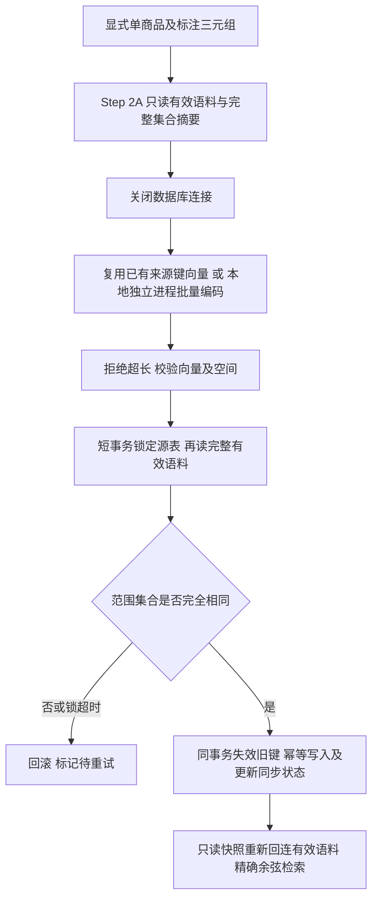

# RAG Step 3：pgvector 存储与小规模同步验收

日期：2026-11-03（Asia/Taipei）。前置报告已阅读：[结构审查](rag-data-structure-audit.md)、[语料契约](rag-effective-corpus-contract.md)、[本地模型评测](rag-embedding-evaluation.md)。

**当前状态：隔离验收与获批业务库小规模执行均已完成。真实有效观点写入 200 条，重复同步全量复用、无重复；其余 891 条未索引。源评论、模型标注、人工表等七张源表的数量及整表内容摘要均未改变。** 用户先审阅迁移/备份/回滚与范围方案，并在本聊天明确回复“许可按此方案及范围执行”，之后才执行业务 DDL 与本地同步。没有接入现有 Agent、HTTP API 或前端。

新增存储专项 **20/20**、本地编码器专项 **12/12** 通过。原回归 329 项中 1 项既有 Worker 问题仍失败。真实检索运算已通过，生产语义质量尚未人工验收，不能将二者混为一谈。

## 1. 实际结构与实现入口

### 1.1 已验证的数据库边界

- 业务 `reviews`：实查 PostgreSQL **18.6**、pgvector **0.8.7**；预检时没有派生表，获批后已实际创建 `review_opinion_embeddings` 和 `rag_embedding_sync_runs`。人工修订数量仍为 **0**。业务账号不能创建数据库，已有 public 建表及源表 REFERENCES 权限已只读核对；没有调整账号权限。
- 隔离实例：使用已安装 PostgreSQL 18 的 `initdb/pg_ctl`，在项目 `.cache/rag-pgvector/cluster` 新建，**仅监听 127.0.0.1:55439**，使用合成数据。没有借用业务库进行写入测试，也没有额外安装 PostgreSQL、Python 依赖或向量框架。
- 实际合成验收库：`rag_vector_acceptance_b36d5bd0b581`；已查询系统目录核对以下列、约束和索引。恢复验证库是 `rag_vector_restore_efbcc8d8247d`。这些属于本机独立实例，不属于业务实例。

证据：[业务只读预检](../outputs/rag-pgvector/business-preflight.json)、[业务实际迁移结构](../outputs/rag-pgvector/business-migration.json)、[隔离实际结构与验收结果](../outputs/rag-pgvector/acceptance.json)。实际结构记录包含 `information_schema.columns`、`pg_constraint/pg_get_constraintdef`、`pg_indexes` 的结果。

### 1.2 `public.review_opinion_embeddings`

完整 DDL：[上迁移](../migrations/003_review_opinion_embeddings.up.sql)。以下结构已在**隔离库及获批业务库**实际建立并查询目录核对；业务向量表有 27 列、9 个索引。

| 字段 | PostgreSQL 类型 | 约束 / 用途 |
|---|---|---|
| `id` | bigint identity | 主键 |
| `source,dataset_version,product_id` | text，各非空 | 完整商品身份，三列复合外键 → `products`，ON DELETE CASCADE |
| `review_id` | integer，非空 | FK → `reviews.id`，CASCADE |
| `annotation_id` | integer，非空 | FK → `review_annotations.id`，CASCADE |
| `label_profile_key` | text，非空 | Step 2A 对 requested_model/base_url/prompt_version 的确定性身份哈希 |
| `opinion_source` | text，非空 | CHECK model/human |
| `model_opinion_id` | integer，可空 | FK → `review_opinions.id`，CASCADE |
| `human_opinion_id` | integer，可空 | FK → `review_human_opinions.id`，CASCADE |
| `human_revision_id` | integer，可空 | FK → `review_human_reviews.id`，CASCADE |
| `stable_versioned_opinion_key` | text，非空 | 完整复用 Step 2A 来源键 |
| `aspect,sentiment` | text，非空 | CHECK 既有六维度与 positive/negative/neutral/unknown |
| `quote_start,quote_end` | integer，非空 | CHECK `0 <= start < end`；Python 字符偏移，非 UTF-8 字节偏移 |
| `review_content_sha256` | text，非空 | 原评论的现有内容身份，不重新计算成纯正文哈希 |
| `embedding_input_sha256` | text，非空 | quote 的原始 UTF-8 SHA-256 |
| `effective_snapshot_sha256` | text，非空 | Step 2A 整条评论有效观点集合及状态摘要 |
| `published_at` | text，非空 | 沿用原库 UTC ISO 字符串及既有范围比较口径 |
| `text_builder_version` | text，非空 | CHECK 固定 `quote-utf8-v1` |
| `embedding_space_id` | text，非空 | CHECK 固定下文已验证空间身份 |
| `embedding` | **vector(1024)**，非空 | float32 存储；CHECK `abs(vector_norm(embedding)-1) < 0.0001` |
| `sync_run_id` | bigint，可空 | FK → 同步记录，ON DELETE SET NULL |
| `created_at,synced_at` | timestamptz，非空 | 默认 `clock_timestamp()` |
| `invalidated_at` | timestamptz，可空 | 派生状态；**不是有效性判断的唯一条件** |

来源互斥 CHECK：model 必须有 model_opinion_id，且人工两个 ID 均 NULL；human 必须有 human_opinion_id 和 human_revision_id，且 model_opinion_id 为 NULL。

唯一约束是 **`(stable_versioned_opinion_key,embedding_space_id,text_builder_version)`**，三列均 NOT NULL。没有对两个可空来源 ID 直接建立容易误解 NULL 的联合唯一约束。重复模型与人工同步都实测无重复行。

上述 FK 只保证各父行存在，**不把独立 FK 宣称为“观点一定属于这条评论/修订”的复合数据库约束**。父子一致性由 Step 2A 实际 JOIN、原文区间验证、发布重读及检索元数据复核共同保证。

不重复存放 quote、完整评论、用户信息、服务地址和文件路径。quote/发布时间/原始文件指纹及行号通过当前有效 `RagOpinionDocument` 回取，`evidence_ref` 保留 `sha256:<文件指纹>#line=<行号>` 形式；它指向原导入文件，而评论 ID/字符区间指向数据库原文。

### 1.3 同步记录与索引

`rag_embedding_sync_runs`：bigint identity PK；source/dataset_version/product_id、label_profile_key、embedding_space_id 均为非空 text；`scope_json` 和 `metrics` 是非空 JSONB；status 为 running/succeeded/partial/retry_required/failed；error_code 可空 text；started_at 非空、finished_at 可空 timestamptz。scope_json 仅存范围，不保存 base_url/原文。此表不对商品建立 FK，让删除数据集后仍能保留同步操作记录。

实际索引均为普通 B-tree：

- 主键、非空三元组唯一索引。
- `review_embeddings_scope`：`(source,dataset_version,product_id,label_profile_key,embedding_space_id,published_at)`。
- review_id、annotation_id、sync_run_id 的索引。
- model_opinion_id、human_opinion_id、human_revision_id 的非空部分索引，支持级联依赖清理。

**没有 HNSW、IVFFlat 或其他向量库，没有新增自定义业务触发器。** 外键会由 PostgreSQL 自动创建内部约束触发器。原有删除入口 `reviews/store.py::delete_import_runs()` 不需要修改，隔离测试实查原删除流程能连带清理向量；不会由派生表 FK 阻塞原有源数据删除。

### 1.4 源码职责

| 路径 / 关键入口 | 职责 |
|---|---|
| `reviews/scope.py::current_reviews_sql`（未改） | 唯一有效标注权威，成功优先、同配置、同内容、最新人工完整快照 |
| `reviews/rag_corpus.py::read_effective_corpus`（未改） | 观点来源 ID、精确原文、身份/来源键/整条评论集合摘要 |
| `reviews/embedding.py::LocalBgeM3Embedder`（未改） | 固定本地权重、CLS/L2、1024、512 tokens |
| [embedding_store.py](../src/data_analysis_agent/reviews/embedding_store.py) | `migrate_embedding_store`、`sync_effective_opinions`、`search_effective_opinions`、`validate_vector` |
| [embedding_process.py](../src/data_analysis_agent/reviews/embedding_process.py) | `LocalEmbeddingProcess`，无模型依赖的业务端，本地子进程通信 |
| [local_embedding_worker.py](../scripts/local_embedding_worker.py) | 独立模型环境，单作业单次加载、批量编码、超长拒绝、CPU/内存计量及禁止网络连接 |
| [sync_opinion_embeddings.py](../scripts/sync_opinion_embeddings.py) | 显式 migrate/rollback/sync 运维入口，没有自动初始化 |
| [verify_pgvector_storage.py](../scripts/verify_pgvector_storage.py) | 只能在指定 55439 隔离实例运行的真实 BGE + PG 合成验收 |
| [test_embedding_store.py](../tests/test_embedding_store.py) | PG 实际迁移、写入、失效、删除、并发、故障及进程隔离测试 |

表中 `reviews/` 源码路径以 `src/data_analysis_agent/` 为根。未修改原有代码、默认依赖、SQL 分母或公共 API。

## 2. 迁移、备份与回滚方案（先审批，后执行）

### 2.1 迁移内容与顺序

1. 选择业务低写入时段；确认没有同名派生表，已安装 vector；不自动安装扩展或授予权限。
2. **先对 reviews 做本机完整 custom 格式备份，检查退出码、文件大小和 `pg_restore --list`。** 备份包含真实数据，只留在被 Git 忽略的本机目录，不上传、不把内容写入日志。
3. 执行上迁移，事务内只创建两张派生表及其索引/FK。设置 lock_timeout=3s、statement_timeout=15s；任何 DDL 失败整体回滚。没有修改源表列、已有业务索引或业务数据。
4. 只读检查系统目录后，对获批的一个完整商品身份执行一次不超过 200 观点的本地同步，再重复同范围验证幂等、对账及检索。
5. 只输出数量、ID、哈希、标签、距离和时间；实际 quote 仅在本机用于编码与证据一致性判断。

迁移命令（**本轮已在明确许可及备份成功后执行；`--ddl-approved` 只能在真实许可后使用**）：

```powershell
.venv/Scripts/python.exe -B scripts/sync_opinion_embeddings.py --db env:DATABASE_URL migrate --ddl-approved
```

代码不在 sync/search 内隐式建表。再次执行上迁移会明确失败，已有表/向量保持原样；不是靠 IF NOT EXISTS 掩盖错误结构。缺少 vector 扩展时，第一张表也会回滚，此分支已实测。

### 2.2 可执行的备份方法

以下从项目根目录在业务虚拟环境执行，只读取数据库。密码通过子进程环境传递，不出现在命令行或输出中。本轮实际按此方法先备份并验证成功，才运行 DDL。

```python
import os, subprocess
from datetime import datetime
from pathlib import Path
import psycopg
from data_analysis_agent.core.database import database_argument

cfg = psycopg.conninfo.conninfo_to_dict(database_argument("env:DATABASE_URL"))
directory = Path("outputs/rag-pgvector/backups")
directory.mkdir(parents=True, exist_ok=True)
backup = (directory / ("reviews-before-step3-" + datetime.now().strftime("%Y%m%d-%H%M%S") + ".dump")).resolve()
env = os.environ.copy()
for key, value in cfg.items():
    if key in ("host", "port", "user", "password", "sslmode", "sslrootcert", "sslcert", "sslkey"):
        env["PG" + key.upper()] = value
env["PGOPTIONS"] = "-c default_transaction_read_only=on"
bin_dir = Path("C:/Program Files/PostgreSQL/18/bin")
result = subprocess.run([str(bin_dir / "pg_dump.exe"), "--no-password", "-Fc",
    "--dbname", cfg["dbname"], "--file", str(backup)], env=env, capture_output=True)
if result.returncode:
    raise RuntimeError("backup_failed; do_not_migrate")
result = subprocess.run([str(bin_dir / "pg_restore.exe"), "--list", str(backup)], capture_output=True)
if result.returncode or backup.stat().st_size == 0:
    raise RuntimeError("backup_validation_failed; do_not_migrate")
print({"backup": str(backup), "bytes": backup.stat().st_size})
```

隔离合成库已经用本机 `pg_dump -Fc` 备份，并 `pg_restore --exit-on-error` 恢复至新的空库：归档 **717,725 bytes**，恢复后 **127 条评论 / 123 条向量**一致。见 [恢复实测](../outputs/rag-pgvector/backup-restore.json)。

业务库也已在 DDL 前完成只读本机备份：`outputs/rag-pgvector/backups/reviews-before-step3-20261103-011301.dump`，**16,376,654 bytes**，SHA-256 `ec7bbee0402c6cab5a2483b7fa13198b96f3770ff7b09acf2dadb5710e48c36f`；`pg_restore --list` 成功，迁移前再次验证文件哈希一致。见 [业务备份清单](../outputs/rag-pgvector/business-backup.json)。真实归档没有上传、没有输出数据内容，也没有恢复到业务库；**真实归档的完整恢复演练尚未做**，合成库的恢复不能替代这项结论。

### 2.3 回滚与失败恢复

[下迁移](../migrations/003_review_opinion_embeddings.down.sql) 在事务内先 DROP 向量表再 DROP 同步记录表，**不 DROP vector 扩展、不删除任何源评论/标注/人工记录**。回滚会丢弃本阶段全部派生向量与同步历史，因此执行前如需保留应先备份这两张表。

```powershell
.venv/Scripts/python.exe -B scripts/sync_opinion_embeddings.py --db env:DATABASE_URL rollback --ddl-approved
```

这是本阶段失败时的首选局部回滚；不要为了两张派生表回滚而将旧全库备份覆盖当前业务库。全库备份先恢复到**新的隔离空库**核验；如果确需灾难恢复，应在单独停写、确认数据丢失窗口后制定恢复操作，不在本轮自动执行。

迁移前后及回滚后的源评论数量与源表数据在隔离测试中保持一致。同步若失败/变化会留下 failed/retry_required；重新执行相同显式范围会重新读取和计算缺失部分。进程被强制终止可能留下 running，表示结果待核查，不当作成功水位；本轮未实现后台自动回收或断点队列。

## 3. 本地同步与固定模型空间

配置完整复用 Step 2B：

```text
BAAI/bge-m3 @ 5617a9f61b028005a4858fdac845db406aefb181
1024 / float32 / CLS / L2 / cosine / max 512 tokens / batch 8
text_builder_version = quote-utf8-v1
embedding_space_id = embedding-space-v1:11e6754662dbd13fc56c6e624bc9416c1c2766f962787267fd4a57b1fa8d622e
```

`SPACE` 直接使用既有 `EmbeddingSpace(MODEL_NAME,MODEL_REVISION,1024)`，用常量断言锁定原空间 ID；表 CHECK 与编码器返回空间 ID 再次核对。没有生成另一套身份算法。



首版接口：

```python
sync_effective_opinions(db, options=scope_and_label_identity, encoder=encoder, limit=200)
search_effective_opinions(db, query_vector, options=scope_and_label_identity,
    embedding_space_id=SPACE_ID, top_k=5, aspect=None, sentiment=None)
```

options 就是 Step 2A 的显式 source、dataset_version、单元素 product_ids、model、base_url、prompt_version、date_from/date_to，可选 as_of。不允许全商品空列表，limit 必须 1～300。选择按评论完整分组，某组放不进剩余额度时跳过；一条评论本身大于上限也会跳过，不拆半组，也不因此宣称范围全量索引完成。

数据库/业务 Python 沿用 `.venv`；模型仅由 `.cache/embedding-eval/venv/Scripts/python.exe` 子进程加载缓存 `.cache/embedding-eval/hf/hub`。一个同步作业一次加载模型，再按 batch=8 编码所有待处理文本，没有逐观点重载。业务环境未安装 Torch/Transformers，模型环境不需要数据库依赖。

父进程通过 stdin/stdout 管道传文本/向量，命令参数没有正文或 DSN；子进程环境采用允许列表，移除 DATABASE_URL、LLM_API_KEY、HF_TOKEN 等凭据。固定本地文件加载、关闭遥测/隐式 token，审计钩子拒绝 socket.connect，实际推理连接尝试 **0**。失败时不传播模型 stderr、原文或底层 SQL 异常消息。

## 4. 来源、哈希、重验与并发协议

### 4.1 沿用语料契约

所有模型/人工观点、空集合状态都来自原 `read_effective_corpus()`，其内部继续调用 `current_reviews_sql()`。没有另一套 MAX(annotation_id) 查询。

- `label_profile_key` 绑定完整标注三元组；annotation_id、评论原 hash、最新 human_revision_id、真实观点行 ID 由原契约决定。
- `stable_versioned_opinion_key`、`embedding_input_sha256`、`effective_snapshot_sha256` 原样使用，不 trim、不拼接标签/商品/上下文，不改变 quote-utf8-v1。
- Step 2A 确认 `review.text[start:end] == quote` 后才有文档；发现任一坏来源/坏区间整次拒绝，不能统计成成功的零观点。这里没有修改/修复源数据。
- 同一来源键 + 空间 + builder 的已有向量会读取并重新校验后复用。**尚未实现跨人工修订、跨来源的输入哈希缓存复用**；相同文本的新人工行仍建立新的来源版本并重新编码，这是成本边界，不是混合旧来源。

### 4.2 发布原子性

Embedding 期间没有数据库连接或长事务。发布时另开 READ COMMITTED 事务，依次：

1. lock_timeout=3s、statement_timeout=15s；先对派生向量表取得 **SHARE ROW EXCLUSIVE** 锁，串行化多个同步发布；此时还没有持有源表锁。
2. 对 products/import_runs/reviews/review_annotations/review_opinions/review_human_reviews/review_human_opinions 取得 **EXCLUSIVE NOWAIT 表锁**。源表正在写入或被行锁读取时立即失败重试，不等待源表锁，也不形成“删除持源锁等待派生表、发布持派生锁等待源表”的等待环。
3. 锁后重读相同范围的完整 `RagCorpus`，包括 failed/pending/empty、成功无观点、人工空快照的状态。与编码前的评论状态及全部观点逐项比较；不只重验本批被选的几条。
4. 任何内容、标注、人工修订、观点标签/区间/原文、完整集合或范围成员变化，整批拒绝并保留 retry_required；锁超时同样待重试。没有“尽量发布未变化部分”的竞态窗口。
5. 仅相同快照下，在同一事务失效不再有效的旧来源键，并 UPSERT 有效向量和同步成功/部分完成状态，最后提交。

EXCLUSIVE 锁与普通源表写入的 ROW EXCLUSIVE、`SELECT FOR UPDATE/SHARE` 的 ROW SHARE 均冲突，**包括不遵循现有业务 advisory lock 的直接 SQL**；普通 SELECT 的 ACCESS SHARE 仍可并发。因此不靠假设所有写入入口都配合新约定，同时会短暂阻塞整个源表的写入与行锁读取，不只是所选商品。收尾审阅将初版 SHARE 改为 EXCLUSIVE NOWAIT，避免行锁持有者与发布外键检查形成死锁；并增加实际行锁测试。若无法获取锁就明确退回重试，未提供无锁原子发布。

测试覆盖：编码中人工删空/整数据集删除 → 整批拒绝；发布锁后先 SELECT FOR UPDATE 再 INSERT 人工修订 → 等提交后才完成，随后旧模型行检索返回空；两个同步并发 → 串行发布、无重复；源表锁或源行锁占用 → 立即 retry_required 且不使源事务失败；派生表锁占用 → 约 3s 超时后 retry_required。均无新损坏向量。

### 4.3 检索时再次核验

检索在一个 READ ONLY / REPEATABLE READ 快照里重读 Step 2A 当前语料，将当前版本键和**完整评论集合摘要**作为 `jsonb_to_recordset` 关系回连向量表，再按完整范围、profile、space、builder、aspect/sentiment 过滤后，用真正的 **`embedding <=> query::vector(1024)`** 排序。仅返回通过逐字段来源元数据复核的当前 `RagOpinionDocument`。

因此 `invalidated_at IS NULL` 只是必要筛选之一。人工空快照、内容 hash 变化或有效集合改变后，即使尚未再同步、旧行还未标失效，它也无法通过当前键/集合摘要 JOIN。更改同一评论的一条观点时，其余旧集合的向量也会暂时隐藏，等新集合成功发布，不制造部分新旧证据。

结果只保证查询快照时刻的有效性；事务结束后发生修订，消费者如果延迟使用结果仍需重新核验。这不是跨事务永久锁定证据的承诺。连接断开造成提交确认丢失时需要对账重试；唯一约束和重新读取可防止重复发布，不能仅信任客户端错误时的计数。

## 5. 小规模实际写入与数量对账（合成数据）

运行 [合成验收脚本](../scripts/verify_pgvector_storage.py)，使用固定模型真实推理、真实 pgvector；并非用假向量宣布模型通过。原夹具 P1 含一条三观点评论、失败/空正文；新增 120 条来自 12 类人工可检查的合成短观点，另加 1 条 1,003-token 超限观点。P2/P3 为隔离干扰。

| 统计 | 第一次同步 | 第二次同步 |
|---|---:|---:|
| 范围内当前有效观点 / 原 SQL 有效观点 | 124 / 124 | 124 / 124 |
| 本批选中 | 124 | 124 |
| 实际尝试新编码（含超限判断） | 124 | 1 |
| 新编码成功 | 123 | 0 |
| 已有向量复用 | 0 | 123 |
| 超长拒绝 | 1 | 1 |
| 非法输入 / 推理失败 | 0 / 0 | 0 / 0 |
| 本次发布有效行（含复用 UPSERT） | 123 | 123 |
| 最终派生表行数 / 当前有效已索引数 | 123 / 123 | 123 / 123 |
| 当前未索引 | 1 | 1 |
| 状态 | partial | partial |

`published_count` 包含复用行的 UPSERT，不等于新增行数。第二轮因尚有超长观点，仍启动一次模型进程做长度判断；没有持久化超长拒绝缓存，不能把这 1 条当作已索引。scope_opinion_count 也不是成功评论数，更不是全库评论数。

原默认 SQL `current_reviews_sql()` 的有效观点 COUNT、Step 2A 文档数量与状态观点之和在合成范围一致；全部 124 个原文字符区间在本机检查一致。这 123 条合成向量没有写入业务库。

### 5.1 获批真实观点的实际结果

范围严格按第 9 节冻结。业务同步记录为 id=1、id=2，详见 [business-sync.json](../outputs/rag-pgvector/business-sync.json)、[business-acceptance.json](../outputs/rag-pgvector/business-acceptance.json)。

收尾加固锁协议后，同一获批范围额外复验一次（id=3）：**200 条全部复用、额外编码 0、表行仍 200、源表摘要仍不变**，最终协议也已在真实库验证。见 [最终锁协议复验](../outputs/rag-pgvector/business-final-lock-verification.json)。

| 统计 | 首轮 | 重复同范围 |
|---|---:|---:|
| 原 SQL 有效观点 / Step 2A 文档 | 1,091 / 1,091 | 1,091 / 1,091 |
| 选中观点（完整评论组） | 200 | 200 |
| 尝试新编码 / 新编码成功 | 200 / 200 | 0 / 0 |
| 已有向量复用 | 0 | 200 |
| 超长 / 非法 / 失败 | 0 / 0 / 0 | 0 / 0 / 0 |
| 发布行（包括复用 UPSERT） | 200 | 200 |
| 实际表行 / 唯一版本键 / 当前有效已索引 | 200 / 200 / 200 | 200 / 200 / 200 |
| 尚未索引 | 891 | 891 |
| 状态 | partial | partial |

200 条覆盖 **105 条完整评论组**，已用原 SQL 逐组核对没有拆半组。`partial` 是人为上限留下 891 条未处理，**不是失败，也不是已经全量完成**。没有扩大到第二款商品或其他数据集。

全部 200 个持久化来源 ID、annotation/profile、人工修订字段、标签、区间、内容及输入哈希、builder、发布时间逐项等于同快照的当前语料；全部集合摘要匹配。全部属于相同获批完整商品身份和同一固定向量空间，原文证据检查不输出正文。

同步前后对七张源表分别计算行数及 PostgreSQL 行 JSON 的 SHA-256 汇总摘要，**全部完全一致**：products 1,706、import_runs 17、reviews 16,514、review_annotations 8,935、review_opinions 14,886、两张人工表各 0。此检查不是只比较 COUNT。见 [源表执行前指纹](../outputs/rag-pgvector/source-fingerprints-before.json) 及 business-acceptance.json 的执行后指纹。

## 6. 检索结果与验收等级

相关性标准在 `verify_pgvector_storage.py::CASES/QUERIES` 中先行固定：客服“不回复”应命中客服负向回应迟缓；物流快/慢分别要求同方面、同方向。没有事后按模型分数构造正确标签。候选存在反向和跨维度干扰。

| 查询 | 范围/过滤 | 结果 |
|---|---|---|
| 客服一直不回复。 | P1，无 aspect/sentiment 强制过滤 | Top5 均为预标客服负向同义观点；首条 cosine distance 约 0.05854 |
| 配送速度很快。 | logistics + positive | Top5 都满足物流正向；首条约 0.10165 |
| 物流迟迟没有送到。 | logistics + negative | Top5 都满足物流负向；首条约 0.07394 |
| 同样查询切到 P2 | 完整商品身份变化 | 0 条，P2 有原观点但未索引 |
| 同样查询更换标注模型 | profile 变化 | 0 条 |
| service + unknown | 范围内无匹配 | 0 条 |

三组本合成测试 Precision@5=1，但候选刻意重复 12 类文本用于吞吐与来源行数量测试，**这不是 123 个独立语义难例的质量得分**。没有声称生产 Recall、复杂否定、短句歧义、多样中文质量已验收。Step 2B 中已记录的短观点局限仍然存在。

数据库与数据集/日期/标注三元组隔离、人工失效、来源区间和无匹配分支还由 PG 自动化测试覆盖。三个层级分别为：

1. **数据库向量运算/存储成功：合成真实模型链路已通过。**
2. **真实业务语义质量合格：已完成有限真实写入和检索，但未做真实相关性人工验收。**
3. **完整 Agent 问答成功：未接入、未测试，本阶段不实施。**

没有从 Top-K 计算总体负面比例；完整统计仍由原 SQL 口径负责。

### 6.1 真实业务库有限精确查询

只生成上述合成查询句的本地向量，使用业务 pgvector 精确运算；结果日志仅含 ID、哈希、标签、偏移、证据引用与距离，没有实际 quote。

| 实测用例 | 返回及第一条距离 |
|---|---|
| 客服一直不回复，无维度/情感强制过滤 | 5 条；第一条 service/negative，distance **0.10074** |
| 同问 + service/negative | 5 条且过滤字段均正确；第一条 **0.10074** |
| 配送速度很快 + logistics/positive | 5 条且过滤正确；第一条 **0.08724** |
| 物流迟迟没有送到 + logistics/negative | 5 条且过滤正确；第一条 **0.10367** |
| service/unknown，无匹配组合 | 0 条 |
| 同一获批商品切换 V4-Flash 标注身份 | 0 条 |
| 同商品 ID 改绑 Amazon 数据集 / 不存在商品 ID | 成员范围校验拒绝，没有返回越界证据 |

全部返回结果在本机回读真实原文，字符区间及 UTF-8 输入哈希一致，并检查来源/profile/空间。商品存在但未索引的合法 P2、相同商品 ID 跨数据集及 base_url/prompt 隔离的完整分支由隔离 PG 测试覆盖；没有为了实测而读取另一款未获批商品原文或写入人工修订。业务人工修订仍为 0，相关失效模拟均在隔离库完成。

此处只验收真实数据库检索、过滤与证据追溯。没有输出原文让外部模型打分，也没有据真实距离高低宣称相关性合格。实际业务语义相关性还需要后续本机人工评审。

## 7. 性能、长度与异常

实测 CPU，4 个计算线程，1 个 inter-op 线程，batch=8；没有 GPU 推理。

| 指标 | 第一次 | 重复同步 |
|---|---:|---:|
| 模型加载（不含 Python/Torch 导入） | 7.65s | 4.51s |
| 稳定编码 | 8.93s / 123 条 | 0.00008s / 0 条 |
| 编码吞吐（只计有效短观点） | 13.78 条/s | 不适用 |
| 同步总计（含子进程启动/模型/重验/写入） | 22.18s | 7.85s |
| 发布事务测量区间（提交前） | 324ms | 388ms |
| 模型进程峰值 RSS | 1.696 GiB | 约 1.472 GiB |
| 模型阶段 CPU 时间 | 42.19 CPU-s | 4.58 CPU-s |
| 连接外部网络尝试 | 0 | 0 |

123 个短输入长 5～14 tokens；最长合成观点 1,003 tokens，直接拒绝，**没有截断或拆分**。模型峰值是进程历史 working set，不是整机总峰值；CPU 时间不是墙钟时间或 GPU 利用率。查询快照/回连/排序在这个小规模合成集约 0.1s，未进行并发吞吐或生产延迟保证。123 行向量表及全部 B-tree/TOAST 总占用 **1,769,472 bytes**，不能直接作为千万级容量预算。

实际写库向量全部 1024 维，范数范围 **[0.9999999139, 1.0000000377]**。Python 写入前检查形状、数值类型、finite、非零、单位范数容差 1e-5；pgvector 类型/数据库 CHECK 再约束。错空间/错维度/NaN/Inf/零向量和模型不完整输出通过故障注入测试整批拒绝，不发布部分损坏结果；假编码器仅用于这些协议测试。

实现中遇到并已处理：scope 中包含模型身份/timezone，不能全部当作 review_scope 参数传入；首个超长合成样例超过既有标注 2000 字符限制，改成满足源 Schema、仍超 512 tokens 的样例后完成真实运行。都发生于隔离环境，没有修改源业务约束或真实评论。

### 7.1 获批业务样本的性能

首轮 200 条：模型加载 **3.86s**，编码 **26.49s**，编码吞吐 **7.55 条/s**，同步总计 **33.76s**，发布测量 **467ms**，模型 CPU **109.16 CPU-s**、峰值 RSS **1.793 GiB**。实际输入长 **4～163 tokens**，平均 15.18，均未超限。设备仍为 CPU/4 线程、batch=8，模型进程连接尝试 0。

重复同步不启动模型进程，全部缓存复用：总计 **903ms**，发布测量 **426ms**。四组真实查询连同额外逐条原文/哈希核验总计各约 **438～461ms**，这不是单纯数据库排序耗时；没有并发压测。

最终 EXCLUSIVE NOWAIT 锁协议的同范围缓存复验总计 **909ms**，发布测量 **414ms**；遇忙立即待重试的分支来自隔离实际锁测试，不宣称在业务源表上人为制造过冲突。

200 行实际维度均为 1024，范数 **[0.9999998920, 1.0000001014]**，表及索引/TOAST 共 **2,834,432 bytes**。合成与真实输入长度、缓存和当时机器负载不同，不能保证固定每批耗时，也不能按这 200 行推断生产质量或容量上限。

## 8. 自动化验证与证据

### 8.1 可复现命令

以下管理地址只用于本机独立实例，不能替换成业务库作测试目标。先确保该独立实例运行。

```powershell
$env:TEST_PGVECTOR_ADMIN_URL='postgresql://rag_test@127.0.0.1:55439/postgres'
$env:LABEL_EXECUTION_MODE='local'
.venv/Scripts/python.exe -B -m unittest discover -s tests -p test_embedding_store.py -v
.venv/Scripts/python.exe -B scripts/verify_pgvector_storage.py
```

新测试逐次创建、清理唯一 `rag_vector_test_*` 数据库；合成真实模型脚本保留验收库供检查。收尾已停止独立实例并保留数据目录，没有停止业务 PostgreSQL 服务。重现时先执行 `pg_ctl -D <项目>/.cache/rag-pgvector/cluster -l <项目>/.cache/rag-pgvector/postgres.log -o "-p 55439 -h 127.0.0.1" -w start`，用完以同一 `-D` 加 `-m fast -w stop` 停止。不把带真实凭据的地址写进命令行。

### 8.2 结果与范围

| 验证集合 | 结果 / 依据 |
|---|---|
| 新存储、进程边界及向量验证 | **20/20 通过**，见 [storage-tests-final.log](../outputs/rag-pgvector/storage-tests-final.log)，覆盖真实迁移/回滚/失败原子性、约束、幂等、当前集合、人工确认/纠正/删空、内容变化、直接并发写入及源行锁、双同步、锁超时、删除兼容、编码期间数据集删除、超长部分完成、凭据隔离及错误不回显 |
| 原本地编码器专项 | **12/12 通过**，[model-unit-tests.log](../outputs/rag-pgvector/model-unit-tests.log) |
| 原评论 + Step 2A + PostgreSQL 回归 | **329 项：328 通过、1 失败、0 跳过**，[regression-tests.log](../outputs/rag-pgvector/regression-tests.log) |
| 真实 BGE + pgvector 合成验收 | **通过**，123 向量、1 超限、幂等、SQL 精确距离及证据一致；[acceptance.json](../outputs/rag-pgvector/acceptance.json) |
| 备份恢复 | **合成库恢复通过**，[backup-restore.json](../outputs/rag-pgvector/backup-restore.json) |
| 获批业务有限验收 | **200 向量通过**，重复复用、完整来源/集合匹配、精确查询及源表指纹未变；[business-acceptance.json](../outputs/rag-pgvector/business-acceptance.json) |

回归唯一失败为原 `test_postgres.PostgresTests.test_task_history_and_live_queue_worker`。隔离重现确认普通分析 Worker 将 `conversation_id` 传给不接受该参数的 `reviews/monitoring.py::run_analysis()`，触发 TypeError。源头在未改动的 `jobs/worker.py` 普通 analysis 分支；这条调用链不使用新 embedding 模块。本轮没有为通过测试而改动 Agent/Worker，**不能宣称全套回归全绿**。这是新启用原 PostgreSQL 测试后发现的既有问题，需单独授权阶段处理。见 [复现记录](../outputs/rag-pgvector/existing-worker-failure.log)。

本轮未做前端改动，因此没有运行前端构建或浏览器验收。模型及业务依赖清单均未修改，没有安装新依赖。新增六个 Python 文件语法检查、CLI help 通过，既有关键源码/依赖没有 diff。Mermaid 保留可编辑源码；实际调用渲染脚本提示缺少 mmdc，没有安装工具，不声称图片渲染验收通过。

## 9. 真实执行的获批范围

先通过只读聚合冻结如下候选，写好迁移/备份/回滚方案后请求许可。用户明确选择“许可按此方案及范围执行”，随后才备份、建表及同步。实际执行严格限于此范围：

| 项目 | 拟执行值 |
|---|---|
| 业务数据库 | 当前配置的本机 `reviews` |
| DDL | 已创建上述两张派生表、约束和普通索引；本机备份先于 DDL，实际没有需要业务回滚的失败 |
| source / dataset_version | `reviews_csv` / `reviews-csv` |
| product_id | `100013588055` |
| UTC 日期范围 | `2021-09-11`～`2022-08-26`（含整天） |
| requested_model | `Pro/deepseek-ai/DeepSeek-V3.2`（已有标注身份，不调用该模型） |
| prompt_version | `review-opinions-v1-e61de599683cba6703c2f61e85125d0be4627c2763440486aa717e4bc884036e` |
| label_profile_key | `1b58dc189d7d3ea6a55713a989f4555837eb83492690afdc020d808a268a5304`，绑定库中实际 base_url，不输出该地址 |
| 只读预检有效规模 | **1,091 观点 / 436 条含有效观点评论**，不代表范围总评论数；执行时重读为准 |
| 首轮上限 | **200 条有效观点，105 完整评论组**，仅在本机 BGE-M3 处理 |
| 同范围复验 | 已再同步一次验证幂等，并完成有限查询及数量/原文区间核对；没有拓展商品或做全量回填 |

用户 Step 3 第三节要求“在执行真实业务数据库 DDL 前，输出迁移方案、备份与回滚方法，并取得明确执行许可”；第四、八节要求真实数据范围获得许可。本轮按该顺序完成，**没有把阶段开发授权误认为提前执行 DDL 的许可**。如未来选择其他商品，应重新冻结完整范围，不按 product_id 单列猜测。

## 10. 风险与进入下一阶段的前置条件

1. 第 9 节获批的小规模备份、DDL、同步和查询已完成；进入语义检索工具开发仍需下一阶段指令、真实相关性人工标准及范围/版本回归，不自动扩大处理量。
2. 发布会短时锁住整个相关源表；先在低写入窗口试跑。更大规模需单独评审行锁/版本水位/触发器等协议，不能直接放大本版上限或取消重验锁。
3. 512-token 超限目前只有显式拒绝，无分块；短 quote 缺上下文的语义局限未消失。输入升级须新 builder/空间契约评审，不能悄悄更改 quote-utf8-v1。
4. 首版读取、完整重验及检索候选关系在内存构造，尚无流式快照、持久增量水位、拒绝缓存、后台调度或跨修订哈希复用。新增评论以完整范围重读发现；人工空快照以状态/集合变化处理；历史失效行暂保留，源删除走 CASCADE。
5. 查询保证当前读快照有效，不能保证跨请求永久有效。崩溃/提交确认丢失应对账并幂等重试，running 不能被当作已同步；未测试断电恢复或生产长时间并发压力。
6. 本合成语义验收是链路和过滤门槛；在接入工具前仍需真实授权样本、预先相关性标准和人工检查，并处理原 Worker 回归失败。没有因相似度分数高就宣称真实检索质量合格。
7. 后续只读语义检索工具必须复用这里的完整范围/profile/空间/当前集合回连，保留原文证据；不能用 Top-K 替代 SQL 总量和比例。Agent/问答集成属于下一阶段，本轮不实施。

本阶段到上述隔离验证及获批 200 条真实观点验收停止，不自动进行全量回填、RAG 问答或 LangGraph 改造。
